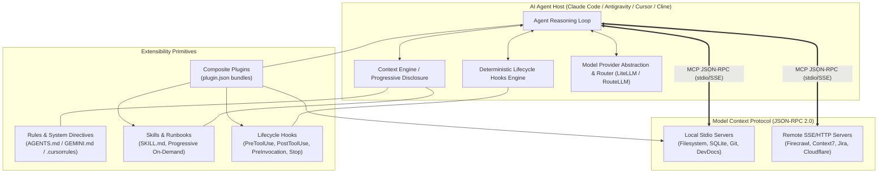
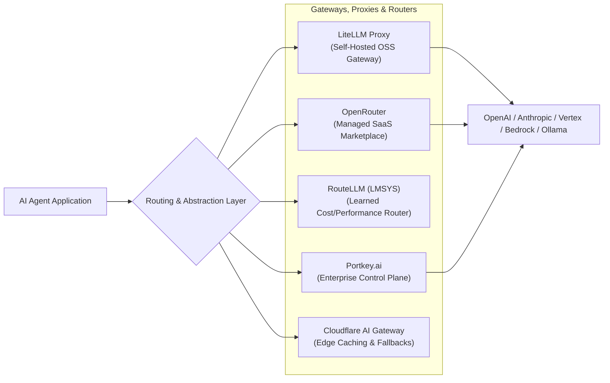

# Phase 1 Batch 3: Integration & Extensibility Broad Mapping Report

This research report evaluates the **Integration & Extensibility landscape** across AI agent architectures, developer assistants, and LLM orchestration frameworks.

The complete artifact has been persisted to [`integration_and_extensibility_map.md`](file:///home/shashank_karamudi/.gemini/antigravity-cli/brain/4702acb2-bb54-4e6d-8b53-377ecf9170c9/integration_and_extensibility_map.md).

---

## 1. Executive Summary & Landscape Overview

The developer assistant and autonomous coding agent ecosystem has standardized around **modular, protocol-driven integration architectures**:
- **Protocol Convergence**: The **Model Context Protocol (MCP)**, open-sourced by Anthropic and adopted across Claude Code, Antigravity, Cursor, Cline/Roo Code, OpenHands, and Continue.dev, has solved the $M \times N$ integration problem, replacing custom SDK wrappers with standard JSON-RPC 2.0 communication.
- **Context Economy & Progressive Disclosure**: Unconstrained prompt stuffing causes reasoning degradation. Modern frameworks decouple **Rules** (passive guidelines), **Skills** (procedural runbooks loaded on-demand via progressive disclosure), and **MCP Tools** (invoked dynamically).
- **Deterministic Quality Gates**: Stochastic prompts are paired with deterministic **Lifecycle Hooks** (`PreToolUse`, `PostToolUse`, `PreInvocation`, `Stop`) to hard-gate dangerous commands and run linters.
- **Dynamic Model Abstraction**: Teams decouple agents from single providers using **AI Gateways** (LiteLLM, Portkey) and **Learned Routers** (RouteLLM, OpenRouter) to balance high-reasoning models with high-speed, cost-effective models.



---

## 2. Model Context Protocol (MCP) & Registry Ecosystem

### 2.1 Protocol Primitives & Architecture
MCP relies on a client-host-server topology communicating via **JSON-RPC 2.0**:

| Primitive | JSON-RPC Methods | Direction | Functionality |
| :--- | :--- | :--- | :--- |
| **Tools** | `tools/list`, `tools/call` | Host $\rightarrow$ Server | Exposes callable functions with JSON schemas for execution and side effects. |
| **Resources** | `resources/list`, `resources/read`, `resources/subscribe` | Host $\rightarrow$ Server | Read-only context endpoints (URIs) representing files, database rows, or telemetry. |
| **Prompts** | `prompts/list`, `prompts/get` | Host $\rightarrow$ Server | Templated interaction patterns and workflows exposed to users/agents. |
| **Sampling** | `sampling/createMessage` | Server $\rightarrow$ Host | Enables server-initiated recursion: server asks the host's LLM to generate completions. |
| **Roots** | `roots/list`, `notifications/roots/list_changed` | Server $\rightarrow$ Host | Informs servers of allowed filesystem boundaries for security isolation. |
| **Transports** | `stdio` vs. `SSE` (HTTP) | Transport Layer | `stdio` for zero-latency local child processes; `SSE` for remote distributed microservices. |

### 2.2 Registries & Marketplaces Comparison

| Registry | Primary Focus | Installation / Consumption Model | Differentiators |
| :--- | :--- | :--- | :--- |
| **[Smithery.ai](https://smithery.ai)** | Agent "App Store" | `npx -y @smithery/cli install <server>` / Hosted | Generates one-click configs for Claude Desktop, Cursor, Cline; provides hosted cloud proxies. |
| **[Glama.ai](https://glama.ai/mcp/servers)** | Registry & Live Inspector | Web-based config builder & remote gateway | Integrated browser-based JSON-RPC inspector to debug servers and test tool payloads before deployment. |
| **[PulseMCP](https://pulsemcp.com)** | Health & Analytics Engine | Directory linking to GitHub repositories | Quantifies commit velocity, star growth, maintenance health, and breaking SDK changes. |
| **[mcp.so](https://mcp.so)** | Community Catalog | JSON snippet generator | Broad community-driven catalog of pre-built integrations for developer tools and SaaS. |
| **[`modelcontextprotocol/servers`](https://github.com/modelcontextprotocol/servers)** | Official Reference Implementations | `npx -y @modelcontextprotocol/server-<name>` | Maintained by Anthropic/MCP core team (Filesystem, Git, Postgres, SQLite, Slack, Brave Search). |
| **[`punkpeye/awesome-mcp-servers`](https://github.com/punkpeye/awesome-mcp-servers)** | Community Awesome List | Open-source GitHub repository | Curated catalog organized by language (TypeScript, Python, Go, Rust) and use-case category. |

---

## 3. Taxonomy Dissection: Skills vs. Plugins vs. MCP Servers vs. Hooks vs. Rules

| Dimension | Rules (`AGENTS.md` / `.cursorrules`) | Skills (`SKILL.md`) | MCP Servers (`mcp_config.json`) | Lifecycle Hooks (`hooks.json`) | Composite Plugins (`plugin.json`) |
| :--- | :--- | :--- | :--- | :--- | :--- |
| **Primary Purpose** | Enforce coding styles, API conventions, and architectural boundaries. | Multi-step procedures, runbooks, and specialized workflows. | Connect agent to external services, databases, and compute tools. | Deterministic execution gates, pre/post validation, auto-fixing. | Distribute a bundled package of skills, rules, hooks, and MCP servers. |
| **Execution Environment** | LLM Context Window (Passive Prompt). | LLM Context + Local script tools. | Subprocess (`stdio`) or Remote HTTP (`SSE`). | Host OS Shell (`sh -c` / `cmd.exe`) or Webhook. | Host configuration packaging layer. |
| **Invocation Model** | Injected on turn initialization (hierarchical path-walking). | **Progressive Disclosure**: Manifest loaded; full body read on demand. | **Dynamic Tool Call**: Host queries tools schema; LLM invokes via JSON-RPC. | **Synchronous Interceptor**: Fired by host event bus at specific lifecycle phases. | Ingested at startup / project load; activates all child components. |
| **Context Window Cost** | Moderate to High if un-scoped; zero if inactive directory. | Minimal baseline (name + description only); expanded when loaded. | Low to Moderate (Tool schema JSON injected into system prompt). | **Zero context cost** (Executes entirely out-of-band in host middleware). | Aggregate of loaded rules, skill manifests, and tool schemas. |
| **Deterministic Guarantee** | Low (Probabilistic model adherence). | Medium-High (Procedural guidance + tool verification). | High for tool code execution; Probabilistic for model calling. | **100% Deterministic** (Hardcode blocking, shell exit codes). | Enforces deterministic hooks + probabilistic reasoning. |
| **Security / Sandbox Model** | Prompt injection vulnerability only. | Scoped to host tool permissions (file view/edit/run). | Process isolation / network boundary; explicit user approvals. | Native OS privileges of the user running the agent CLI/IDE. | Inherits security boundaries of its bundled subcomponents. |

---

## 4. Documentation-Context MCPs & Knowledge Injection Engines

To prevent **knowledge cutoff obsolescence** and API hallucinations, developers use specialized doc-context MCP servers:

| Engine | Transport / Architecture | Strengths | Tradeoffs | Best Use Case |
| :--- | :--- | :--- | :--- | :--- |
| **[Context7](https://context7.com)** (`mcp.context7.com`) | Remote SSE / Cloud Gateway | Version-pinned, token-optimized doc extraction for 1,000+ libraries. | Requires network; depends on upstream index. | Fast-moving JavaScript/Python frameworks (Next.js 15, LangChain). |
| **[DevDocs MCP](https://devdocs.io)** | Local `stdio` (SQLite / JSON) | Fast, offline retrieval across 100+ standard languages and core libraries. | Static snapshot updates; lacks cutting-edge packages. | Systems programming, standard libraries, offline development. |
| **[Firecrawl MCP](https://firecrawl.dev)** (`mcp.firecrawl.dev`) | Remote SSE / Local Docker | Converts any URL to clean LLM-ready markdown; renders JS; bypasses anti-bot. | Scraping latency (1–3s per page); potential token density. | Internal company wikis, newly published SaaS docs, GitHub READMEs. |
| **[Crawl4AI MCP](https://github.com/unclecode/crawl4ai)** | Local Python `stdio` (Playwright) | 100% open-source; CSS/XPath filtering to minimize token consumption. | Requires local Chromium dependencies and system RAM. | Privacy-sensitive enterprise docs behind corporate VPN. |
| **[Brave Search / Tavily MCP](https://github.com/modelcontextprotocol/servers)** | Remote API via `stdio` | Real-time web index; finds error logs, GitHub issues, and discussion threads. | Summary-focused; may require follow-up scraping for code snippets. | Debugging novel compiler errors, runtime exceptions, CVEs. |

---

## 5. Hook Management & Deterministic Agent Lifecycle Interceptors

Agent execution hooks act as **middleware quality gates** intercepting actions before and after execution:

```
[User Prompt] ──> PreInvocation Hook (Context Injection) ──> LLM Reasoning
                                                                   │
                                                                   ▼
[Tool Result] <── PostToolUse Hook (Lint / Format) <── Tool Exec <── PreToolUse Hook (Allow/Deny/Ask)
       │
       ▼
  PostInvocation / Stop Hook (Verify tests pass before stopping) ──> [Completion]
```

### Lifecycle Event Specification
1. **`PreInvocation`**: Runs before LLM generation; injects transient system messages or dynamic context.
2. **`PreToolUse`**: Intercepts tool calls before execution. Returns `allow`, `deny` (hard block), `ask` (prompt user), or `force_ask`. Can rewrite arguments (`overwrite: {"CommandLine": "npm test -- --bail"}`).
3. **`PostToolUse`**: Executes immediately after tool completion. Triggers formatters (Prettier, Ruff) or diagnostics.
4. **`Stop`**: Intercepts agent termination. Returns `decision: "continue"` with a reason if verification tests or background tasks have not passed.

### Tooling Comparison
- **Claude Code Hooks (`.claude/settings.json` / `/hooks`)**: Command and HTTP hooks; exits with code `2` to block/deny execution.
- **Antigravity Hooks (`.agents/hooks.json`)**: Regex matcher support (`matcher: "run_command|view_file"`), argument overwrites, and structured JSON contracts.
- **Git Hook Runners ([Lefthook](https://github.com/evilmartians/lefthook), [pre-commit](https://pre-commit.com))**: Enforce repository-wide pre-commit verification across all human and agent code commits.

---

## 6. Model & Provider Abstraction: Gateways, Proxies & Dynamic Routers



| System | Classification | Architecture & Deployment | Key Strengths | Primary Use Case |
| :--- | :--- | :--- | :--- | :--- |
| **[LiteLLM](https://github.com/BerriAI/litellm)** | Self-Hosted AI Gateway & Proxy | Docker container / Python library (100% OSS) | OpenAI-compatible proxy for 100+ providers, virtual team keys, exact cost tracking, load balancing. | Enterprise self-hosted deployments requiring data residency and zero provider markup. |
| **[OpenRouter](https://openrouter.ai)** | Managed Model Marketplace | Cloud SaaS proxy | Single API key for 200+ models, automatic failover routing, latency ranking, usage credits. | Zero-ops prototyping and multi-model access without managing multiple vendor cloud accounts. |
| **[RouteLLM](https://github.com/lmsys/route-llm)** | Learned Model Router | Python framework / Library (LMSYS / Anyscale) | Uses preference classifiers (Matrix Factorization, BERT) to route between weak and strong models. | Cost reduction: Retains 85–95% of benchmark quality while reducing API spend by 50–75%. |
| **[Portkey.ai](https://portkey.ai)** | Enterprise AI Control Plane | Managed SaaS / Self-hosted | Semantic prompt caching, DLP/PII sanitization, fallback chains, detailed tracing. | Regulated enterprise production workloads (SOC2, HIPAA compliance). |
| **[Cloudflare AI Gateway](https://developers.cloudflare.com/ai-gateway/)** | Edge AI Gateway | Cloudflare Global Edge | Edge response caching, rate limiting, request analytics, worker integration. | Applications deployed on Cloudflare edge infrastructure. |

---

## 7. Cross-Ecosystem Translation Matrix (8 Platforms)

| Extensibility Concept | 1. Antigravity (Gemini CLI) | 2. Anthropic Claude Code | 3. Cursor IDE | 4. Cline / Roo Code | 5. OpenHands (OpenDevin) | 6. Continue.dev | 7. LangGraph / LangChain | 8. AutoGen / CrewAI |
| :--- | :--- | :--- | :--- | :--- | :--- | :--- | :--- | :--- |
| **System Rules & Guidelines** | `GEMINI.md`, `AGENTS.md`, `.agents/rules/*.md` | `CLAUDE.md`, `.claude/rules/*.md` | `.cursorrules`, `.cursor/rules/*.mdc` | `.clinerules`, `.roomodes` system prompt | `.openhands/microagents/repo.md` | `.continuerules`, `systemMessage` in `config.json` | System Prompt templates, State modifiers | Agent `system_message`, Role definition |
| **Procedural Skills / Runbooks** | `skills/<name>/SKILL.md` (Progressive disclosure) | Slash commands / Subagent prompts | Custom `.mdc` docs referenced with `@docs` | Custom Modes (`.roomodes`) | Micro-agents (`.openhands/microagents/`) | Custom Slash Commands (`config.json`) | Custom Subgraphs / Tools | CrewAI Tasks / AutoGen Skills |
| **Tool / MCP Extensibility** | `mcp_config.json` (stdio & SSE) | `claude mcp add` / `.claude/settings.json` | Settings > MCP (`cursor_mcp.json`) | `cline_mcp_settings.json` | MCP configuration in `config.toml` | `mcpServers` in `config.json` | `langchain-mcp-adapters`, Tool decorators | `@register_tool`, CrewAI BaseTool |
| **Lifecycle Hooks & Interceptors** | `hooks.json` (`PreToolUse`, `PostToolUse`, `Stop`) | `.claude/settings.json` `hooks` (`PreToolUse`, `PostToolUse`) | Terminal command hooks / Not native | Extension events / Auto-approved command whitelist | Event stream interceptors, Docker action hooks | Pre/post prompt transformations | LangChain Callbacks / LangGraph Middleware | AutoGen Human-in-the-loop interceptors |
| **Composite Packaging / Plugins** | `plugins/<name>/plugin.json` (bundles rules, skills, hooks, MCP) | Claude Desktop extensions / npm packages | Cursor Extensions / Marketplace | VS Code Extension bundles / Custom Modes | Docker agent images / Microagent repos | Continue Hub packages / Plugins | LangChain Packages / LangGraph Studio | CrewAI Flow packages / Custom packages |
| **Model / Provider Routing** | Configurable provider (`auto`, model aliases) | Anthropic API / Amazon Bedrock / Vertex AI | Cursor Models selector (Claude, GPT-4o, Custom API) | Dynamic Provider selector (OpenRouter, LiteLLM, Ollama) | LiteLLM backend abstraction in `config.toml` | Multiple model providers in `config.json` | ChatModel abstraction, FallbackRunnables | LiteLLM integration, Multi-agent LLM configs |

---

## 8. Synthesis & Architectural Guidelines

When designing an extensible agent environment:
1. **Use Rules for Invariants**: Reserve `AGENTS.md` / `.cursorrules` for concise, always-relevant code conventions.
2. **Use Skills for Complex Runbooks**: Put multi-step domain workflows in `SKILL.md` folders to take advantage of **Progressive Disclosure** (loading details only when needed).
3. **Use MCP for External Integrations**: Build or mount MCP servers over `stdio` for local tools and `SSE` for remote SaaS APIs.
4. **Use Hooks for Deterministic Safety**: Enforce test execution, linting, and command sandboxing via `PreToolUse` / `PostToolUse` hooks rather than relying on LLM compliance.
5. **Use Gateways & Routers for Production Cost Control**: Route everyday coding tasks to cost-effective models using RouteLLM / OpenRouter while preserving high-tier reasoning models for complex refactoring.

---

## 9. Sources

- **Model Context Protocol**: [Official Spec & Overview](https://modelcontextprotocol.io) | [Official MCP Server Catalog](https://github.com/modelcontextprotocol/servers) | [Anthropic Announcement](https://www.anthropic.com/news/model-context-protocol)
- **MCP Registries**: [Smithery.ai](https://smithery.ai) | [Glama.ai MCP Directory](https://glama.ai/mcp/servers) | [PulseMCP Tracker](https://pulsemcp.com) | [mcp.so](https://mcp.so) | [punkpeye/awesome-mcp-servers](https://github.com/punkpeye/awesome-mcp-servers)
- **Knowledge & Doc-Context MCPs**: [Context7 Documentation MCP](https://context7.com) | [Firecrawl Web Scraper MCP](https://firecrawl.dev) | [Crawl4AI GitHub](https://github.com/unclecode/crawl4ai) | [DevDocs.io](https://devdocs.io)
- **Hook Management & Agent Interceptors**: [Claude Code Lifecycle Hooks](https://docs.anthropic.com/claude/docs/claude-code) | [Lefthook Fast Git Hooks](https://github.com/evilmartians/lefthook) | [Antigravity Customization Guides](file:///home/shashank_karamudi/.gemini/antigravity-cli/builtin/skills/agy-customizations/docs/hooks.md)
- **Rules & Marketplaces**: [Cursor Directory](https://cursor.directory) | [PatrickJS/awesome-cursorrules](https://github.com/PatrickJS/awesome-cursorrules) | [Cline / Roo Code Repositories](https://github.com/cline/cline)
- **Model Abstraction & Gateways**: [LiteLLM Proxy & Gateway](https://github.com/BerriAI/litellm) | [OpenRouter Marketplace](https://openrouter.ai) | [RouteLLM (LMSYS / Anyscale)](https://github.com/lmsys/route-llm) | [Portkey AI Control Plane](https://portkey.ai) | [Cloudflare AI Gateway](https://developers.cloudflare.com/ai-gateway/)
