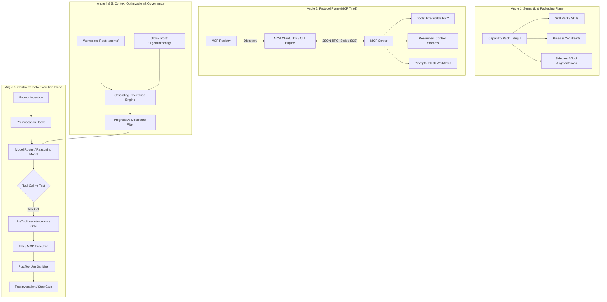

# Research Brief: Phase 1 Batch 3 — Integration & Extensibility
**Role:** RESEARCHER B (Challenger)  
**Focus:** Alternative vocabularies, architectural blind spots, protocol primitives, and structural cross-examinations.

---

## Executive Summary & Challenger Thesis

Standard ecosystem analyses (typical *Researcher A* output) often treat **Integration & Extensibility** as a flat taxonomy consisting of: *"Tools (functions) + Rules (prompts) + MCP Servers (external APIs)"*. 

This Challenger analysis deconstructs that simplistic view across **five distinct architectural angles**, utilizing specialized systems vocabulary:
1. **Taxonomy & Semantic Planes:** Disambiguating extensions, plugins, skill packs, capability packs, and function calling.
2. **Protocol & Tripartite Architecture:** Deconstructing the **MCP Client $\leftrightarrow$ MCP Server $\leftrightarrow$ MCP Registry** triangle, contrasting executable Tools against Resource and Prompt primitives.
3. **Execution Plane vs. Control Plane:** Differentiating deterministic lifecycle interceptors (**Hooks**) from non-deterministic agentic tools (**MCP / Native Functions**).
4. **Context Budgeting & Dynamic Augmentation:** Contrasting progressive disclosure, dynamic schema injection, and multi-tier model routing against static context bloat.
5. **Governance, Scoping & Packaging:** Multi-tenant inheritance trees (`skills.json` / `plugins.json`), cascading overrides, and sandbox permission policies.

Additionally, this report proposes **four high-impact architectural candidates** routinely overlooked by standard analyses and resolves two critical taxonomy cross-checks.

---

## Minimum 5 Angles of Analysis



---

### Angle 1: Nomenclature & Semantic Disambiguation (The Taxonomy Matrix)

In agentic systems, terms like *extension*, *tool*, *skill*, and *plugin* are frequently conflated. They exist on distinct operational and conceptual planes:

| Term | Operational Plane | Primary Artifact | Purpose & Runtime Nature |
| :--- | :--- | :--- | :--- |
| **Function Calling** | Model Protocol / API | JSON Schema (`parameters`, `properties`) | Wire-level mechanism where an LLM emits structured JSON arguments targeting a designated function identifier. |
| **Tool Use / Tool Augmentation** | Agent Runtime | Client-side Invocation Handler | The broader closed-loop pattern: Schema injection $\rightarrow$ Model emission $\rightarrow$ Client execution $\rightarrow$ Result injection into context. |
| **Skill (`SKILL.md`)** | Procedural Knowledge | Markdown + Frontmatter + Subdocs | Multi-step procedural runbook and verification playbook loaded on-demand via **progressive disclosure**. |
| **Skill Pack / Capability Pack**| Compositional Domain Bundle | Folder / Manifest (`skills.json`) | A curated collection of domain-specific skills, executable helper scripts (`scripts/`), and references (`references/`). |
| **Plugin** | Distribution Container | Manifest (`plugin.json`) + Bundle | Atomic, namespaced deployment unit combining Skills, Rules, Lifecycle Hooks, and MCP Server configurations. |
| **Extension / Sidecar** | Process / Environment | Native Process / VS Code Extension | A long-running background daemon or host-editor bridge exposing editor APIs, OS-level sockets, or UI lenses. |

---

### Angle 2: Protocol & Transport Plane (MCP Registry vs. MCP Server vs. MCP Client)

The **Model Context Protocol (MCP)** is an open JSON-RPC 2.0 based protocol. Understanding extensibility requires separating its three structural roles:

```
+-------------------------------------------------------------+
|                        MCP REGISTRY                         |
|  - Central/Private Catalog of Server Metadata               |
|  - Capabilities Manifest, Auth Requirements, Versioning     |
+------------------------------+------------------------------+
                               | Discovers / Fetches Config
                               v
+-------------------------------------------------------------+
|                         MCP CLIENT                          |
|  (e.g., Antigravity IDE / Antigravity 2.0 / CLI Engine)     |
|  - Manages Subprocess Lifecycles (Stdio) or HTTP/SSE Conns  |
|  - Merges Schemas into LLM Context Window                  |
|  - Handles User Approvals, Sandboxing & Policy Enforcement  |
+------------------------------+------------------------------+
                               | JSON-RPC (Stdio / SSE)
                               v
+-------------------------------------------------------------+
|                         MCP SERVER                          |
|  - Exposes Primitives:                                      |
|    1. Tools (Executable actions with side-effects)          |
|    2. Resources (Read-only data, MIME types, URI schemas)   |
|    3. Prompts (Pre-configured templates / slash workflows)  |
+-------------------------------------------------------------+
```

* **MCP Client:** The host application (e.g., Antigravity IDE, Antigravity 2.0 Desktop, or CLI). The client initiates connections, aggregates schemas, controls sandboxing, and orchestrates user approval flows.
* **MCP Server:** An independent process exposing capabilities. Crucially, a server can expose **Tools** (executable), **Resources** (URI-addressable static/dynamic data), and **Prompts** (slash-command workflows).
* **MCP Registry:** The discovery layer (enterprise catalog or public registry) providing indexation, cryptographic signing, compatibility matrixes, and package installation coordinates.

---

### Angle 3: Execution Plane vs. Control Plane (Deterministic Hooks vs. Non-Deterministic Tools)

Extensibility does not simply mean *"giving the model more tools"*. Enterprise-grade integration separates the **Data/Execution Plane** from the **Control/Governance Plane**:

1. **The Non-Deterministic Data Plane (Tools & Functions):** The LLM autonomously chooses if, when, and how to invoke an MCP tool or system function based on token context.
2. **The Deterministic Control Plane (Lifecycle Hooks):** External shell scripts and middleware execute at fixed boundaries in the agent loop (`PreToolUse`, `PostToolUse`, `PreInvocation`, `PostInvocation`, `Stop`) via `hooks.json`.
   * **Payload Interception & Argument Mutation:** A `PreToolUse` hook can inspect the tool call, return `"decision": "deny"`, `"force_ask"`, or perform an in-flight parameter rewrite (`overwrite: { CommandLine: "safe_command" }`).
   * **Loop Termination Enforcement:** A `Stop` hook can evaluate test outputs or CI status and force the agent to continue (`"decision": "continue"`), preventing premature task abandonment.

---

### Angle 4: Context Optimization & Progressive Disclosure vs. Model Routing

Scaling an agent's capability library introduces the **Context Bloat & Distraction Dilemma**: dumping 100 tool definitions into an LLM's prompt degrades reasoning, consumes token budget, and increases tool-calling hallucination.

```
Incoming Request
       │
       ▼
[Tier 0: Classifier / Router] ──(Low Complexity)──► Small/Fast Model (Gemini Flash)
       │ (High Complexity)
       ▼
[Tier 1: Semantic Metadata Scan] ──► Reads Name + Description Frontmatter only
       │ (Matches Skill/Capability)
       ▼
[Tier 2: Progressive Disclosure] ──► Ingests Target SKILL.md / References on Demand
       │ (Invokes Heavy Reasoning)
       ▼
[Tier 3: Frontier Agent] ──────────► Frontier Model (Gemini Pro / Claude 3.7) + Target Tools
```

* **Progressive Disclosure:** Instead of loading full skills, the client exposes only frontmatter `name` and `description` (Tier 1). The agent dynamically reads `SKILL.md` or `references/*.md` via file viewing tools only when activated.
* **Model Routing:** Routing occurs at two levels:
  * **Inter-Step Routing:** Routing simple retrieval steps to high-throughput models (e.g., Flash) while routing orchestration/refactoring to reasoning-heavy models (e.g., Pro).
  * **Tool-Selection Routing (Tool Augmentation):** Using an embedding index or small classifier to dynamically inject only the top-$K$ relevant MCP schemas into the active prompt per turn.

---

### Angle 5: Governance, Scoping & Packaging (Cascading Registries)

Antigravity and advanced agent architectures implement a multi-tenant, hierarchical inheritance system for capabilities:

```
[Level 1: Built-in Customizations] (Base capabilities bundled with app)
               ▲
               │ (Overridden by)
[Level 2: Global Config (~/.gemini/config/)] (Machine-local settings & global MCP servers)
               ▲
               │ (Overridden by)
[Level 3: Shared Team Config (Inherited via skills.json / plugins.json)]
               ▲
               │ (Overridden by)
[Level 4: Workspace Root (.agents/ / .git root)] (Repository-specific skills & rules)
               ▲
               │ (Overridden by)
[Level 5: Hierarchical Directory Rules (GEMINI.md / AGENTS.md)] (Subtree-specific constraints)
```

* **Declarative Filtering:** Shared enterprise configs support fine-grained scoping via `"include_only": ["regex"]` and `"exclude": ["regex"]` in `skills.json` and `plugins.json`.
* **Deduplication:** Customizations are deduplicated by resolved canonical file paths, preventing token waste when multiple directory trees inherit common libraries.

---

## >= 3 Candidate Capabilities Researcher A Would Miss

### Candidate 1: Dynamic JIT Tool Schema Injection via Virtual Registry (Client-Side Tool Router)
* **What R-A Misses:** Researcher A assumes all registered MCP tools must be declared in the model's system prompt at session initialization.
* **The Advanced Mechanism:** A Just-In-Time (JIT) virtual registry. The client holds 500+ MCP tool schemas in an offline vector/BM25 index. When a user prompt arrives, a lightweight semantic router fetches the top 3-5 relevant function schemas and injects them ephemerally into the model's `tools` array for that turn only.
* **Why It Matters:** Eliminates tool limit bottlenecks, reduces prompt token costs by up to 90%, and prevents tool confusion/hallucination across unrelated domains.

### Candidate 2: In-Flight Tool Call Interception & Mutation (Control-Plane Middleware)
* **What R-A Misses:** R-A views tool execution as a direct pipe from Model Output $\rightarrow$ MCP Server/OS Execution.
* **The Advanced Mechanism:** The `PreToolUse` lifecycle hook contract with dynamic argument overwriting (as implemented in Antigravity `hooks.json`). A deterministic security script intercepts the raw JSON payload before execution, sanitizes destructive flags (e.g., rewriting `rm -rf /` or injecting safe environment variables), or asserts strict AST checks, transparently substituting arguments before passing execution to the underlying tool runtime.
* **Why It Matters:** Bridges the gap between untrusted LLM probabilistic output and strict corporate compliance/sandboxing guarantees.

### Candidate 3: Multi-Tier Cascading Capability Inheritance with Exclusion Filters
* **What R-A Misses:** R-A treats configuration as flat local files (`.agents/skills/` or `mcp_config.json`).
* **The Advanced Mechanism:** The declarative inheritance engine (`skills.json` / `plugins.json`) using `inherits` arrays with regex-based `include_only` and `exclude` filters. This allows enterprise platform teams to publish a centralized core repository of 100 skills, while individual microservice repositories inherit the central repository but selectively exclude incompatible versions or restrict access to read-only tooling.
* **Why It Matters:** Solves monorepo vs. multi-repo agent configuration synchronization at enterprise scale without code duplication.

### Candidate 4: Multi-Modal Contextual Sidecars (Auxiliary HTML / Pane Streamers)
* **What R-A Misses:** R-A equates extensibility purely with text tokens and CLI tool output.
* **The Advanced Mechanism:** Bidirectional IDE/Desktop sidecar integrations (e.g., Antigravity Auxiliary Panes and VS Code Language Model Tools API) that allow extensions to render real-time interactive UI canvases (Mermaid diagrams, live browser viewports, visual diff lenses, and background task monitors) synchronized with the agent's internal thought stream.
* **Why It Matters:** Converts the agent from a blind terminal executor into a visually grounded pair programmer capable of inspecting UI layout state and interactive browser DOM trees.

---

## Critical Cross-Checks

### Cross-Check 1: Are "Skills" a Capability Category, a Resource, or a Repo?

| Dimensional Lens | Classification | Deconstruction & Architectural Justification |
| :--- | :--- | :--- |
| **Cognitive / Capability Level** | **Capability Category** | Functionally, a Skill is a structured *procedural heuristic* (runbook + verification loop). It teaches the model *how* to sequence existing tools to achieve a complex goal. |
| **Filesystem / Runtime Level** | **Structured Resource Pack** | Concretely, a Skill is a directory resource consisting of a manifest (`SKILL.md` with YAML frontmatter), executable helper scripts (`scripts/`), documentation subdocs (`references/`), and templates (`resources/`). |
| **Packaging / Distribution Level** | **Repository / Sub-Module Artifact** | At the governance level, Skills are version-controlled repo subtrees, packaged into **Plugins** (`plugin.json`) or imported via manifest entries (`skills.json`). |

> **Challenger Synthesis:**  
> A **Skill** is fundamentally an **On-Demand Procedural Resource Pack**. It is **not** a raw tool (it does not declare an API schema) and **not** merely a prompt (it carries executable sidecars). It transitions into a **Capability** when mounted by the agent runtime, and is distributed as a **Repository/Plugin Artifact**.

---

### Cross-Check 2: Is "Documentation-Context MCP" a Distinct Category or a Subtype?

| Aspect | Architectural Evaluation |
| :--- | :--- |
| **Protocol Specification Perspective** | **Distinct First-Class Primitives (`Resources` & `Prompts`)**<br>In the official Model Context Protocol (MCP) specification, documentation and context servers utilize the **`Resources`** primitive (`resources/read`, `resources/list`, `resources/subscribe`) and **`Prompts`** primitive. They are structurally distinct from the **`Tools`** primitive (`tools/call`), featuring distinct MIME types, URI schemas, and subscription lifecycles. |
| **Client Implementation Perspective** | **Coerced Functional Subtype (`tools/call` fallback)**<br>Because many early MCP client implementations only implemented the `tools` capability, many doc servers wrapped documentation retrieval inside synthetic tools (e.g., `search_docs(query)` or `fetch_page(url)`). |
| **Verdict** | **Architecturally Distinct Primitive / Functionally Emulated Subtype**<br>In a pure MCP architecture, a Documentation/Context provider is a **Distinct Primitive (`Resource Provider`)**. Treating it merely as a "Tool Subtype" is an implementation compromise of clients that lack native Resource UX. |

---

## Reference Sources & Documentation Map

* **Antigravity Customization Architecture:**
  * Customization Core: [agy-customizations/SKILL.md](file:///home/shashank_karamudi/.gemini/antigravity-cli/builtin/skills/agy-customizations/SKILL.md)
  * Lifecycle Hooks Specification: [docs/hooks.md](file:///home/shashank_karamudi/.gemini/antigravity-cli/builtin/skills/agy-customizations/docs/hooks.md)
  * Plugin Bundle Manifests: [docs/plugins.md](file:///home/shashank_karamudi/.gemini/antigravity-cli/builtin/skills/agy-customizations/docs/plugins.md)
  * MCP Server Integrations: [docs/mcp_servers.md](file:///home/shashank_karamudi/.gemini/antigravity-cli/builtin/skills/agy-customizations/docs/mcp_servers.md)
  * Workspace Skills & Progressive Disclosure: [docs/skills.md](file:///home/shashank_karamudi/.gemini/antigravity-cli/builtin/skills/agy-customizations/docs/skills.md)
  * JSON Configurations & Inheritance: [docs/json_configs.md](file:///home/shashank_karamudi/.gemini/antigravity-cli/builtin/skills/agy-customizations/docs/json_configs.md)
  * Hierarchical Directory Rules: [docs/rules.md](file:///home/shashank_karamudi/.gemini/antigravity-cli/builtin/skills/agy-customizations/docs/rules.md)
* **Antigravity Guide & Surface References:**
  * Python SDK Architecture: [references/sdk.md](file:///home/shashank_karamudi/.gemini/antigravity-cli/builtin/skills/antigravity_guide/references/sdk.md)
  * IDE UI & Code Lenses: [references/ide.md](file:///home/shashank_karamudi/.gemini/antigravity-cli/builtin/skills/antigravity_guide/references/ide.md)
  * Desktop Architecture (2.0): [references/app.md](file:///home/shashank_karamudi/.gemini/antigravity-cli/builtin/skills/antigravity_guide/references/app.md)
  * CLI & Headless Orchestration: [references/cli.md](file:///home/shashank_karamudi/.gemini/antigravity-cli/builtin/skills/antigravity_guide/references/cli.md)
* **Standard Protocols & Specifications:**
  * Model Context Protocol (MCP) Specification (JSON-RPC 2.0: Tools, Resources, Prompts, Transports)
  * Gemini / Vertex AI Function Calling & Tool Use Specifications
