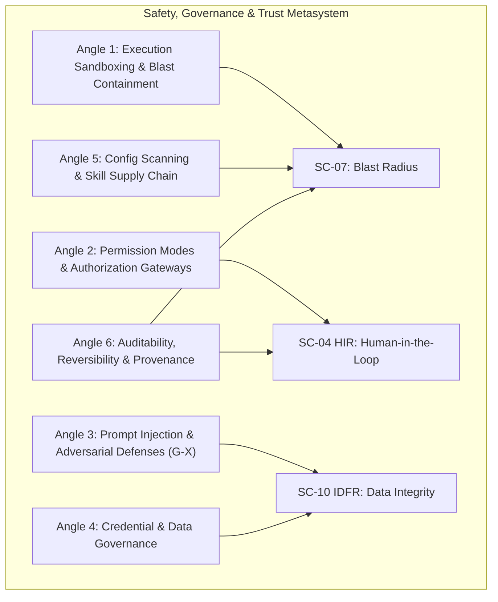
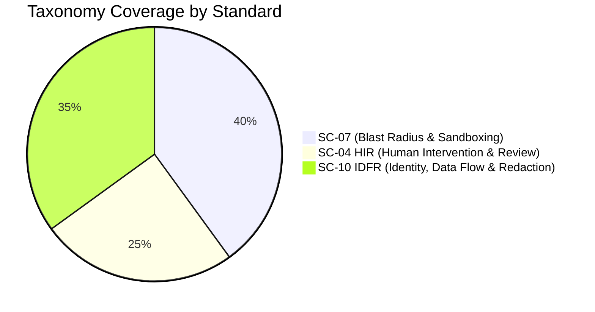

# PHASE 1 BATCH 4: SAFETY, GOVERNANCE & TRUST
## Comprehensive Broad Mapping & Cross-Ecosystem Taxonomy

---

### Executive Summary & Taxonomy Alignment

This research report provides a foundational taxonomy for **Agent Safety, Governance, and Trust**. It covers permission architectures, runtime sandboxing, adversarial prompt-injection defenses (G-X), credential and data governance (IDFR), static/dynamic security linters, and deterministic auditability/provenance.

Each candidate has been evaluated across multiple production ecosystems (e.g., Anthropic Claude Code, OpenAI Assistants/Operator, LangChain/LangGraph, Microsoft AutoGen/Semantic Kernel, AWS Bedrock Guardrails, NVIDIA NeMo Guardrails, OpenHands, and the Model Context Protocol [MCP]), and mapped directly to three core governance standards:

*   **SC-07 (Blast Radius & Execution Sandboxing)**: Isolation boundaries, compute/network containment, environment ephemeralization, and side-effect reversibility.
*   **SC-04 HIR (Human Intervention & Review / Human-in-the-Loop)**: Dynamic authorization thresholds, graduated autonomy gates, step-level reviews, and dual-party escalations.
*   **SC-10 IDFR (Identity, Data Flow & Redaction)**: Secret isolation, just-in-time tokenization, egress DLP/PII filtering, prompt-injection firewalls, and immutable provenance tracking.

---

### Taxonomy Classification System

---

## Angle 1: Execution Sandboxing & Blast-Radius Containment (SC-07)

### 1.1 Ephemeral MicroVM / Container Isolation Environment
*   **Canonical Name**: Ephemeral Execution Sandbox
*   **Definition**: A disposable, isolated execution environment (e.g., Firecracker microVM, gVisor container, WASI runtime) provisioned per-session or per-agent-task to execute arbitrary code and shell commands without host-system risk.
*   **Problem Addressed**: Unchecked shell execution, lateral network movement, persistent malware dropper execution, and uncontrolled file system destruction.
*   **Level**: Mechanism / Infrastructure
*   **Lifecycle Role**: Runtime / Tool Execution
*   **Cross-Ecosystem Translation**:
    *   *Anthropic / Claude Code*: Local OS execution with optional Docker container wrapper; host filesystem protection via path-traversal traps.
    *   *OpenAI Assistants / ChatGPT*: Code Interpreter sandbox (gVisor-isolated containers with unprivileged user access and network disabled).
    *   *OpenHands / SWE-agent*: Isolated Docker container per task with mounting of virtual/scratch workspaces.
    *   *Microsoft AutoGen*: `DockerCommandLineCodeExecutor` / `UserProxyAgent` docker execution context.
*   **Taxonomy Mapping**:
    *   **SC-07**: Primary (Strict process, disk, and memory isolation).
    *   **SC-04 HIR**: Secondary (Bypasses human confirmation for low-risk isolated compute).
    *   **SC-10 IDFR**: Supporting (Prevents credential extraction from host `/etc` or metadata endpoints).
*   **Confidence**: High | **Tier**: Tier 1 (Core/Foundational)

---

### 1.2 Virtual File-System & Workspace Overlay (Copy-on-Write)
*   **Canonical Name**: Copy-on-Write Workspace Overlay
*   **Definition**: A layered file-system abstraction that redirects all agent file modifications to an ephemeral overlay or transient git branch/worktree, preserving the pristine host workspace until verification.
*   **Problem Addressed**: Accidental deletion of source code, destructive edits, unrecoverable git state corruptions, and workspace pollution.
*   **Level**: Mechanism
*   **Lifecycle Role**: Pre-execution / Runtime / Rollback
*   **Cross-Ecosystem Translation**:
    *   *Claude Code / Antigravity*: `git worktree` / branched isolated workspaces (`Workspace: 'branch' | 'share'`).
    *   *OpenHands*: Volume overlay mounts on containerized workspaces (`/workspace` overlayfs).
    *   *Aider*: In-memory diff staging before git commit auto-application.
*   **Taxonomy Mapping**:
    *   **SC-07**: Primary (Prevents non-reversible disk mutations).
    *   **SC-04 HIR**: Supporting (Provides clean diffs for human review prior to merge).
    *   **SC-10 IDFR**: N/A
*   **Confidence**: High | **Tier**: Tier 1 (Core/Foundational)

---

### 1.3 Pre-Execution Simulation & Dry-Run Engine
*   **Canonical Name**: Side-Effect Simulation / Shadow Execution
*   **Definition**: A mechanism that intercepts mutating tool calls (e.g., SQL queries, HTTP POST/DELETE, cloud infrastructure API calls) and computes an expected impact blast-radius summary or executes them against a shadow/mock environment before applying them to production.
*   **Problem Addressed**: Unintended API mutations, irreversible database drops, accidental cloud resource provisioning, and email/notification broadcast errors.
*   **Level**: Capability / Framework
*   **Lifecycle Role**: Pre-execution / Planning Validation
*   **Cross-Ecosystem Translation**:
    *   *Terraform / IaC Agents*: `terraform plan` speculative execution analysis.
    *   *Semantic Kernel*: Pre-invocation filter (`IFunctionInvocationFilter`) with dry-run/preview context flags.
    *   *LangGraph*: Node-level conditional staging with draft execution state.
*   **Taxonomy Mapping**:
    *   **SC-07**: Primary (Limits side-effects and predicts destructive radius).
    *   **SC-04 HIR**: Primary (Generates impact reports presented to human approvers).
    *   **SC-10 IDFR**: Supporting (Prevents unauthorized exfiltration payloads).
*   **Confidence**: Medium | **Tier**: Tier 2 (Emerging)

---

## Angle 2: Permission Modes, Authorization & Human-in-the-Loop (SC-04 HIR)

### 2.1 Graduated Autonomy & Dynamic Permission Tiering
*   **Canonical Name**: Dynamic Permission Tiering (PoLP Tool Scoping)
*   **Definition**: A dynamic permission system classifying agent tools into distinct privilege classes (e.g., Read-Only, Safe Write, Destructive System Command, External Network Request), requiring escalating authorization levels based on calculated risk.
*   **Problem Addressed**: Over-privileged agent configurations where an agent reading docs can arbitrarily run bash or delete databases.
*   **Level**: Framework / Protocol
*   **Lifecycle Role**: Configuration / Runtime Authorization
*   **Cross-Ecosystem Translation**:
    *   *Anthropic Claude Code*: `--dangerously-skip-permissions` vs interactive prompt-on-tool-use (bash, edit, view) vs configurable auto-approval allowlists.
    *   *Model Context Protocol (MCP)*: Client-mediated tool consent prompts (`roots/list`, `sampling/createMessage`, and user-in-the-loop tool calling approvals).
    *   *OpenAI GPTs / Actions*: Action Conformance Prompts ("Always allow" vs "Ask every time" OAuth consent).
    *   *Microsoft AutoGen*: `HumanInputMode.ALWAYS`, `NEVER`, `TERMINATE`.
*   **Taxonomy Mapping**:
    *   **SC-04 HIR**: Primary (Defines deterministic rules for when human approval is required).
    *   **SC-07**: Primary (Restricts agent operational capabilities to least-privilege boundary).
    *   **SC-10 IDFR**: Supporting (Prevents privileged tool execution across trust domains).
*   **Confidence**: High | **Tier**: Tier 1 (Core/Foundational)

---

### 2.2 Break-Glass & Dual-Party Quorum Gateways
*   **Canonical Name**: Dual-Key Agent Authorization Gateway
*   **Definition**: An approval pipeline requiring cryptographic multi-signature or multi-stakeholder human approval before an autonomous agent executes high-impact mutations (e.g., deploying to production, modifying IAM policies).
*   **Problem Addressed**: Single-operator fatigue, malicious internal prompts, or rogue autonomous loop triggering critical infrastructure failures.
*   **Level**: Protocol / Tool
*   **Lifecycle Role**: Runtime / Intercept
*   **Cross-Ecosystem Translation**:
    *   *LangGraph*: `interrupt_before` breakpoint mapped to multi-user webhook / Slack approval channel.
    *   *AWS Bedrock / Step Functions*: `TaskToken` pause pattern waiting for external SNS/SQS approval signal.
    *   *Temporal / Temporal.io Agent Workflows*: Human-signal blocking activity with timer escalation.
*   **Taxonomy Mapping**:
    *   **SC-04 HIR**: Primary (Mandatory multi-party oversight).
    *   **SC-07**: Primary (Prevents catastrophic single-point failures).
    *   **SC-10 IDFR**: Supporting (Enforces enterprise segregation of duties [SoD]).
*   **Confidence**: High | **Tier**: Tier 2 (Emerging Enterprise)

---

## Angle 3: Prompt-Injection Defense, Semantic Firewalls & Adversarial Robustness (G-X / SC-10)

### 3.1 Privileged/Unprivileged Dual-LLM Architecture (CaMeL / G-X Split)
*   **Canonical Name**: Dual-LLM Instruction/Data Separation (Privileged vs. Quarantined Model)
*   **Definition**: Architectural pattern splitting agent execution into two tiers: an unprivileged LLM processing raw, untrusted external inputs (web pages, user documents, emails), and a privileged planner LLM that only receives structured, sanitized data and controls tool invocations.
*   **Problem Addressed**: Indirect Prompt Injection (IPI) where malicious web content or file inputs hijack the agent's system prompt and exfiltrate data.
*   **Level**: Capability / Architecture Pattern
*   **Lifecycle Role**: Ingestion / Runtime
*   **Cross-Ecosystem Translation**:
    *   *Academic / Industry (G-X / Simon Willison)*: Dual-LLM Pattern / CaMeL (Causal Model-based Execution Layer).
    *   *LangChain*: Multi-agent supervisor pattern separating `WebScraperAgent` (untrusted) from `ExecutivePlannerAgent` (trusted).
    *   *Microsoft Semantic Kernel*: Content Isolation Filter pipelines.
*   **Taxonomy Mapping**:
    *   **SC-10 IDFR**: Primary (Protects data flow integrity and blocks injection vectors).
    *   **SC-07**: Primary (Prevents untrusted payloads from controlling tool triggers).
    *   **SC-04 HIR**: Supporting (Reduces false alarm fatigue from prompt injection triggers).
*   **Confidence**: High | **Tier**: Tier 1 (Core/Foundational)

---

### 3.2 Hierarchical Boundary Delimitation & Data Spotlighting
*   **Canonical Name**: Semantic Delimitation & Spotlighting Transformation
*   **Definition**: A structured transformation technique encoding untrusted input with cryptographic tokens, XML delimiters, or semantic transformations (e.g., base64/rot13 interleaving, random delimiter tags) to force the LLM to treat content strictly as inert data rather than instructions.
*   **Problem Addressed**: Direct and indirect prompt injections escaping prompt boundaries.
*   **Level**: Mechanism
*   **Lifecycle Role**: Ingestion / Prompt Assembly
*   **Cross-Ecosystem Translation**:
    *   *Anthropic*: XML tags formatting (`<user_data>`, `<untrusted_content>`) enforced via system prompt instructions.
    *   *OpenAI*: System vs. Developer vs. User message roles with schema enforcement.
    *   *Microsoft Research*: Data Spotlighting / Datamarking (encoding data with specific token markers).
*   **Taxonomy Mapping**:
    *   **SC-10 IDFR**: Primary (Sanitizes data ingress boundaries).
    *   **SC-07**: Supporting (Inert input guarantees).
    *   **SC-04 HIR**: N/A
*   **Confidence**: High | **Tier**: Tier 1 (Core/Foundational)

---

### 3.3 Semantic Ingress/Egress Guardrail Interceptors
*   **Canonical Name**: Runtime Guardrail Interceptor
*   **Definition**: Specialized low-latency neural classifiers, rule engines, or embedding distance filters placed at agent ingress and egress to detect toxicity, PII, prompt injections, and off-topic jailbreaks before and after model inference.
*   **Problem Addressed**: LLM hallucination of toxic outputs, direct jailbreaks (DAN/AIM), data exfiltration in generated responses.
*   **Level**: Framework / Tool
*   **Lifecycle Role**: Pre-inference (Ingress) / Post-inference (Egress)
*   **Cross-Ecosystem Translation**:
    *   *NVIDIA*: NeMo Guardrails (`input.co`, `output.co` Colang flow scripts).
    *   *AWS*: Amazon Bedrock Guardrails (Denied topics, Content filters, Word filters, Sensitive data filters).
    *   *LlamaIndex / LangChain*: `guardrails-ai` / `Llama-Guard` integration.
    *   *Google Cloud*: Vertex AI Model Armor / Safety Attributes.
*   **Taxonomy Mapping**:
    *   **SC-10 IDFR**: Primary (PII filtering, prompt-injection blocking, egress leak prevention).
    *   **SC-07**: Supporting (Prevents malicious input from propagating to system tools).
    *   **SC-04 HIR**: Supporting (Flags violations for human review).
*   **Confidence**: High | **Tier**: Tier 1 (Core/Foundational)

---

## Angle 4: Credential Management, Secret Handling & Data Governance (SC-10 IDFR)

### 4.1 Just-In-Time (JIT) Ephemeral Token Brokering & Secret Redaction
*   **Canonical Name**: Zero-Trust Agent Credential Broker
*   **Definition**: A security gateway where the agent never accesses persistent, raw credentials (API keys, SSH keys, DB passwords). Instead, an intermediary proxy injects short-lived, scoped JIT tokens into tool requests and scrubs all secrets from context windows and logs.
*   **Problem Addressed**: Model context dumping secrets into logs, prompts leaking environment variables via prompt injection, and credential exfiltration.
*   **Level**: Mechanism / Protocol
*   **Lifecycle Role**: Configuration / Runtime Interception
*   **Cross-Ecosystem Translation**:
    *   *Model Context Protocol (MCP)*: Client-side secret resolution where server parameters reference environment secrets without passing them in LLM prompts.
    *   *LangChain*: Secret masking in `LangSmith` tracers and environment variable auto-sanitizers.
    *   *Enterprise Agent Frameworks*: HashiCorp Vault / AWS Secrets Manager agent sidecars.
*   **Taxonomy Mapping**:
    *   **SC-10 IDFR**: Primary (Prevents credential exposure in context, traces, and tool payloads).
    *   **SC-07**: Supporting (Restricts compromised agent token lifetime).
    *   **SC-04 HIR**: N/A
*   **Confidence**: High | **Tier**: Tier 1 (Core/Foundational)

---

### 4.2 Automated PII Scrubbing & Data Residency Egress Filtering
*   **Canonical Name**: Contextual DLP & De-Identification Engine
*   **Definition**: Inline deterministic regex and NER (Named Entity Recognition) engines that replace PII, PHI, PCI, and proprietary intellectual property with deterministic pseudonyms or cryptographic hash masks before context storage or external model dispatch.
*   **Problem Addressed**: Training data contamination, GDPR/HIPAA compliance violations, and intellectual property leakage to external LLM providers.
*   **Level**: Tool / Framework
*   **Lifecycle Role**: Ingestion / Pre-inference
*   **Cross-Ecosystem Translation**:
    *   *Microsoft*: Presidio Analyzer & Anonymizer.
    *   *AWS Bedrock Guardrails*: Sensitive Information Filter (PII entity type masking & hashing).
    *   *LangChain*: `PresidioDataAnonymizer` / `PIIMaskingParser`.
*   **Taxonomy Mapping**:
    *   **SC-10 IDFR**: Primary (Enforces strict data classification, anonymization, and residency).
    *   **SC-04 HIR**: Supporting (Highlights anonymized fields for human auditor approval).
    *   **SC-07**: N/A
*   **Confidence**: High | **Tier**: Tier 1 (Core/Foundational)

---

### 4.3 AI License Compatibility & Code Provenance Attestation
*   **Canonical Name**: Code IP & License Compliance Guard
*   **Definition**: Static and runtime inspection system verifying that code generated, retrieved, or embedded by an agent conforms to enterprise open-source licensing rules (e.g., blocking GPL/AGPL contamination in proprietary codebases) and attaches verifiable attribution.
*   **Problem Addressed**: Legal liability from copyright infringement, copyleft license contamination, and unvetted code snippet ingestion.
*   **Level**: Capability / Tool
*   **Lifecycle Role**: Post-execution / Code Ingestion
*   **Cross-Ecosystem Translation**:
    *   *GitHub Copilot*: Public code match filter & license reference alerts.
    *   *DevOps Agent CI/CD*: FOSSA / Snyk / SonarQube integration into agent PR pipelines.
    *   *OpenHands*: Automated static license linting step on generated PRs.
*   **Taxonomy Mapping**:
    *   **SC-10 IDFR**: Primary (Ensures legal integrity and software provenance).
    *   **SC-07**: N/A
    *   **SC-04 HIR**: Supporting (Escalates potential license violations to legal review).
*   **Confidence**: High | **Tier**: Tier 2 (Emerging)

---

## Angle 5: Agent Config Scanning, Static Security Linters & Supply Chain (SC-07 / SC-10)

### 5.1 Agent Manifest & Skill Security Linter
*   **Canonical Name**: Agent Configuration & Capability Static Scanner (Agent-SAST)
*   **Definition**: Static analysis tooling that inspects agent definition files (`agent.yaml`, `SKILL.md`, system prompts, MCP tool definitions) for over-privileged capabilities, missing authorization gates, ambiguous instructions, and dangerous tool combinations.
*   **Problem Addressed**: Insecure agent definitions (e.g., granting both unrestricted web scraping and arbitrary bash execution), toxic instruction priming, and malformed parameter schemas.
*   **Level**: Tool / Framework
*   **Lifecycle Role**: Design / Build / CI/CD Configuration
*   **Cross-Ecosystem Translation**:
    *   *MCP Ecosystem*: MCP server inspector & schema validator (`@modelcontextprotocol/inspector`).
    *   *OpenAI*: Action schema validation (OpenAPI 3.0 linter for function calling).
    *   *Academic / Open Source*: Garak (LLM vulnerability scanner), PyRIT (Python Risk Identification Tool for generative AI).
*   **Taxonomy Mapping**:
    *   **SC-07**: Primary (Prevents dangerous capability combinations from being deployed).
    *   **SC-10 IDFR**: Supporting (Identifies insecure secret references in manifests).
    *   **SC-04 HIR**: Supporting (Flags missing human approval policies).
*   **Confidence**: High | **Tier**: Tier 1 (Core/Foundational)

---

### 5.2 Agent Skill Supply-Chain & SBOM Attestation
*   **Canonical Name**: Agentic Software Bill of Materials (A-SBOM) & Skill Signing
*   **Definition**: Cryptographic signing, provenance verification, and vulnerability scanning for third-party agent skills, tool packages, prompt templates, and MCP servers.
*   **Problem Addressed**: Poisoned MCP servers, compromised community skills, typosquatting in skill repositories, and prompt injection payloads hidden in tool docstrings.
*   **Level**: Protocol / Tool
*   **Lifecycle Role**: Package Ingestion / Build Time
*   **Cross-Ecosystem Translation**:
    *   *OpenSSF / Sigstore*: Cosign signatures for agent container tools and skill packages.
    *   *MCP Community*: MCP Registry verification and cryptographic author attestation.
    *   *LangChain*: LangChain Hub verified publisher badges and prompt template checksums.
*   **Taxonomy Mapping**:
    *   **SC-07**: Primary (Blocks malicious third-party code from sandbox execution).
    *   **SC-10 IDFR**: Primary (Guarantees authenticity of prompt templates and tool logic).
    *   **SC-04 HIR**: Supporting (Alerts user when untrusted or unsigned skills are loaded).
*   **Confidence**: Medium | **Tier**: Tier 2 (Emerging)

---

## Angle 6: Audit Trails, Reversibility & Deterministic Reproducibility (SC-07 / SC-04 / SC-10)

### 6.1 Cryptographically Chained Execution Log (Flight Recorder)
*   **Canonical Name**: Immutable Agent Audit Trail (Verifiable Flight Recorder)
*   **Definition**: An append-only, tamper-evident log capturing full execution trajectories—including raw user inputs, model reasoning traces, exact tool invocations, parameters, environment hashes, and user approval actions.
*   **Problem Addressed**: Non-repudiation failures, incident post-mortem opacity, inability to trace rogue actions to specific subagents or prompts, and compliance reporting gaps.
*   **Level**: Mechanism / Framework
*   **Lifecycle Role**: Runtime / Post-execution Auditing
*   **Cross-Ecosystem Translation**:
    *   *Antigravity / Internal Architecture*: `transcript.jsonl` / `transcript_full.jsonl` with step-indexed execution states and tool call hashes.
    *   *LangSmith / Langfuse*: Distributed trace spans tracking model runs, latency, tokens, tool IO, and user feedback.
    *   *OpenAI*: Assistants API Runs and Steps logs (`thread.runs.steps.list`).
    *   *Arize Phoenix / OpenLLMetry*: OpenTelemetry-compliant GenAI instrumentation traces.
*   **Taxonomy Mapping**:
    *   **SC-10 IDFR**: Primary (Provides indisputable provenance and tamper-evident auditing).
    *   **SC-04 HIR**: Supporting (Records human approval signatures alongside actions).
    *   **SC-07**: Supporting (Supplies telemetry for blast-radius post-mortem analysis).
*   **Confidence**: High | **Tier**: Tier 1 (Core/Foundational)

---

### 6.2 Transactional State Checkpointing & Reversible Tool Rollback
*   **Canonical Name**: State-Reversible Transactional Rollback Manager
*   **Definition**: A state management system that creates point-in-time snapshots of workspace memory, database states, and file modifications before executing tool steps, providing one-click or automated rollbacks if an agent fails or acts destructively.
*   **Problem Addressed**: Failed multi-step operations leaving environments in corrupted, half-applied states; agent getting stuck in catastrophic error loops.
*   **Level**: Mechanism / Capability
*   **Lifecycle Role**: Runtime / Error Recovery / Post-Execution
*   **Cross-Ecosystem Translation**:
    *   *LangGraph*: State Checkpointers (`SqliteSaver`, `PostgresSaver`, MemorySaver) allowing "time travel" (forking/rewinding graphs).
    *   *OpenHands*: Git-backed commit checkpoints at each interaction step with automated `git reset` on step failure.
    *   *Temporal Agent Workflows*: Sagas pattern with compensating actions for failed multi-step tool sequences.
*   **Taxonomy Mapping**:
    *   **SC-07**: Primary (Restores system state to pre-blast radius baseline).
    *   **SC-04 HIR**: Primary (Enables human operator to rewind agent to previous step and redirect).
    *   **SC-10 IDFR**: Supporting (Preserves state integrity).
*   **Confidence**: High | **Tier**: Tier 1 (Core/Foundational)

---

### 6.3 Deterministic Replay & Seeded Environment Snapshotting
*   **Canonical Name**: Deterministic Agent Replay Harness
*   **Definition**: A testing and verification framework that freezes all stochastic variables (temperature=0, fixed PRNG seed, mocked external API responses, deterministic system clock, container image digest) to achieve 100% bit-for-bit or step-for-step replayability of agent runs.
*   **Problem Addressed**: Flaky agent evaluations, inability to reproduce safety failures in CI/CD, and non-deterministic security regression testing.
*   **Level**: Capability / Framework
*   **Lifecycle Role**: Post-execution / Regression Testing & Verification
*   **Cross-Ecosystem Translation**:
    *   *OpenAI*: `seed` and `system_fingerprint` parameters for deterministic sampling tracking.
    *   *SWE-bench / OpenHands*: Docker environment freezing via pinned hashes and golden mock HTTP replay cassettes (e.g., VCR.py).
    *   *Microsoft AutoGen*: `Cache` / DiskCache for freezing and replaying deterministic model and tool responses.
*   **Taxonomy Mapping**:
    *   **SC-07**: Supporting (Enables exact replication of safety incidents).
    *   **SC-04 HIR**: Supporting (Permits offline auditing and review of decisions).
    *   **SC-10 IDFR**: Primary (Ensures repeatable cryptographic verification).
*   **Confidence**: Medium | **Tier**: Tier 2 (Emerging / Research)

---

## Cross-Ecosystem Translation Matrix

| Taxonomy Candidate | Level | Lifecycle Role | Anthropic / Claude Code / MCP | OpenAI / ChatGPT / Swarm | LangChain / LangGraph | Microsoft AutoGen / SK | AWS / NVIDIA / Cloud |
| :--- | :--- | :--- | :--- | :--- | :--- | :--- | :--- |
| **Ephemeral Sandbox** | Mechanism | Runtime Tool Execution | Local Sandbox / Path traps / MCP Sandbox | gVisor Code Interpreter | Sandbox Subprocess / Docker Tool | Docker Execution Engine | AWS Bedrock Sandbox / ECS MicroVM |
| **Dynamic Permission Tiering** | Framework | Config / Runtime Gate | Tool Approval Prompt / MCP Client Consent | Action Confirmation Modal | Conditional Routing / `interrupt` | `HumanInputMode` (ALWAYS/AUTO) | IAM Policy / API Gateway Auth |
| **Dual-LLM (G-X) Split** | Pattern | Ingestion / Runtime | XML tagging / Subagent separation | Multi-Assistant Orchestration | Supervisor / Untrusted Parser | AutoGen Multi-Agent Firewall | NeMo Guardrails Input Rail |
| **Spotlighting / Delimiters** | Mechanism | Prompt Assembly | `<user_data>` XML formatting | System/Developer/User roles | Prompt Template Delimiters | Data Spotlighting Filters | Bedrock Guardrail Regex Filters |
| **Semantic Ingress/Egress Rails** | Tool | Pre/Post Inference | Safety moderation API / Claude filters | Moderation API / Guardrail endpoints | `guardrails-ai` / `Llama-Guard` | SK `IPromptRenderFilter` | AWS Bedrock Guardrails / NeMo Colang |
| **Zero-Trust JIT Secrets** | Protocol | Config / Tool Dispatch | MCP Client Secret Mapping | OAuth Action Proxy | LangSmith Secret Scrubbing | Azure KeyVault Plugin | HashiCorp Vault Agent Sidecar |
| **Contextual DLP / PII** | Tool | Pre-Inference Ingestion | Data scrubbing instructions | Schema-level strict parsing | Presidio Masking Interceptor | Microsoft Presidio Integration | Bedrock Sensitive Info Filter |
| **Agent Config Linters** | Tool | Design / CI Build | MCP Schema Validator | OpenAPI 3.0 Action Validator | LangSmith Prompt Evaluator | PyRIT / Garak AI Red-Teamer | AWS Automated Reasoning Checks |
| **Immutable Audit Logs** | Mechanism | Runtime Auditing | `transcript.jsonl` Trace Log | Assistant Run Steps API | LangSmith / Langfuse Tracing | AutoGen Telemetry Logger | OpenLLMetry / Phoenix Tracing |
| **Transactional Rollback** | Mechanism | Error Recovery | Git Worktree Branch Reset | Thread State Reset | LangGraph State Checkpointers | Temporal Saga Compensators | OpenHands Checkpoint Reset |

---

## Standards Alignment: SC-07, SC-04 HIR, and SC-10 IDFR

### 1. SC-07: Blast Radius, Sandboxing & Execution Safety
*   **Core Mandate**: Ensure that unconstrained agent execution cannot cause irrecoverable system damage, escape compute boundaries, or impact external production infrastructure without containment.
*   **Mapped Candidates**: 1.1 (Ephemeral Sandbox), 1.2 (Copy-on-Write Overlay), 1.3 (Side-Effect Simulation), 5.1 (Agent Config Linter), 5.2 (A-SBOM Attestation), 6.2 (Transactional Rollback).

### 2. SC-04 HIR: Human Intervention & Review
*   **Core Mandate**: Guarantee that autonomous decision loops incorporate graduated human supervision, deterministic approval escalations for high-consequence operations, and actionable review interfaces.
*   **Mapped Candidates**: 2.1 (Dynamic Permission Tiering), 2.2 (Dual-Key Quorum), 1.3 (Dry-Run Impact Reporting), 6.2 (Human-Assisted State Time-Travel).

### 3. SC-10 IDFR: Identity, Data Flow & Redaction
*   **Core Mandate**: Prevent adversarial manipulation (prompt injection), secure confidential credentials, enforce data residency/privacy (PII scrubbers), and provide verifiable cryptographic audit trails.
*   **Mapped Candidates**: 3.1 (Dual-LLM CaMeL Split), 3.2 (Spotlighting Delimitation), 3.3 (Runtime Guardrails), 4.1 (Zero-Trust JIT Secrets), 4.2 (Contextual DLP), 4.3 (IP & License Provenance), 6.1 (Immutable Flight Recorder), 6.3 (Deterministic Replay Harness).

---

## Sources & Authoritative References

1.  **Anthropic**: *Building effective agents & Claude Code Safety Architecture* (2024–2025). System prompts, tool permissions, and path-containment boundaries.
2.  **Model Context Protocol (MCP)**: *MCP Specification 2024-11-05* (Anthropic & Open Source). Root boundaries, sampling authorization, and client-side security model.
3.  **Simon Willison et al.**: *Indirect Prompt Injection Threats & The Dual LLM Pattern* (2023–2025). Foundational research on unprivileged data interpreters and privileged execution models.
4.  **OpenAI**: *Assistants API Architecture, Function Calling Schema Strictness & Safety Guidelines* (2024–2025).
5.  **Microsoft Research**: *Data Spotlighting: Mitigating Indirect Prompt Injections via Provable Transformations* (2024).
6.  **NVIDIA**: *NeMo Guardrails: A Toolkit for Controllable and Safe LLM Applications with Colang* (2023–2025).
7.  **Amazon Web Services (AWS)**: *Amazon Bedrock Guardrails: Automated PII, Jailbreak, and Denied Topic Filtering* (2024–2025).
8.  **LangChain & LangGraph**: *Human-in-the-loop, State Checkpointing, Time-Travel, and LangSmith Observability Protocols* (2024–2025).
9.  **OpenSSF & OWASP**: *OWASP Top 10 for Large Language Model Applications & Agent Security Guidelines* (LLM01: Prompt Injection, LLM02: Sensitive Information Disclosure, LLM06: Excessive Agency).
10. **OpenHands (formerly OpenDevin) & SWE-bench**: *Containerized Software Engineering Sandboxes, Rollback Checkpointing, and Docker Runtime Guarantees* (2024–2025).
