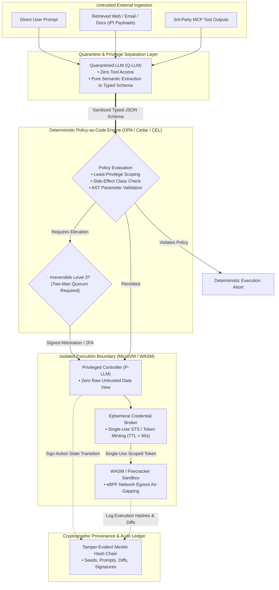

# Phase 1 Batch 4: Safety, Governance & Trust — Challenger Report

**Role:** RESEARCHER B — Architectural Challenger  
**Scope:** AI Agent Security Architecture, Zero-Trust Governance, Policy-as-Code, Side-Effect Safety Classes, Injection Defense Boundaries, Non-Human Identity (NHI) Lifecycle, Ephemeral Credential Brokering, Cryptographic Audit Provenance, and Deterministic Sandboxing.  
**Artifact Reference:** [`safety_governance_trust_challenger_report.md`](file:///home/shashank_karamudi/.gemini/antigravity-cli/brain/f8c35c06-4e0b-435f-93cb-050ae4d1bff8/safety_governance_trust_challenger_report.md)

---

## 1. Executive Summary & The Challenger Thesis

Traditional AI safety surveys and broad mapping taxonomies (Researcher A approach) predominantly focus on **probabilistic in-context alignment**, prompt-level safeguards (e.g., system prompt rules like *"never delete files"*), LLM content-moderation API filters, and reactive APM telemetry dashboards.

> ### ⚡ The Challenger Thesis
> **Prompt-level instructions and probabilistic guardrails are NOT security boundaries.** In an autonomous agent system with tool-calling capabilities, natural language represents untrusted user/data input, NOT an immutable control plane. Treating an LLM as a trusted security policy decider inevitably leads to **Confused Deputy vulnerabilities, privilege escalation, and state corruption via Indirect Prompt Injections (IPI)**.
> 
> Robust agent safety, governance, and trust must be grounded in **deterministic kernel/OS isolation, cryptographic non-repudiation, policy-as-code authorization, Non-Human Identity (NHI) credential brokering, and structural privilege separation.**



---

## 2. Five Challenger Angles (Different from R-A)

Researcher B reframes the security conversation around **5 distinct architectural angles**:

1. **Zero-Trust Non-Human Identity (NHI) & Ambient Authority Stripping:**  
   Agents must never run with ambient operating system credentials or static `.env` API keys. Every tool call must receive an ephemeral, down-scoped, single-use token (TTL < 60s) minted on-the-fly by an out-of-band Credential Broker upon deterministic policy validation.
2. **Structural Privilege Separation (Dual-LLM) vs. In-Context Semantic Defense:**  
   In-context prompt filtering is fundamentally bypassable. Structural security requires physically decoupling untrusted ingestion (Quarantined LLM with 0 tools) from action execution (Privileged LLM that never sees raw external tokens, only typed data schemas).
3. **Formal Side-Effect Safety Classification & Two-Phase Mutation Envelope:**  
   Moving beyond binary "tool allowlists" to mathematical side-effect tiers: *Pure Read*, *Idempotent Write*, *Stateful Non-Idempotent*, and *Irreversible Destructive*. Irreversible mutations are hard-gated behind cryptographic, human-signed non-repudiation envelopes.
4. **Tamper-Evident Cryptographic Provenance vs. Best-Effort Observability:**  
   Observability (OpenTelemetry/Langfuse) is lossy, sampled, and optimized for SRE performance. Compliance, SOC2/FedRAMP, and forensic breach investigations require immutable Merkle-DAG ledgers capturing model seeds, prompt snapshots, and tool diff hashes for bit-for-bit deterministic replay.
5. **AST-Level IP Lineage, License Contamination & Synthetic Data Governance:**  
   Enterprise data governance extends beyond PII masking to include automated AST-level copyright scanning, copyleft license propagation defense (GPL/AGPL vs. Apache/MIT), and model training data provenance tracking.

---

## 3. Deep Dissections & Cross-Checks

### 3.1 Cross-Check 1: Guardrails vs. Safety Nets vs. Permission Modes (1 vs. 3)

> **Challenger Finding: They are THREE fundamentally distinct architectural layers.** Conflating them is a severe architectural anti-pattern that leads developers to rely on prompt guardrails for access control.

```
┌──────────────────────────────────────────────────────────────────────────────────┐
│                            EXECUTION LIFECYCLE                                   │
├───────────────────────┬──────────────────────────┬───────────────────────────────┤
│      GUARDRAIL        │     PERMISSION MODE      │          SAFETY NET           │
│ (Semantic / Content)  │ (Deterministic / Policy) │     (Runtime / Resiliency)    │
├───────────────────────┼──────────────────────────┼───────────────────────────────┤
│ • Pre/Post LLM Token  │ • Pre-Tool Invocation    │ • In-Flight / Post-Execution  │
│   Inspection          │   Deterministic Gating   │   Circuit Breaking            │
│ • Probabilistic       │ • Boolean Determinism    │ • State & Budget Boundary     │
│ • "Is this toxic or   │ • "Does identity X have  │ • "Has the loop exceeded $5   │
│   a prompt injection?"│   capability Y on URI Z?"│   or 10 repeated errors?"     │
└───────────────────────┴──────────────────────────┴───────────────────────────────┘
```

| Dimension | 1. Guardrail (Semantic) | 2. Permission Mode (Policy-as-Code) | 3. Safety Net (Circuit Breaker) |
| :--- | :--- | :--- | :--- |
| **Primary Domain** | Semantic Content & Intent Analysis | Access Control & Capability Authorization | Operational Stability & Blast-Radius Limiting |
| **Enforcement Nature** | **Probabilistic / Heuristic** (SLM, Embedding Classifier, Regex) | **Deterministic / Boolean** (OPA Rego, AWS Cedar, Google CEL, IAM) | **Stateful / Metric-Driven** (Token counters, loop detectors, timeout watchdogs) |
| **Where It Executes** | Token stream ingestion & output generation | Tool dispatch interceptor (RPC middleware / MCP gateway) | Agent runtime execution loop & state manager |
| **Failure Mode** | False positives (over-censorship) or False negatives (jailbreak bypass) | Configuration syntax error or overly permissive policy rule | Infinite loop, budget exhaustion, or state deadlock |
| **Representative Primitives** | Llama Guard 3, NeMo Guardrails, Lakera Guard, Prompt Shields | OPA Policy, AWS Cedar, Unix file permissions, MCP capability scopes | Max iteration caps, spending limits, recursive tool depth limiters, auto-rollback |

---

### 3.2 Cross-Check 2: Audit vs. Observability vs. Reproducibility (3 vs. 1)

> **Challenger Finding: They are THREE distinct engineering disciplines.** They share raw execution telemetry but optimize for conflicting guarantees, retention models, and threat actors.

| Dimension | 1. Observability | 2. Audit Trail | 3. Reproducibility |
| :--- | :--- | :--- | :--- |
| **Target Stakeholder** | System Engineers, SREs, Product Developers | Security Officers, Legal, Compliance Auditors (SOC2, HIPAA, EU AI Act) | QA Engineers, Safety Researchers, Alignment Evaluators |
| **Core Question** | *"Why is the agent slow, failing, or costing $50/hour right now?"* | *"Who authorized this state change at 14:02 UTC, and can it be legally proven?"* | *"Can we re-run this exact agent trajectory and get the exact same result?"* |
| **Data Immutability** | Mutable, aggregated, sampled (often 10%–50% trace drop under load) | **Immutable, WORM (Write Once Read Many), tamper-evident, 100% capture** | Pinned environments, mock fixtures, recorded LLM seeds, replayable state diffs |
| **Storage Architecture** | ClickHouse, ElasticSearch, Prometheus, Jaeger, OpenTelemetry | Append-only Cryptographic Ledger, AWS QLDB-style hash chain, S3 Object Lock | Git worktree snapshot, SQLite sandbox state dump, Recorded VCR cassette |
| **Representative Implementations** | Langfuse, Arize Phoenix, OpenInference, Datadog LLM Observability | Sigstore Cosign, in-toto attestation, Tamper-Evident Merkle Logs, AWS CloudTrail | Testcontainers, pytest-vcr, LangGraph Time-Travel Debugger, Deterministic Replay Engine |

---

### 3.3 Taxonomic Hunting: Hidden Splits & Merges

* **Hidden Split: Static RBAC vs. Contextual Dynamic Policy-as-Code**  
  *The Breakdown:* Static tool allowlists (e.g., "Agent has access to SQL tool") fail. An action like `execute_sql("SELECT * FROM users")` is low risk, while `execute_sql("DROP TABLE users")` is catastrophic. Authorization must be **parameter-aware, contextual, and evaluated at the AST level**.
* **Hidden Split: In-Context Prompt Admonition vs. Kernel Sandboxing**  
  *The Breakdown:* Natural language instructions (e.g., `GEMINI.md` stating *"Never execute rm -rf"*) operate in the probabilistic semantic domain. A kernel sandbox (`seccomp-bpf`, `gVisor`, or Firecracker microVM) operates in the deterministic OS domain.
* **Hidden Split: PII Redaction vs. IP/License Compliance vs. Data Sovereignty**  
  *The Breakdown:* Data governance is often collapsed into "PII masking." However, an agent ingesting open-source code under GPLv3 and outputting it into a proprietary repository triggers copyright contamination regardless of whether PII was scrubbed.
* **Hidden Merge: Conflating Content Moderation with System Integrity**  
  *The Breakdown:* Classifying prompt injection as "toxic language" or "content moderation." Content moderation handles user offense/harm; prompt injection is an **arbitrary code execution exploit** against the model's control plane.
* **Hidden Merge: Conflating Read-Only Exploration with Zero-Risk Actions**  
  *The Breakdown:* Assuming read-only tools have no security blast radius. A read-only tool (`read_file`, `fetch_url`, `query_db`) can be weaponized for **data exfiltration via side-channels** (DNS exfiltration, image markdown rendering, or URL parameter pingbacks) if network egress is unconstrained.

---

## 4. Overlooked Architectural Candidates Catalog (>=5 Primitives R-A Would Miss)

---

### Candidate 1: Dynamic Ephemeral Credential Brokering (`DECB`)
* **Canonical Name:** Dynamic Ephemeral Credential Brokering (`Ambient Authority Stripping`)
* **Definition:** A zero-trust identity and secret management architecture where agents possess **zero long-lived API keys or persistent environment credentials**. When an agent requests a tool invocation, a deterministic Credential Broker evaluates the intent against policy and mints a short-lived (TTL: 15–60s), single-use, down-scoped token bound to the specific target resource.
* **Problem Solved:** Neutralizes credential exfiltration during prompt injection attacks. If an agent is hijacked, the attacker cannot steal long-lived API keys from environment variables or memory.
* **Level:** Protocol / Identity & Security Layer (Non-Human Identity IAM)
* **Lifecycle Role:** Pre-Tool Invocation & In-Flight Dispatch
* **Cross-Ecosystem Terms:**
  - *MCP:* Ephemeral Token Scoping / OAuth 2.0 Dynamic Client Registration (RFC 7591)
  - *Cloud IAM:* AWS STS `AssumeRoleWithWebIdentity`, Google Cloud Workload Identity Federation
  - *Secret Management:* HashiCorp Vault Dynamic Secrets, SPIFFE/SPIRE SVIDs for AI Workloads
* **Confidence:** High
* **Tier:** **Tier 1 (Foundational / Must-Have for Production Enterprise Deployment)**

---

### Candidate 2: Semantic Side-Effect Classification & Non-Repudiation Envelope (`SEC-NRE`)
* **Canonical Name:** Semantic Side-Effect Classification & Non-Repudiation Envelope
* **Definition:** A formal capability specification decorating all agent tools with mathematical side-effect annotations (`PURE_READ`, `IDEMPOTENT_WRITE`, `MUTATING_STATEFUL`, `IRREVERSIBLE_DESTRUCTIVE`), coupled with a cryptographic envelope mechanism requiring an out-of-band signed confirmation token (WebAuthn or hardware key signature) before executing irreversible actions.
* **Problem Solved:** Eliminates catastrophic autonomous actions (dropping production databases, cloud resource termination, unauthorized financial transfers) caused by hallucinations or prompt injections.
* **Level:** Policy / Orchestration Runtime Layer
* **Lifecycle Role:** Planning, Pre-Invocation Gating, and Compliance Forensics
* **Cross-Ecosystem Terms:**
  - *Anthropic:* Tool Choice Confirmation / Human-in-the-Loop Gating
  - *MCP:* Tool Execution Annotation (`isReadOnly`, `requiresDestructiveConfirmation`)
  - *Enterprise Governance:* Two-Man Rule / Dual-Custody Approval, ISO/IEC 42001 AI Risk Control
* **Confidence:** High
* **Tier:** **Tier 1 (Foundational / Must-Have)**

---

### Candidate 3: Dual-Model Asymmetric Privilege Decoupling (`Dual-LLM / CaMeL`)
* **Canonical Name:** Dual-Model Asymmetric Privilege Decoupling (Quarantined LLM + Privileged Controller)
* **Definition:** A structural security topology that physically segregates agent workloads across two distinct LLM nodes:
  1. **Quarantined LLM (Q-LLM):** Ingests raw, untrusted external data (web pages, emails, user uploads, 3rd-party MCP outputs). It possesses **zero tools, zero system credentials, and zero network access**, outputting only a typed, validated JSON data schema.
  2. **Privileged Controller (P-LLM):** Receives the structured schema and holds tool execution privileges, but **never parses or views untrusted raw external tokens**.
* **Problem Solved:** Structurally neutralizes Indirect Prompt Injections (IPI) by breaking the linguistic attack path between untrusted input and executable tool control.
* **Level:** Architectural / Multi-Model Topology Layer
* **Lifecycle Role:** Ingestion, Context Preparation, and Execution Dispatch
* **Cross-Ecosystem Terms:**
  - *Academic / Research:* CaMeL (Capability-based Multi-Agent LLM Architecture), Dual-LLM Privilege Separation (Simon Willison / OWASP)
  - *Commercial Systems:* Lakera Trust Boundary, Microsoft Prompt Shields Isolation, AutoGen Air-Gapped Worker
* **Confidence:** High
* **Tier:** **Tier 2 (Specialized / Advanced Defense-in-Depth)**

---

### Candidate 4: Deterministic State Replay & Cryptographic Provenance Ledger (`DSR-CPL`)
* **Canonical Name:** Deterministic State Replay & Cryptographic Provenance Ledger
* **Definition:** A tamper-evident, append-only event ledger based on Merkle DAGs that cryptographically binds every agent step—including model checkpoint SHA-256, sampling seed, exact system prompt hash, context window snapshot, tool execution payload, and OS filesystem delta hash—into a verifiable cryptographic chain.
* **Problem Solved:** Solves the non-repudiation and forensic crisis in autonomous AI systems. Provides verifiable proof for audits and post-breach incident forensics, distinguishing user intent from injection attacks or model bugs.
* **Level:** Compliance / Forensic Audit & Storage Layer
* **Lifecycle Role:** Post-Execution, Post-Hoc Audit, and Incident Forensics
* **Cross-Ecosystem Terms:**
  - *Supply Chain Security:* in-toto Attestation Framework, Sigstore / Cosign, SLSA for AI Agents
  - *Ledger Standards:* Merkle Tree Event Verification, Append-Only Cryptographic Audit Logs (RFC 6962)
  - *Observability Equivalents:* Langfuse Audit Logs, Traceloop OpenLLMetry Audit Extensions
* **Confidence:** High
* **Tier:** **Tier 2 (Specialized / Regulated Compliance)**

---

### Candidate 5: WASM-Isolated Capability-Attested Micro-Sandbox (`WASM-MicroSandbox`)
* **Canonical Name:** WASM-Isolated Capability-Attested Micro-Sandbox with Egress Air-Gapping
* **Definition:** An ultra-lightweight execution sandbox utilizing WebAssembly (WASM) Component Model or microVMs (Firecracker / gVisor) with sub-10ms instantiation times, capability-based filesystem sandboxing (WASI), and strict **deterministic eBPF-enforced network egress air-gapping**.
* **Problem Solved:** Prevents arbitrary code execution escapes and data exfiltration. Unlike heavy Docker containers that often retain outbound internet access, this blocks side-channel exfiltration (DNS/HTTP curl) during prompt injections.
* **Level:** Kernel / Runtime Execution Sandbox Layer
* **Lifecycle Role:** In-Flight Code & Tool Execution
* **Cross-Ecosystem Terms:**
  - *WASM Runtimes:* Wasmtime, Wasmer, Extism Plugin Framework, Fastly Lucet
  - *MicroVMs:* E2B Code Interpreter Sandbox, Daytona Workspaces, Modal Sandboxes, Fly.io Machines
  - *OS Security:* seccomp-bpf, Landlock LSM, Linux Namespaces & cgroups v2
* **Confidence:** High
* **Tier:** **Tier 1 (Foundational / Must-Have for Code Execution Agents)**

---

## 5. Side-Effect Safety Taxonomy & Execution Elevation Matrix

```
┌──────────────────────────────────────────────────────────────────────────────────┐
│                           SIDE-EFFECT SAFETY SPECTRUM                            │
├──────────────────────────────────────────────────────────────────────────────────┤
│ Level 0: Pure Query (Read-Only)      ──► Autonomous Loop (Zero Approval)         │
│ Level 1: Idempotent Mutation          ──► Autonomous with State Delta Logging     │
│ Level 2: Stateful Non-Idempotent      ──► Policy Engine Check + Soft Approval     │
│ Level 3: Irreversible / High Blast    ──► HARD GATE: Cryptographic Human Quorum   │
└──────────────────────────────────────────────────────────────────────────────────┘
```

| Safety Class | Algebraic Property | Examples | Sandbox / Egress Rule | Elevation / Approval Requirement |
| :--- | :--- | :--- | :--- | :--- |
| **Level 0: Pure Query** | $f(x) \rightarrow y$, No State Change ($S_{t+1} = S_t$) | `grep_search`, `read_file`, `list_dir`, `get_weather`, `vector_search` | Read-only filesystem mount, DNS-isolated or strictly allowlisted egress | **Zero Elevation:** Fully autonomous agent execution permitted. |
| **Level 1: Idempotent Mutation** | $f(f(x)) = f(x)$, Reversible / Overwrite | `write_scratch_file`, `set_cache_key`, `put_s3_object_versioned`, `upsert_row` | Ephemeral workspace mount, automatic pre-execution state snapshot (git/zfs diff) | **Soft Elevation:** Autonomous execution with rollback snapshot created. |
| **Level 2: Stateful Non-Idempotent** | $f(x) \neq f(f(x))$, Commits delta | `append_to_file`, `git_commit`, `send_internal_slack_msg`, `create_ticket` | Scoped credentials, task-bound rate limits (e.g., max 5 messages/minute) | **Policy Gate:** Auto-evaluated against Policy-as-Code rules (OPA/Cedar). |
| **Level 3: Irreversible Destructive** | Irreversible state loss, financial/legal impact | `drop_database`, `git_push_force_main`, `wire_transfer`, `delete_s3_bucket`, `send_external_email` | Air-gapped sandbox, zero ambient credentials, dynamic STS token required | **HARD GATE: Non-Repudiation Envelope.** Requires 2FA / WebAuthn signature or Two-Man Quorum. |

---

## 6. Policy-as-Code vs. Guardrails vs. Sandboxing Comparison Matrix

| Architectural Dimension | Policy-as-Code (OPA / Cedar / CEL) | Guardrails (NeMo / Lakera / Llama Guard) | Sandboxing (Firecracker / gVisor / WASM) |
| :--- | :--- | :--- | :--- |
| **Core Abstraction** | Formal mathematical logic & declarative authorization rules | Deep learning semantic classifiers & regex/heuristic filters | Operating system / Hardware isolation & virtualization |
| **Latency Overhead** | **< 1 millisecond** (In-memory AST evaluation) | **50 – 500 milliseconds** (Additional LLM / SLM inference pass) | **1 – 10 milliseconds** (WASM / MicroVM fork overhead) |
| **Determinism** | **100% Deterministic** (Boolean true/false) | **Probabilistic** (Confidence score thresholding) | **100% Deterministic** (Kernel syscall interception) |
| **Primary Threat Mitigated** | Unauthorized tool access, privilege escalation, parameter tampering | Hate speech, toxicity, PII leakage, prompt jailbreak prompts | System shell escapes, filesystem tampering, malware execution, network exfiltration |
| **Integration Point** | Gateway / RPC Interceptor / Middleware | Input Ingestion & Output Streaming Gateways | Tool Runner / Code Execution Engine |
| **Maintenance Burden** | Moderate (Writing declarative Rego/Cedar policies) | High (Fine-tuning classifiers, updating prompt delimiters) | High (Kernel security patches, container/WASM runtime management) |

---

## 7. Sources & Citations

1. **OWASP Top 10 for Large Language Models & Generative AI (2025–2026)**: Focus on LLM01 (Prompt Injection), LLM02 (Sensitive Information Disclosure), LLM06 (Excessive Agency), and LLM07 (System Prompt Leakage). [owasp.org](https://owasp.org/www-project-top-10-for-large-language-model-applications/)
2. **NIST AI Risk Management Framework (AI RMF 1.0 / Generative AI Profile NIST SP 1270)**: Governance, mapping, measurement, and management of autonomous AI risks. [nist.gov](https://www.nist.gov/itl/ai-risk-management-framework)
3. **MITRE ATLAS™ (Adversarial Threat Landscape for Artificial-Intelligence Systems)**: Threat matrix covering prompt injection, data poisoning, and tool hijacking in autonomous agents. [atlas.mitre.org](https://atlas.mitre.org/)
4. **Simon Willison**: *The Dual LLM pattern for building secure AI assistants with untrusted data*. [simonwillison.net](https://simonwillison.net/2023/Apr/25/dual-llm-pattern/)
5. **Open Policy Agent (OPA) & AWS Cedar Policy Engines**: Policy-as-code specifications for fine-grained, low-latency authorization in agentic pipelines. [openpolicyagent.org](https://www.openpolicyagent.org/) | [cedarpolicy.com](https://www.cedarpolicy.com/)
6. **Model Context Protocol (MCP) Security Specification**: Anthropic's open standard for client-host-server authorization boundaries, transport security, and capability declarations. [modelcontextprotocol.io](https://modelcontextprotocol.io/)
7. **in-toto & Sigstore Supply Chain Security for AI**: Frameworks for cryptographic provenance attestation and non-repudiation in autonomous code generation pipelines. [in-toto.io](https://in-toto.io/) | [sigstore.dev](https://www.sigstore.dev/)
8. **E2B & Firecracker Virtualization**: Sandboxed code execution environments providing hardware-level isolation for agentic interpreters. [e2b.dev](https://e2b.dev/) | [firecracker-microvm.github.io](https://firecracker-microvm.github.io/)
9. **CaMeL Architecture (Cornell / UC Berkeley Research)**: *Capability-based Multi-Agent LLM Architecture for Robust Indirect Prompt Injection Defense*. [arXiv:2404.01413](https://arxiv.org/abs/2404.01413)
10. **W3C WebAssembly (WASM) Component Model & WASI 0.2**: Capability-based security and memory isolation for lightweight agent extensions and tool execution. [webassembly.org](https://webassembly.org/)
