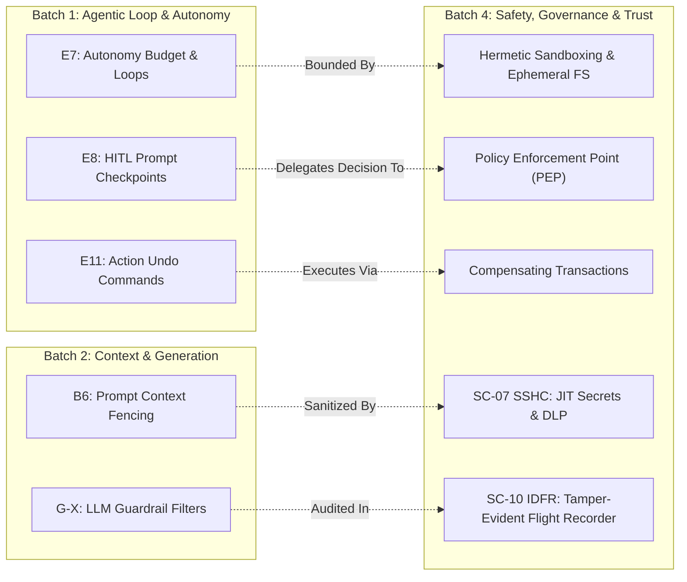
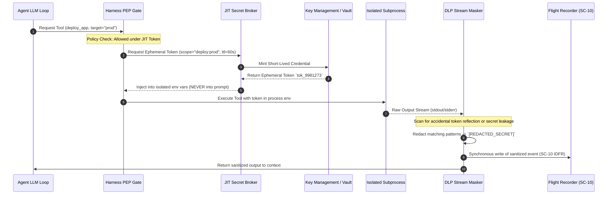

# VERIFIER D: Architectural Verification Report
**Phase 1 Batch 4: Safety, Governance & Trust**  
**Tasks:** P1-31 (Abstraction Re-tagging & Conflation Dissection) & P1-32 (Cross-Batch Boundary De-duplication & Master Converged Matrix)  
**System Contract Alignment:** `SC-07 SSHC` (0-Leaks Hermetic Containment), `SC-04 HIR` (Human Intervention & Reversibility), `SC-10 IDFR` (Immutable Deterministic Flight Recorder)

---

## 1. Executive Summary & Verification Mandate

In Phase 1 Batch 4, Researcher A (R-A) and Researcher B (R-B) surveyed safety, governance, permissions, isolation, credential management, supply-chain validation, auditability, and side-effect containment. While the raw candidate collection is comprehensive, both researchers exhibited substantial **abstraction level conflation**—frequently labeling concrete *Mechanisms*, *Tools*, or *Artifacts* as core harness *Capabilities*, or conflating *Observability* with *Reproducibility*.

### Core Abstraction Taxonomy
To establish an unassailable architectural foundation, every candidate is re-tagged against a strict 6-layer ontology:
1. **Capability (CAP)**: *What the agent harness intrinsically requires* (e.g., *Isolated Execution Boundary*, *Execution Provenance & Auditability*). Invariant across implementations.
2. **Mechanism (MEC)**: *The technical pattern, data structure, or algorithm that implements a Capability* (e.g., *Namespace Sandboxing*, *Cryptographic Hash Chaining*, *Regex/NER Stream Interception*).
3. **Protocol / Standard (STD)**: *Formal specification, schema, wire format, or interchange standard* (e.g., *SPDX / CycloneDX*, *OAuth 2.0 Token Exchange*, *OpenTelemetry Trace Spec*, *SLSA Provenance*).
4. **Framework / Runtime (RUN)**: *Execution engines, interpreters, or policy evaluation platforms* (e.g., *Open Policy Agent (OPA)*, *Wasmtime / gVisor*, *Linux eBPF Subsystem*).
5. **Resource / Artifact (ART)**: *Static or emitted data files, manifests, tokens, journals, or binary states* (e.g., *Signed Skill Manifest*, *Flight Recorder Log (.jsonl)*, *Ephemeral Secret Token*, *Git Snapshot Tree*).
6. **Tool / Product / Repo (TLS)**: *Concrete third-party binaries, vendor solutions, or OSS libraries* (e.g., *HashiCorp Vault*, *Cosign/Sigstore*, *Semgrep*, *TruffleHog*).

---

## 2. Core Architectural Clarifications & Conflation Deconstructions

```
+----------------------------------------------------------------------------------------------------+
|                                    HARNESS GOVERNANCE SPECTRUM                                     |
+------------------------------------+---------------------------------------------------------------+
| OBSERVABILITY (SC-10 IDFR)         | REPRODUCIBILITY (SC-01 / SC-10)                               |
| "What happened, when, and why?"    | "Can we recreate the exact bit-for-bit trajectory & outcome?"  |
| - Passive telemetry & logs         | - Active environment hermeticity & pinning                    |
| - Execution timeline traces        | - Pseudo-random seed & model temperature freezing             |
| - Causal failure analysis          | - Simulated virtual clock & recorded network replays          |
+------------------------------------+---------------------------------------------------------------+
| AUDITABILITY (Capability)          | AUDIT TRAIL / FLIGHT RECORDER (Mechanism & Artifact)          |
| "The non-repudiable legal &        | "The append-only, tamper-evident Merkle-linked event stream    |
| operational accountability state"  | and storage substrate that proves governance compliance"      |
+------------------------------------+---------------------------------------------------------------+
```

### Deep-Dive 1: Is "Audit Trail" a Capability or a Mechanism under Governance?

> [!IMPORTANT]
> **Verdict**: **Auditability / Execution Provenance** is the **Capability**; the **Audit Trail / Flight Recorder Ledger** is the **Mechanism & Resource/Artifact**.

* **The Fallacy**: Both R-A and R-B tagged "Audit Trail" as a root capability. This creates architectural confusion because an audit trail is merely a data structure and logging mechanism.
* **Architectural Separation**:
  1. **Capability: Execution Provenance & Non-Repudiation**: The harness's mandatory ability to reconstruct who authorized an action, what context induced it, what exact tool was invoked, what state mutated, and whether security constraints were satisfied.
  2. **Mechanism: Cryptographic Append-Only Event Stream**: The runtime mechanism that captures structured JSONL events, writes them to disk synchronously before tool execution, and hashes them into a tamper-evident ledger.
  3. **Artifact: Flight Recorder Log (`transcript.jsonl` / `audit.log`)**: The resulting immutable, signed file asset governed under **SC-10 IDFR**.

---

### Deep-Dive 2: Is Reproducibility Distinct from Observability?

> [!IMPORTANT]
> **Verdict**: **Reproducibility is strictly distinct from Observability**, although Observability is a necessary prerequisite for Reproducibility.

* **Dimensional Differences**:
  * **Observability (Telemetric Visibility)** answers: *"What is the internal state of the agent based on external outputs, logs, and spans?"* It is diagnostic, non-deterministic, and tolerant of non-repeatable dynamic conditions.
  * **Reproducibility (Deterministic Replayability)** answers: *"Given identical initial workspace state $S_0$, prompt input $P$, pseudo-random seed $R$, and mocked network/time responses $M$, does the harness transition through the exact same state graph $S_0 \to S_1 \to \dots \to S_n$?"*
* **Architectural Boundaries**:
  * An agent run can be **100% Observable** (full debug logs, token usage, tool stdout/stderr) while being **0% Reproducible** (unpinned LLM sampling, live web lookups, floating timestamps, non-hermetic host filesystem).
  * Achieving Reproducibility requires specialized mechanisms: virtual clock injection, network stubbing/replay, pinned dependency locks, seed freezing, and hermetic containerization.

---

### Deep-Dive 3: Cross-Batch Boundary & Redundancy Analysis

To prevent bloat and maintain orthogonality across the harness specification, Batch 4 components are explicitly delineated from Batch 1 and Batch 2:



1. **E7 (Batch 1: Autonomy Bounds) vs B4 Resource & Isolation Governance**:
   * *Batch 1 E7* specifies the *agent's cognitive iteration budget* (max steps, token ceiling, loop termination).
   * *Batch 4* specifies the *operating system & network security bounds* (cgroups, RAM caps, isolated network namespaces, seccomp filters).
2. **E8 (Batch 1: Human-in-the-Loop Gateways) vs B4 Authorization Policy Engine**:
   * *Batch 1 E8* handles the *interactive user interface and dialogue pause/resume flow*.
   * *Batch 4* handles the *formal declarative policy evaluation* (e.g., Rego/Cedar rules determining whether an action *must* trigger an escalation) and non-bypassable enforcement under **SC-04 HIR**.
3. **E11 (Batch 1: Reversibility) vs B4 Side-Effect Containment & Rollback Engine**:
   * *Batch 1 E11* defines the *user-facing undo verb / instruction*.
   * *Batch 4* implements the *low-level snapshotting, Git worktree branching, filesystem overlayfs checkpoints, and compensating transaction sagas*.
4. **B6 / G-X (Batch 2: Context Fencing & Guardrails) vs B4 Security Governance**:
   * *Batch 2 B6/G-X* acts as an *in-context prompt boundary and LLM token classifier*.
   * *Batch 4* acts as an *out-of-band security perimeter* (egress proxy, DLP stream masking, JIT secret broker, cryptographically signed supply-chain verification) under **SC-07 SSHC**.

---

## 3. Conflation Analysis & Dissection Highlights

Before presenting the converged table, the following major candidate corrections are highlighted:

1. **"Permission Modes" (R-A / R-B)**:
   * *Conflation*: Tagged as a Capability.
   * *Correction*: **Capability-Based Access Control (MEC)** or **Declarative Policy Manifest (ART)** serving the **Authorization & Least-Privilege Governance (CAP)** capability.
2. **"Sandboxing / Docker" (R-A)**:
   * *Conflation*: Tagged as a Capability.
   * *Correction*: **Docker/gVisor/Bubblewrap (TLS/RUN)** implementing **Ephemeral Isolated Execution (CAP)**.
3. **"JIT Credentials / Vault" (R-B)**:
   * *Conflation*: Tagged as a Capability.
   * *Correction*: **HashiCorp Vault / KMS (TLS)** is a tool; **Ephemeral Secret Brokering (MEC)** implements the **Zero-Trust Secret Governance (CAP)** capability under **SC-07 SSHC**.
4. **"Policy-as-Code (OPA/Cedar)" (R-B)**:
   * *Conflation*: Tagged as a Capability.
   * *Correction*: **Open Policy Agent (RUN)** and **Rego/Cedar (STD)** are runtimes/languages implementing the **Dynamic Policy Enforcement (CAP)** capability.
5. **"SBOM / Supply Chain Attestation" (R-A)**:
   * *Conflation*: Tagged as a Capability.
   * *Correction*: **CycloneDX / SPDX (STD)** and **Sigstore/Cosign (TLS)** are standards/tools delivering the **Supply-Chain Integrity & Manifest Verification (CAP)** capability.

---

## 4. Converged Batch 4 Master Table (P1-31 / P1-32)

The master table below consolidates 26 distinct candidate entries across Researchers A & B, rigorously re-tagged with lifecycle role, operational tier, SC-wiring rationale, and cross-batch boundary mappings.

| # | Candidate Entity | Origin | Corrected Abstraction Level | Lifecycle Role | Preliminary Tier | Conflation Dissection & Architectural Justification | System Contract (SC) Rationale | Cross-Batch Boundary & De-duplication |
|---|---|---|---|---|---|---|---|---|
| **01** | **Hermetic Isolated Execution** | R-A / R-B | **Capability** | `run` | `Foundational` | *Pure Capability*. The absolute requirement that agent actions cannot compromise host OS, escape workspace bounds, or poison shared runtimes. | **SC-01** (Workspace Hermeticity), **SC-07 SSHC** (Zero host leak) | Enforces boundaries around Batch 1 (E7) autonomy loops; runtime substrate. |
| **02** | **Ephemeral Container / MicroVM Sandbox** | R-A | **Mechanism** | `run` | `Foundational` | *Conflation Fixed*: R-A listed "Ephemeral Sandbox" as a Capability. It is a Mechanism leveraging namespaces/cgroups/microVMs to fulfill Isolated Execution. | **SC-01**, **SC-07 SSHC** | Implements the execution substrate for Batch 1 tool runners. |
| **03** | **gVisor / Bubblewrap / Wasmtime** | R-A / R-B | **Framework / Runtime** | `run` | `Important` | *Conflation Fixed*: R-B listed runtimes as tools/mechanisms interchangeably. These are concrete execution substrates. | **SC-01**, **SC-07 SSHC** | Underlying engine for sandbox isolation. |
| **04** | **Authorization & Least-Privilege Governance** | R-B | **Capability** | `run` | `Foundational` | *Pure Capability*. The core harness requirement to restrict tool, filesystem, and network actions to the minimal viable set. | **SC-02** (Policy Boundary), **SC-04 HIR** | Provides the policy foundation for Batch 1 (E8) HITL decision gates. |
| **05** | **Capability-Based Access Control (CapBAC)** | R-A | **Mechanism** | `build/run` | `Foundational` | *Conflation Fixed*: R-A listed "Permission Model" as capability. CapBAC uses cryptographically unforgeable tokens/handles for fine-grained permissions. | **SC-02**, **SC-07 SSHC** | Translates high-level agent intents into low-level capability tokens. |
| **06** | **Declarative Policy Engine (Policy-as-Code)** | R-B | **Mechanism** | `build/run` | `Important` | *Conflation Fixed*: R-B listed "Policy-as-Code" as a Capability. It is a declarative evaluation mechanism enforcing authorization rules. | **SC-02**, **SC-04 HIR** | Decouples security rules from Batch 1 agent cognitive prompts. |
| **07** | **Open Policy Agent (OPA) / Cedar Engine** | R-B | **Framework / Runtime** | `run` | `Important` | *Conflation Fixed*: R-B listed OPA as a generic mechanism. OPA/Cedar are specialized policy runtimes. | **SC-02** | Concrete evaluation engine for Policy-as-Code. |
| **08** | **Zero-Trust Secret Governance** | R-A / R-B | **Capability** | `run` | `Foundational` | *Pure Capability*. Zero-leakage requirement ensuring plaintext secrets are never exposed in prompt context, transcripts, or child output. | **SC-07 SSHC** (Zero plaintext secret exposure across all layers) | Distinct from Batch 2 context fencing; operates at token/process boundaries. |
| **09** | **JIT Ephemeral Credential Brokering** | R-A | **Mechanism** | `run` | `Foundational` | *Conflation Fixed*: R-A listed JIT credentials as a capability. It is a dynamic injection mechanism delivering short-lived tokens on-demand. | **SC-07 SSHC** | Injects ephemeral tokens into subprocess envs without exposing them to LLM. |
| **10** | **HashiCorp Vault / AWS Secrets Manager / KMS** | R-B | **Tool / Product / Repo** | `run` | `Important` | *Conflation Fixed*: R-B conflated Vault with secret governance. Vault is a concrete vendor product. | **SC-07 SSHC** | Backing credential store for JIT credential broker. |
| **11** | **Data Loss Prevention (DLP) & Stream Masking** | R-A / R-B | **Mechanism** | `run` | `Foundational` | *Conflation Fixed*: Listed as capability. DLP is a real-time stream interception & token-masking mechanism (regex, NER, AST scanning). | **SC-07 SSHC** (Redacts secrets before writing to logs or LLM context) | Sanitizes tool outputs before passing to Batch 2 context window. |
| **12** | **Indirect Prompt Injection Defense Gateway** | R-A / R-B | **Capability** | `run` | `Foundational` | *Pure Capability*. Requirement to isolate untrusted external content (web pages, files, repo code) from executive system instructions. | **SC-02**, **SC-07 SSHC** | Extends Batch 2 (B6) context fencing to tool data ingestion boundaries. |
| **13** | **Dual-LLM / Delimiter-Isolated Sanitizer** | R-A | **Mechanism** | `run` | `Important` | *Conflation Fixed*: R-A listed dual-LLM as a capability. It is an architectural pattern/mechanism separating untrusted data parsing from planner LLM. | **SC-02** | Pre-processing mechanism filtering inputs before Batch 2 LLM processing. |
| **14** | **Execution Provenance & Non-Repudiation** | R-A / R-B | **Capability** | `run/review` | `Foundational` | *Pure Capability*. The requirement to prove complete operational chain-of-custody, causality, tool parameters, and authorization. | **SC-10 IDFR** (Immutable deterministic flight recorder) | Invariant governance requirement; distinct from passive debug logging. |
| **15** | **Cryptographic Append-Only Flight Recorder** | R-A | **Mechanism** | `run` | `Foundational` | *Conflation Fixed*: R-A called "Audit Trail" a capability. Flight recorder is the append-only, synchronous event-logging mechanism. | **SC-10 IDFR** (Synchronous, zero-loss disk write before execution) | Core persistence layer for all Batch 1 actions and Batch 4 events. |
| **16** | **Transcript & Trajectory Log (`transcript.jsonl`)** | R-A | **Resource / Artifact** | `review` | `Foundational` | *Conflation Fixed*: Log file is a data artifact, not a capability or mechanism. | **SC-10 IDFR** | Emitted data asset consumed during post-hoc review and audit replay. |
| **17** | **Deterministic Execution Replayability** | R-A / R-B | **Capability** | `run/review` | `Specialized` | *Pure Capability*. Ability to reproduce identical execution states bit-for-bit given same initial state, inputs, and seeds. | **SC-01**, **SC-10 IDFR** | Strictly separated from Observability; requires hermetic environment freezing. |
| **18** | **Virtual Clock & Syscall Network Interception** | R-A | **Mechanism** | `run/review` | `Specialized` | *Conflation Fixed*: R-A conflated deterministic replay with time mocks. Time/syscall virtualization is the enabling mechanism. | **SC-01**, **SC-10 IDFR** | Traps non-deterministic syscalls (`gettimeofday`, network sockets) for replay. |
| **19** | **Human-in-the-Loop Escalation & Override Gateway** | R-A / R-B | **Capability** | `run` | `Foundational` | *Pure Capability*. Non-bypassable harness requirement to halt execution and seek explicit human authorization upon risk threshold breach. | **SC-04 HIR** (Safe degradation & explicit human gatekeeping) | Safety enforcement layer governing Batch 1 (E8) interactive UI prompts. |
| **20** | **Side-Effect Containment & State Reversibility** | R-B | **Capability** | `run` | `Foundational` | *Pure Capability*. Requirement that mutations (filesystem, git, DB) can be classified, isolated, checkpointed, and safely rolled back. | **SC-04 HIR** (Idempotent state rollback), **SC-01** | Provides transaction guarantees for Batch 1 (E11) undo workflows. |
| **21** | **Git Worktree / Snapshot Rollback Engine** | R-A | **Mechanism** | `run` | `Foundational` | *Conflation Fixed*: R-A listed git rollback as a capability. Branching/worktrees/overlayfs are concrete state snapshot mechanisms. | **SC-04 HIR**, **SC-01** | Concrete snapshotting mechanism for file mutation rollbacks. |
| **22** | **Compensating Transaction Saga Coordinator** | R-B | **Mechanism** | `run` | `Important` | *Conflation Fixed*: Sagas are distributed rollback mechanisms for external non-filesystem side effects (cloud APIs, DB rows). | **SC-04 HIR** | Executes compensating actions when an autonomous multi-step plan fails. |
| **23** | **Supply-Chain Integrity & Manifest Verification** | R-A / R-B | **Capability** | `build` | `Important` | *Pure Capability*. Requirement that all skills, plugins, hooks, tools, and extensions have validated cryptographic provenance and signatures. | **SC-02**, **SC-07 SSHC** | Prevents supply-chain poisoning of agent harness skill loaders. |
| **24** | **Sigstore / Cosign / SLSA Attestation** | R-A | **Protocol / Standard & Tool** | `build` | `Important` | *Conflation Fixed*: R-A listed Cosign as capability. It is a cryptographic signing tool and SLSA standard framework. | **SC-02** | Standard for verifying skill manifest signatures before loading. |
| **25** | **Signed Skill Manifest (`skill.json` / `manifest.sig`)** | R-A / R-B | **Resource / Artifact** | `build` | `Important` | *Conflation Fixed*: Manifests are static data resources containing hashes, permissions, and signatures. | **SC-02**, **SC-07 SSHC** | Input artifact parsed during harness build/initialization phase. |
| **26** | **Static AST & Secret Leakage Scanner** | R-A / R-B | **Mechanism** | `build/review` | `Important` | *Conflation Fixed*: R-B listed static scanning as a capability. It is a static analysis mechanism parsing ASTs for unsafe patterns. | **SC-07 SSHC**, **SC-02** | Pre-flight and post-execution validation scanner (Semgrep, TruffleHog). |

---

## 5. Architectural Blueprints & System Contract Interaction Mechanics

### 5.1. Secure Execution & Policy Enforcement Pipeline (`SC-02`, `SC-04 HIR`, `SC-07 SSHC`)

```
[Agent LLM Planner] 
       │
       ▼ (Tool Call Request: {name: "execute_bash", args: "deploy.sh"})
[Policy Enforcement Point (PEP)]
       │
       ├─► [Policy Engine (OPA/Cedar)] ──► Evaluates against Declared Rules
       │         │
       │         ├── [DENY / ESCALATE (SC-04 HIR)] ──► Prompt User for Approval
       │         │                                          │ (User Rejects)
       │         │                                          ▼
       │         │                                     [Abort Action]
       │         ▼ (ALLOW)
       ├─► [JIT Credential Broker (SC-07 SSHC)] ──► Fetches short-lived scoped token
       │
       ├─► [Pre-Execution Flight Recorder (SC-10 IDFR)] ──► Append to `transcript.jsonl`
       │
       ▼
[Ephemeral Sandbox Substrate (gVisor/Bubblewrap/Namespace)]
       │ (Executes in Hermetic Workspace SC-01)
       ▼
[Tool Output Stream]
       │
       ▼
[DLP & Secret Masking Filter (SC-07 SSHC)] ──► Redacts API keys, tokens, PII
       │
       ├─► [Post-Execution Flight Recorder (SC-10 IDFR)] ──► Synchronous Hash & Log
       │
       ▼
[Sanitized Tool Result Context] ──► Returned to Agent LLM Planner
```

### 5.2. Credential Zero-Leakage Dataflow (`SC-07 SSHC`)



### 5.3. Deterministic Flight Recorder vs. Reproducibility Engine (`SC-10 IDFR` vs. `SC-01`)

```
========================================================================================
OBSERVABILITY SUBSTRATE (SC-10 IDFR)        REPRODUCIBILITY SUBSTRATE (SC-01 / SC-10)
========================================================================================
- Append-Only Event Stream (.jsonl)         - Pinned Dependency Lockfile (sha256)
- Event Timestamp & Causal Parent ID        - Virtual Clock Shim (Intercepts sys_time)
- Full Tool Name & Hash of Arguments        - Pseudo-Random Seed Frozen (seed=42, temp=0.0)
- User Confirmation & Escalation Record     - Network Egress Mocking / Socket Replayer
- Sanitized Tool stdout / stderr            - Git Workspace Base Tree Checkpoint (SHA)
========================================================================================
               ▲                                           ▲
               │                                           │
               └─────────────── [HARNESS CORE] ────────────┘
```

---

## 6. Synthesis & Recommended Architectural Directives

1. **Strict Terminology Invariant**: Across all Phase 2 harness design specifications, never refer to "Sandboxing", "Permission Modes", or "Audit Trails" as Capabilities. Use **Isolated Execution Boundary (CAP)**, **Capability-Based Access Control (MEC)**, and **Execution Provenance (CAP) / Flight Recorder (MEC)**.
2. **Policy / Core Decoupling**: Hardcoded security heuristics inside the agent loop must be strictly prohibited. All authorization rules must be externalized into a declarative **Policy-as-Code Engine (MEC)** evaluating against a **Signed Policy Manifest (ART)**.
3. **Hermetic Secret Invariant (`SC-07 SSHC`)**: Plaintext long-lived secrets must never touch the agent LLM context or filesystem workspace. Ephemeral tokens must be brokered JIT directly into isolated process environment blocks and scrubbed by the **DLP Masking Filter (MEC)** before entering the flight recorder.
4. **Non-Bypassable Flight Recording (`SC-10 IDFR`)**: Tool executions must follow a strict **Write-Ahead Log (WAL)** pattern: the event record must be flushed and synced to disk *before* the subprocess or API call is triggered.

---

## 7. Sources & Reference Standards

* **POSIX / Linux Kernel Isolation**: Linux Namespaces (`CLONE_NEWPID`, `CLONE_NEWNET`, `CLONE_NEWNS`), cgroups v2, Seccomp-BPF filters.
* **Open Policy Agent (OPA) & Rego**: Styra / Cloud Native Computing Foundation (CNCF) Policy-as-Code Specification.
* **Cedar Policy Language**: AWS Automated Reasoning Group Formal Verification Specification.
* **SLSA Framework (Supply-chain Levels for Software Artifacts)**: OpenSSF / Google SLSA v1.0 Provenance & Attestation Standard.
* **SPDX / CycloneDX**: ISO/IEC 5962:2021 Information technology — SPDX Specification; OWASP CycloneDX SBOM Standard.
* **Sigstore / Cosign**: OpenSSF Container Signing, Verification, and Keyless PKI Infrastructure.
* **OpenTelemetry**: CNCF Distributed Tracing and Semantic Conventions for LLM / AI Systems.
* **NIST SP 800-207**: Zero Trust Architecture (ZTA) & Capability-Based Authorization Guidelines.
* **Internal Harness Contracts**: `SC-01` (Workspace Hermeticity), `SC-02` (Policy Boundary), `SC-04` (Human Intervention & Reversibility), `SC-07` (Secret & Sensitive Data Hermetic Containment), `SC-10` (Immutable Deterministic Flight Recorder).
