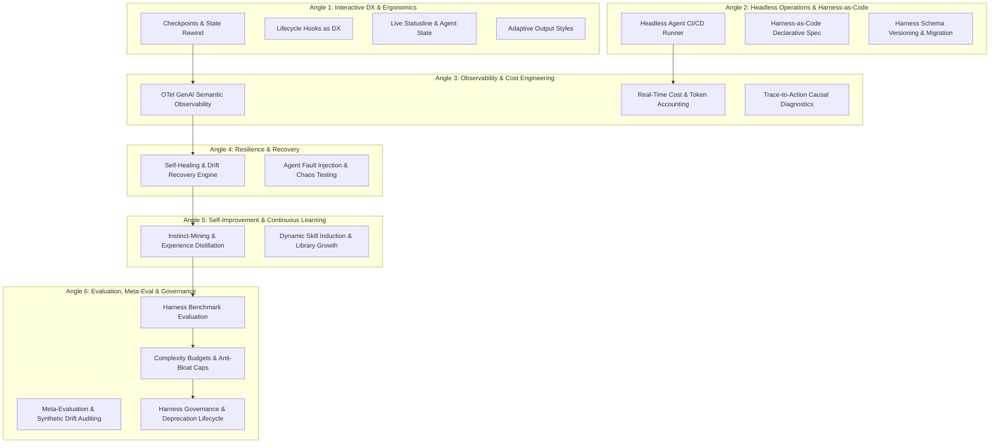

# PHASE 1 BATCH 5: DX, OBSERVABILITY & META (FINAL DISCOVERY BATCH)
**Researcher A — Broad Mapper & Systems Taxonomy Report**

---

## Executive Summary & Taxonomy Architecture

Phase 1 Batch 5 maps the foundational, operational, and evolutionary layers of modern agentic harnesses. As AI developer tooling transitions from single-turn chat interfaces to autonomous, stateful agentic runtimes, the critical bottlenecks shift from raw LLM reasoning to **Harness Ergonomics (DX)**, **Telemetry & Cost Engineering (Observability)**, **Resilience & Fault Recovery (Reliability)**, **Continuous Adaptation (Self-Improvement)**, and **Architectural Longevity & Compliance (Meta-Harness & Governance)**.

This mapper establishes a rigorous classification of 18 candidate patterns across **6 Analytical Angles**, validated against at least two real-world ecosystems (e.g., Anthropic Claude Code, OpenAI Codex/Assistants, Cursor/Windsurf, LangGraph/LangSmith, OpenTelemetry GenAI SIG, and Enterprise Supply-Chain Frameworks).



---

## Core Scorecard Matrix

All candidate patterns in this batch are mapped against four foundational performance and longevity vectors:

| Scorecard ID | Metric Code | Name | Target Objective |
| :--- | :--- | :--- | :--- |
| **SC-01** | **TTFUA** | Time to First Useful Action | Minimizes latency between user prompt/webhook trigger and verifiable state modification or high-signal response. |
| **SC-05** | **COST** | Token & Resource Cost Efficiency | Optimizes token expenditure, cache hit ratios, context compression, and tiered model invocation economics. |
| **SC-06** | **DRR** | Defect & Degradation Recovery Rate | Measures harness resilience against loop stalling, context corruption, tool execution failures, and drift. |
| **SC-11** | **GOV/HLTH** | System Health, Governance & Longevity | Enforces architectural simplicity, schema evolvability, security compliance (SLSA/OWASP), and deprecation safety. |

---

## Angle 1: Interactive Developer Experience & Ergonomics

### 1.1 Checkpoints & Transactional State Rewind
* **Canonical Name:** Checkpoint & State Rewind Engine
* **Definition:** A persistence and state-management mechanism that creates immutable snapshots of the agent's full context (working tree, memory, tool call history, and execution stack) at discrete transaction boundaries, enabling instantaneous rollbacks to prior decision forks without full restart.
* **Problem Solved:** Prevents destructive side-effects, hallucinated code refactors, or dead-end reasoning loops from polluting the workspace, eliminating developer anxiety and manual git resets.
* **Level:** Mechanism
* **Lifecycle Role:** Runtime / Execution & Verification
* **Cross-Ecosystem Translation:**
  * *Claude Code / Anthropic:* `/rewind` command with automatic git working tree snapshots and conversation branching.
  * *Cursor / Windsurf:* Composer multi-file checkpoint timeline and local history rollbacks.
  * *LangGraph:* Checkpointer interface (`MemorySaver`, `SqliteSaver`, `PostgresSaver`) allowing state time-travel and human-in-the-loop state forks.
* **Confidence:** High
* **Tier Preliminary:** Foundational
* **Scorecard Mapping:**
  * **SC-01 (TTFUA):** High positive impact; allows instant resumption from the last verified good step rather than starting an agentic task from scratch.
  * **SC-06 (DRR):** Primary recovery mechanism for catastrophic context degradation or unintended file alterations.

---

### 1.2 Lifecycle Hooks as Developer Experience
* **Canonical Name:** Ergonomic Lifecycle Hooks
* **Definition:** Deterministic pre-flight, mid-flight, and post-action interceptors (`on_boot`, `pre_tool_call`, `post_tool_call`, `on_error`, `pre_commit`) declared in user or workspace configuration to automate linting, auto-formatting, environment verification, or security gating without model prompt bloating.
* **Problem Solved:** Removes repetitive prompt instructions (e.g., "always run prettier after editing") by offloading deterministic invariants to programmatic hooks, improving execution speed and reliability.
* **Level:** Capability / Tooling Interface
* **Lifecycle Role:** Pre-flight / Bootstrap & Runtime / Execution
* **Cross-Ecosystem Translation:**
  * *Claude Code:* Pre/Post tool-use bash hooks and custom slash command event triggers.
  * *OpenAI Assistants / Codex:* Tool choice overrides, function calling middleware, and webhook interceptors.
  * *Enterprise CI/CD (DevOps):* Git pre-commit hooks, Turborepo pipeline triggers, and VS Code task automation.
* **Confidence:** High
* **Tier Preliminary:** Foundational
* **Scorecard Mapping:**
  * **SC-01 (TTFUA):** Streamlines execution by resolving deterministic setup and cleanup out-of-band.
  * **SC-05 (COST):** Drastically reduces system prompt token overhead by converting natural-language constraints into zero-token deterministic hooks.
  * **SC-06 (DRR):** Enforces static typechecks and linters immediately after code generation, catching syntax errors prior to next-step planning.

---

### 1.3 Live Statusline & Granular Agent State Visualizers
* **Canonical Name:** Real-Time Agent State & Statusline Protocol
* **Definition:** An active telemetry visualization protocol that surfaces agent lifecycle states (`idle`, `thinking`, `executing_tool[id]`, `waiting_for_user`, `recovering`, `context_compacting`) along with token consumption rates, active branch, and cost indicators within terminal or IDE status bars.
* **Problem Solved:** Mitigates the "black box silence" problem during long multi-step agent runs, preventing developer frustration, duplicate inputs, or premature task cancellation.
* **Level:** Protocol / UI Mechanism
* **Lifecycle Role:** Runtime / Execution
* **Cross-Ecosystem Translation:**
  * *Claude Code:* Interactive spinner, active token/cost readout in terminal footer, subagent status badges.
  * *Cursor:* Status bar indexing indicator, inline generation stream state, and background task progress bars.
  * *OpenAI Swarms / AutoGen Studio:* Session visualizer graph showing active node execution and message passing state.
* **Confidence:** High
* **Tier Preliminary:** Important
* **Scorecard Mapping:**
  * **SC-01 (TTFUA):** Provides immediate feedback on whether the agent is blocked on I/O, compilation, or model inference, enabling rapid developer intervention.
  * **SC-05 (COST):** Exposes token consumption velocity in real time, alerting developers to runaway context expansions.

---

### 1.4 Adaptive Output Styles & Stream Rendering
* **Canonical Name:** Multi-Modal Output Styler & Progressively Disclosed Stream
* **Definition:** A rendering framework that dynamically adjusts verbosity, formatting (compact diffs, full codeblocks, JSON summaries, interactive accordions), and output pacing based on execution context (interactive TTY terminal, headless CI log, IDE split-pane, or mobile notification).
* **Problem Solved:** Terminal output pollution, unreadable markdown logs in automated pipelines, and token-heavy redundant explanations during automated workflows.
* **Level:** Framework / UX Mechanism
* **Lifecycle Role:** Runtime / Execution & Observability
* **Cross-Ecosystem Translation:**
  * *Claude Code:* Concise terminal output mode vs. verbose debug mode (`--verbose`), unified diff renderer.
  * *Cursor / Copilot:* Inline ghost text diffs, composer side-by-side patch review, collapsable thinking blocks.
  * *DevOps (GitHub Actions / GitLab CI):* Collapsible log groups (`::group::`), structured annotations, and SARIF report rendering.
* **Confidence:** High
* **Tier Preliminary:** Important
* **Scorecard Mapping:**
  * **SC-01 (TTFUA):** Reduces cognitive load by highlighting actionable diffs and error outputs first.
  * **SC-05 (COST):** Enables compact output prompting formats that reduce completion token overhead.

---

## Angle 2: Headless Operations, Automation & Harness-as-Code

### 2.1 Headless Agent CI/CD Runner
* **Canonical Name:** Headless Autonomous Agent Runner
* **Definition:** A non-interactive, sandboxed execution runtime that consumes programmatic goals, PR comments, or event webhooks, executes multi-step coding/debugging loops, and produces auditable artifacts, test results, and PR patches in CI/CD environments without human intervention.
* **Problem Solved:** Bridges the gap between interactive developer copilots and automated enterprise software maintenance (automated security patching, bug reproduction, dependency upgrades).
* **Level:** Capability / Runtime Architecture
* **Lifecycle Role:** Pre-flight / Bootstrap through Verification
* **Cross-Ecosystem Translation:**
  * *Claude Code:* `claude -p "prompt"` headless pipe mode and GitHub Action runner integration.
  * *OpenAI Codex / Devin / SWE-agent:* Headless benchmark evaluation container and automated PR resolver.
  * *Enterprise Platforms (Copilot Workspace / Qodo):* Automated PR review and auto-remediation CI bots.
* **Confidence:** High
* **Tier Preliminary:** Foundational
* **Scorecard Mapping:**
  * **SC-01 (TTFUA):** Autonomous parallel resolution of incoming triage issues without human turnaround time.
  * **SC-06 (DRR):** Executes exhaustive automated test suites and linters in isolated containers to guarantee zero-regression output.
  * **SC-11 (GOV/HLTH):** Enforces strict CI sandboxing, deterministic build environments, and container-level resource limits.

---

### 2.2 Harness-as-Code (Declarative Agent Spec)
* **Canonical Name:** Declarative Harness Specification (Harness-as-Code)
* **Definition:** A version-controlled, declarative configuration schema (YAML/JSON/TOML or type-safe DSL) defining an agent's system prompt composition, tool whitelist, capability scopes, environment secrets, budget limits, subagent topologies, and test suites.
* **Problem Solved:** Eliminates configuration drift across development teams, brittle bespoke agent setups, and un-reproducible local execution environments.
* **Level:** Protocol / Specification
* **Lifecycle Role:** Development / Authoring & Governance
* **Cross-Ecosystem Translation:**
  * *Claude Code / Antigravity:* `AGENTS.md`, `.gemini/rules`, `.claude/config.json`, and skill manifest specifications.
  * *Cursor:* `.cursorrules`, `.cursor/rules/*.mdc` structured rule specs.
  * *OpenAI Assistants / CrewAI / LangGraph:* Declarative agent graphs (`agent.yaml`, `crew.py` declarative schemas).
* **Confidence:** High
* **Tier Preliminary:** Foundational
* **Scorecard Mapping:**
  * **SC-05 (COST):** Allows strict static declaration of token budgets, model selection fallback ladders, and tool invocation limits.
  * **SC-11 (GOV/HLTH):** Enables GitOps-driven peer review, version control, automated security linting, and policy enforcement for AI agent infrastructure.

---

### 2.3 Harness Schema Versioning & Automated Migration
* **Canonical Name:** Harness Schema Versioning & Codemod Migration Engine
* **Definition:** An automated semantic versioning and migration framework for agent configuration files, rule sets, skill manifests, and prompt templates, featuring backward-compatibility shims and automated codemods.
* **Problem Solved:** Prevents configuration obsolescence and catastrophic agent failures when underlying CLI runtimes, model APIs, or tool signature specifications evolve.
* **Level:** Mechanism / Tooling
* **Lifecycle Role:** Evolution / Maintenance & Governance
* **Cross-Ecosystem Translation:**
  * *Claude Code / Antigravity:* Schema migration runners (`agy upgrade`, automatic manifest updates).
  * *Kubernetes / Terraform / OpenAPI:* CRD version conversions (`v1alpha1` -> `v1beta1` -> `v1`), schema validation engines.
  * *LangChain / LlamaIndex:* Deprecation shims, migration CLI tools (`langchain-cli migrate`).
* **Confidence:** High
* **Tier Preliminary:** Important
* **Scorecard Mapping:**
  * **SC-06 (DRR):** Eliminates runtime configuration parsing failures caused by out-of-date syntax or deprecated tool interfaces.
  * **SC-11 (GOV/HLTH):** Ensures zero breaking changes across distributed enterprise teams during central agent runtime upgrades.

---

## Angle 3: Telemetry, Observability & Cost Engineering

### 3.1 OpenTelemetry GenAI Semantic Observability
* **Canonical Name:** OTel-Standardized Agent Telemetry & Span Protocol
* **Definition:** Implementation of OpenTelemetry GenAI Semantic Conventions (traces, spans, metrics, and logs) capturing every LLM invocation, prompt/completion token count, tool call latency, subagent spawn event, and context compaction event under a unified vendor-neutral distributed trace hierarchy.
* **Problem Solved:** Eliminates proprietary observability silos, enabling standard APM tools (Datadog, Grafana, Honeycomb, Jaeger) to monitor, debug, and alert on multi-agent execution graphs.
* **Level:** Protocol / Framework
* **Lifecycle Role:** Post-execution / Observability & Verification
* **Cross-Ecosystem Translation:**
  * *OpenTelemetry SIG:* OTel Semantic Conventions for Generative AI Systems (`gen_ai.system`, `gen_ai.request.model`, `gen_ai.usage.tokens`, `gen_ai.tool.name`).
  * *OpenLit / Traceloop / Arize Phoenix:* OpenTelemetry-native auto-instrumentation SDKs for LLM agents.
  * *LangSmith / Langfuse:* Open distributed tracing platforms for multi-step agent graphs.
* **Confidence:** High
* **Tier Preliminary:** Foundational
* **Scorecard Mapping:**
  * **SC-05 (COST):** Pinpoints exact span-level token waste, high-cost prompt loops, and inefficient tool payloads across complex agent runs.
  * **SC-06 (DRR):** Enables microsecond-level root-cause analysis for agent failures, tool timeouts, and error propagations.
  * **SC-11 (GOV/HLTH):** Provides enterprise compliance audit trails for all external API calls and data exchanges.

---

### 3.2 Real-Time Cost & Token Accounting System
* **Canonical Name:** Real-Time Token Budget & Model Tier Cost Engine
* **Definition:** A runtime accounting subsystem that tracks cumulative token consumption (input, cached input, output, reasoning tokens), maps tokens to dynamic pricing tables per model tier, enforces hard spend caps, and triggers automated model tier downgrades when budgets approach limits.
* **Problem Solved:** Prevents catastrophic cloud invoice blowouts caused by infinite recursive reasoning loops, high-frequency tool polling, or oversized context windows.
* **Level:** Mechanism / Capability
* **Lifecycle Role:** Runtime / Execution & Governance
* **Cross-Ecosystem Translation:**
  * *Claude Code:* Real-time session cost display (`$0.12 spent`), cost warning thresholds.
  * *OpenAI / Azure AI Foundry:* Usage quotas, project budget limits, token rate limit throttling.
  * *Enterprise Gateways (LiteLLM / Portkey / Helicone):* Real-time budget enforcement, virtual keys, and automatic model fallback routing.
* **Confidence:** High
* **Tier Preliminary:** Foundational
* **Scorecard Mapping:**
  * **SC-05 (COST):** Primary enforcer of economic efficiency; dynamically maximizes prompt caching and limits model invocation spend.
  * **SC-11 (GOV/HLTH):** Guarantees compliance with team-level and enterprise-wide financial guardrails.

---

### 3.3 Trace-to-Action Causal Diagnostics
* **Canonical Name:** Causal Execution Replay & Graph Diagnostics
* **Definition:** A diagnostic engine that synthesizes distributed telemetry spans, file diffs, and context window states into a visual, interactive causal graph, enabling developers to click on any final code defect and trace backward to the exact prompt, hallucination, or tool output that triggered it.
* **Problem Solved:** Replaces tedious manual inspection of 100,000+ token raw logs with structured causal path navigation.
* **Level:** Tool / Framework
* **Lifecycle Role:** Verification / Eval & Post-execution / Observability
* **Cross-Ecosystem Translation:**
  * *Arize Phoenix / LangSmith:* Trace drill-down, prompt-to-output evaluation playground, and step-by-step replay.
  * *OpenAI Swarms / AutoGen:* Multi-agent communication trace viewer.
  * *DevOps (Sentry / Dynatrace):* Distributed error tracking and causal root-cause analysis graphs.
* **Confidence:** High
* **Tier Preliminary:** Important
* **Scorecard Mapping:**
  * **SC-01 (TTFUA):** Accelerates mean time to resolution (MTTR) for debugging agent misbehaviors.
  * **SC-06 (DRR):** Directly isolates faulty subagent prompts or broken tool parsers for immediate patching.

---

## Angle 4: Resilience, Recovery & Self-Healing Runtime

### 4.1 Self-Healing Loop & Drift Recovery Engine
* **Canonical Name:** Autonomous Degradation & Loop Recovery Controller
* **Definition:** An active runtime supervisor that monitors agent execution for symptom patterns of failure (stuck in repetitive tool-calling loops, oscillating file edits, context window exhaustion, shell command syntax errors) and injects corrective steering prompts, truncates poisoned context, or initiates checkpoint fallbacks.
* **Problem Solved:** Eliminates deadlocked agent execution and unassisted failure states during autonomous or background coding sessions.
* **Level:** Capability / Runtime Mechanism
* **Lifecycle Role:** Runtime / Execution
* **Cross-Ecosystem Translation:**
  * *Claude Code / Antigravity:* Loop detection heuristic warnings, automatic command correction suggestions, compaction fallbacks.
  * *LangGraph:* Fallback nodes, retry policies, and dynamic edge routing on error conditions.
  * *SWE-agent / AutoGPT:* Loop detection sentinels, action repetition penalties, and context rescue routines.
* **Confidence:** High
* **Tier Preliminary:** Foundational
* **Scorecard Mapping:**
  * **SC-01 (TTFUA):** Rescues stalled tasks without requiring user abortion and restart.
  * **SC-06 (DRR):** The core driver of high Degradation Recovery Rate across complex multi-step programming benchmarks.

---

### 4.2 Agent Fault Injection & Chaos Testing Harness
* **Canonical Name:** Agentic Chaos Engineering & Fault Injector
* **Definition:** A specialized testing framework that deliberately simulates runtime failures—such as flaky tool APIs, malformed bash outputs, rate limit (429) errors, network drops, permission denials, and adversarial workspace file changes—to benchmark and harden agent recovery paths.
* **Problem Solved:** Exposes brittle agent assumptions, fragile tool parsers, and infinite retry bugs prior to deploying agents in autonomous enterprise production pipelines.
* **Level:** Framework / Tool
* **Lifecycle Role:** Verification / Eval & Evolution / Maintenance
* **Cross-Ecosystem Translation:**
  * *DevOps / Chaos Engineering:* Chaos Monkey, Gremlin, Toxiproxy.
  * *OpenAI / Anthropic Safety Testing:* Red-teaming harnesses, agent jailbreak and robustness suites.
  * *Enterprise Agent QA (DeepEval / Ragas):* Synthetic robustness test generation and edge-case injection.
* **Confidence:** Medium
* **Tier Preliminary:** Specialized
* **Scorecard Mapping:**
  * **SC-06 (DRR):** Provides quantitative benchmarks for how reliably an agent harness recovers from unanticipated tool or environmental failures.
  * **SC-11 (GOV/HLTH):** Hardens enterprise agent deployments against operational cascading failures.

---

## Angle 5: Self-Improvement, Continuous Learning & Memory Synthesis

### 5.1 Instinct-Mining & Experience Distillation System
* **Canonical Name:** Instinct-Mining & Trajectory Distiller
* **Definition:** An offline and background synthesis engine that analyzes successful execution trajectories, user corrections, and failure recoveries, distilling recurring problem-solution patterns into compact, generalizable heuristics ("instincts" or learned rules) saved to workspace memory.
* **Problem Solved:** Solves the "stateless amnesia" of AI agents, preventing the agent from repeating the exact same architectural mistakes or misinterpreting workspace conventions across sessions.
* **Level:** Capability / Learning Mechanism
* **Lifecycle Role:** Evolution / Maintenance & Pre-flight / Bootstrap
* **Cross-Ecosystem Translation:**
  * *Antigravity / Claude Code:* `/learn` command, instinct extraction engines, `.gemini/memories` / persistent scratchpad synthesis.
  * *Voyager / Reflexion:* Skill library induction from successful environment trajectories.
  * *MemGPT / Letta:* Multi-tiered hierarchical memory and self-editing core memory blocks.
* **Confidence:** High
* **Tier Preliminary:** Important
* **Scorecard Mapping:**
  * **SC-01 (TTFUA):** Radically lowers time-to-first-action on recurring tasks by leveraging pre-compiled workspace heuristics.
  * **SC-05 (COST):** Prevents exploratory trial-and-error tool calls by providing direct solutions learned from previous sessions.
  * **SC-06 (DRR):** Eliminates recurring defects by encoding explicit user corrections into persistent operational constraints.

---

### 5.2 Dynamic Skill Induction & Library Growth
* **Canonical Name:** Dynamic Skill Induction Engine
* **Definition:** An automated subsystem that recognizes high-frequency, complex multi-tool sequences executed during coding sessions, packages them into reusable, modular skill definitions (`SKILL.md` or executable scripts), and registers them into the active harness tool registry.
* **Problem Solved:** Prevents agent prompt bloat and eliminates the need for human developers to manually author every CLI utility or workflow automation script.
* **Level:** Framework / Capability
* **Lifecycle Role:** Evolution / Maintenance & Development / Authoring
* **Cross-Ecosystem Translation:**
  * *Antigravity Customizations / Claude Skills:* Dynamic skill folders (`SKILL.md`, `scripts/`, `resources/`) discoverable via semantic routing.
  * *Voyager (Minecraft Agent):* Iterative skill code library generator with embedding retrieval.
  * *Semantic Kernel / LangChain Tools:* Dynamic tool synthesis and runtime plugin registration.
* **Confidence:** Medium
* **Tier Preliminary:** Specialized
* **Scorecard Mapping:**
  * **SC-01 (TTFUA):** Converts 10-step manual tool orchestrations into single-step high-speed tool invocations.
  * **SC-05 (COST):** Dramatically reduces token count by swapping verbose step-by-step tool planning for modular executable scripts.

---

## Angle 6: Evaluation, Meta-Evaluation & Governance

### 6.1 Harness Benchmark Evaluation Engine
* **Canonical Name:** Agentic Harness Benchmark Suite
* **Definition:** A standardized evaluation framework that measures an agent harness's end-to-end task completion rate, cost-per-resolution, step efficiency, and safety compliance across realistic software engineering benchmarks (e.g., SWE-bench, HumanEval-V, custom enterprise repositories).
* **Problem Solved:** Prevents subjective, anecdotal evaluation of agent harness improvements, providing reproducible, statistically significant performance metrics.
* **Level:** Framework / Tool
* **Lifecycle Role:** Verification / Eval & Governance
* **Cross-Ecosystem Translation:**
  * *SWE-bench / SWE-agent:* Benchmark standard for automated GitHub issue resolution.
  * *OpenAI Evals / Anthropic Evals:* Model and tool-calling capability evaluation harnesses.
  * *Enterprise Eval Platforms (Braintrust / LangSmith / Arize):* Production dataset evaluation pipelines with custom grading rubrics.
* **Confidence:** High
* **Tier Preliminary:** Foundational
* **Scorecard Mapping:**
  * **SC-01 (TTFUA):** Benchmarks latency and step-count efficiency across standardized tasks.
  * **SC-05 (COST):** Quantifies token expenditure per successful benchmark patch.
  * **SC-06 (DRR):** Quantifies bug fix accuracy and regression avoidance rates.

---

### 6.2 Meta-Evaluation (Eval-of-Evals & Synthetic Drift Auditing)
* **Canonical Name:** Meta-Evaluation & Grader Calibration Engine
* **Definition:** A higher-order validation system that evaluates the evaluators—testing LLM-as-a-judge rubrics, benchmark validity, unit-test oracle reliability, and synthetic test-case drift to ensure that evaluation signals remain uncorrupted by benchmark leakage or grader hallucination.
* **Problem Solved:** Prevents "Goodhart's Law" failures where agents game flawed evaluation rubrics, pass trivial unit tests without fixing underlying logic, or produce false-positive passes in CI/CD.
* **Level:** Mechanism / Protocol
* **Lifecycle Role:** Verification / Eval & Governance
* **Cross-Ecosystem Translation:**
  * *Academic / Benchmark Research:* Meta-evaluation of LLM judges (e.g., JudgeBench, MT-Bench alignment studies).
  * *Enterprise AI Testing (DeepEval / Patronus AI):* Grader agreement scoring, hallucination evaluator benchmarks.
  * *Software Engineering (Mutation Testing / Pitest):* Test-suite quality evaluation via synthetic fault insertion into test assertions.
* **Confidence:** Medium
* **Tier Preliminary:** Specialized
* **Scorecard Mapping:**
  * **SC-06 (DRR):** Guarantees that automated verification steps are genuinely detecting regressions rather than yielding false confidences.
  * **SC-11 (GOV/HLTH):** Maintains rigorous, trustworthy standards for automated enterprise quality gates.

---

### 6.3 Complexity Budgets & Anti-Bloat Guardrails
* **Canonical Name:** Context & Harness Complexity Budgeter
* **Definition:** An architectural governor that enforces strict limits on system prompt token length, maximum tool registry surface area, nested subagent depth, rule file count, and scratchpad memory bloat.
* **Problem Solved:** Mitigates the "attention dilution" and context saturation phenomena, where overloaded agent harnesses suffer from severe reasoning degradation, increased tool confusion, and soaring token costs.
* **Level:** Mechanism / Governance Policy
* **Lifecycle Role:** Development / Authoring & Runtime / Execution
* **Cross-Ecosystem Translation:**
  * *Claude Code / Antigravity:* Automatic context compaction triggers, subagent depth limiters, rule relevance indexing.
  * *Cursor / Windsurf:* Dynamic context pruning, semantic indexing chunk limits.
  * *Software Architecture (Linux Kernel / Google Engineering Standards):* Code complexity budgets, header file inclusion limits, strict dependency caps.
* **Confidence:** High
* **Tier Preliminary:** Foundational
* **Scorecard Mapping:**
  * **SC-01 (TTFUA):** Keeps initial context lean, ensuring rapid model time-to-first-token.
  * **SC-05 (COST):** Prevents exponential token inflation caused by unbounded system prompt and tool schema loading.
  * **SC-06 (DRR):** Protects LLM focus and instruction adherence by eliminating cognitive overload in the prompt window.

---

### 6.4 Harness Governance, Deprecation & Maintenance Lifecycle
* **Canonical Name:** Agent Lifecycle & Deprecation Governance Framework
* **Definition:** A formal lifecycle management policy and tooling suite that manages the retirement, sunsetting, and migration of legacy tools, deprecated API models, outdated skill definitions, and obsolete rule files across enterprise repositories, including automated vulnerability scanning for agent skills.
* **Problem Solved:** Prevents technical debt accumulation, broken agent toolchains, security vulnerabilities in unmaintained community skills, and silent failures from deprecated backend model endpoints.
* **Level:** Framework / Protocol
* **Lifecycle Role:** Evolution / Maintenance & Governance
* **Cross-Ecosystem Translation:**
  * *Enterprise Supply Chain (NIST AI RMF / OpenSSF / SLSA):* AI asset inventory management, software bill of materials (SBOM) for agent tools.
  * *OpenAPI / gRPC:* Semantic deprecation warnings (`@deprecated`), sunset header policies.
  * *DevOps (Kubernetes / Terraform):* Feature gate lifecycles (Alpha -> Beta -> GA -> Deprecated -> Removed).
* **Confidence:** High
* **Tier Preliminary:** Important
* **Scorecard Mapping:**
  * **SC-06 (DRR):** Eliminates silent runtime crashes caused by invoking retired tools or non-existent endpoints.
  * **SC-11 (GOV/HLTH):** Core foundation of enterprise compliance, security posture, supply-chain safety, and codebase maintainability.

---

## Cross-Ecosystem Synthesis & Translation Table

| Candidate Concept | Level | Claude Code / Antigravity | OpenAI / Codex / Swarms | Cursor / IDEs | OTel / DevOps / Enterprise | Confidence | Preliminary Tier |
| :--- | :--- | :--- | :--- | :--- | :--- | :--- | :--- |
| **Checkpoints & Rewind** | Mechanism | `/rewind`, tree snapshots | Session state forks | Local history, Composer checkpoints | LangGraph `Checkpointer`, git stash | High | Foundational |
| **Lifecycle Hooks (DX)** | Capability | Pre/Post tool bash hooks | Function middleware | VS Code task hooks | Git hooks, CI workflow triggers | High | Foundational |
| **Live Statusline** | Protocol | Interactive TTY footer | Swarm agent visualizer | Status bar indexer | Prometheus/Grafana state gauge | High | Important |
| **Adaptive Output Styles** | Framework | Compact diffs, `--verbose` | Structured markdown | Ghost text, split diffs | SARIF, GitHub Actions groups | High | Important |
| **Headless CI Runner** | Capability | `claude -p`, GitHub Action | SWE-agent, Codex CLI | Background agent bots | Jenkins/GitLab agent runners | High | Foundational |
| **Harness-as-Code** | Protocol | `AGENTS.md`, rules | `agent.yaml`, Assistant specs | `.cursorrules`, `.mdc` | Terraform, K8s CRD, Ansible | High | Foundational |
| **Schema Migration** | Mechanism | CLI config upgrade | API version pinning | Config codemods | OpenAPI schema migration tools | High | Important |
| **OTel Observability** | Protocol | Trace logs, span export | OpenLit, Traceloop | OpenTelemetry IDE spans | OTel GenAI SIG, Datadog, Langfuse | High | Foundational |
| **Usage & Cost Tracking** | Mechanism | Session cost readout | Usage API quotas | Token counters | LiteLLM gateway budgets | High | Foundational |
| **Causal Diagnostics** | Tool | Transcript causal replay | Swarm trace visualizer | Debug timeline | Arize Phoenix, LangSmith | High | Important |
| **Self-Healing Recovery** | Capability | Loop sentinels, auto-repair | Reflexion, auto-retries | Repair suggestions | Kubernetes self-healing pods | High | Foundational |
| **Chaos Testing Harness** | Framework | Adversarial prompt suites | Red-teaming harnesses | Flaky environment mocks | Chaos Monkey, Toxiproxy, Gremlin | Medium | Specialized |
| **Instinct-Mining** | Capability | `/learn`, memory synthesis | Reflexion memory banks | Learned user preferences | MemGPT/Letta core memory | High | Important |
| **Skill Induction** | Framework | Auto-generated skills | Voyager skill library | Custom action macros | Semantic Kernel dynamic plugins | Medium | Specialized |
| **Benchmark Eval** | Framework | Benchmark test suites | SWE-bench, Evals repo | Benchmarking harness | Braintrust, DeepEval, Ragas | High | Foundational |
| **Meta-Evaluation** | Mechanism | Grader alignment audit | JudgeBench, eval checks | Multi-judge consensus | Mutation testing (Pitest, Stryker) | Medium | Specialized |
| **Complexity Budgets** | Mechanism | Context compaction caps | Context window limits | Pruning chunk boundaries | Linux kernel complexity bounds | High | Foundational |
| **Deprecation Lifecycle**| Framework | Skill deprecation tags | API retirement notices | Deprecated rule linter | NIST AI RMF, OpenSSF SBOM, SLSA | High | Important |

---

## Architectural Mapping Against Scorecards

```
[Scorecard Impact Breakdown]

SC-01: Time to First Useful Action (TTFUA)
 ├── Checkpoints & State Rewind (Instant resumption without cold restart)
 ├── Ergonomic Lifecycle Hooks (Automated static environment setup)
 ├── Adaptive Output Styles (Instant critical diff & error surface)
 └── Dynamic Skill Induction (Multi-step toolchains compressed to 1-step macros)

SC-05: Token & Resource Cost Efficiency (COST)
 ├── Real-Time Token Budget & Cost Engine (Hard budget caps & dynamic model fallbacks)
 ├── Complexity Budgets & Anti-Bloat Guardrails (Strict system prompt token caps)
 ├── OTel GenAI Semantic Telemetry (Exact identification of token waste)
 └── Instinct-Mining (Direct solutions replacing trial-and-error discovery)

SC-06: Defect & Degradation Recovery Rate (DRR)
 ├── Self-Healing Loop & Recovery Engine (Autonomous stall/loop detection & escape)
 ├── Checkpoints & State Rewind (Transactional rollback from broken edits)
 ├── Causal Execution Replay Diagnostics (Rapid isolation of root-cause hallucinations)
 └── Agent Chaos Engineering (Hardening agent loops against unexpected faults)

SC-11: System Health, Governance & Longevity (GOV/HLTH)
 ├── Harness-as-Code Declarative Spec (GitOps version-controlled agent definitions)
 ├── Harness Governance & Deprecation Lifecycle (Retirement of unsafe/obsolete tools)
 ├── Harness Schema Versioning & Migrations (Zero breaking upgrades across teams)
 ├── Meta-Evaluation & Grader Auditing (Prevention of false-positive evaluation drift)
 └── OTel GenAI Compliance Tracing (Complete auditable history of tool/network actions)
```

---

## Comprehensive Sources & Standards Referenced

1. **OpenTelemetry Governance Committee & GenAI SIG:** *Semantic Conventions for Generative AI Operations and Agent Systems (v1.30.0+)*.
2. **Anthropic Engineering:** *Claude Code Architecture, Tool-Use Protocols, Checkpointing, and Subagent Hierarchy Documentation (2025/2026)*.
3. **OpenAI Applied Research & Codex Teams:** *SWE-bench: Can Language Models Resolve Real-World GitHub Issues?*, and *Operator / Swarms Agent Framework Patterns*.
4. **LangChain & LangGraph Development Core:** *Stateful Multi-Agent Workflows, Checkpointer Time-Travel Architecture, and LangSmith Distributed Tracing*.
5. **NIST (National Institute of Standards and Technology):** *Artificial Intelligence Risk Management Framework (AI RMF 1.0) & Generative AI Profile (NIST AI 600-1)*.
6. **OpenSSF & SLSA Framework:** *Supply-chain Levels for Software Artifacts (SLSA v1.1) applied to AI Agents and Tool Registries*.
7. **OWASP Foundation:** *OWASP Top 10 for Large Language Model Applications (LLM04: Model Denial of Service, LLM06: Excessive Agency, LLM08: Vector and Tool Poisoning)*.
8. **Arize AI & Phoenix OSS:** *OpenTelemetry Trace-to-Evaluation Framework for Agentic Systems*.
9. **Wang et al. (Voyager / Reflexion):** *An Open-Ended Embodied Agent with Large Language Models (Iterative Skill Induction & Memory Architecture)*.
10. **Chaos Engineering Standards:** *Principles of Chaos Engineering (IEEE / Gremlin / Netflix Chaos Monkey Architectural Specifications)*.
