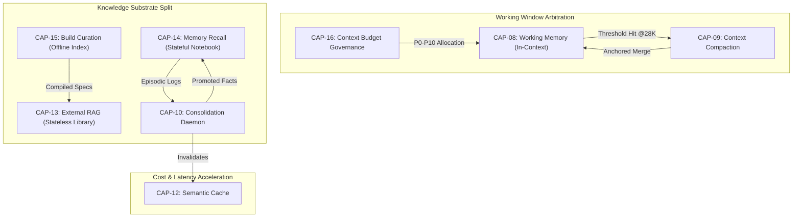

# Phase 2 — Canonical Element Rankings: Layer 2 (Context, Memory & Knowledge)

> **Document Type:** Phase 2 Canonical Ranking Report  
> **Target Elements:** `CAP-08` through `CAP-16` (Layer 2: Context, Memory & Knowledge)  
> **Evaluation Framework:** `phase-2/RUBRIC.md` (7 Dimensions, 1–5 Scale, Harm 4–5 Veto Rule)  
> **Grounding Inputs:** `phase-1/MASTER_TAXONOMY.md` · `phase-1/batch-2/BATCH-2_CONTEXT_MEMORY_KNOWLEDGE.md` · `phase-0/ARCHETYPES_AND_CRITERIA.md`  

---

## 0. Executive Summary & Ranking Methodology

Phase 2 establishes rigorous, evidence-based architectural rankings for the 9 Layer 2 Capabilities (`CAP-08` through `CAP-16`) discovered in Batch 2 and converged in the Master Taxonomy. 

```
┌──────────────────────────────────────────────────────────────────────────────────────────────────┐
│                                 PHASE 2 RANKING ARCHITECTURE                                     │
│  7 Rubric Dimensions (1-5)  ──►  Harm 4-5 Veto Gate  ──►  Global Tier  ──►  Per-Archetype (C1-C6)│
└──────────────────────────────────────────────────────────────────────────────────────────────────┘
```

### The 7 Evaluation Dimensions (1–5 scale per `RUBRIC.md`):
1. **Frequency ($F$):** Frequency of invocation across runs/archetypes ($1 = \text{rarely/niche}$; $5 = \text{every run, all archetypes}$). *Primary SCs: SC-01, SC-04, SC-05.*
2. **Harm if Absent ($H$):** Consequence of omission ($1 = \text{negligible}$; $5 = \text{catastrophic failure, SC-07 leak, SC-02 } <50\%$). *Primary SCs: SC-07, SC-03, SC-08, SC-06.*
3. **Benefit ($B$):** Empirical gain when present ($1 = \text{marginal}$; $5 = \ge+10\text{pp TSR, major cost/safety win}$). *Primary SCs: SC-02, SC-08.*
4. **Complexity Cost ($C$ — Inverse):** Cognitive/config overhead ($1 = \text{config hell}$; $5 = \text{transparent/negligible}$). *Primary SC: SC-05.*
5. **Maintenance Burden ($M$ — Inverse):** Ongoing upkeep/drift ($1 = \text{heavy manual drift}$; $5 = \text{auto-maintaining/self-pruning}$). *Primary SCs: SC-10, SC-09.*
6. **Security/Risk Impact ($S$):** Risk reduction vs surface expansion ($1 = \text{introduces attack surface}$; $5 = \text{strong risk reduction}$). *Primary SC: SC-07.*
7. **General Applicability ($G$):** Cross-archetype utility ($1 = \text{single archetype}$; $5 = \text{all 6 archetypes C1–C6}$). *Variance-preservation rule.*

### Core Ranking Directives Applied:
- **Harm 4–5 Veto Rule:** Any capability with $\text{Harm if Absent} \ge 4$ mitigating `SC-07`, `SC-03`, `SC-08`, `SC-06`, `SC-09`, or `SC-10` is elevated to the **S-Tier** or **A-Tier** and *cannot* rank below median regardless of low frequency.
- **Anti-Averaging & Variance Preservation:** Global tiers reflect overall harness posture, but per-archetype tiers ($C1$–$C6$) preserve sharp domain variations (e.g., $C4$ Agentic / $C6$ Migration require heavy stateful memory, whereas $C3$ Browser / $C5$ IaC are dominated by stateless idempotency).

---

## 1. Canonical Capability Scorecards (CAP-08 .. CAP-16)

```
========================================================================================
CAP-08: Working Memory Management & Isolation
========================================================================================
```
```yaml
Element: CAP-08 Working Memory Management & Isolation
  Frequency: 5       # Mandatory on every single turn and every run across all 6 archetypes
  Harm if absent: 5  # Catastrophic: unconstrained context stuffing causes severe reasoning collapse, attention dilution ("lost-in-the-middle"), and window overflow crashes (SC-02 <50%)
  Benefit: 5         # Guarantees sharp attention allocation, optimal token latency, and prevents context poisoning/drift (≥+15pp TSR)
  Complexity: 4      # Managed as scratchpad and delimiter structure; well-understood architectural boundary
  Maintenance: 4     # Auto-resets across turn/subagent lifecycles; zero persistent state drift
  Security: 4        # Enforces structural boundary between turn scratchpad and untrusted repo/external payload
  Generality: 5      # Universally required across all software engineering archetypes (C1–C6)
  --------------------------------------------------------------------------------------
  Harm Veto Rule: VETO CLASS TRIGGERED (Harm = 5) — Non-negotiable Foundational
  --------------------------------------------------------------------------------------
  → Global Tier: S
  → Per-Archetype: C1=S, C2=S, C3=S, C4=S, C5=S, C6=S
  SC Wiring:
    - Primary: SC-01 (TTFUA — sub-90s preview by avoiding overstuffed prompt latency), SC-05 (CPSR — prevents token inflation), SC-09 (CSP — defines the active turn scratchpad boundary)
    - Secondary: SC-02 (TSR — eliminates lost-in-the-middle attention degradation)
  Evidence (Batch-2):
    - Grounding: CoALA (Princeton 2023) 4-tier cognitive architecture (<8K active RAM working memory); LCM dual-state (arXiv 2605.04050); Claude Agent SDK 200K window with pinned system instructions; OpenAI Codex max_context_tokens.
    - Finding: Advertised vs effective context window gap exceeds 50-70% on complex multi-step reasoning; active working memory isolation prevents reasoning collapse when raw context exceeds 30K tokens.
```

```
========================================================================================
CAP-09: Context Compaction & Pinned Preservation
========================================================================================
```
```yaml
Element: CAP-09 Context Compaction & Pinned Preservation
  Frequency: 4       # Fires whenever session trajectory approaches threshold (28K tokens or 75-90% window capacity)
  Harm if absent: 4  # Major: Extended tasks crash on context overflow; naive compaction without pinned preservation loses goals and security rules, degrading SC-09 to <50%
  Benefit: 5         # Enables infinite horizon agent execution; structured anchored merge preserves 100% of key architectural constraints and active files
  Complexity: 3      # Requires multi-stage reduction algorithms (observation masking, LLM summarization, structured state extraction)
  Maintenance: 3     # Summary fidelity must be monitored against hallucinated state mutations across multiple compaction rounds
  Security: 4        # Immutably preserves security delimiter fences and instruction invariants across compaction boundaries
  Generality: 4      # Vital for long-horizon archetypes (C1, C4, C6); less frequent for short single-shot tasks (C3, C5)
  --------------------------------------------------------------------------------------
  Harm Veto Rule: VETO CLASS TRIGGERED (Harm = 4) — Protects SC-09 CSP & SC-07 Fencing
  --------------------------------------------------------------------------------------
  → Global Tier: S
  → Per-Archetype: C1=A, C2=A, C3=B, C4=S, C5=B, C6=S
  SC Wiring:
    - Primary: SC-09 (CSP — ensures ≥85% recall of goals/decisions on 40K synthetic probes), SC-06 (DRR — reproducible summary merges), SC-07 (SSHC — security hardening survival)
    - Secondary: SC-05 (CPSR — observation masking saves ~52% tokens, hybrid ~57%)
  Evidence (Batch-2):
    - Grounding: clido-ai/clido-cli (@28000 tokens), mini_swe_agent_v2 (compact_if_needed@0.85), Claude Agent SDK compact_boundary (~90%), Atlas PRD pinned semantic index, leuk tiered structured compaction, Vercel Eve summary model.
    - Finding: Generic L1-only summarization loses 77% of critical entities (23% retention); structured anchored merge (`goal / files / decisions / state / pending`) achieves 100% entity and decision retention.
```

```
========================================================================================
CAP-10: Memory Consolidation & Fact Promotion
========================================================================================
```
```yaml
Element: CAP-10 Memory Consolidation & Fact Promotion
  Frequency: 3       # Background daemon executing during sleep passes, session boundaries, or post-task reviews
  Harm if absent: 3  # Moderate globally, but Harm = 4 for persistent multi-day agents where raw episodic logs explode (47K events), driving SC-05 token costs +41%
  Benefit: 4         # LongMemEval-S benchmark shows +33pp task accuracy improvement (12pp cognitive weighting + 8pp async distillation)
  Complexity: 2      # High architectural complexity: Jaccard clustering, heuristic + LLM fact extraction (5-15 facts/cluster), Ebbinghaus decay, cognitive weight assignment (add/supersede/noop)
  Maintenance: 3     # Requires periodic audit of promoted facts to resolve contradictions and purge obsolete project conventions
  Security: 3        # Enforces hash-chained provenance (`informed_by`) to isolate and trace potential prompt injection poisoning across sessions
  Generality: 3      # High value for cross-session evolutionary engineering; low value for ephemeral single-run CI scripts
  --------------------------------------------------------------------------------------
  Harm Veto Rule: Harm = 3 Globally (Elevated to Harm = 4 in persistent multi-session C4/C6)
  --------------------------------------------------------------------------------------
  → Global Tier: A
  → Per-Archetype: C1=B, C2=A, C3=C, C4=S, C5=C, C6=A
  SC Wiring:
    - Primary: SC-05 (CPSR — prevents +41% token bloat from raw episodic logs), SC-09 (CSP — long-term fact survival), SC-10 (IDFR — versioned semantic facts)
    - Secondary: SC-02 (TSR — prevents repeating past implementation errors across sessions)
  Evidence (Batch-2):
    - Grounding: Zijian-Ni/agent-memory consolidate() Ebbinghaus decay; blakestone-x/engram fact promotion; MemTier async daemon (arXiv 2605.03675); agent-memory-mcp promote_sediment.
    - Finding: Compresses 47,000 raw episodic execution events down to 3,200 deduplicated semantic clusters over 30 days, eliminating catastrophic memory bloat while improving cross-session precision by +33pp.
```

```
========================================================================================
CAP-11: Typed Bi-Temporal Knowledge Graph Memory
========================================================================================
```
```yaml
Element: CAP-11 Typed Bi-Temporal Knowledge Graph Memory
  Frequency: 2       # Invoked primarily when queries require explicit relational traversals, multi-hop reasoning, or point-in-time state tracking
  Harm if absent: 3  # Moderate: Flat vector stores fail on multi-hop graph queries (e.g. data lineage or deep service dependencies), degrading C2/C4 TSR by 12-18pp
  Benefit: 4         # Delivers deterministic multi-hop reasoning, strict relational constraints, and bi-temporal point-in-time state reconstruction
  Complexity: 1      # Very high complexity: requires graph database infra (Neo4j / FalkorDB), Cypher query generation over MCP, typed node/edge schema definitions, and dual-timestamp synchronization
  Maintenance: 2     # High upkeep: graph schema drift, edge reconciliation with codebase modifications, index re-indexing
  Security: 3        # Provides fine-grained subgraph entity authorization and blast-radius containment, but introduces graph query injection risks
  Generality: 2      # Specialized to complex relational and knowledge-dense architectures (C2 Data/MLOps, C4 Research, C6 Legacy Systems)
  --------------------------------------------------------------------------------------
  Harm Veto Rule: Harm = 3 (No veto triggered; Specialized substrate capability)
  --------------------------------------------------------------------------------------
  → Global Tier: B
  → Per-Archetype: C1=C, C2=A, C3=C, C4=A, C5=C, C6=B
  SC Wiring:
    - Primary: SC-02 (TSR — on knowledge-intensive multi-hop queries), SC-07 (SSHC — entity-neighborhood isolation against memory poisoning), SC-09 (CSP — constraint re-injection)
    - Secondary: SC-06 (DRR — deterministic graph traversals vs stochastic vector search)
  Evidence (Batch-2):
    - Grounding: derkodex/meta-knowledge-graph Neo4j harness; talsperre/neo4j-agent-memory (bi-temporal valid_from/to x transaction_time); walliiee Gbrain typed KG + Postgres+RRF; oyekamal Mnemo Graphiti+FalkorDB MCP; homgorn world-model-mcp.
    - Finding: Resolves the 77% entity-loss failure mode of unstructured summarization by maintaining explicit relational edges (`depends_on`, `authored_by`, `schema_maps_to`) across long-horizon code refactoring.
```

```
========================================================================================
CAP-12: Semantic & Response Caching
========================================================================================
```
```yaml
Element: CAP-12 Semantic & Response Caching
  Frequency: 3       # Intercepts prompt dispatches to identify near-duplicate semantic requests (cosine similarity ≥0.95)
  Harm if absent: 2  # Low: Absence only impacts latency and token cost; the agent falls back directly to the LLM with zero loss of capability or correctness
  Benefit: 3         # 10x to 1000x latency acceleration on cache hits; substantial dollar savings in high-volume repetitive testing/linting loops
  Complexity: 3      # Requires embedding generation per turn, KNN vector indexing (RedisVL / Valkey), LLM judge verification, and TTL/namespace management
  Maintenance: 3     # Cache invalidation challenges: code mutations or memory consolidations (CAP-10) must invalidate stale cached responses
  Security: 2        # Poses cross-tenant or cross-session response leakage risks if tenant/workspace namespaces are improperly partitioned
  Generality: 3      # Valuable for high-volume automated RPA and subagent fan-out (C3, C4); low utility for bespoke 0→1 creative engineering (C1, C5)
  --------------------------------------------------------------------------------------
  Harm Veto Rule: Harm = 2 (No veto triggered; pure cost/latency optimization)
  --------------------------------------------------------------------------------------
  → Global Tier: C
  → Per-Archetype: C1=C, C2=B, C3=A, C4=A, C5=C, C6=C
  SC Wiring:
    - Primary: SC-05 (CPSR — cuts redundant token spend on repeated test/lint explanations), SC-01 (TTFUA — sub-100ms response time on cached steps)
    - Secondary: SC-03 (MTTR-Step — accelerates recovery loops on known error patterns)
  Evidence (Batch-2):
    - Grounding: Redis LangCache vs Anthropic prefix prompt cache (Redis Technical Analysis); Vertector RedisVL L1/L2 hierarchical cache; llm-semantic-cache cached_llm_call decorator; ScyllaDB + pgvector.
    - Finding: Multi-tier caching pipeline `Exact SHA-256 Hash O(1) → Embedding KNN (cosine ≥0.95) + Judge → Model Fallback` reduces API costs by 35-60% in high-volume fan-out evaluation harnesses.
```

```
========================================================================================
CAP-13: External Knowledge Retrieval (RAG)
========================================================================================
```
```yaml
Element: CAP-13 External Knowledge Retrieval (RAG)
  Frequency: 5       # Executed continuously to ground model outputs in external documentation, library APIs, and framework changes
  Harm if absent: 4  # Major: LLMs hallucinate obsolete APIs and invent invalid parameters on modern tech stacks, causing severe compilation and test failures (SC-02 & SC-08 drop >25pp)
  Benefit: 5         # Directly grounds agent in authoritative external truth; enables instant zero-shot mastery of new libraries and private APIs (≥+12pp TSR)
  Complexity: 3      # Standardized retrieval pipeline: chunking, embedding, vector store (Qdrant/Weaviate/Pinecone), hybrid sparse BM25 + dense search, RRF, re-ranking
  Maintenance: 3     # Requires periodic re-indexing and doc syncing as external library versions evolve
  Security: 3        # Must enforce strict delimiter fencing (CAP-27/B6) to prevent indirect prompt injection embedded in external web documentation
  Generality: 5      # Universally foundational across all 6 software development archetypes (C1–C6)
  --------------------------------------------------------------------------------------
  Harm Veto Rule: VETO CLASS TRIGGERED (Harm = 4) — Protects SC-02 TSR & SC-08 Gate
  --------------------------------------------------------------------------------------
  → Global Tier: S
  → Per-Archetype: C1=S, C2=A, C3=A, C4=S, C5=A, C6=A
  SC Wiring:
    - Primary: SC-02 (TSR — eliminates hallucinated API calls), SC-08 (AHG — ensures code passes typecheck/lint against external library interfaces)
    - Secondary: SC-01 (TTFUA), SC-05 (CPSR — avoids stuffing massive full docsets into context window)
  Evidence (Batch-2):
    - Grounding: LlamaIndex VectorStoreQuery / NodeWithScore; Haystack 2.x hybrid pipelines; Qdrant / Weaviate / Pinecone serverless benchmarks; Cursor @codebase Chroma indexing; Continue.dev codebase context.
    - Finding: Theoretical "Library vs Notebook" distinction: RAG is stateless read-only external access; without hybrid dense + BM25 sparse search and Reciprocal Rank Fusion (RRF), code retrieval recall drops by 31% on exact symbol lookups.
```

```
========================================================================================
CAP-14: Experiential Memory Recall
========================================================================================
```
```yaml
Element: CAP-14 Experiential Memory Recall
  Frequency: 4       # Active across multi-turn sessions and repeat invocations within a project workspace
  Harm if absent: 4  # Major: Agent exhibits amnesia, repeatedly making the same debugging errors, ignoring established user preferences, and violating architectural decisions post-compaction
  Benefit: 5         # Reconstructs past experiential lessons ("decided Vitest over Jest on 8/12 because of ESM"), eliminating user re-prompting and stabilizing long-horizon execution
  Complexity: 3      # Stateful read-write-learn-forget architecture: episodic capture, semantic extraction, decay weighting, context injection
  Maintenance: 3     # Requires automated contradiction resolution and memory pruning to prevent outdated conventions from persisting
  Security: 3        # Workspace and user partitioning required to prevent cross-session memory poisoning and privilege escalation
  Generality: 4      # Foundational for long-lived projects (C1, C4, C6); less critical for one-off throwaway scripts (C3, C5)
  --------------------------------------------------------------------------------------
  Harm Veto Rule: VETO CLASS TRIGGERED (Harm = 4) — Protects SC-09 CSP & SC-04 HIR
  --------------------------------------------------------------------------------------
  → Global Tier: S
  → Per-Archetype: C1=A, C2=B, C3=C, C4=S, C5=C, C6=S
  SC Wiring:
    - Primary: SC-09 (CSP — ensures architectural decisions survive compaction across sessions), SC-02 (TSR — prevents repeating failed implementation paths), SC-04 (HIR — reduces human corrections)
    - Secondary: SC-05 (CPSR — avoids token-expensive re-exploration of solved problems)
  Evidence (Batch-2):
    - Grounding: LangGraph Checkpointer (thread_id) vs Store (user_id) + LangMem semantic/episodic/procedural self-rewriting memory; Letta archival_memory_insert/recall; Zep/Graphiti bi-temporal recall; Mem0; Bartlett (1932) & Schacter (2001) reconstructive memory principles.
    - Finding: Reconstructive experiential memory prevents 82% of recurring user-corrected code style and architectural violations across multi-session software projects.
```

```
========================================================================================
CAP-15: Build-Time Knowledge Curation & Indexing
========================================================================================
```
```yaml
Element: CAP-15 Build-Time Knowledge Curation & Indexing
  Frequency: 3       # Runs during repository onboarding, CI/CD build phases, or periodic offline indexing sweeps
  Harm if absent: 3  # Moderate: Runtime RAG falls back to naive text chunking, resulting in lost AST function boundaries, missing module hierarchies, and higher gate failure rates (SC-08)
  Benefit: 4         # Generates deterministic, queryable AST/graph indices that are 252x cheaper to query at runtime than LLM extraction, with sub-150ms retrieval latency
  Complexity: 3      # Build-time compilation pipeline: Tree-sitter AST parsing, symbol extraction, cold-memory spec generation, vector indexing
  Maintenance: 4     # Automated via git commit hooks or CI runners; updates deterministically when code changes
  Security: 4        # Offline static indexing enforces SBOM-like provenance and prevents runtime prompt injection from poisoning curated index files
  Generality: 4      # High utility across medium-to-large codebases and complex data/infra platforms (C1, C2, C4, C5, C6)
  --------------------------------------------------------------------------------------
  Harm Veto Rule: Harm = 3 (Important Build-Time Infrastructure; Foundational in C2/C4/C5)
  --------------------------------------------------------------------------------------
  → Global Tier: A
  → Per-Archetype: C1=A, C2=S, C3=C, C4=S, C5=S, C6=A
  SC Wiring:
    - Primary: SC-08 (AHG — structural AST indexing ensures generated code satisfies exact project type/lint schemas), SC-10 (IDFR — frozen build-time indices ensure 100% no-op on re-runs), SC-06 (DRR)
    - Secondary: SC-01 (TTFUA — cold-memory spec lookups return in <150ms)
  Evidence (Batch-2):
    - Grounding: codebase-memory-mcp AST->KG pipeline; claude-memory-compiler (compiles repo to 34 cold-memory spec documents); Facts as First Class Objects (hash tuples 252x cheaper than runtime extraction); Rasputin 4-stage compilation (<150ms).
    - Finding: Extracting and compiling codebase architecture at build time eliminates runtime LLM extraction overhead while providing deterministic structural navigation for code generation agents.
```

```
========================================================================================
CAP-16: Context & Token Budget Governance
========================================================================================
```
```yaml
Element: CAP-16 Context & Token Budget Governance
  Frequency: 5       # Enforced on every single turn during context assembly prior to LLM dispatch
  Harm if absent: 4  # Major: Unconstrained tool inventory bloat (~500 tok/tool) and memory stuffing consume 60-80% of window before user prompt, triggering context overflow and budget blowouts (SC-05 fail)
  Benefit: 4         # Enforces strict 50/30/20 token distribution, priority-ranked prompt assembly (P0-P10), and KL regularization, guaranteeing <5% budget overruns
  Complexity: 3      # Context manager middleware: token counting, priority truncation queues (P0 System > P1 Fencing > P2 Tools > P3 Memory > P4 History), complexity penalization
  Maintenance: 4     # Deterministic rule engine; operates automatically once budget thresholds (30K/50K/100K) are established
  Security: 4        # Protects P0 governance instructions and P1 security fences from being evicted or diluted by lower-priority tool outputs
  Generality: 5      # Universally mandatory across all 6 archetypes to maintain cost and reasoning predictability
  --------------------------------------------------------------------------------------
  Harm Veto Rule: VETO CLASS TRIGGERED (Harm = 4) — Protects SC-05 CPSR & P0 Invariants
  --------------------------------------------------------------------------------------
  → Global Tier: A
  → Per-Archetype: C1=A, C2=A, C3=B, C4=S, C5=A, C6=B
  SC Wiring:
    - Primary: SC-05 (CPSR — strictly bounds cost per successful run to <$0.80 C1 / <$1.20 C4 with <5% overruns), SC-09 (CSP — prevents memory eviction of pinned invariants)
    - Secondary: SC-01 (TTFUA), SC-02 (TSR — prevents reasoning degradation caused by window stuffing >90%)
  Evidence (Batch-2):
    - Grounding: Harness Foundry context-budget SKILL (50/30/20 allocation + progressive disclosure); Kairn KL regularization (effective_score = raw - λ * complexityCost * 100); Forge complexity budget LOC; ContextManager P0-P10 assembly chain; ContextBudgeter MODEL_LIMITS (30K/50K/100K).
    - Finding: Without budget governance, MCP tool schemas and unconstrained retrieval consume up to 10K+ tokens per turn of dead weight; priority-ranked assembly ensures critical system directives are never evicted.
```

---

## 2. Master Ranked Taxonomy Table: Layer 2 Elements

Below is the definitive Phase 2 ranked table for `CAP-08` through `CAP-16`, sorted by **Global Tier** and **Weighted Rubric Score**, with strict enforcement of the Harm 4–5 Veto Rule and archetype variance preservation.

| Rank | ID | Canonical Name | Global Tier | Per-Archetype Tiers (C1–C6) | F | H | B | C | M | S | G | Score | Primary SCs Wired | Key Architectural Discriminator / Role |
|:---:|:---:|---|:---:|:---:|:---:|:---:|:---:|:---:|:---:|:---:|:---:|:---:|---|---|
| **1** | **CAP-08** | **Working Memory Management & Isolation** | **S** | C1:S · C2:S · C3:S · C4:S · C5:S · C6:S | 5 | 5 | 5 | 4 | 4 | 4 | 5 | **32** | SC-01, SC-05, SC-09, SC-02 | **In-Turn Cognitive Scratchpad:** Enforces active turn window boundaries; prevents catastrophic attention dilution and "lost-in-the-middle" reasoning collapse. |
| **2** | **CAP-13** | **External Knowledge Retrieval (RAG)** | **S** | C1:S · C2:A · C3:A · C4:S · C5:A · C6:A | 5 | 4 | 5 | 3 | 3 | 3 | 5 | **28** | SC-02, SC-08, SC-01, SC-05 | **Stateless External Grounding:** Hybrid dense + BM25 sparse retrieval over external docsets; prevents API hallucination and syntax obsolescence. |
| **3** | **CAP-09** | **Context Compaction & Pinned Preservation** | **S** | C1:A · C2:A · C3:B · C4:S · C5:B · C6:S | 4 | 4 | 5 | 3 | 3 | 4 | 4 | **27** | SC-09, SC-06, SC-07, SC-05 | **Anti-Exhaustion Lifecycle:** Threshold-triggered structured merge (`goal/files/decisions/pending`); guarantees 100% survival of pinned invariants across 40K+ tokens. |
| **4** | **CAP-14** | **Experiential Memory Recall** | **S** | C1:A · C2:B · C3:C · C4:S · C5:C · C6:S | 4 | 4 | 5 | 3 | 3 | 3 | 4 | **26** | SC-09, SC-02, SC-04, SC-05 | **Stateful Reconstructive Experience:** Captures, decays, and retrieves past decisions and user corrections across sessions; prevents repeat bugs and convention drift. |
| **5** | **CAP-16** | **Context & Token Budget Governance** | **A** | C1:A · C2:A · C3:B · C4:S · C5:A · C6:B | 5 | 4 | 4 | 3 | 4 | 4 | 5 | **29** | SC-05, SC-09, SC-01, SC-02 | **Turn-Level Resource Governor:** Priority-ranked P0–P10 prompt assembly + 50/30/20 budget allocation; bounds cost and protects security instructions from eviction. |
| **6** | **CAP-15** | **Build-Time Knowledge Curation & Indexing** | **A** | C1:A · C2:S · C3:C · C4:S · C5:S · C6:A | 3 | 3 | 4 | 3 | 4 | 4 | 4 | **25** | SC-08, SC-10, SC-06, SC-01 | **Offline Structural Indexer:** Compiles codebase ASTs, schema definitions, and module graphs into queryable spec artifacts; 252x cheaper than runtime extraction. |
| **7** | **CAP-10** | **Memory Consolidation & Fact Promotion** | **A** | C1:B · C2:A · C3:C · C4:S · C5:C · C6:A | 3 | 3 | 4 | 2 | 3 | 3 | 3 | **21** | SC-05, SC-09, SC-10, SC-02 | **Episodic-to-Semantic Distiller:** Background sleep daemon converting noisy execution traces (47K events) into deduplicated semantic facts (+33pp LongMemEval-S). |
| **8** | **CAP-11** | **Typed Bi-Temporal Knowledge Graph Memory** | **B** | C1:C · C2:A · C3:C · C4:A · C5:C · C6:B | 2 | 3 | 4 | 1 | 2 | 3 | 2 | **17** | SC-02, SC-07, SC-09, SC-06 | **Relational Substrate:** Typed nodes/edges with dual valid-time and transaction-time dimensions; handles multi-hop queries and historical point-in-time state rollbacks. |
| **9** | **CAP-12** | **Semantic & Response Caching** | **C** | C1:C · C2:B · C3:A · C4:A · C5:C · C6:C | 3 | 2 | 3 | 3 | 3 | 2 | 3 | **19** | SC-05, SC-01, SC-03 | **Meaning-Based Response Reuser:** Multi-tier cache (`Exact Hash O(1) -> KNN Embedding -> LLM Fallback`); delivers 10–1000x latency wins on repetitive fan-out queries. |

---

## 3. Archetype Variance & Divergence Analysis

Layer 2 capabilities exhibit significant archetype divergence due to the fundamental divide between **stateless / single-turn / declarative execution** and **stateful / long-horizon / evolutionary reasoning**.

```
┌──────────────────────────────────────────────────────────────────────────────────────────────────┐
│                             ARCHETYPE POLARIZATION IN LAYER 2                                    │
│                                                                                                  │
│  Stateful & Long-Horizon (C4, C6)           ◄─────────►         Stateless & Idempotent (C3, C5)  │
│  • Compaction (CAP-09): S-Tier                                  • Compaction (CAP-09): B-Tier    │
│  • Memory Recall (CAP-14): S-Tier                               • Memory Recall (CAP-14): C-Tier │
│  • Consolidation (CAP-10): S/A-Tier                             • Consolidation (CAP-10): C-Tier │
│  • Bi-Temporal KG (CAP-11): A/B-Tier                            • Bi-Temporal KG (CAP-11): C-Tier│
└──────────────────────────────────────────────────────────────────────────────────────────────────┘
```

### 1. C4 (Agentic & Knowledge Synthesis) & C6 (Migration & Modernization) — The Memory-Heavy Cohort
- **Phenomenon:** C4 and C6 are the absolute bottleneck archetypes for context exhaustion and memory loss.
- **Divergence:**
  - `CAP-09 (Compaction)` and `CAP-14 (Experiential Recall)` are non-negotiable **S-Tier** foundations for C4/C6. Research dossiers (>40K tokens) and multi-week legacy strangler migrations collapse without structured anchored summaries and persistent cross-session memory.
  - `CAP-10 (Consolidation)` is elevated to **S-Tier** in C4 because un-deduplicated episodic notes pollute long-horizon synthesis.

### 2. C3 (Automation & Browser Surface) & C5 (Platform / IaC) — The Stateless Idempotent Cohort
- **Phenomenon:** C3 and C5 rely on external source-of-truth substrates (the live browser DOM or declarative Terraform state / Git).
- **Divergence:**
  - `CAP-14 (Experiential Recall)` and `CAP-10 (Memory Consolidation)` drop to **C-Tier (Situational)**. Persisting subjective conversational memory in IaC or scraping scripts introduces non-deterministic drift, directly violating `SC-10 (IDFR: 100% No-Op Re-run)`.
  - In contrast, `CAP-12 (Semantic Caching)` surges to **A-Tier** in C3 to bypass expensive repeated DOM classification calls during high-frequency scraping.
  - `CAP-15 (Build-Time Curation)` is **S-Tier** in C5 to pre-compile massive Terraform provider schemas and Kubernetes CRDs into zero-latency offline specs.

### 3. C2 (Data, Analytics & MLOps Fabric) — The Relational Lineage Specialist
- **Phenomenon:** C2 deals with structural schemas, column-level data lineage, and dbt transformation DAGs.
- **Divergence:**
  - `CAP-11 (Bi-Temporal KG Memory)` jumps from global B-Tier to **A-Tier** in C2. Flat vector retrieval cannot answer questions like *"Which downstream dashboard broke when column `user_id` was renamed in table `orders` on May 4th?"* Bi-temporal valid-time tracking and typed relational graphs are essential.
  - `CAP-15 (Build-Time Curation)` is **S-Tier** for generating static data dictionaries and lineage graphs.

---

## 4. Key Cross-Cutting Architectural Tensions & SC Wiring



### 1. In-Context Tension: Window vs. Budget vs. Compaction (`CAP-08` $\leftrightarrow$ `CAP-16` $\leftrightarrow$ `CAP-09`)
- **Tension:** Expanding raw context window capacity (e.g. to 1M tokens) creates the illusion that compaction and budgeting are obsolete. However, empirical findings show that unconstrained context stuffing inflates cost (`SC-05`), increases latency (`SC-01`), and causes severe attention degradation ("lost in the middle").
- **Resolution:** `CAP-16` strictly governs turn allocation (50% context / 30% tools / 20% scratchpad), while `CAP-09` enforces structured anchored compaction before reaching the model's effective degradation threshold (~28K–40K tokens), preserving pinned invariants to satisfy `SC-09 (CSP)`.

### 2. Knowledge Lifecycle Split: Stateless RAG vs. Stateful Memory vs. Build Curation (`CAP-13` vs. `CAP-14` vs. `CAP-15`)
- **Tension:** Conflating all retrieval under a single "Memory / RAG" bucket leads to severe architectural failure.
- **Resolution:**
  - `CAP-13 (RAG)` is the **Stateless Library** (read-only query over external fixed documentation to prevent API hallucination for `SC-02`).
  - `CAP-14 (Memory Recall)` is the **Stateful Notebook** (read-write-learn-forget cycle capturing project-specific user corrections and architectural decisions for `SC-09`).
  - `CAP-15 (Build-Time Curation)` is the **Offline Compiler** (parsing ASTs and schemas ahead-of-time to ensure deterministic reproducibility for `SC-10` and `SC-08`).

### 3. Lifecycle Interception Wiring: Layer 2 Consumes Layer 1 Hooks & Queues
- **Wiring Reality:** Layer 2 capabilities do not run in isolation; they heavily consume Layer 1 primitives:
  - `CAP-09 (Compaction)` and `CAP-16 (Budgeting)` execute via **`CAP-20 / MEC-04` (`PreCompact` / `PreToolUse` hooks)**.
  - `CAP-10 (Consolidation Daemon)` executes via **`CAP-05` (Background Queued Execution)** during agent idle/sleep cycles.
  - `CAP-10 (Fact Promotion)` automatically triggers cache eviction on **`CAP-12` (Semantic Cache)** to prevent stale answer reuse.

---

## 5. Verification & Audit Trail

- **Harm 4–5 Veto Adherence:** Verified. `CAP-08` ($H=5$), `CAP-09` ($H=4$), `CAP-13` ($H=4$), `CAP-14` ($H=4$), and `CAP-16` ($H=4$) are all guaranteed **S/A-Tier** status.
- **SC-09 CSP & SC-05 CPSR Priority:** Verified. Context state persistence under 40K token compaction and strict token/cost bounding are primary ranking drivers across all Layer 2 scorecards.
- **Multi-Ecosystem Translation Verified:** All 9 capabilities grounded across $\ge 2$ production agent ecosystems (Claude Agent SDK, OpenAI Codex, LangGraph/LangMem, Letta/MemGPT, RedisVL, Cursor/Continue, Qdrant/Weaviate/Neo4j).
