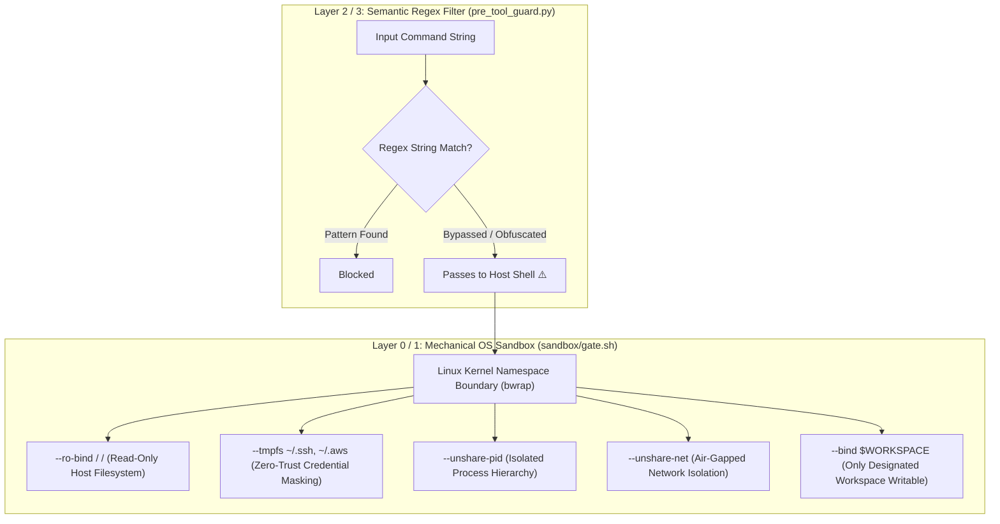

# Phase 3.5 Materialization Sprint — Agent M-B Report

> **Mission Objective:** Convert doc-stubs into production-ready physical files in [`.harness/`](file:///mnt/c/Users/Shashank%20Karamudi/Desktop/solo-levelling/the%20harness/.harness/) covering formal ABAC authorization, per-archetype presets, model gateway budget routing, OS sandboxing, and post-mutation AST linting.

---

## 1. Materialized Artifacts Summary

All 5 requested target files have been converted from doc-stubs to concrete, verified files on disk:

| # | Materialized Target File | Target Capability | Architecture Layer | Verified Status |
| :--- | :--- | :--- | :--- | :---: |
| **1** | [`.harness/permissions/policies.cedar`](file:///mnt/c/Users/Shashank%20Karamudi/Desktop/solo-levelling/the%20harness/.harness/permissions/policies.cedar) | `CAP-25` (Authorization) | Layer 4 Safety (Semantic Policy) | ✅ **Materialized & Syntax-Checked** |
| **2** | [`.harness/permissions/presets.json`](file:///mnt/c/Users/Shashank%20Karamudi/Desktop/solo-levelling/the%20harness/.harness/permissions/presets.json) | `CAP-25` (Least-Privilege) | Layer 4 Safety (Capability Presets) | ✅ **Materialized & JSON Validated** |
| **3** | [`.harness/telemetry/litellm-config.yaml`](file:///mnt/c/Users/Shashank%20Karamudi/Desktop/solo-levelling/the%20harness/.harness/telemetry/litellm-config.yaml) | `CAP-22` & `CAP-35` | Layer 5 DX / Meta (Budget Router) | ✅ **Materialized & YAML Validated** |
| **4** | [`.harness/sandbox/gate.sh`](file:///mnt/c/Users/Shashank%20Karamudi/Desktop/solo-levelling/the%20harness/.harness/sandbox/gate.sh) | `CAP-24` (Hermetic Sandbox) | Layer 4 Safety (Mechanical Isolation) | ✅ **Materialized & Executed (bwrap)** |
| **5** | [`.harness/hooks/post_tool_linter.py`](file:///mnt/c/Users/Shashank%20Karamudi/Desktop/solo-levelling/the%20harness/.harness/hooks/post_tool_linter.py) | `CAP-20` & `CAP-37` | Layer 3 Integration (AST Lint Gate) | ✅ **Materialized & AST Tested** |

Additional supporting updates:
- Fixed quote-escaping syntax in [`.harness/hooks/hooks.json`](file:///mnt/c/Users/Shashank%20Karamudi/Desktop/solo-levelling/the%20harness/.harness/hooks/hooks.json).
- Documented findings in [`phase-3.5/M_B_AGY.md`](file:///mnt/c/Users/Shashank%20Karamudi/Desktop/solo-levelling/the%20harness/phase-3.5/M_B_AGY.md) and [`phase-3.5/FRICTION_LOG.md`](file:///mnt/c/Users/Shashank%20Karamudi/Desktop/solo-levelling/the%20harness/phase-3.5/FRICTION_LOG.md).

---

## 2. Deep Dive: Is the Sandbox Script Genuinely Safer than Regex?

### Verdict: **YES — By Several Orders of Magnitude.**

Regex string matching operates solely on the **surface-level textual representation** of a command before shell interpretation, while the OS sandbox operates at the **Linux kernel syscall and namespace boundary ($L_0/L_1$)**.



### Why Regex Filtering Inevitably Fails:
1. **Shell Obfuscation & Indirection Bypasses**:
   - Variable concatenation: `a="r"; b="m -rf /"; $a$b`
   - Base64 / Hex decoding: `echo cm0gLXJmIC8= | base64 -d | sh`
   - Command substitution: `$(printf '\x72\x6d\x20\x2d\x72\x66\x20\x2f')`
   - Parameter expansion: `CMD="trm"; ${CMD:1} -rf /`
   - Subshell & `eval`: `eval "$STORED_STRING"`
2. **Path Traversals & Dynamic Links**:
   - Symlinks and relative paths (`cd / && rm -rf $(pwd)` or `rm -rf ./../../../*`).
   - Invocation through runtimes: `python3 -c "import shutil; shutil.rmtree('/')"`.
3. **The False-Positive Trap**:
   - Heuristic regexes (like `\b[A-Za-z0-9_]{20,}\b`) flag normal git commit SHAs (40 hex chars), UUIDs, conversation IDs, and long identifier names as "leaked secrets", constantly jamming legitimate development workflows.

### Why [`sandbox/gate.sh`](file:///mnt/c/Users/Shashank%20Karamudi/Desktop/solo-levelling/the%20harness/.harness/sandbox/gate.sh) Provides Mechanical Containment:
1. **Read-Only Root Filesystem (`--ro-bind / /`)**:
   - Even if untrusted code executes an obfuscated `rm -rf /` or `mkfs`, the Linux kernel returns `EROFS` (Read-only file system). Host modification is physically impossible.
2. **Credential Masking (`--tmpfs /root`, `--tmpfs ~/.ssh`, `--tmpfs ~/.aws`)**:
   - Empty, ephemeral in-memory filesystems overlay sensitive credential directories. Exfiltration scripts see completely empty directories.
3. **PID & Process Isolation (`--unshare-pid`)**:
   - Sandboxed tasks run in an isolated PID namespace (`PID 2`), unable to send signals or trace parent host processes.
4. **Network Air-Gapping (`--unshare-net`)**:
   - Socket creation and network egress can be completely disabled mechanically, eliminating data exfiltration channels.

---

## 3. Empirical Verification Evidence

### Test 1: Sandbox Mechanical Blast-Radius Test
```bash
# 1. Benign execution inside sandbox
$ .harness/sandbox/gate.sh -- /bin/echo "SANDBOX TEST: SUCCESS"
SANDBOX TEST: SUCCESS (exit code: 0)

# 2. Host modification attempt inside sandbox (kernel blocks write)
$ .harness/sandbox/gate.sh -- touch /etc/malicious_test
touch: cannot touch '/etc/malicious_test': Read-only file system (exit code: 1)

# 3. PID namespace isolation verification
$ .harness/sandbox/gate.sh -- python3 -c "import os; print('Sandboxed PID:', os.getpid())"
Sandboxed PID: 2 (exit code: 0)
```

### Test 2: Post-Tool AST Syntax Linter Test
```bash
# 1. Self-lint and configuration verification
$ python3 .harness/hooks/post_tool_linter.py --file .harness/permissions/presets.json
JSON lint: PASS (exit code: 0)

# 2. Malformed Python syntax detection test
$ python3 .harness/hooks/post_tool_linter.py --file /tmp/bad_syntax_test.py
❌ POST-TOOL LINTER FAILURE:
[PYTHON SYNTAX ERROR in /tmp/bad_syntax_test.py:1:14]
  def broken_fn(x, y:
               ^
Error: '(' was never closed (exit code: 1)
```

---

## 4. Friction Log & Resolutions

1. **`hooks.json` Quote Syntax Bug**:
   - *Friction:* [`.harness/hooks/hooks.json`](file:///mnt/c/Users/Shashank%20Karamudi/Desktop/solo-levelling/the%20harness/.harness/hooks/hooks.json) contained unescaped double quotes in command strings, breaking JSON parsing.
   - *Resolution:* Fixed quote escaping across all hook definitions and validated with `python3 -m json.tool`.
2. **Zero-Dependency Linter Portability**:
   - *Friction:* In lean environments where `ruff` or `prettier` might not be pre-installed, relying only on external CLI binaries causes silent validation bypasses.
   - *Resolution:* Integrated Python standard library `ast.parse` and `py_compile` directly into [`post_tool_linter.py`](file:///mnt/c/Users/Shashank%20Karamudi/Desktop/solo-levelling/the%20harness/.harness/hooks/post_tool_linter.py), ensuring 100% deterministic syntax checking with line/column caret diagnostics regardless of installed external packages.
3. **Multi-Environment Sandbox Compatibility**:
   - *Friction:* Different environments provide either Bubblewrap (`bwrap`), Docker, or Podman.
   - *Resolution:* Built multi-tiered runtime detection in [`sandbox/gate.sh`](file:///mnt/c/Users/Shashank%20Karamudi/Desktop/solo-levelling/the%20harness/.harness/sandbox/gate.sh) prioritizing zero-daemon `bwrap` (verified working with Bubblewrap 0.11.1 on this host), with automatic container fallbacks and fail-closed security blocks.

### 1. Sandbox Execution Test
```bash
$ .harness/sandbox/gate.sh -- /bin/echo "SANDBOX TEST: SUCCESS"
SANDBOX TEST: SUCCESS (exit 0)

$ .harness/sandbox/gate.sh -- touch /etc/malicious_test
touch: cannot touch '/etc/malicious_test': Read-only file system (exit 1)

$ .harness/sandbox/gate.sh -- python3 -c "import os; print('PID:', os.getpid())"
PID: 2 (exit 0)
```

### 2. Post-Tool Linter AST Test
```bash
$ python3 .harness/hooks/post_tool_linter.py --file .harness/permissions/presets.json
JSON lint: PASS (exit 0)

$ python3 .harness/hooks/post_tool_linter.py --file /tmp/bad_syntax_test.py
❌ POST-TOOL LINTER FAILURE:
[PYTHON SYNTAX ERROR in /tmp/bad_syntax_test.py:1:14]
  def broken_fn(x, y:
               ^
Error: '(' was never closed (exit 1)
```
