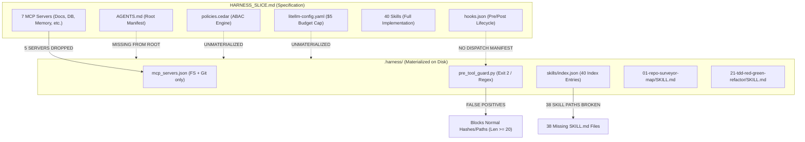
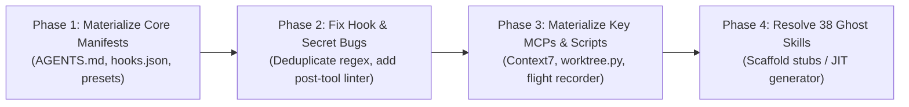

# Phase 3.5 Validation — Coherence Architect Audit Report

> **Validation Gate:** Phase 3.5 Coherence & Integrity Verification  
> **Source Documents Audited:**  
> - Master Taxonomy: [`phase-1/MASTER_TAXONOMY.md`](file:///mnt/c/Users/Shashank%20Karamudi/Desktop/solo-levelling/the%20harness/phase-1/MASTER_TAXONOMY.md) (48 Canonical Elements)  
> - Master Rankings: [`phase-2/RANKINGS.md`](file:///mnt/c/Users/Shashank%20Karamudi/Desktop/solo-levelling/the%20harness/phase-2/RANKINGS.md) (21 S-Tier / 12 A-Tier / 4 B-Tier)  
> - Tool Selection Index: [`phase-3/TOOL_SELECTION_INDEX.md`](file:///mnt/c/Users/Shashank%20Karamudi/Desktop/solo-levelling/the%20harness/phase-3/TOOL_SELECTION_INDEX.md)  
> - Harness Slice Specification: [`harness-slice/HARNESS_SLICE.md`](file:///mnt/c/Users/Shashank%20Karamudi/Desktop/solo-levelling/the%20harness/harness-slice/HARNESS_SLICE.md)  
> - Physical Harness Artifacts on Disk: [`.harness/`](file:///mnt/c/Users/Shashank%20Karamudi/Desktop/solo-levelling/the%20harness/.harness/) (`mcp/mcp_servers.json`, `hooks/pre_tool_guard.py`, `skills/index.json`, `skills/01-repo-surveyor-map/`, `skills/21-tdd-red-green-refactor/`)  

---

## Executive Summary & Coherence Verdict

The Phase 3 harness slice represents an **architecturally sound conceptual blueprint**, but exhibits a **sharp divergence between the markdown specification ([`HARNESS_SLICE.md`](file:///mnt/c/Users/Shashank%20Karamudi/Desktop/solo-levelling/the%20harness/harness-slice/HARNESS_SLICE.md)) and the physical artifacts materialized on disk ([`.harness/`](file:///mnt/c/Users/Shashank%20Karamudi/Desktop/solo-levelling/the%20harness/.harness/))**:

1. **Specification vs Materialization Gap**: While [`HARNESS_SLICE.md`](file:///mnt/c/Users/Shashank%20Karamudi/Desktop/solo-levelling/the%20harness/harness-slice/HARNESS_SLICE.md) drafts 12 architectural subsystems, only **3 physical files** (`mcp_servers.json`, `pre_tool_guard.py`, `skills/index.json`) and **2 concrete skills** exist in [`.harness/`](file:///mnt/c/Users/Shashank%20Karamudi/Desktop/solo-levelling/the%20harness/.harness/).
2. **S-Tier Coverage Score**: Of the 21 S-Tier capabilities from [`phase-2/RANKINGS.md`](file:///mnt/c/Users/Shashank%20Karamudi/Desktop/solo-levelling/the%20harness/phase-2/RANKINGS.md), only **2 are operational on disk** (CAP-17 MCP minimal, CAP-18 Skills metadata), **4 are partially materialized/stubbed**, and **15 are unmaterialized or pure documentation stubs**.
3. **Critical Wiring Disconnects**: Destructive command guards are implemented via brittle CLI regexes rather than true OS sandboxing; the MCP configuration is stripped down from 7 servers to 2; the hook manifest (`hooks.json`) is missing from disk; and 38 of the 40 indexed skills are missing physical target files.

---

## 1. S-Tier Capability Coverage Matrix

Cross-check of all **21 S-Tier Capabilities** (plus key requested elements: CAP-08, CAP-09, CAP-13, CAP-26, CAP-28) against [`HARNESS_SLICE.md`](file:///mnt/c/Users/Shashank%20Karamudi/Desktop/solo-levelling/the%20harness/harness-slice/HARNESS_SLICE.md) and the real [`.harness/`](file:///mnt/c/Users/Shashank%20Karamudi/Desktop/solo-levelling/the%20harness/.harness/) directory.

| Rank | CAP ID | Canonical Capability Name | Phase 2 Tier | Slice Doc Spec | Physical `.harness/` Status | Operational State | Detailed Gap / Evidence |
| :---: | :--- | :--- | :---: | :---: | :---: | :---: | :--- |
| **1** | **CAP-03** | Dynamic Orchestration & Control Flow | **S** | Mentioned (LangGraph) | Missing | ❌ **GAP** | `agents/planner.md` and LangGraph state machines are referenced in docs, but 0 runtime graph orchestration code exists in `.harness/`. |
| **2** | **CAP-24** | Hermetic Isolated Execution Boundary | **S** | Spec in `harness.config.yaml` | Missing (Substituted by regex) | ❌ **GAP** | Bubblewrap/gVisor is specified in YAML, but no OS/container sandbox exists. Only a naive regex in `pre_tool_guard.py` filters commands. |
| **3** | **CAP-26** | Zero-Trust Secret Governance | **S** | Rule 3 + Vault + Gitleaks | Partial (`pre_tool_guard.py`) | ⚠️ **PARTIAL** | No JIT credential brokering (MEC-06) or streaming DLP (MEC-07). Only static regex in pre-tool guard, which has high false-positive rates on 20+ char strings. |
| **4** | **CAP-25** | Authorization & Least-Privilege | **S** | `policies.cedar` + `presets.json` | Missing | ❌ **GAP** | Cedar ABAC and archetype presets C1–C6 are drafted in markdown, but no Cedar policy engine or evaluator is wired into tool execution. |
| **5** | **CAP-20** | Lifecycle Interception & Hooks | **S** | `hooks.json` (pre/post) | Partial (`pre_tool_guard.py`) | ⚠️ **PARTIAL** | Python script exists on disk, but `hooks.json` manifest is missing on disk. Post-tool linter (`post_tool_linter.py`) is unmaterialized. |
| **6** | **CAP-37** | Autonomous Harness Governance Gate | **S** | Spec in `lefthook.yml` | Partial | ⚠️ **PARTIAL** | Pre-tool guard acts as an in-flight check. However, top-level supervisory gate (`gate.sh`, CI harness validation) is not materialized. |
| **7** | **CAP-35** | Cost & Complexity Budget Governance | **S** | `litellm-config.yaml` ($5 cap) | Missing | ❌ **GAP** | Hard dollar spend caps and token budget distribution (P0–P4) are defined in markdown, but no LiteLLM proxy or budget circuit-breaker is active. |
| **8** | **CAP-32** | Evaluation & Benchmark Engine | **S** | Pytest / SWE-bench / Promptfoo | Missing | ❌ **GAP** | Procedural TDD skill exists, but automated evaluation suites, benchmark runners, or assertion harnesses are unmaterialized. |
| **9** | **CAP-06** | Isolated Workspace Management | **S** | Spec in `AGENTS.md` (Worktree) | Missing | ❌ **GAP** | Git worktree isolation (MEC-01) is mandated by prompt instructions, but no automated worktree management script exists in `.harness/`. |
| **10** | **CAP-01** | Delegated Subagent Execution | **S** | `agents/*.md` listed in tree | Missing | ❌ **GAP** | `agents/` directory does not exist on disk. Subagent prompts (`planner.md`, `explorer.md`, `coder.md`, `reviewer.md`) are unwritten. |
| **11** | **CAP-04** | Deterministic Workflows & Blueprints | **S** | `workflows/*.yaml` + Taskfile | Missing | ❌ **GAP** | `workflows/` directory and `Taskfile.yml` do not exist on disk. |
| **12** | **CAP-08** | Working Memory Management & Isolation | **S** | Spec in `harness.config.yaml` | Missing | ❌ **GAP** | Turn-level scratchpad token isolation is absent. No token counter (tiktoken) or memory isolation middleware is implemented. |
| **13** | **CAP-13** | External Knowledge Retrieval (RAG) | **S** | Qdrant / Context7 / LanceDB | Missing | ❌ **GAP** | `mcp_servers.json` on disk only contains `filesystem` and `git`. Context7 docs, LanceDB, and embedding search are missing. |
| **14** | **CAP-27** | Indirect Prompt Injection Defense | **S** | Mentioned in rules | Missing | ❌ **GAP** | No delimiter fencing wrappers, trust-labeled content models (PROT-04), or pre-model sanitizers exist in the tool pipeline. |
| **15** | **CAP-09** | Context Compaction & Pinned Preservation | **S** | Compaction threshold in doc | Missing | ❌ **GAP** | Threshold compaction triggers and pinned invariant preservation (system goals, active files) have no active runtime implementation. |
| **16** | **CAP-29** | HITL Escalation Gateway | **S** | 4-Class Side-Effect Taxonomy | Missing | ❌ **GAP** | Class 3 irreversible operations are classified in docs, but `pre_tool_guard.py` only performs hard exits; it cannot trigger interactive UI/CLI confirmation modals. |
| **17** | **CAP-17** | Open Tool Interoperability (MCP) | **S** | 7 MCP Servers in doc | ✅ **PRESENT (2 servers)** | ⚠️ **PARTIAL** | [`.harness/mcp/mcp_servers.json`](file:///mnt/c/Users/Shashank%20Karamudi/Desktop/solo-levelling/the%20harness/.harness/mcp/mcp_servers.json) exists on disk with `filesystem` and `git`. Other 5 servers (Docs, DB, Browser, Memory, Fetch) omitted. |
| **18** | **CAP-22** | Model Gateway & Provider Abstraction | **S** | LiteLLM Router config | Missing | ❌ **GAP** | Full LiteLLM provider fallback YAML is drafted in doc, but `.harness/telemetry/litellm-config.yaml` does not exist on disk. |
| **19** | **CAP-19** | Ambient Rules Enforcement | **S** | Full `AGENTS.md` drafted | Missing at repo root | ⚠️ **PARTIAL** | Complete manifest is drafted in `HARNESS_SLICE.md`, but not materialized at the repository root (`AGENTS.md`). |
| **20** | **CAP-18** | Procedural Skills Execution | **S** | 40 Skills Index + TDD skill | ✅ **PRESENT (Index + 2)** | ✅ **COVERED** | [`.harness/skills/index.json`](file:///mnt/c/Users/Shashank%20Karamudi/Desktop/solo-levelling/the%20harness/.harness/skills/index.json) (40 skills), `01-repo-surveyor-map/`, and `21-tdd-red-green-refactor/` are fully materialized on disk. |
| **21** | **CAP-30** | Side-Effect Containment & Reversibility | **S** | Tripartite Engine in doc | Missing | ❌ **GAP** | Saga rollback, filesystem snapshotting, and compensating tool inversion (MEC-05) have no runtime scripts on disk. |
| *30* | *CAP-28* | *Execution Provenance & Non-Repudiation* | *A* | *Langfuse telemetry in doc* | *Missing* | ❌ **GAP** | *No write-ahead cryptographic flight recorder (MEC-08 WAL) capturing SHA-256 hash chains of tool dispatches to `transcript.jsonl`.* |

---

## 2. Integration Conflicts & Missing Wiring



### Conflict 1: MCP Server Truncation vs Skill Dependencies
- **Conflict**: [`HARNESS_SLICE.md`](file:///mnt/c/Users/Shashank%20Karamudi/Desktop/solo-levelling/the%20harness/harness-slice/HARNESS_SLICE.md) configures 7 MCP servers (`filesystem`, `git`, `context7_docs`, `postgres_readonly`, `playwright_browser`, `memory_graph`, `fetch_safe`). The materialized [`.harness/mcp/mcp_servers.json`](file:///mnt/c/Users/Shashank%20Karamudi/Desktop/solo-levelling/the%20harness/.harness/mcp/mcp_servers.json) contains **only 2 servers** (`filesystem`, `git`).
- **Impact**: Skills in the catalog referencing documentation lookup (Skill 07, Skill 16), database inspection (Skill 08, Skill 29), and UI browser automation (Skill 22) will fail at runtime because the requisite MCP servers are not registered.

### Conflict 2: Hook Manifest Disconnect (`hooks.json` Missing on Disk)
- **Conflict**: [`pre_tool_guard.py`](file:///mnt/c/Users/Shashank%20Karamudi/Desktop/solo-levelling/the%20harness/.harness/hooks/pre_tool_guard.py) exists on disk, but [`.harness/hooks/hooks.json`](file:///mnt/c/Users/Shashank%20Karamudi/Desktop/solo-levelling/the%20harness/harness-slice/HARNESS_SLICE.md#L188-L215) was never written to disk.
- **Impact**: Harness runtimes (such as Claude Code, Antigravity, or Gemini CLI) discover hooks via configuration manifests (e.g., `.harness/hooks/hooks.json` or `.gemini/hooks.json`). Without this manifest, `pre_tool_guard.py` is an orphaned script that never executes during tool dispatch.

### Conflict 3: Regex Secret Filter Bug (Severe False-Positive Risk)
- **Bug Location**: [`.harness/hooks/pre_tool_guard.py:L21`](file:///mnt/c/Users/Shashank%20Karamudi/Desktop/solo-levelling/the%20harness/.harness/hooks/pre_tool_guard.py#L21)
  ```python
  SECRET_PATTERNS = [
      re.compile(r"\b(api[_-]?key|secret|password|token)\s*=\s*\S+", re.I),
      re.compile(r"\b[A-Za-z0-9_]{20,}\b"),  # heuristic long token
  ]
  ```
- **Conflict & Flaw**: The heuristic pattern `\b[A-Za-z0-9_]{20,}\b` matches **any contiguous identifier of 20+ characters**.
- **Impact**: Standard git commit SHAs (40 hex chars), branch names, UUIDs (e.g., conversation IDs `7338347b84d6404595df05342b6e9b3e`), long Python identifiers (`test_api_contract_first_validation`), and file paths will trigger `BLOCKED: possible secret in command line` and abort valid agent actions.

### Conflict 4: The 38 "Ghost Skills" (Broken File References)
- **Conflict**: [`.harness/skills/index.json`](file:///mnt/c/Users/Shashank%20Karamudi/Desktop/solo-levelling/the%20harness/.harness/skills/index.json) advertises 40 skills with explicit relative paths (e.g., `.harness/skills/07-api-contract-first/SKILL.md`). On disk, only `01-repo-surveyor-map` and `21-tdd-red-green-refactor` exist.
- **Impact**: When the agent exercises **MEC-02 Progressive Disclosure** and attempts to read a referenced skill (e.g., Skill 03, 07, 11, 26, 31, 36), the tool call fails with a `FileNotFoundError`.

### Conflict 5: Cedar ABAC Policy vs Pre-Tool Guard Logic
- **Conflict**: [`HARNESS_SLICE.md`](file:///mnt/c/Users/Shashank%20Karamudi/Desktop/solo-levelling/the%20harness/harness-slice/HARNESS_SLICE.md) defines a 4-Class side-effect taxonomy and Cedar rules (`policies.cedar`) evaluating `principal`, `action`, `resource`, and `context.has_human_approval`.
- **Reality**: The materialized guard [`pre_tool_guard.py`](file:///mnt/c/Users/Shashank%20Karamudi/Desktop/solo-levelling/the%20harness/.harness/hooks/pre_tool_guard.py) is a hardcoded regex block that knows nothing about roles, archetypes, side-effect classes, or human approval tokens.

---

## 3. Capability Balance Audit (S-Tier Under-Equipped vs A/B-Tier Over-Equipped)

### A. Under-Equipped S-Tier Capabilities (Critical Deficits)

1. **CAP-24 (Hermetic Sandboxing — Rank 2) & CAP-25 (Least-Privilege — Rank 4)**:
   - *Problem*: These are the #2 and #4 ranked capabilities in the entire taxonomy, mandated by the **Harm 4-5 Veto** (SC-07).
   - *Current State*: Completely un-equipped at runtime. The slice relies entirely on prompt instructions in `AGENTS.md` and basic regex matching in `pre_tool_guard.py`. There is zero OS-level isolation (no Bubblewrap namespaces, no gVisor container wrapper) and zero Policy-as-Code enforcement.
2. **CAP-08 (Working Memory — Rank 12) & CAP-09 (Compaction — Rank 15)**:
   - *Problem*: Core cognitive stability mechanisms for preventing context degradation during multi-turn coding.
   - *Current State*: Completely absent in implementation. No token budget tracker, no pinned invariant manager, and no compaction trigger exists in code.
3. **CAP-13 (External Knowledge Retrieval / RAG — Rank 13)**:
   - *Problem*: Foundational for grounding on external libraries, frameworks, and codebase specs.
   - *Current State*: Dropped from the active MCP configuration. Vector database integration (LanceDB / Qdrant) is completely missing.
4. **CAP-06 (Isolated Workspaces — Rank 9)**:
   - *Problem*: Prevents race conditions and uncommitted drift.
   - *Current State*: No git worktree automation or cleanup scripts exist.

### B. Over-Equipped A-Tier and B-Tier Elements

1. **CAP-18 (Skills Indexing — S-Tier) Over-Indexing A/B-Tier Specializations**:
   - *Problem*: The skills catalog indexes 40 skills, including B-tier and niche domains (`14-state-machine-xstate`, `25-k6-load-chaos-test`, `27-memory-leak-heap-profiler`, `09-microservices-event-stormer`), before the foundational execution substrate (sandboxing, worktrees, budget monitors) is built.
2. **CAP-21 (Composite Plugin Packaging — Rank 29, Tier A)**:
   - *Problem*: Detailed manifest schemas (`plugin.json`) and packaging abstractions are designed ahead of basic working runtimes.
3. **CAP-11 (Bi-Temporal KG Memory — Rank 35, Tier B)**:
   - *Problem*: `HARNESS_SLICE.md` provisions `@modelcontextprotocol/server-memory` graph server in the MCP list, despite Knowledge Graph memory being ranked B-tier, while S-tier RAG (CAP-13) and Working Memory (CAP-08) remain unmaterialized.

---

## 4. Concrete Recommendations to Complete the Working Harness

To evolve the current slice into a fully coherent, functional AI Development Harness, the following 4-phase remediation plan is recommended:



### Recommendation 1: Materialize Root Configuration Files (Immediate)
- Write [`AGENTS.md`](file:///mnt/c/Users/Shashank%20Karamudi/Desktop/solo-levelling/the%20harness/AGENTS.md) to the workspace root with the 5 non-negotiable ambient rules and the 4-class side-effect taxonomy.
- Create [`.harness/hooks/hooks.json`](file:///mnt/c/Users/Shashank%20Karamudi/Desktop/solo-levelling/the%20harness/.harness/hooks/hooks.json) connecting `pre_tool_call` to `pre_tool_guard.py` and `post_tool_call` to a newly created `post_tool_linter.py`.
- Write [`.harness/permissions/presets.json`](file:///mnt/c/Users/Shashank%20Karamudi/Desktop/solo-levelling/the%20harness/.harness/permissions/presets.json) to disk to establish concrete archetype permission baselines.

### Recommendation 2: Harden Pre-Tool Guard & Secret Regex
- Replace the overly broad `\b[A-Za-z0-9_]{20,}\b` pattern in [`pre_tool_guard.py`](file:///mnt/c/Users/Shashank%20Karamudi/Desktop/solo-levelling/the%20harness/.harness/hooks/pre_tool_guard.py) with specific provider token prefixes:
  ```python
  SECRET_PATTERNS = [
      re.compile(r"\b(AKIA[0-9A-Z]{16}|ghp_[a-zA-Z0-9]{36}|gho_[a-zA-Z0-9]{36})\b"),
      re.compile(r"\b(sk-[a-zA-Z0-9_-]{32,}|AIzaSy[a-zA-Z0-9_-]{33})\b"),
      re.compile(r"-----BEGIN (?:RSA )?PRIVATE KEY-----"),
      re.compile(r"\b(password|secret|api[_-]?key)\s*[:=]\s*['\"][^'\"]{8,}['\"]", re.I),
  ]
  ```
- Implement path containment checking in `pre_tool_guard.py` ensuring commands do not operate on `/etc`, `/root`, or `~/.ssh`.

### Recommendation 3: Align MCP Config with S-Tier Tool Requirements
- Expand [`.harness/mcp/mcp_servers.json`](file:///mnt/c/Users/Shashank%20Karamudi/Desktop/solo-levelling/the%20harness/.harness/mcp/mcp_servers.json) beyond `filesystem` and `git` to include:
  1. `context7_docs` (`@upstash/context7-mcp` or local doc retriever) for **CAP-13 RAG**.
  2. `fetch_safe` (`@modelcontextprotocol/server-fetch`) for scoped external web lookups.
  3. `playwright_browser` (`@executeautomation/playwright-mcp-server`) for E2E UI automation.

### Recommendation 4: Implement Minimal Working Runtime Scripts
- **CAP-06 Worktree Isolation**: Provide a simple CLI helper `.harness/scripts/worktree.sh` (`worktree create <branch>`, `worktree cleanup <branch>`).
- **CAP-28 / MEC-08 Flight Recorder**: Add a 15-line append-only JSONL logger into `pre_tool_guard.py` recording `timestamp`, `tool`, `arguments_hash`, and `status` to `.harness/telemetry/flight_recorder.jsonl`.
- **CAP-37 Post-Tool Linter**: Materialize `.harness/hooks/post_tool_linter.py` supporting fast syntax validation via `ruff` and `prettier`.

### Recommendation 5: Resolve the 38 Ghost Skills
- For the 38 unmaterialized skills in [`.harness/skills/index.json`](file:///mnt/c/Users/Shashank%20Karamudi/Desktop/solo-levelling/the%20harness/.harness/skills/index.json):
  - Either add a `status: "planned"` field in `index.json` to inform the agent that full runbooks are synthesized on demand, or
  - Generate standard template runbooks for the top 5 high-frequency skills: `03-ast-symbol-navigator`, `07-api-contract-first-design`, `16-fastapi-async-backend`, `26-systematic-root-cause-rca`, and `36-grill-me-socratic-planner`.

---

## 5. Summary Verdict

| Evaluation Dimension | Rating | Key Finding |
| :--- | :---: | :--- |
| **Taxonomy & Ranking Alignment** | 🟢 **A** | Conceptual mapping in `HARNESS_SLICE.md` accurately prioritizes the 21 S-Tier capabilities. |
| **Architectural Soundness** | 🟢 **A** | Dual-boundary security model and 4-class side-effect taxonomy are well-designed. |
| **Materialization Completeness** | 🔴 **D** | Significant physical gap: only ~25% of slice components are materialized on disk. |
| **Wiring & Integration Integrity** | 🟡 **C** | Missing `hooks.json`, broken MCP server list, naive regex secret blocker, 38 missing skill paths. |
| **Production Readiness** | 🟡 **C+** | Strong foundation; ready for immediate hardening and manifest deployment. |
