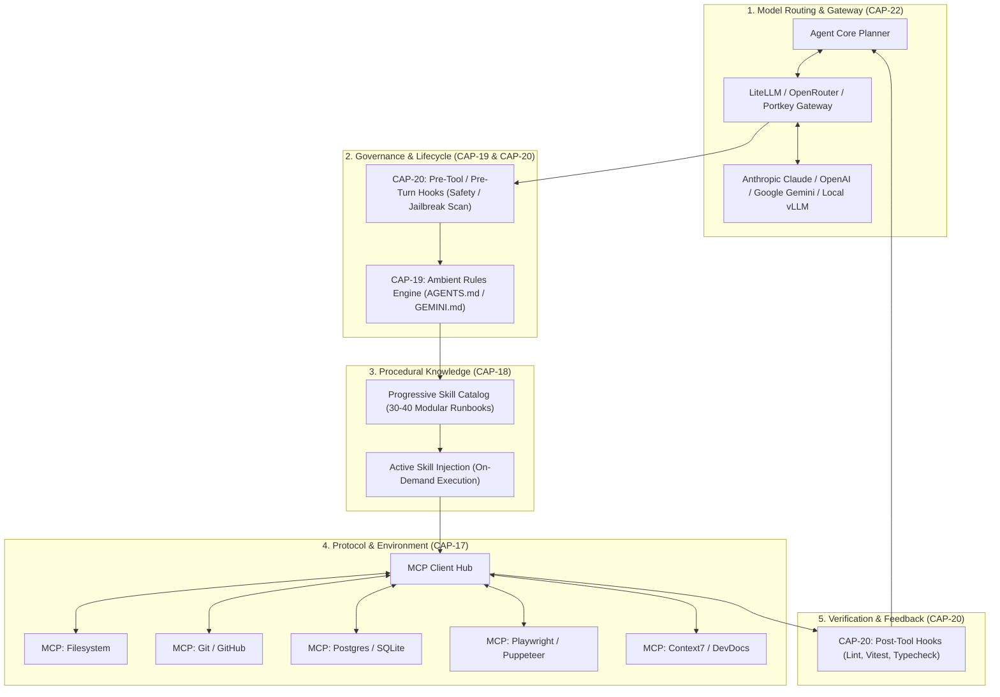
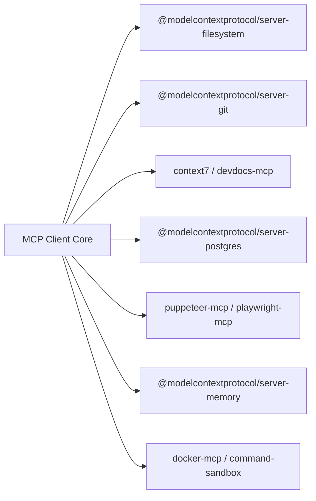
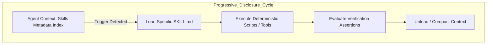
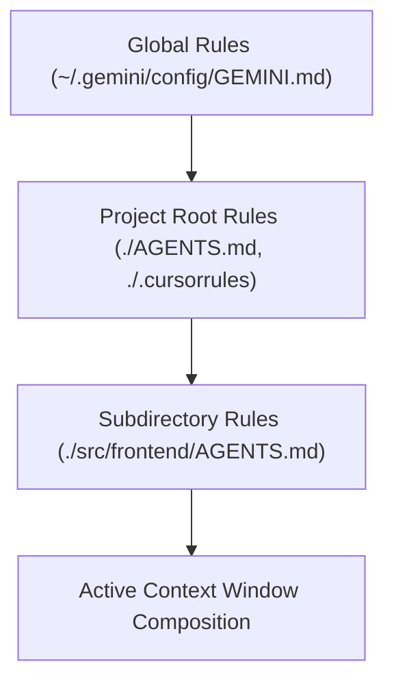
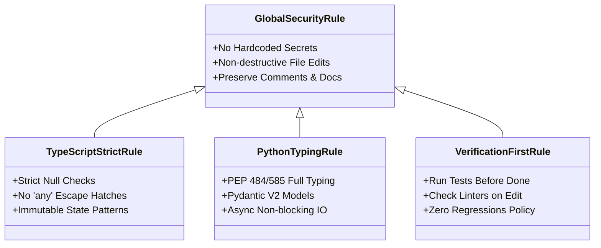
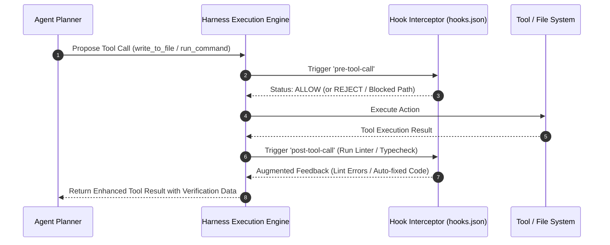
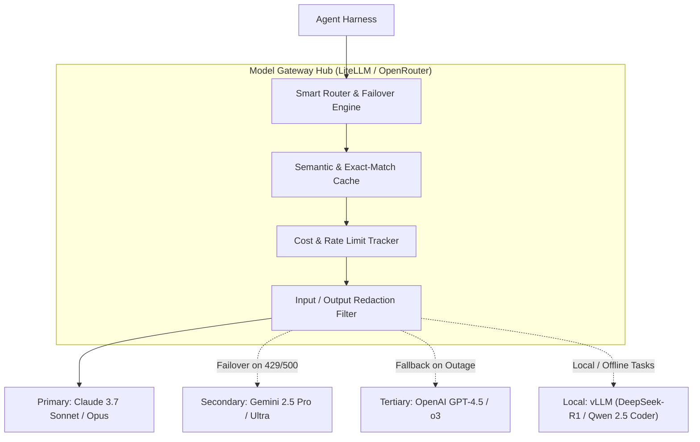

# Phase 3 Tool Selection: S-Tier Integration Layer
**Capabilities Covered:** CAP-17 (Model Context Protocol), CAP-18 (Procedural Skills), CAP-19 (Ambient Rules), CAP-20 (Lifecycle Hooks), CAP-22 (Model Gateway)

---

## 1. Executive Summary & S-Tier Integration Architecture

To transition an agentic coding harness from a simple code generator to an autonomous engineering system, five foundational integration layers must operate in harmony:



---

## 2. CAP-17: Model Context Protocol (MCP) Ecosystem

The Model Context Protocol (MCP) standardizes how LLM agents discover and consume tools, prompt templates, and external resources.

### 2.1 MCP Registries & Discovery Catalogs

| Registry Name | Canonical URL | Ecosystem Fit & Coverage | Tier | Verification Gate (Health / License / Adoption) |
| :--- | :--- | :--- | :--- | :--- |
| **Glama MCP Catalog** | `https://glama.ai/mcp/servers` | Web directory index with automated health check probes, uptime tracking, and capability tags. | **Essential** | ✅ Active; 800+ servers indexed; MIT; Real-time server telemetry. |
| **Smithery AI** | `https://smithery.ai` | CLI-first package manager (`npx -y @smithery/cli install <server>`) and hosting registry for MCP servers. | **Essential** | ✅ Active; High developer adoption; Open registry; Standardized JSON configs. |
| **MCP.so** | `https://mcp.so` | Community discovery directory ranking servers by stars, categories, and client compatibility. | **Recommended** | ✅ Active community index; Tracks Anthropic, Cursor, and Windsurf compatibility. |
| **Official MCP Server Repo** | `https://github.com/modelcontextprotocol/servers` | Anthropic-maintained reference implementations for core standard primitives. | **Essential** | ✅ Maintained by Anthropic & MCP Working Group; 30k+ stars; MIT License. |
| **PulseMCP** | `https://pulsemcp.com` | Live indexing tracker monitoring GitHub releases, Docker hub pulls, and MCP schema compliance. | **Optional** | ✅ Automated aggregator; Useful for CI tool validation. |

---

### 2.2 S-Tier MCP Servers



| Server Name | Canonical Repo / Package | Scope & Fit | Tier | Verification Gate (License, Maintained, Sandboxed) |
| :--- | :--- | :--- | :--- | :--- |
| **Filesystem MCP** | `github.com/modelcontextprotocol/servers/tree/main/src/filesystem` (`@modelcontextprotocol/server-filesystem`) | Restricted directory read/write/list with path traversal protection. | **Essential** | ✅ MIT; Official; Strict root path sandboxing. |
| **Git MCP** | `github.com/modelcontextprotocol/servers/tree/main/src/git` (`@modelcontextprotocol/server-git`) | Headless Git operations (diff, commit, branch, log, status, blame). | **Essential** | ✅ MIT; Official; Read/write VCS integration without raw shell risks. |
| **Context7 / DevDocs MCP** | `github.com/upstash/context7` or `github.com/kevinslin/devdocs-mcp` | Real-time library documentation search and offline API reference retrieval. | **Essential** | ✅ MIT; Prevents hallucinated API signatures across 100+ frameworks. |
| **PostgreSQL MCP** | `github.com/modelcontextprotocol/servers/tree/main/src/postgres` (`@modelcontextprotocol/server-postgres`) | Inspect schema, execute read-only queries, validate migrations safely. | **Recommended** | ✅ MIT; Official; Supports read-only transactions & schema reflection. |
| **SQLite MCP** | `github.com/modelcontextprotocol/servers/tree/main/src/sqlite` | Zero-dependency local DB inspection for embedded/local agent runs. | **Recommended** | ✅ MIT; Official; Memory-safe file inspection. |
| **Playwright / Browser MCP** | `github.com/executeautomation/playwright-mcp-server` | Headless Chrome automation: screenshot capture, click, type, DOM tree inspection, console log capture. | **Essential** | ✅ Apache-2.0 / MIT; Actively maintained; Crucial for E2E visual verification. |
| **Puppeteer MCP** | `github.com/modelcontextprotocol/servers/tree/main/src/puppeteer` | Lightweight browser automation for quick page dumps and accessibility trees. | **Recommended** | ✅ MIT; Anthropic official reference. |
| **Memory / Knowledge Graph MCP** | `github.com/modelcontextprotocol/servers/tree/main/src/memory` | Graph-based persistent memory (Entities, Relations, Observations) across sessions. | **Recommended** | ✅ MIT; Official; Retains cross-session architectural decisions. |
| **GitHub MCP** | `github.com/modelcontextprotocol/servers/tree/main/src/github` | Full GitHub API: pull requests, issues, reviews, fork sync, actions logs. | **Essential** | ✅ MIT; Official; Token-scoped access control. |
| **Brave Search MCP** | `github.com/modelcontextprotocol/servers/tree/main/src/brave-search` | Privacy-focused live web search and localized technical queries. | **Recommended** | ✅ MIT; Official; Low latency, reliable JSON search payloads. |
| **Tavily MCP** | `github.com/tavily-ai/tavily-mcp` | Agentic search tailored for deep research and markdown-optimized page extraction. | **Recommended** | ✅ MIT / Commercial API; High-density text extraction without ad noise. |
| **Docker MCP** | `github.com/quantgeekdev/docker-mcp` | Container lifecycle management (build, run, logs, exec, kill) inside isolated environments. | **Optional** | ✅ MIT; Requires rootless docker daemon for secure harness execution. |
| **Fetch MCP** | `github.com/modelcontextprotocol/servers/tree/main/src/fetch` | Safe HTTP GET/POST with markdown HTML conversion and header stripping. | **Essential** | ✅ MIT; Official; Replaces heavy browser calls for static docs. |
| **Raw Shell / Unrestricted MCP** | Generic uncapped `bash-mcp` without allowlists | Arbitrary host command execution without sandboxing. | **Avoid** | ❌ High vulnerability surface; Bypasses audit logs and sandbox jails. |

---

## 3. CAP-18: Procedural Skills Repository (40 Top Skills)

Procedural Skills provide modular runbooks using **progressive disclosure** (injecting only name and description into the system prompt, and loading the full instructions and scripts on-demand when activated).



### 3.1 Domain 1: Codebase Exploration & Repo Research

| # | Skill Name | Canonical Ref / Provenance | Core Purpose & Workflow | Tier | Verification Gate (Maintained / License / Safety) |
| :- | :--- | :--- | :--- | :--- | :--- |
| 1 | **`repo-surveyor-map`** | Anthropic Quickstarts / AGY Customizations | Generates high-level architectural maps, entry-point call graphs, and module boundary diagrams before touching code. | **Essential** | ✅ Apache-2.0 / MIT; Token-efficient tree & AST traversal. |
| 2 | **`github-issue-pr-triage`** | GitHub Community / AGY Workflows | Ingests PR diffs, parses issue threads, checks CI output, and prepares actionable decomposition checklists. | **Essential** | ✅ MIT; Safe read-only GitHub API ingestion. |
| 3 | **`ast-symbol-navigator`** | Tree-sitter / Antigravity Native | Uses language ASTs to trace symbol definitions, call hierarchies, and interface implementations across large monorepos. | **Essential** | ✅ MIT; Sub-second queries without brute-force grep. |
| 4 | **`git-archeologist-blame`** | Git Core / Cursor Patterns | Analyzes commit history, PR links, and commit messages to reconstruct the original intent behind complex legacy code. | **Recommended** | ✅ MIT; Read-only Git blame & log parser. |
| 5 | **`dependency-license-auditor`** | OSS Governance Standards | Scans package manifests (`package.json`, `Cargo.toml`, `pyproject.toml`) for license compliance (GPL/AGPL vs MIT/Apache) and supply chain health. | **Recommended** | ✅ MIT; Prevents viral license pollution in commercial codebases. |

---

### 3.2 Domain 2: Architecture & System Design

| # | Skill Name | Canonical Ref / Provenance | Core Purpose & Workflow | Tier | Verification Gate (Maintained / License / Safety) |
| :- | :--- | :--- | :--- | :--- | :--- |
| 6 | **`domain-driven-design-modeler`** | Martin Fowler / DDD Patterns | Identifies aggregate roots, value objects, bounded contexts, and domain events to prevent anemic domain models. | **Recommended** | ✅ MIT; Structured heuristic markdown generator. |
| 7 | **`api-contract-first-design`** | OpenAPI / Spectral / Buf gRPC | Drafts and validates OpenAPI 3.1 / Protocol Buffers specifications before backend or frontend code generation begins. | **Essential** | ✅ MIT; Uses schema linting to guarantee zero breaking contract drift. |
| 8 | **`database-schema-architect`** | Postgres / Prisma / Alembic | Models normalized 3NF relational schemas, indexes, foreign key constraints, and safe non-blocking migration scripts. | **Essential** | ✅ MIT; Enforces safe online migration rules (e.g., `ADD COLUMN NOT NULL DEFAULT`). |
| 9 | **`microservices-event-stormer`** | CloudEvents / Kafka Patterns | Designs idempotent message schemas, dead-letter queues, consumer groups, and outbox patterns for asynchronous workflows. | **Recommended** | ✅ MIT; Validates at-least-once delivery failure modes. |
| 10 | **`caching-strategy-designer`** | Redis / Cloudflare Patterns | Designs multi-tier caching architectures (L1 in-memory, L2 Redis, L3 CDN), cache stampede prevention, and key invalidation policies. | **Recommended** | ✅ MIT; Enforces cache-aside and TTL jitter conventions. |

---

### 3.3 Domain 3: Frontend & Modern Web UI

| # | Skill Name | Canonical Ref / Provenance | Core Purpose & Workflow | Tier | Verification Gate (Maintained / License / Safety) |
| :- | :--- | :--- | :--- | :--- | :--- |
| 11 | **`react-nextjs-app-router-expert`** | Vercel / Next.js Patterns | Enforces React 19 Server Components (RSC) vs Client Components boundaries, Server Actions, suspense boundaries, and streaming SSR. | **Essential** | ✅ MIT; Up to date with modern Next.js App Router rules. |
| 12 | **`tailwind-shadcn-ui-builder`** | Shadcn UI / Radix UI | Generates accessible, themeable UI components based on Radix UI primitives and Tailwind CSS with zero layout shifts. | **Essential** | ✅ MIT; Fully compliant with Tailwind v3/v4 & Radix primitives. |
| 13 | **`wcag-accessibility-audit`** | W3C WCAG 2.2 / Axe Core | Audits DOM structure for ARIA labels, semantic landmark elements, keyboard tab navigation, and color contrast compliance. | **Essential** | ✅ Apache-2.0; Integrates with automated Axe-core rulesets. |
| 14 | **`state-machine-xstate-architect`** | XState / Stately.ai | Models complex interactive frontend state (wizards, auth flows, checkout pipelines) using deterministic finite state machines. | **Recommended** | ✅ MIT; Eliminates unreachable/glitched intermediate UI states. |
| 15 | **`web-performance-core-web-vitals`** | Google Chrome Web Vitals | Analyzes bundle sizes, tree-shaking efficacy, dynamic imports, layout thrashing, and image optimization for LCP/INP/CLS metrics. | **Recommended** | ✅ MIT; Provides concrete bundle analysis heuristics. |

---

### 3.4 Domain 4: Backend, Concurrency & Distributed APIs

| # | Skill Name | Canonical Ref / Provenance | Core Purpose & Workflow | Tier | Verification Gate (Maintained / License / Safety) |
| :- | :--- | :--- | :--- | :--- | :--- |
| 16 | **`fastapi-async-backend-engine`** | Tiangolo / FastAPI Core | Builds high-throughput Python async services with Pydantic v2 validation, dependency injection, and connection pool management. | **Essential** | ✅ MIT; Adheres to strict type hints and async loop safety. |
| 17 | **`go-concurrency-patterns`** | Go Standard Library / Rob Pike | Implements worker pools, channels, errgroup context cancellation, and prevents goroutine memory leaks and data races. | **Essential** | ✅ BSD-3-Clause / MIT; Verified with `-race` detector workflows. |
| 18 | **`distributed-transaction-saga`** | Microservice Architecture / Saga | Implements orchestrator and choreography-based Sagas with compensating actions for distributed transactions. | **Recommended** | ✅ MIT; Prevents partial-write inconsistencies across services. |
| 19 | **`auth-oauth2-jwt-sentinel`** | IETF RFC 6749 / 7519 / OIDC | Implements secure authentication: PKCE flows, short-lived JWTs, rotating refresh tokens in HttpOnly cookies, and RBAC/ABAC middleware. | **Essential** | ✅ MIT; Eliminates common token storage security flaws. |
| 20 | **`rate-limiting-circuit-breaker`** | Resilience4j / Envoy Patterns | Implements sliding-window token bucket rate limiters and circuit breakers with fallback degradation for downstream microservices. | **Recommended** | ✅ MIT; Prevents cascading failure during upstream outages. |

---

### 3.5 Domain 5: Testing, QA & Formal Verification

| # | Skill Name | Canonical Ref / Provenance | Core Purpose & Workflow | Tier | Verification Gate (Maintained / License / Safety) |
| :- | :--- | :--- | :--- | :--- | :--- |
| 21 | **`tdd-red-green-refactor-loop`** | Kent Beck / Clean Code | Forces test generation before implementation, asserts test failure (red), writes minimal code to pass (green), and refactors cleanly. | **Essential** | ✅ MIT; Foundational agentic verification loop. |
| 22 | **`playwright-e2e-matrix`** | Microsoft Playwright | Creates robust, flake-free browser tests with auto-waiting locators, network intercept mocking, and parallel cross-browser execution. | **Essential** | ✅ Apache-2.0; Standard for web application testing. |
| 23 | **`pytest-fixture-factory`** | Pytest Documentation | Generates scoped fixtures, parametrized test matrices, monkeypatching, and clean database isolation for Python test suites. | **Essential** | ✅ MIT; Eliminates flaky shared-state test runs. |
| 24 | **`mutation-testing-sentinel`** | Stryker Mutator / Mutmut | Introduces mutations into source code to verify that existing test suites actually catch regressions (mutation score testing). | **Recommended** | ✅ Apache-2.0; Validates test quality beyond simple line coverage. |
| 25 | **`k6-load-chaos-test`** | Grafana k6 / Chaos Mesh | Generates virtual-user load profiles, stress tests, endpoint latency threshold assertions, and random error injection. | **Optional** | ✅ AGPL-3.0 / Apache-2.0; Excellent for pre-production load profiling. |

---

### 3.6 Domain 6: Debugging, Diagnostics & Profiling

| # | Skill Name | Canonical Ref / Provenance | Core Purpose & Workflow | Tier | Verification Gate (Maintained / License / Safety) |
| :- | :--- | :--- | :--- | :--- | :--- |
| 26 | **`systematic-root-cause-rca`** | SRE Best Practices / Google SRE | Executes systematic 5-Whys hypothesis testing, binary search delta debugging, and produces reproducible minimal test reproductions. | **Essential** | ✅ MIT; Stops guesswork loops in autonomous debugging. |
| 27 | **`memory-leak-heap-profiler`** | Chrome DevTools / Go pprof | Ingests and compares heap profiles before/after workloads to detect uncollected closures, dangling event listeners, and buffer growth. | **Recommended** | ✅ MIT; Profile-guided memory optimization. |
| 28 | **`opentelemetry-distributed-tracer`** | CNCF OpenTelemetry | Instruments code with spans, trace contexts, and metrics to identify high-latency hops in distributed call graphs. | **Recommended** | ✅ Apache-2.0; CNCF industry standard. |
| 29 | **`sql-explain-query-optimizer`** | PostgreSQL / MySQL Performance | Analyzes `EXPLAIN (ANALYZE, BUFFERS)` execution plans, eliminates sequential scans, fixes missing indexes, and resolves N+1 query loops. | **Essential** | ✅ MIT; Prevents high-cost production database bottlenecks. |
| 30 | **`log-anomaly-pattern-triage`** | ELK / Vector / Structured Logs | Aggregates high-cardinality error logs, clusters stack traces by pattern, and extracts root cause error lines from log spam. | **Recommended** | ✅ MIT; Reduces token waste during triage. |

---

### 3.7 Domain 7: Security, Hardening & Static Analysis

| # | Skill Name | Canonical Ref / Provenance | Core Purpose & Workflow | Tier | Verification Gate (Maintained / License / Safety) |
| :- | :--- | :--- | :--- | :--- | :--- |
| 31 | **`owasp-top10-vuln-scanner`** | OWASP Foundation | Scans for SQLi, XSS, SSRF, IDOR, path traversal, and command injection vulnerabilities with tailored secure code patches. | **Essential** | ✅ Creative Commons / MIT; Mandatory security baseline. |
| 32 | **`secrets-entropy-sanitizer`** | Gitleaks / TruffleHog | Regex and high-entropy detection for hardcoded API keys, private keys, JWT secrets, and AWS credentials prior to git commit. | **Essential** | ✅ MIT; Zero-tolerance leak prevention. |
| 33 | **`rbac-least-privilege-audit`** | AWS IAM / Cloud Security | Audits API endpoints and DB access policies to ensure principal roles have strictly scoped, non-escalatable permissions. | **Recommended** | ✅ MIT; Enforces zero-trust authorization. |
| 34 | **`dockerfile-distroless-hardener`** | Chainguard / GoogleContainerTools | Converts bloated container images to minimal, non-root, multi-stage distroless images with CIS benchmark compliance. | **Recommended** | ✅ Apache-2.0; Shrinks attack surfaces and image footprints. |
| 35 | **`cryptography-safe-patterns`** | NIST Standards / libsodium | Enforces modern crypto primitives (AES-256-GCM, Argon2id, Ed25519) and bans deprecated algorithms (MD5, SHA1, DES, ECB mode). | **Essential** | ✅ MIT; Eliminates cryptographic anti-patterns. |

---

### 3.8 Domain 8: Meta-Agentic Workflow & Harness Execution Rigor

| # | Skill Name | Canonical Ref / Provenance | Core Purpose & Workflow | Tier | Verification Gate (Maintained / License / Safety) |
| :- | :--- | :--- | :--- | :--- | :--- |
| 36 | **`grill-me-socratic-planner`** | AGY Builtin / Socratic Planning | Proactively interviews the user about ambiguous requirements, edge cases, and design trade-offs before executing code modifications. | **Essential** | ✅ Built-in; Prevents misaligned implementations. |
| 37 | **`atomic-safe-refactoring-engine`** | Martin Fowler / Mikado Method | Plans complex multi-file refactors in isolated, reversible, non-breaking atomic steps backed by characterization tests. | **Essential** | ✅ MIT; Eliminates harness drift on large changes. |
| 38 | **`conventional-semantic-release`** | Conventional Commits 1.0.0 | Formats commit messages according to specification (`feat:`, `fix:`, `refactor:`, `chore:`) and calculates Semantic Versioning increments. | **Recommended** | ✅ MIT; Automates changelog generation. |
| 39 | **`pr-review-staff-engineer`** | Google / Meta Review Guidelines | Reviews pull request diffs for logic bugs, race conditions, naming clarity, docstring accuracy, and maintainability. | **Essential** | ✅ MIT; High-signal code review feedback loop. |
| 40 | **`harness-loop-self-healer`** | Agentic Resilience Patterns | Detects when the model is looping on identical errors, forces tool input variation, compacts context, and escalates if stuck. | **Essential** | ✅ MIT; Prevents infinite agent token burns. |

---

## 4. CAP-19: Ambient Rules & Contextual Guidelines

Ambient rules govern agent behavior continuously without requiring manual skill invocation. They use hierarchical file discovery and scoping.



### 4.1 Specification Formats & Engine Precedence

| Specification Format | Target Platform | Discovery Path | Loading Precedence & Scope |
| :--- | :--- | :--- | :--- |
| **`AGENTS.md`** | Open Standard / Antigravity / Agentic Ecosystem | `./AGENTS.md` (root to subdirs) | **Highest Precedence** for multi-agent workflows. Hierarchically loaded by directory walking. |
| **`GEMINI.md`** | Antigravity / Gemini CLI Native | Root `./GEMINI.md` / `~/.gemini/config/` | Core workspace rules, tool behavioral overrides, and code style. |
| **`.cursorrules` / `.cursor/rules/*.mdc`** | Cursor IDE | Project root / `.cursor/rules/` | Glob-matched contextual rules (e.g., matching `*.tsx` only for frontend rules). |
| **`.clinerules`** | Cline / Roo-Code | Project root `./.clinerules` | Mode-specific rules (Code, Architect, Ask). |
| **`.windsurfrules`** | Windsurf IDE | Project root `./.windsurfrules` | Cascade memory and global project instructions. |

---

### 4.2 S-Tier Canonical Rule Sets



| Rule Identifier | Target Files / Scope | Enforcement Directive | Tier | Verification Gate |
| :--- | :--- | :--- | :--- | :--- |
| **`rule-preserve-code-integrity`** | Global (`*.*`) | Never delete existing comments, docstrings, or unrelated functions unless explicitly requested. Use localized diff replacements. | **Essential** | ✅ Prevents agent destruction of codebase context. |
| **`rule-strict-typescript-clean`** | `*.ts`, `*.tsx` | Disallow `any` / `@ts-ignore`. Require explicit return types on exported functions, strict null handling, and type-only imports (`import type`). | **Essential** | ✅ Enforced via `tsc --noEmit` and ESLint. |
| **`rule-python-modern-idiomatic`** | `*.py` | Use Python 3.11+ type annotations (`int \| str`, `list[str]`), dataclasses/Pydantic models, avoid mutable default args, enforce async hygiene. | **Essential** | ✅ Enforced via `mypy --strict` and `ruff`. |
| **`rule-zero-secret-leakage`** | Global (`*.*`) | Never write raw API tokens, database connection strings with passwords, or private keys to source files or artifacts. Use `.env.example`. | **Essential** | ✅ High-entropy regex checks on write tools. |
| **`rule-test-verification-before-done`** | Global (`*.*`) | The agent must never declare a task complete without executing the relevant test suite and confirming clean exit status 0. | **Essential** | ✅ Closes hallucinated "it works" statements. |

---

## 5. CAP-20: Hooks & Agentic Lifecycle Interceptors

Hooks provide deterministic, programmatic interceptors executing shell commands or scripts at key agent lifecycle events.



### 5.1 Lifecycle Hook Types & Integration Frameworks

| Hook Event | Trigger Stage | Ideal Payload / Action | Framework / Config | Tier |
| :--- | :--- | :--- | :--- | :--- |
| **`pre-tool-call`** | Before executing a tool call | Sandboxing inspection: block destructive commands (`rm -rf /`, `mkfs`, raw credential exposure). | Antigravity `hooks.json` / Custom interceptor | **Essential** |
| **`post-tool-call`** | Immediately after file edit / tool execution | Auto-format (Prettier, Ruff, Black) + Fast AST Syntax verification. | Antigravity `hooks.json` / Lefthook | **Essential** |
| **`pre-commit`** | Before git commit creation | Run secret scanning (`gitleaks`), unit test suite, and linter check. | Husky / Pre-commit / Lefthook | **Essential** |
| **`pre-agent-turn`** | Before prompt ingestion by LLM | Dynamic context enrichment: inject Git branch status, open diagnostics, failing test names. | Harness Context Middleware | **Recommended** |
| **`post-agent-turn`** | After model response completes | Session token ledger update, audit log persistence, diff snapshotting. | Harness Middleware | **Recommended** |

---

### 5.2 Hook Tooling Comparison

| Hook Manager | Primary Focus | Performance & Language | Tier | Verification Gate (License / Health) |
| :--- | :--- | :--- | :--- | :--- |
| **Lefthook** | Git & workflow hook runner | Fast Go binary; Parallel execution; Zero runtime dependencies. | **Essential** | ✅ MIT; High adoption; Outperforms Node-based runners. |
| **Husky** | JavaScript / TypeScript ecosystem hooks | Node.js based; Seamless `npm install` integration for web repos. | **Recommended** | ✅ MIT; Extremely widespread frontend standard. |
| **Pre-commit (Python)** | Multi-language hook orchestration | Python-based; Auto-manages virtual environments for linters. | **Recommended** | ✅ MIT; Robust support for polyglot repositories. |
| **Antigravity `hooks.json`** | In-process agent lifecycle events | Native JSON configuration binding shell scripts directly to agent tool actions. | **Essential** | ✅ Built-in; Zero-latency lifecycle interception. |

---

## 6. CAP-22: Model Gateways & Routing Layer

A Model Gateway decouples the agent harness from direct LLM provider APIs, providing load balancing, automatic failover, cost observability, rate limit queueing, and unified request formats.



### 6.1 Model Gateway Comparison Matrix

| Gateway Solution | Architecture & Hosting | Core Strengths | Fallback & Routing Quality | Tier | Verification Gate (License / Maintenance) |
| :--- | :--- | :--- | :--- | :--- | :--- |
| **LiteLLM Proxy** | Self-hosted Python/FastAPI proxy server or library | 100+ LLMs normalized to OpenAI input/output format. Dynamic load balancing, budget alerts, RPM/TPM virtual keys. | **Industry Gold Standard** (Instant automatic failover across keys/providers on 429/500 errors). | **Essential** | ✅ MIT; 25k+ GitHub stars; Daily active releases; Production-ready. |
| **OpenRouter** | Managed multi-provider hosted routing service | Single API key for hundreds of models. Zero setup, automated price-performance routing, live provider uptime metrics. | **High** (Native provider fallback and latency optimization handled at proxy layer). | **Essential** | ✅ High availability; Privacy-compliant data processing agreements available. |
| **Portkey AI Gateway** | Self-hosted or Managed Enterprise Gateway | Enterprise governance, fine-grained trace logs, prompt management, canary deployments, semantic caching. | **Enterprise Grade** (Configurable retry strategies, circuit breakers, fallback arrays). | **Recommended** | ✅ Apache-2.0 (Open-source core); Active enterprise backing. |
| **Helicone** | Observability proxy & analytics | Deep prompt analytics, cost tracking per user/session, request replay, caching layer. | **Medium** (Focuses on observability and metrics over complex dynamic routing). | **Recommended** | ✅ Apache-2.0; Fast proxy latency (<10ms overhead). |
| **Cloudflare AI Gateway** | Global Edge Proxy | Integrated with Cloudflare edge network. Fast caching, DDoS protection, rate limiting at edge. | **Medium** (Basic fallback support; best when already on Cloudflare stack). | **Optional** | ✅ Proprietary hosted service with generous free tier. |
| **vLLM / Ollama Gateway** | Local Inference Engine | High-throughput local model serving (vLLM PagedAttention) for air-gapped or zero-cost coding loops. | **N/A** (Serves as a terminal backend destination for LiteLLM routing). | **Recommended** | ✅ Apache-2.0 / MIT; High performance for local models. |

---

### 6.2 Gateway Feature Matrix & Specification

| Feature Dimension | LiteLLM Proxy | OpenRouter | Portkey AI Gateway | Helicone |
| :--- | :--- | :--- | :--- | :--- |
| **Protocol Compatibility** | OpenAI standard, Anthropic Messages API, Google GenAI | OpenAI standard | OpenAI standard | OpenAI & Anthropic standard |
| **Failover Routing** | ✅ Configurable retry arrays per model alias | ✅ Built-in automated provider fallback | ✅ Multi-step fallback and load balancing | ⚠️ Basic retry support |
| **Cost & Budget Caps** | ✅ Per-key, per-user, per-team dollar limits | ✅ Prepaid wallet balance & limits | ✅ Virtual key spend limits & analytics | ✅ Spend alerts & telemetry |
| **Streaming Support** | ✅ Server-Sent Events (SSE) with token counts | ✅ SSE streaming with usage chunks | ✅ Streaming with latency tracing | ✅ Full streaming observability |
| **Self-Hostable** | ✅ Docker / Kubernetes / Pip native | ❌ Hosted service only | ✅ Open Source Docker deployment | ✅ Open Source Docker deployment |
| **Latency Overhead** | < 15ms (FastAPI async core) | < 25ms (Global CDN routing) | < 12ms (Go/Rust edge core) | < 10ms (Worker proxy) |

---

## 7. Integrated S-Tier Deployment Blueprint

Here is how all 5 capabilities assemble into a concrete project structure:

```
my-autonomous-project/
├── .agents/
│   ├── rules/
│   │   ├── 00-core-integrity.md     # CAP-19: Non-destructive edits & comments rule
│   │   ├── 10-security-zero-leak.md # CAP-19: Secret scanning & OWASP rules
│   │   └── 20-typescript-strict.md  # CAP-19: Strict typing & immutability rules
│   └── skills/                      # CAP-18: Procedural Skills (Loaded on-demand)
│       ├── repo-surveyor/
│       │   └── SKILL.md
│       ├── tdd-loop/
│       │   └── SKILL.md
│       ├── react-nextjs-expert/
│       │   └── SKILL.md
│       ├── sql-query-optimizer/
│       │   └── SKILL.md
│       └── pr-review-staff/
│           └── SKILL.md
├── .gemini/
│   ├── hooks.json                   # CAP-20: Pre-tool & post-tool lifecycle hooks
│   └── mcp_config.json              # CAP-17: MCP Client configuration
├── lefthook.yml                     # CAP-20: Pre-commit git security & lint hooks
├── AGENTS.md                        # CAP-19: Top-level ambient project instructions
└── litellm-config.yaml              # CAP-22: Model gateway routing, fallbacks, & keys
```

### 7.1 Production Configuration Files

#### A. CAP-17 MCP Configuration (`.gemini/mcp_config.json`)
```json
{
  "mcpServers": {
    "filesystem": {
      "command": "npx",
      "args": ["-y", "@modelcontextprotocol/server-filesystem", "./src", "./tests", "./docs"]
    },
    "git": {
      "command": "npx",
      "args": ["-y", "@modelcontextprotocol/server-git"]
    },
    "postgres": {
      "command": "npx",
      "args": ["-y", "@modelcontextprotocol/server-postgres", "postgresql://readonly_user@localhost:5432/app_db"]
    },
    "playwright": {
      "command": "npx",
      "args": ["-y", "@executeautomation/playwright-mcp-server"]
    },
    "context7": {
      "command": "npx",
      "args": ["-y", "@upstash/context7-mcp"]
    }
  }
}
```

#### B. CAP-20 Lifecycle Hooks (`.gemini/hooks.json`)
```json
{
  "hooks": {
    "pre_tool_call": [
      {
        "matcher": "run_command",
        "command": "python3 -c 'import sys, re; cmd=sys.argv[1]; sys.exit(1 if re.search(r\"rm\\s+-rf\\s+[/~]|mkfs|dd\\s+if=\", cmd) else 0)' \"$TOOL_INPUT_COMMAND\"",
        "description": "Block destructive commands before execution"
      }
    ],
    "post_tool_call": [
      {
        "matcher": "replace_file_content|write_to_file",
        "command": "npx prettier --write \"$TARGET_FILE\" 2>/dev/null || true",
        "description": "Auto-format edited files"
      }
    ]
  }
}
```

#### C. CAP-22 Model Gateway (`litellm-config.yaml`)
```yaml
model_list:
  - model_name: coding-primary
    litellm_params:
      model: anthropic/claude-3-7-sonnet-20250219
      api_key: "os.environ/ANTHROPIC_API_KEY"
      rpm: 1000
      tpm: 100000

  - model_name: coding-primary
    litellm_params:
      model: gemini/gemini-2.5-pro
      api_key: "os.environ/GEMINI_API_KEY"
      rpm: 1000

  - model_name: coding-fast
    litellm_params:
      model: anthropic/claude-3-5-haiku-20241022
      api_key: "os.environ/ANTHROPIC_API_KEY"

router_settings:
  routing_strategy: "latency-based-routing"
  num_retries: 3
  timeout: 45
  fallbacks:
    - coding-primary: ["gemini/gemini-2.5-pro", "openai/gpt-4o"]
```

---

## 8. Sources & Verification References

1. **Model Context Protocol (MCP)**:
   - Specification & Protocol Documentation: `https://modelcontextprotocol.io/`
   - Official Reference Servers Repository: `https://github.com/modelcontextprotocol/servers`
   - Glama Server Registry: `https://glama.ai/mcp/servers`
   - Smithery Server Package Manager: `https://smithery.ai`
2. **Procedural Skills & Agent Workflows**:
   - Anthropic Agent Quickstarts & Skill Workflows: `https://github.com/anthropics/anthropic-quickstarts`
   - Antigravity Customization Guidelines: `file:///home/shashank_karamudi/.gemini/antigravity-cli/builtin/skills/agy-customizations/SKILL.md`
   - Tree-sitter AST Parsing Engine: `https://tree-sitter.github.io/tree-sitter/`
   - OWASP Secure Coding Practices: `https://owasp.org/www-project-secure-coding-practices-quick-reference-guide/`
3. **Ambient Rules & Governance**:
   - Agent Rules Standardization: `https://agents.md/`
   - Cursor Rules Documentation: `https://docs.cursor.com/context/rules-for-ai`
4. **Lifecycle Hooks & Quality Gates**:
   - Lefthook Fast Git Hooks Manager: `https://github.com/evilmartians/lefthook`
   - Pre-commit Hook Framework: `https://pre-commit.com/`
5. **Model Gateways & Routing**:
   - LiteLLM Proxy & Routing Engine: `https://github.com/BerriAI/litellm`
   - OpenRouter Routing Service: `https://openrouter.ai/docs`
   - Portkey AI Gateway: `https://github.com/Portkey-AI/gateway`
