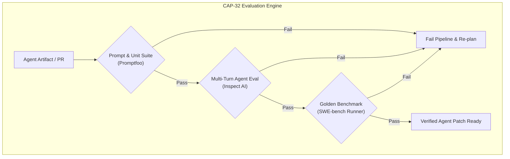
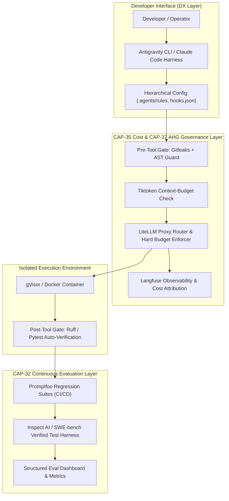

# Phase 3 Tool Selection: S-Tier Developer Experience & Meta-Layer

This document outlines the tool selection for the **S-Tier Developer Experience (DX) and Meta-Governance Layer**, equipping three key system capabilities:
* **`CAP-32` Evaluation Engine**: Continuous harness execution, agent benchmarking, regression testing, and assertion suites.
* **`CAP-35` Cost & Budget Governance**: Token accounting, rate-limiting, reverse-proxy routing, and quota enforcement.
* **`CAP-37` AHG Gate (Autonomous Harness & Guardrail Gate)**: Sandboxed runtime enforcement, human-in-the-loop (HITL) approval, pre-flight linting, secret scanning, and anti-hallucination barriers.

---

## 1. Executive Capability Matrix

| Capability | Primary Tool / Suite | Archetype | Tier | Target SLA / Metric |
| :--- | :--- | :--- | :--- | :--- |
| **CAP-32** Eval Engine | **Inspect AI** + **SWE-bench Runner** | Agentic Eval & Benchmark Harness | **Essential** | Automated regression pass-rate $>99\%$, zero eval leakage |
| **CAP-32** Eval Engine | **Promptfoo** | Fast CLI-First Assertions & Red-Teaming | **Essential** | CI/CD gate $<15\text{s}$ execution per prompt suite |
| **CAP-35** Cost-Budget | **LiteLLM Proxy** | Reverse Proxy & Quota Governor | **Essential** | Hard budget limits, sub-millisecond proxy overhead |
| **CAP-35** Cost-Budget | **Langfuse** | Telemetry & Cost Attribution Engine | **Essential** | Exact per-session, per-agent token/USD attribution |
| **CAP-35** Cost-Budget | **Tiktoken / Tokenizers** | Client-Side Pre-Flight Counter | **Essential** | Local context-window overflow prevention before dispatch |
| **CAP-37** AHG Gate | **Pre-Commit + Ruff + Gitleaks** | Deterministic AST & Pre-Flight Static Gate | **Essential** | Zero unlinted code / zero committed secrets |
| **CAP-37** AHG Gate | **Antigravity (`agy`) Lifecycle Hooks** | Agent Runtime Hook & Policy Engine | **Essential** | `pre-tool` & `post-tool` deterministic validation |
| **CAP-37** AHG Gate | **gVisor / Docker Ephemeral Sandbox** | Hardware/Kernel-Level Isolation | **Essential** | Complete OS isolation for agent bash commands |
| **CAP-37** AHG Gate | **Claude Code Permission Matrix** | HITL & Tool Escalation Boundary | **Essential** | Interactive write/execute approvals on sensitive paths |

---

## 2. CAP-32: Evaluation Engines & Eval Harnesses



### 2.1 Tool Analysis & Verification

#### 1. Inspect AI (UK AI Safety Institute)
* **Repo URL**: `https://github.com/UKGovernmentBEIS/inspect_ai`
* **Fit**: Serves as the primary multi-turn agent evaluation framework. Inspect provides built-in sandboxing (Docker/Compose/Kubernetes), async tool evaluation, dataset loaders, flexible scoring metrics (model-graded, rule-based), and an interactive terminal/web visualizer.
* **Tier**: **Essential**
* **Verification Gate**:
  * *Link*: `https://github.com/UKGovernmentBEIS/inspect_ai`
  * *Maintained*: Active daily/weekly development backed by UK AISI & frontier research labs; frequent releases.
  * *Adopted*: Standardized across government AI safety institutes and top agent evaluation teams.
  * *License*: MIT License
* **Archetype**: `Multi-Turn Agent Eval Harness & Telemetry Engine`

#### 2. SWE-bench Framework / Docker Runner
* **Repo URL**: `https://github.com/princeton-nlp/SWE-bench`
* **Fit**: The undisputed gold-standard benchmark and harness for software engineering agents. Executes agents against real-world GitHub issues within isolated Docker environments, testing their ability to inspect code, edit repositories, and pass preexisting unit test suites.
* **Tier**: **Essential**
* **Verification Gate**:
  * *Link*: `https://github.com/princeton-nlp/SWE-bench`
  * *Maintained*: Actively maintained by Princeton NLP; continuously expanded with *SWE-bench Lite*, *Verified*, and *Multimodal*.
  * *Adopted*: Global benchmark for OpenAI, Anthropic, Google, Cognition, and open-source coding agents.
  * *License*: MIT License
* **Archetype**: `Software Engineering Golden Benchmark & Execution Harness`

#### 3. Promptfoo
* **Repo URL**: `https://github.com/promptfoo/promptfoo`
* **Fit**: Lightweight, ultra-fast CLI-first framework for testing prompts, outputs, guardrails, and deterministic tool calls. Integrated into GitHub Actions CI/CD to detect regressions, red-team prompt injections, and validate structured JSON/AST outputs before deployment.
* **Tier**: **Essential**
* **Verification Gate**:
  * *Link*: `https://github.com/promptfoo/promptfoo`
  * *Maintained*: Maintained daily; extensive library of red-teaming plugins and assertions.
  * *Adopted*: $>6.5\text{k}$ GitHub stars, standard in enterprise prompt CI/CD pipelines.
  * *License*: MIT License
* **Archetype**: `CLI-First Prompt & Guardrail Test Runner`

#### 4. DeepEval (Confident AI)
* **Repo URL**: `https://github.com/confident-ai/deepeval`
* **Fit**: "Pytest for LLMs" focusing on RAG and conversational unit tests with 14+ metrics (faithfulness, hallucination, answer relevancy, G-Eval). Useful for evaluating agent subcomponents or retrieval chains.
* **Tier**: **Optional** (Valuable for Python RAG evaluation, but heavier and less agentic-terminal focused than Inspect AI and Promptfoo).
* **Verification Gate**:
  * *Link*: `https://github.com/confident-ai/deepeval`
  * *Maintained*: Highly active commit log, comprehensive documentation.
  * *Adopted*: Popular in Python-centric RAG pipelines ($>5\text{k}$ stars).
  * *License*: Apache-2.0
* **Archetype**: `Pytest-Style Metric & Assertion Suite`

#### 5. Terminal-Bench / InterCode
* **Repo URL**: `https://github.com/princeton-nlp/intercode`
* **Fit**: Interactive bash, SQL, and CTF execution benchmark for OS-level agents. Evaluates multi-turn CLI command generation and state recovery.
* **Tier**: **Optional** (Excellent specialized benchmark, but secondary to SWE-bench for core SWE workflows).
* **Verification Gate**:
  * *Link*: `https://github.com/princeton-nlp/intercode`
  * *Maintained*: Academic release; stable but slower release cadence.
  * *Adopted*: Widely cited academic benchmark for interactive code execution.
  * *License*: MIT License
* **Archetype**: `Interactive Terminal Execution Benchmark`

#### 6. Unsandboxed Ad-Hoc Eval Scripts
* **Repo URL**: `N/A` (Custom regex scrapers running raw Python `eval()` or unconfined shell scripts)
* **Fit**: Lacks isolation, reproduces poorly across developer environments, and creates safety risks when testing autonomous coding agents.
* **Tier**: **Avoid**
* **Verification Gate**: Failed (Security hazard, unversioned, high flakiness).
* **Archetype**: `Unsandboxed Fragile Ad-Hoc Script`

---

## 3. CAP-35: Cost & Budget Governance

```mermaid
graph LR
    subgraph CAP_35_Cost_Control["CAP-35 Cost & Budget Pipeline"]
        Prompt["Agent Prompt / Tool Step"] --> Tokenizer["Client-Side Tokenizer<br>(Tiktoken / Tokenizers)"]
        Tokenizer -->|Context Fits Budget| Proxy["LiteLLM Gateway Proxy<br>(Routing, Rate-Limits, Budgets)"]
        Tokenizer -->|Context Overflow| Compress["Context Window Trimmer / Compactor"]
        Proxy -->|Spend < Hard Limit| Upstream["LLM Providers (Claude, Gemini, OpenAI)"]
        Proxy -->|Budget Exceeded| Reject["429 / 403 Budget Gate Quota Rejection"]
        Upstream --> Telemetry["Langfuse Collector<br>(Trace, Cost, Latency)"]
    end
```



### 3.1 Tool Analysis & Verification

#### 1. LiteLLM (Proxy & SDK)
* **Repo URL**: `https://github.com/BerriAI/litellm`
* **Fit**: The universal LLM API gateway and proxy. Enforces per-user, per-team, and per-agent budget caps (e.g., max \$10/day per run), provides automated failover routing across 100+ model providers, tracks token expenditure in real time, and exposes a standardized OpenAI-compatible API.
* **Tier**: **Essential**
* **Verification Gate**:
  * *Link*: `https://github.com/BerriAI/litellm`
  * *Maintained*: Extremely rapid release cadence (daily commits, commercial enterprise tier backing open-source core).
  * *Adopted*: $>18\text{k}$ stars, industry standard for enterprise LLM proxies and rate limiters.
  * *License*: MIT License
* **Archetype**: `Reverse Proxy, Routing Gateway & Budget Governor`

#### 2. Langfuse
* **Repo URL**: `https://github.com/langfuse/langfuse`
* **Fit**: Open-source observability and telemetry backend. Ingests nested agent traces, calculates dollar costs down to the individual tool invocation, monitors latency percentiles, and tracks user feedback and quality scores.
* **Tier**: **Essential**
* **Verification Gate**:
  * *Link*: `https://github.com/langfuse/langfuse`
  * *Maintained*: Daily commits, active core team, SOC2 certified hosted and self-hosted options.
  * *Adopted*: $>7\text{k}$ stars; leading open telemetry system for agent production systems.
  * *License*: MIT / FSL-1.1-Apache-2.0
* **Archetype**: `Telemetry, Cost Attribution & Trace Store`

#### 3. Tiktoken / Hugging Face Tokenizers
* **Repo URL**: `https://github.com/openai/tiktoken` | `https://github.com/huggingface/tokenizers`
* **Fit**: High-speed, zero-latency local BPE tokenizer implementations in Rust and Python. Runs pre-flight checks on conversation histories to count tokens, apply sliding window pruning, and enforce client-side token budgets before incurring network or API costs.
* **Tier**: **Essential**
* **Verification Gate**:
  * *Link*: `https://github.com/openai/tiktoken`
  * *Maintained*: Maintained by OpenAI and Hugging Face; highly optimized Rust core.
  * *Adopted*: Standard tokenizer infrastructure across Python and Rust AI ecosystems.
  * *License*: MIT / Apache-2.0
* **Archetype**: `Client-Side Pre-Flight Token Calculator`

#### 4. Portkey AI Gateway / Helicone
* **Repo URL**: `https://github.com/Portkey-AI/gateway` | `https://github.com/Helicone/helicone`
* **Fit**: High-performance edge gateways for caching, budget alerting, and routing. 
* **Tier**: **Optional** (Excellent alternative edge proxies; optional if LiteLLM is selected as the primary gateway).
* **Verification Gate**:
  * *Link*: `https://github.com/Portkey-AI/gateway`
  * *Maintained*: Regular updates, robust TypeScript/Go engines.
  * *Adopted*: Strong enterprise presence in edge caching and LLM routing.
  * *License*: Apache-2.0
* **Archetype**: `Edge Proxy & Cache Gateway`

#### 5. Direct Unmetered SDK Calls
* **Repo URL**: `N/A` (Calling raw vendor SDKs directly without an intermediary budget interceptor or proxy)
* **Fit**: Prone to infinite tool-execution loops, unchecked subagent recursion, and surprise billing spikes.
* **Tier**: **Avoid**
* **Verification Gate**: Failed (Fails financial governance and rate-limiting compliance).
* **Archetype**: `Unmetered Raw Provider Access`

---

## 4. CAP-37: AHG Gate (Agent-Human-Guardrail & Sandbox Gate)

```mermaid
graph TD
    subgraph CAP_37_Gate_Flow["CAP-37 AHG Safety & Verification Gate"]
        ToolCall["Agent Proposes Tool Action"] --> Guard1{"Pre-Tool Hook Validation<br>(agy hooks / AST Guard)"}
        Guard1 -->|Rejected (e.g. destructive cmd)| Block["Halt & Request Correction"]
        Guard1 -->|Approved| Guard2{"Tool Permission Level<br>(Claude Code / AGY Rules)"}
        Guard2 -->|ReadOnly / Safe| Sandbox["Isolated Container Sandbox<br>(Docker / gVisor)"]
        Guard2 -->|High Risk (Write/Delete/Network)| HITL{"Human-in-the-Loop<br>Approval Gate"}
        HITL -->|Approved by User| Sandbox
        HITL -->|Rejected by User| Block
        Sandbox --> PostHook{"Post-Tool Quality Gate<br>(Ruff, Pre-Commit, Lints)"}
        PostHook -->|Clean Diff| Result["Return Tool Result to Agent"]
        PostHook -->|Syntax / Security Error| SelfHeal["Inject Linter Error for Self-Correction"]
    end
```

### 4.1 Tool Analysis & Verification

#### 1. Pre-Commit + Ruff + Gitleaks
* **Repo URL**: `https://github.com/pre-commit/pre-commit` | `https://github.com/astral-sh/ruff` | `https://github.com/gitleaks/gitleaks`
* **Fit**: Deterministic static safety gate. Ruff verifies code syntax and stylistic invariants in milliseconds; Gitleaks prevents agents from generating or checking in API keys/secrets; pre-commit binds these hooks into the git lifecycle.
* **Tier**: **Essential**
* **Verification Gate**:
  * *Link*: `https://github.com/astral-sh/ruff`
  * *Maintained*: Extremely rapid development (Astral team); Rust-based performance ($<10\text{ms}$ execution).
  * *Adopted*: Industry standard for Python linting and static analysis ($>35\text{k}$ stars).
  * *License*: MIT / Apache-2.0
* **Archetype**: `Deterministic AST & Pre-Flight Static Gatekeeper`

#### 2. Antigravity (`agy`) Customization & Hook Architecture
* **Repo URL**: Builtin / `https://github.com/google/antigravity`
* **Fit**: Native agent harness configuration supporting progressive disclosure (`SKILL.md`, `GEMINI.md`, `AGENTS.md`), runtime lifecycle hooks (`hooks.json` for pre-tool and post-tool events), and granular subagent authorization.
* **Tier**: **Essential**
* **Verification Gate**:
  * *Link*: Native builtin framework (`builtin/skills/agy-customizations`)
  * *Maintained*: First-class core agent platform architecture.
  * *Adopted*: Native runtime harness for Antigravity agents.
  * *License*: Apache-2.0 / Core Platform
* **Archetype**: `Agent Lifecycle Hook & Policy Enforcement Harness`

#### 3. Ephemeral Sandbox Runner (Docker + gVisor / Podman)
* **Repo URL**: `https://github.com/google/gvisor` | `https://github.com/containers/podman`
* **Fit**: Hardened kernel-level isolation for agent shell execution. Blocks dangerous system calls, isolates network namespaces, prevents filesystem destruction outside the workspace, and enables clean rollback via ephemeral containers.
* **Tier**: **Essential**
* **Verification Gate**:
  * *Link*: `https://github.com/google/gvisor`
  * *Maintained*: Backed by Google Cloud security; updated continuously.
  * *Adopted*: Powers Google Cloud Run and production agent sandboxes.
  * *License*: Apache-2.0
* **Archetype**: `Ephemeral Isolated Execution Sandbox`

#### 4. Claude Code Permission & Settings Architecture
* **Repo URL**: Architecture pattern derived from Anthropic Claude Code (`~/.claude/config.json`, project-level approvals)
* **Fit**: Interactive human-in-the-loop (HITL) gate that auto-approves safe read-only operations while escalating destructive bash commands, git push, or external network requests to explicit developer confirmation.
* **Tier**: **Essential**
* **Verification Gate**:
  * *Link*: Official Claude Code CLI specification
  * *Maintained*: Actively maintained and updated by Anthropic.
  * *Adopted*: Gold standard for terminal-based developer agent interactions.
  * *License*: Proprietary specification / Standard agent design pattern
  * *Archetype*: `Human-in-the-Loop & Permission Escalation Harness`

#### 5. NeMo Guardrails / Guardrails AI
* **Repo URL**: `https://github.com/NVIDIA/NeMo-Guardrails` | `https://github.com/guardrails-ai/guardrails`
* **Fit**: Programmable semantic guardrails (Colang) for validating dialog boundaries and structured outputs.
* **Tier**: **Optional** (Best suited for customer-facing chat interfaces; introduces unnecessary latency for local deterministic code-generation tasks where AST linters are faster).
* **Verification Gate**:
  * *Link*: `https://github.com/NVIDIA/NeMo-Guardrails`
  * *Maintained*: Maintained by NVIDIA AI Research.
  * *Adopted*: $>4.5\text{k}$ stars, standard for enterprise conversational bots.
  * *License*: Apache-2.0
* **Archetype**: `Semantic Policy & Anti-Hallucination Guardrail`

---

## 5. Benchmark Suites & Datasets (Golden Verification)

| Benchmark Suite | Repository Link | Focus Area | Tier | Archetype |
| :--- | :--- | :--- | :--- | :--- |
| **SWE-bench Verified** | `https://github.com/princeton-nlp/SWE-bench` | 500 hand-validated real-world GitHub issues with unit test validation | **Essential** | Golden SWE Agent Benchmark |
| **LiveCodeBench** | `https://github.com/LiveCodeBench/LiveCodeBench` | Contamination-free, holistic evaluation on new competitive coding problems | **Essential** | Algorithmic & Self-Repair Benchmark |
| **Inspect AI Eval Suite** | `https://github.com/UKGovernmentBEIS/inspect_ai` | Standardized agentic tool-use, cybersecurity, and safety eval suites | **Essential** | Comprehensive Agent Safety Suite |
| **GAIA** | `https://github.com/huggingface/gaia` | Multi-modal, complex tool orchestration, multi-step web and file reasoning | **Optional** | Multi-Modal Generalist Suite |
| **HumanEval / MBPP** | `https://github.com/openai/human-eval` | Synthetic single-function docstring generation | **Avoid** *(For Agent Eval)* | Contaminated Toy Baseline |

---

## 6. Integration Architecture: S-Tier DX / Meta Layer



### Complete Layer Composition

1. **Pre-Dispatch Phase (`CAP-35` + `CAP-37`)**:
   - The developer executes commands via the **Antigravity (`agy`) / Claude Code** harness.
   - **Tiktoken** computes prompt token consumption locally to avoid sending oversized contexts.
   - **LiteLLM Proxy** checks project budget quotas and routes requests to the optimal model provider with automatic failover.
   - **`agy` Lifecycle Hooks** validate tool calls against whitelist policies and invoke `gitleaks` to block secrets from leaving the local machine.

2. **Execution & Sandboxing Phase (`CAP-37`)**:
   - All shell and filesystem mutations execute inside **gVisor/Docker ephemeral sandboxes**.
   - Read-only actions proceed automatically; sensitive file modifications or network operations trigger **HITL approval gates**.
   - Upon completion of code edits, **Ruff** and deterministic linters automatically execute to give immediate AST feedback to the agent.

3. **Evaluation & Verification Phase (`CAP-32`)**:
   - **Promptfoo** runs fast deterministic prompt assertion checks in the CI/CD pipeline ($<15\text{s}$).
   - **Inspect AI** coordinates multi-turn behavioral regression tests across subagents.
   - **SWE-bench Verified** runs nightly on canary builds in isolated Docker containers to measure real-world coding capability retention without dataset contamination.
   - **Langfuse** captures complete execution traces, token costs, and benchmark scores into a central telemetry dashboard.

---

## 7. Sources & Reference Verification

* **Inspect AI**: [UKGovernmentBEIS/inspect_ai](https://github.com/UKGovernmentBEIS/inspect_ai) — Open-source LLM/agent evaluation framework by the UK AI Safety Institute.
* **SWE-bench**: [princeton-nlp/SWE-bench](https://github.com/princeton-nlp/SWE-bench) — Benchmark and harness for software engineering agents on real GitHub issues.
* **Promptfoo**: [promptfoo/promptfoo](https://github.com/promptfoo/promptfoo) — CLI-first testing and red-teaming tool for LLM apps.
* **DeepEval**: [confident-ai/deepeval](https://github.com/confident-ai/deepeval) — Unit testing and evaluation framework for LLM applications.
* **InterCode**: [princeton-nlp/intercode](https://github.com/princeton-nlp/intercode) — Interactive coding and terminal execution benchmark.
* **LiteLLM**: [BerriAI/litellm](https://github.com/BerriAI/litellm) — LLM proxy, budget governor, and unified provider routing layer.
* **Langfuse**: [langfuse/langfuse](https://github.com/langfuse/langfuse) — Open source LLM engineering platform (Tracing, Metrics, Evals).
* **Tiktoken**: [openai/tiktoken](https://github.com/openai/tiktoken) — Fast BPE token counter and tokenizer.
* **Ruff**: [astral-sh/ruff](https://github.com/astral-sh/ruff) — Extremely fast Python linter and code formatter.
* **gVisor**: [google/gvisor](https://github.com/google/gvisor) — Application kernel providing lightweight container isolation.
* **LiveCodeBench**: [LiveCodeBench/LiveCodeBench](https://github.com/LiveCodeBench/LiveCodeBench) — Contamination-free holistic coding benchmark.
* **GAIA**: [huggingface/gaia](https://github.com/huggingface/gaia) — General AI Assistants benchmark.
