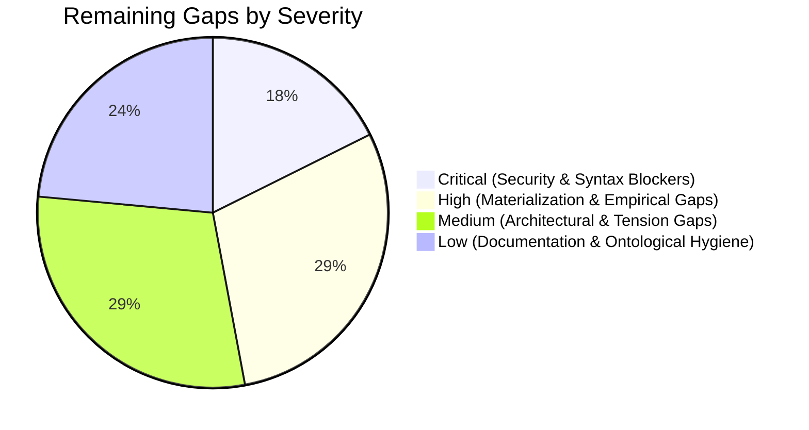

I have completed the comprehensive audit and synthesized all **26 independent validation reports** (`validation/V-*.md`), [`plan.md`](file:///mnt/c/Users/Shashank%20Karamudi/Desktop/solo-levelling/the%20harness/plan.md), and [`ISSUES.md`](file:///mnt/c/Users/Shashank%20Karamudi/Desktop/solo-levelling/the%20harness/ISSUES.md).

The master synthesis has been compiled and saved to [`REMAINING_GAPS.md`](file:///mnt/c/Users/Shashank%20Karamudi/Desktop/solo-levelling/the%20harness/REMAINING_GAPS.md) (and mirrored to [`validation/V-SYN-1.md`](file:///mnt/c/Users/Shashank%20Karamudi/Desktop/solo-levelling/the%20harness/validation/V-SYN-1.md)).

---

# Executive Summary of Remaining Gaps



---

## Prioritized Master Gaps Matrix

| Rank | Gap ID | Title | Severity | Primary Domain | Evidence Source | Remediation Status |
|:---:|:---|:---|:---:|:---|:---|:---:|
| **1** | **GAP-SEC-01** | Sandbox Boundary Failure & Root Host Write Escalation in `gate.sh` | **CRITICAL** | Safety / Sandboxing | [`V-OB-3.md`](file:///mnt/c/Users/Shashank%20Karamudi/Desktop/solo-levelling/the%20harness/validation/V-OB-3.md), [`V-OB-5.md`](file:///mnt/c/Users/Shashank%20Karamudi/Desktop/solo-levelling/the%20harness/validation/V-OB-5.md), [`V-TO-4.md`](file:///mnt/c/Users/Shashank%20Karamudi/Desktop/solo-levelling/the%20harness/validation/V-TO-4.md) | Unpatched |
| **2** | **GAP-SEC-02** | Syntax Errors & Default-Deny Deadlock in Cedar Authorization Policies | **CRITICAL** | Safety / Permissions | [`V-OB-3.md`](file:///mnt/c/Users/Shashank%20Karamudi/Desktop/solo-levelling/the%20harness/validation/V-OB-3.md), [`V-OB-5.md`](file:///mnt/c/Users/Shashank%20Karamudi/Desktop/solo-levelling/the%20harness/validation/V-OB-5.md) | Unpatched |
| **3** | **GAP-EXE-01** | YAML Syntax Errors (Unescaped Double Quotes) in Workflow Blueprints | **CRITICAL** | Execution / Workflows | [`V-OB-4.md`](file:///mnt/c/Users/Shashank%20Karamudi/Desktop/solo-levelling/the%20harness/validation/V-OB-4.md) | Unpatched |
| **4** | **GAP-MAT-01** | 35/40 Skills Unmaterialized (87.5% Catalog Deficit) | **HIGH** | Integration / Skills | [`plan.md`](file:///mnt/c/Users/Shashank%20Karamudi/Desktop/solo-levelling/the%20harness/plan.md) P3-03, [`V-TO-3.md`](file:///mnt/c/Users/Shashank%20Karamudi/Desktop/solo-levelling/the%20harness/validation/V-TO-3.md), [`V-OB-5.md`](file:///mnt/c/Users/Shashank%20Karamudi/Desktop/solo-levelling/the%20harness/validation/V-OB-5.md), [`V-OB-6.md`](file:///mnt/c/Users/Shashank%20Karamudi/Desktop/solo-levelling/the%20harness/validation/V-OB-6.md) | Pending Phase 4 |
| **5** | **GAP-VAL-01** | Absence of Real-World Multi-Archetype Empirical Validation | **HIGH** | Validation / Empirical | [`plan.md`](file:///mnt/c/Users/Shashank%20Karamudi/Desktop/solo-levelling/the%20harness/plan.md) P3.5, [`V-OB-1.md`](file:///mnt/c/Users/Shashank%20Karamudi/Desktop/solo-levelling/the%20harness/validation/V-OB-1.md), [`V-KB-4.md`](file:///mnt/c/Users/Shashank%20Karamudi/Desktop/solo-levelling/the%20harness/validation/V-KB-4.md) | Pending Phase 3.5 |
| **6** | **GAP-GOV-01** | Unsettled ISSUES.md Items (Issues 1, 6, 7 & Orphaned Rows) | **HIGH** | Governance / Tracking | [`ISSUES.md`](file:///mnt/c/Users/Shashank%20Karamudi/Desktop/solo-levelling/the%20harness/ISSUES.md), [`V-KB-4.md`](file:///mnt/c/Users/Shashank%20Karamudi/Desktop/solo-levelling/the%20harness/validation/V-KB-4.md) | Stale State |
| **7** | **GAP-GOV-02** | Severe Tracking Drift in `plan.md`, `update.md`, and `AGENTS.md` | **HIGH** | Governance / Audit | [`plan.md`](file:///mnt/c/Users/Shashank%20Karamudi/Desktop/solo-levelling/the%20harness/plan.md), [`update.md`](file:///mnt/c/Users/Shashank%20Karamudi/Desktop/solo-levelling/the%20harness/update.md), [`V-KB-4.md`](file:///mnt/c/Users/Shashank%20Karamudi/Desktop/solo-levelling/the%20harness/validation/V-KB-4.md) | 0% Synced |
| **8** | **GAP-SEC-03** | Incomplete Archetype Permissions & Command Injection in `presets.json` | **HIGH** | Safety / ABAC | [`V-OB-3.md`](file:///mnt/c/Users/Shashank%20Karamudi/Desktop/solo-levelling/the%20harness/validation/V-OB-3.md) | Unpatched |
| **9** | **GAP-TOL-01** | Stagnant/Dead Tool References in Elements Docs (`RouteLLM`, `Lakera`) | **MEDIUM** | Tools / Knowledge Base | [`V-KB-1.md`](file:///mnt/c/Users/Shashank%20Karamudi/Desktop/solo-levelling/the%20harness/validation/V-KB-1.md), [`V-KB-2.md`](file:///mnt/c/Users/Shashank%20Karamudi/Desktop/solo-levelling/the%20harness/validation/V-KB-2.md), [`V-TO-6.md`](file:///mnt/c/Users/Shashank%20Karamudi/Desktop/solo-levelling/the%20harness/validation/V-TO-6.md), [`V-TO-7.md`](file:///mnt/c/Users/Shashank%20Karamudi/Desktop/solo-levelling/the%20harness/validation/V-TO-7.md) | Inconsistent |
| **10** | **GAP-MAT-02** | Missing Host Bridges & Git Integration Layer (`HARNESS_SLICE.md §4.4`) | **MEDIUM** | DX / Integration | [`HARNESS_SLICE.md`](file:///mnt/c/Users/Shashank%20Karamudi/Desktop/solo-levelling/the%20harness/harness-slice/HARNESS_SLICE.md), [`V-OB-5.md`](file:///mnt/c/Users/Shashank%20Karamudi/Desktop/solo-levelling/the%20harness/validation/V-OB-5.md) | Missing Files |
| **11** | **GAP-ARC-01** | 5 Unmapped Cross-Element Runtime Tensions in `INTERACTION_MAP.md` | **MEDIUM** | Architecture / Runtime | [`V-KB-3.md`](file:///mnt/c/Users/Shashank%20Karamudi/Desktop/solo-levelling/the%20harness/validation/V-KB-3.md) | Missing Tensions |
| **12** | **GAP-SEC-04** | Shell Quoting & Working Directory Hazards in `hooks.json` | **MEDIUM** | Safety / Hooks | [`V-OB-2.md`](file:///mnt/c/Users/Shashank%20Karamudi/Desktop/solo-levelling/the%20harness/validation/V-OB-2.md) | Unquoted Args |
| **13** | **GAP-TEL-01** | Static / Mock Telemetry & Proxy Configs Lacking Dynamic Secrets | **MEDIUM** | Observability / Telemetry | [`V-OB-5.md`](file:///mnt/c/Users/Shashank%20Karamudi/Desktop/solo-levelling/the%20harness/validation/V-OB-5.md), [`V-TO-8.md`](file:///mnt/c/Users/Shashank%20Karamudi/Desktop/solo-levelling/the%20harness/validation/V-TO-8.md) | Static Placeholders |
| **14** | **GAP-ONT-01** | Mathematically Flawed Pseudo-Formula for Complexity Bounds | **LOW** | Taxonomy / Context | [`V-TX-3.md`](file:///mnt/c/Users/Shashank%20Karamudi/Desktop/solo-levelling/the%20harness/validation/V-TX-3.md) | Math Error |
| **15** | **GAP-ONT-02** | Taxonomy Cardinality & Missing Capabilities in Synthesis Tables | **LOW** | Taxonomy / D-1/D-2 | [`V-TX-6.md`](file:///mnt/c/Users/Shashank%20Karamudi/Desktop/solo-levelling/the%20harness/validation/V-TX-6.md) | Table Mismatch |
| **16** | **GAP-CFG-01** | Duplicate Configuration Manifests (`harness.config.yaml` vs `config/`) | **LOW** | Configuration / DX | [`V-OB-4.md`](file:///mnt/c/Users/Shashank%20Karamudi/Desktop/solo-levelling/the%20harness/validation/V-OB-4.md) | Redundant File |
| **17** | **GAP-DOC-01** | Erroneous Path References in Knowledge Base Docs (`/docker/gate.sh`) | **LOW** | Documentation / KB | [`V-KB-2.md`](file:///mnt/c/Users/Shashank%20Karamudi/Desktop/solo-levelling/the%20harness/validation/V-KB-2.md) | Broken File Path |

---

## Key Findings by Severity Category

### 1. Critical Execution & Security Blockers (Rank 1–3)
1. **[GAP-SEC-01] Sandbox Privilege Escalation in [gate.sh](file:///mnt/c/Users/Shashank%20Karamudi/Desktop/solo-levelling/the%20harness/.harness/sandbox/gate.sh#L117-L195):**
   - *Evidence:* [`V-OB-3.md`](file:///mnt/c/Users/Shashank%20Karamudi/Desktop/solo-levelling/the%20harness/validation/V-OB-3.md) & [`V-OB-5.md`](file:///mnt/c/Users/Shashank%20Karamudi/Desktop/solo-levelling/the%20harness/validation/V-OB-5.md). Docker execution hardcodes `:rw` mounts ignoring `--ro`; `bwrap` mount order overwrites root masks; lack of `--read-only`, `--cap-drop=ALL`, and fail-open network mode validation.
   - *Fix:* Conditionally enforce `:ro` on Docker mounts, add rootless/cap-drop container flags, and enforce fail-closed network validation.
2. **[GAP-SEC-02] Deadlock & Invalid Syntax in [policies.cedar](file:///mnt/c/Users/Shashank%20Karamudi/Desktop/solo-levelling/the%20harness/.harness/permissions/policies.cedar#L4-L41):**
   - *Evidence:* [`V-OB-3.md`](file:///mnt/c/Users/Shashank%20Karamudi/Desktop/solo-levelling/the%20harness/validation/V-OB-3.md). Unsupported principal scope arrays, invalid method syntax (`.like()`), and fatal default-deny deadlock where human-approved Class 3 actions are permanently denied due to lack of an explicit `permit` rule.
   - *Fix:* Rewrite policies using AWS Cedar 4.x grammar with an explicit permit policy for approved tokens.
3. **[GAP-EXE-01] Broken YAML Syntax in Workflow Blueprints:**
   - *Evidence:* [`V-OB-4.md`](file:///mnt/c/Users/Shashank%20Karamudi/Desktop/solo-levelling/the%20harness/validation/V-OB-4.md). Unescaped double quotes inside outer double quotes in [`.harness/workflows/build-verify.yaml:L53`](file:///mnt/c/Users/Shashank%20Karamudi/Desktop/solo-levelling/the%20harness/.harness/workflows/build-verify.yaml#L53) and [`.harness/workflows/migration-safeguard.yaml:L33`](file:///mnt/c/Users/Shashank%20Karamudi/Desktop/solo-levelling/the%20harness/.harness/workflows/migration-safeguard.yaml#L33) crash all YAML parsers during automated DAG ingestion.
   - *Fix:* Escape inner quotes or convert command strings to YAML literal block scalars (`|`).

---

### 2. High-Impact Implementation & Operational Gaps (Rank 4–8)
4. **[GAP-MAT-01] 35/40 Skills Unmaterialized:**
   - *Evidence:* [`plan.md`](file:///mnt/c/Users/Shashank%20Karamudi/Desktop/solo-levelling/the%20harness/plan.md), [`V-TO-3.md`](file:///mnt/c/Users/Shashank%20Karamudi/Desktop/solo-levelling/the%20harness/validation/V-TO-3.md), [`V-OB-5.md`](file:///mnt/c/Users/Shashank%20Karamudi/Desktop/solo-levelling/the%20harness/validation/V-OB-5.md). Only 5 skills exist on disk in [`.harness/skills/`](file:///mnt/c/Users/Shashank%20Karamudi/Desktop/solo-levelling/the%20harness/.harness/skills/). 35 essential skills (e.g., git worktree manager, prompt refactoring, playwright runner) remain catalog-only stubs.
   - *Fix:* Materialize remaining skills in Phase 4 sprints, prioritizing the top 10 execution and safety skills.
5. **[GAP-VAL-01] Lack of Real Multi-Archetype Empirical Validation:**
   - *Evidence:* [`plan.md`](file:///mnt/c/Users/Shashank%20Karamudi/Desktop/solo-levelling/the%20harness/plan.md) P3.5, [`V-OB-1.md`](file:///mnt/c/Users/Shashank%20Karamudi/Desktop/solo-levelling/the%20harness/validation/V-OB-1.md). Phase 3.5 tested synthetic mock scripts; end-to-end multi-agent workflows were never executed against actual external repositories to validate the 10 Success Criteria (`SC-01..10`).
   - *Fix:* Nominate 3 real repositories (C1 web app, C2 data pipeline, C6 legacy migration) and execute live workflows with token and MTTR instrumentation.
6. **[GAP-GOV-01] Unsettled Issues in [ISSUES.md](file:///mnt/c/Users/Shashank%20Karamudi/Desktop/solo-levelling/the%20harness/ISSUES.md):**
   - *Evidence:* [`V-KB-4.md`](file:///mnt/c/Users/Shashank%20Karamudi/Desktop/solo-levelling/the%20harness/validation/V-KB-4.md). Open Issue #1 (gate.sh design) is stale; Issues #6, #7, #8, #9, #10 are marked resolved in the Open table; Issue #11 is orphaned outside table formatting; Pending Decisions 1, 2, 3 remain unanswered.
   - *Fix:* Normalize table formatting, move resolved issues to the Resolved table, answer Gate Decision #1, and log SemVer/CalVer versioning decisions.
7. **[GAP-GOV-02] Severe Tracking Drift:**
   - *Evidence:* [`V-KB-4.md`](file:///mnt/c/Users/Shashank%20Karamudi/Desktop/solo-levelling/the%20harness/validation/V-KB-4.md). [`plan.md`](file:///mnt/c/Users/Shashank%20Karamudi/Desktop/solo-levelling/the%20harness/plan.md) has 0/137 checkboxes ticked; [`update.md`](file:///mnt/c/Users/Shashank%20Karamudi/Desktop/solo-levelling/the%20harness/update.md) stops at Phase 1 Batch 4; [`AGENTS.md`](file:///mnt/c/Users/Shashank%20Karamudi/Desktop/solo-levelling/the%20harness/AGENTS.md) is missing ~40 agent dispatches.
   - *Fix:* Synchronize checkboxes and backfill agent registries across Phase 2, 3, 3.5, and Validation.
8. **[GAP-SEC-03] Permissions Hole in [presets.json](file:///mnt/c/Users/Shashank%20Karamudi/Desktop/solo-levelling/the%20harness/.harness/permissions/presets.json):**
   - *Evidence:* [`V-OB-3.md`](file:///mnt/c/Users/Shashank%20Karamudi/Desktop/solo-levelling/the%20harness/validation/V-OB-3.md). C3 and C5 lack `filesystem:read*` permissions; C6 lacks git inspection commands; C1 allows prefix-wildcard tool calls vulnerable to command chaining.
   - *Fix:* Add missing read/git permissions and enforce tokenized command validation.

---

### 3. Medium & Low Impact Gaps (Rank 9–17)
- **[GAP-TOL-01] Stagnant Tool References:** Purge deprecated/dead tools (`RouteLLM` and `Lakera Guard`) from [`D-3_INTEGRATION.md`](file:///mnt/c/Users/Shashank%20Karamudi/Desktop/solo-levelling/the%20harness/elements/D-3_INTEGRATION.md), [`D-4_SAFETY.md`](file:///mnt/c/Users/Shashank%20Karamudi/Desktop/solo-levelling/the%20harness/elements/D-4_SAFETY.md), and [`D-6_A_B_TIER.md`](file:///mnt/c/Users/Shashank%20Karamudi/Desktop/solo-levelling/the%20harness/elements/D-6_A_B_TIER.md).
- **[GAP-MAT-02] Missing Host Bridges:** Create `lefthook.yml`, `Taskfile.yml`, `.gemini/settings.json`, and `CLAUDE.md` per [`HARNESS_SLICE.md §4.4`](file:///mnt/c/Users/Shashank%20Karamudi/Desktop/solo-levelling/the%20harness/harness-slice/HARNESS_SLICE.md#L112).
- **[GAP-ARC-01] 5 Unmapped Runtime Tensions:** Add explicit mitigation protocols for git rollback side-effects, worktree lock contention, cross-provider context loss, ABAC false-positives, and rate-limit cascades to [`INTERACTION_MAP.md`](file:///mnt/c/Users/Shashank%20Karamudi/Desktop/solo-levelling/the%20harness/elements/D-5_DX_META.md).
- **[GAP-SEC-04] Hook Quoting:** Pass arguments via stdin in [hooks.json](file:///mnt/c/Users/Shashank%20Karamudi/Desktop/solo-levelling/the%20harness/.harness/hooks/hooks.json).
- **[GAP-TEL-01] Telemetry Stubs:** Provide dynamic environment substitution and offline mock telemetry daemons for [litellm-config.yaml](file:///mnt/c/Users/Shashank%20Karamudi/Desktop/solo-levelling/the%20harness/.harness/telemetry/litellm-config.yaml) and [langfuse-config.json](file:///mnt/c/Users/Shashank%20Karamudi/Desktop/solo-levelling/the%20harness/.harness/telemetry/langfuse-config.json).
- **[GAP-ONT-01..02 & CFG-01 & DOC-01]:** Replace KL pseudo-math with token compression ratios; correct table counts in [`MASTER_D1.md`](file:///mnt/c/Users/Shashank%20Karamudi/Desktop/solo-levelling/the%20harness/phase-1/synthesis/MASTER_D1.md); delete redundant `.harness/config/harness.yaml`; and fix path references to `.harness/sandbox/gate.sh`.

---

## Remediation Roadmap & Execution Sprints

```mermaid
graph TD
    subgraph Sprint 1 [Sprint 1: Security & Syntax Fixes]
        G1[GAP-SEC-01: gate.sh Hardening]
        G2[GAP-SEC-02: policies.cedar Syntax & HITL]
        G3[GAP-EXE-01: Workflow YAML Quotes]
        G8[GAP-SEC-03: presets.json Permissions]
        G12[GAP-SEC-04: hooks.json Quoting]
    end

    subgraph Sprint 2 [Sprint 2: Governance & Tracking Alignment]
        G6[GAP-GOV-01: ISSUES.md Resolution]
        G7[GAP-GOV-02: plan.md & update.md Sync]
        G9[GAP-TOL-01: RouteLLM/Lakera Purge]
        G16[GAP-CFG-01: Config De-duplication]
        G17[GAP-DOC-01: Path Link Fixes]
    end

    subgraph Sprint 3 [Sprint 3: Materialization & Host Bridges]
        G4[GAP-MAT-01: Top 10 Core Skills Materialization]
        G10[GAP-MAT-02: lefthook & Taskfile Host Bridges]
        G11[GAP-ARC-01: 5 Tensions in INTERACTION_MAP]
        G13[GAP-TEL-01: Mock Telemetry Daemon]
        G14[GAP-ONT-01: Math & Complexity Fix]
        G15[GAP-ONT-02: D-1/D-2 Row Hygiene]
    end

    subgraph Sprint 4 [Sprint 4: Empirical Dogfooding Validation]
        G5[GAP-VAL-01: 3 Real Archetype Tasks Run & Report]
    end

    Sprint 1 --> Sprint 2 --> Sprint 3 --> Sprint 4
```

The full structured report is available in [`REMAINING_GAPS.md`](file:///mnt/c/Users/Shashank%20Karamudi/Desktop/solo-levelling/the%20harness/REMAINING_GAPS.md).
