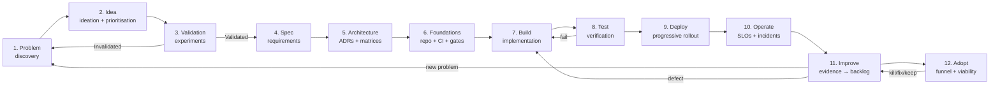

# 03 — The Complete Product Lifecycle

**The full iterative loop:** problem → idea → validation → spec → architecture → foundations → build → test → deploy → operate → improve → adopt. Each stage carries its checklist or gate (condensed; full versions live in `research/`). The loop is the unit of analysis — value is proven or disproven in the feedback arrows, not in any single stage.

---

## 1. Problem — discovery (§3)

**Where real problems come from** (eight channels): story-based customer interviews (The Mom Test rules: talk about their life, ask for past specifics, listen — compliments are not data; **Corroborated**), workflow observation ("get out of the building" — workarounds are the strongest early signal; **Corroborated**), support-ticket/review streams (symptom-rich, cause-poor; needs triangulation — **Inferred**), product analytics (precise on "what," weak on "why"; **Corroborated**), competitive research (rivals' 1-star reviews are your opportunity list; a competitor shipping a feature proves buildability, not desirability — **Corroborated**), market/tech changes (the "why now" field), dogfooding, and emerging technology (handled with suspicion — keep the problem statement technology-free; **Corroborated**).

**Real problem vs mirage** — five distinctions: real problem vs interesting idea (priced pain + costly workaround = real); root cause vs symptom (5 Whys, each answered with observed data); user demand vs internal assumption (commitment is the test: time, reputation, money); genuine differentiation vs imitation (would a user notice in 5 minutes?); technically possible vs commercially worthwhile (Cagan's business-viability risk — one of the two risks weakest teams most under-attend; **Corroborated**).

**The evidence ladder** (weakest → strongest; Corroborated): (0) founder conviction → (1) compliments/survey interest → (2) story-based interviews n≥5–10 → (3) observed workarounds with real cost → (4) behavioral data → (5) commitment (time, reputation, data, LOI) → (6) money (prepayment, paid pilot) → (7) retention & expansion in a cohort. Level 2–3 justifies discovery investment; Level 5–6 justifies build; Level 7 justifies scale. Committing build-scale resources on Level 0–1 evidence is the modal postmortem failure — CB Insights' analyses consistently find ~42% of startup postmortems cite "no market need" (**Corroborated**).

**DELIVERABLE — Problem-discovery checklist (condensed; full 12-row gate in `research/discovery/01`):** segment named → problem stated in their words (5–10 story interviews) → priced pain (workaround cost or budget line) → root cause diagnosed with observed data → frequency & trend → "why now" answered → demand separated from assumption (≥1 commitment signal) → differentiation hypothesis → commercial viability sketched (WTP × reachable buyers > cost-to-serve + acquire) → kill criterion pre-committed → four risks triaged (value, usability, feasibility, viability) → dated decision (proceed/pivot/reject). **Discovery that cannot produce a *no* is not discovery** — that's "discovery theater" (community observation).

## 2. Idea — ideation & prioritisation (§4)

**Ideas are generated against a validated problem, not in a vacuum** — eight methods: customer-driven ideation (workarounds are market-drawn solution sketches), jobs-to-be-done with Ulwick's opportunity algorithm (`Opportunity = Importance + max(Importance − Satisfaction, 0)`; scores >15 mark severely underserved outcomes — **Corroborated**), opportunity-solution trees (one outcome → opportunities → solutions → experiments; never evaluate a single solution in isolation — **Corroborated**, Torres 2021), design thinking (divergence before convergence; the cargo-cult version is "innovation theater"), behavioral ideation from analytics, competitive analysis, technical spikes (feasibility only — written answer, not a demo that quietly becomes the implementation), and AI-assisted ideation (AI generates, humans and customers decide; AI-generated ideas enter evaluation at evidence Level 0–1).

**Nine evaluation dimensions** — user value, reach, differentiation, feasibility (effort estimates come from engineering, never PM guesses), cost (build *and* run), uncertainty, business value, maintenance burden, risk. The two teams most often skip: *maintenance burden* (the demo is cheap; the 3-year ownership — especially AI inference + eval upkeep — is the real price) and *uncertainty itself*.

**The false-precision warning** (**Corroborated**, three independent practitioner critiques): RICE outputs look like math but inputs are gut feel — comparing a 1.7 vs a 1.9 is "comparing two guesses dressed up with a decimal point"; the number short-circuits the strategic conversation; scores drift toward the loudest voice. Practical rule: **score to compare and discuss, never to decide**; record scores *and* the overrides with reasons; treat low confidence as a discovery task, not just a discount factor.

**Idea dispositions** — every idea moves to an explicit, dated state: reject (with recorded rationale so it doesn't resurrect), combine (sibling solutions under one opportunity), refine (opportunity real, solution wrong-shaped), defer (**with a trigger** — "revisit when X" — a deferred idea without a trigger is a rejected idea lying to itself).

## 3. Validation — experiments (§5)

**Validation = running a cheap test that could prove you wrong before you spend serious resources.** The methods, ordered by what each proves: customer interviews (solution-stage) → landing page/smoke test → fake door (painted door) → concierge MVP (value with perfect tech) → Wizard of Oz (demand for the outcome) → throwaway prototype (usability risk) → pilot paid/committed → technical PoC/spike (feasibility only) → pricing test → usability research. **Ordering principle:** run the cheapest test that attacks the *riskiest assumption first* (Corroborated).

**The commitment hierarchy** (strongest commonly available signals): money changing hands (prepayment, signed contract — the only signal proving willingness to pay) > costly non-monetary commitment (their data, their hour, their boss) > behavioral change > stated intent with specifics (from a budget holder — directionally useful, routinely overstated) > stated interest (waitlist from untargeted traffic: absolute size is vanity; conversion-weighted size is the signal — 53 people at 20% and 1,000 at 1% are the *same* 10 customers).

**Anatomy of an honest experiment** (Corroborated synthesis): hypothesis (one falsifiable sentence) → riskiest assumption named → cheapest method → one primary metric + 1–2 guardrails → pre-committed success criterion → pre-committed kill criterion → interpretation plan (prevents HARKing — rewriting the hypothesis after seeing the data) → time-box and cost cap. Two consecutive inconclusives = treat as invalidated ("the market is telling you it doesn't care enough to give a clear signal" — **Proposed**).

**Per-idea stage gates** (Proposed structure): Problem→Ideation (priced pain, named segment, demand signal); Idea→Prototype (riskiest assumption identified, cheapest test designed, criteria pre-committed); Prototype→Build (value + usability evidenced behaviorally, feasibility spike passed, viability math works on verified numbers — *not* on paid-pilot failure or Sean Ellis <25% with no segment story); Build→Scale (retention/expansion in cohort, repeatable acquisition, economics improving with scale).

**AI feasibility judgment** (Corroborated synthesis): use conventional software when rules are simple, data is scarce, wrongness is catastrophic, a lookup covers 99%, explainability is required, or the problem changes faster than retraining. Use ML when no definable rule solves it or conditions outpace rulesets. Use generative AI only when the system must create/transform content **and** you add grounding, evaluation, and human review proportional to the harm of wrong output. And validate the AI idea with a Wizard-of-Oz or concierge test *before* any model work — it tests the value risk, where AI ideas usually die, without paying the feasibility cost.

## 4. Spec — requirements (§6)

**A spec is a buildable contract**: objectives, target users/use cases, user journeys, functional and non-functional requirements, business rules, acceptance criteria, dependencies, constraints, success metrics, risks/assumptions, explicit exclusions, release requirements — 13 elements, each answering one downstream consumer (PM, designer, engineer, tester, AI agent). Requirements-origin defects are roughly 40–60% of all defects (directional, **Corroborated**); type systems prevent only ~15% of public JS bugs (Gao et al., **Verified**). The spec is where defect prevention starts.

**Writing requirements that survive**: EARS notation (ubiquitous / event-driven / state-driven / optional / unwanted patterns — the constrained natural language adopted by Amazon Kiro; **Verified**) — *"When a user submits the login form with an invalid email, the system shall display an inline validation error below the email field"* vs *"The system should handle login."* Acceptance criteria describe observable user outcomes, not implementation ("the user remains logged in for 30 minutes" not "use Redis"); NFRs are quantified (P95 ≤ 300ms at 500 RPS) or they're unenforceable; weak words (*fast, scalable, robust*) are banned unless paired with numbers.

**The weak-spec → strong-spec lesson** (`research/spec-arch/01`, worked): a weak spec's seven failure classes (unenumerated content, subjective adjectives, unquantified NFRs, scope-ambiguous options, "eventually" creep, date-without-scope, missing success metric) trace downstream to design/engineering mismatches, AI-agent invention ("an agent given this prompt fills ambiguity with invention"), and silent scope growth. The strong spec names every element including **explicit exclusions** — "deferred is not deleted," with re-entry triggers.

**Scope discipline**: MoSCoW (if >40% of features are "Must," the bar is too low; legal/safety are automatic Musts — **Corroborated**); cut scope vertically (a complete small experience), not horizontally; riskiest-Must first; "must-not-omit" catches safety, security, compliance, data recovery — retrofitting costs 10–100×.

**The AI angle** (Corroborated): spec quality matters *more* with agents — agents are "literal-minded but talented pair programmers" that fill ambiguity with invention, and default to over-abstraction (interfaces around single implementations). The counterweight: EARS SHALL-statements with explicit triggers and error handling, named exclusions, and the AGENTS.md/SPEC.md machine-readable layer. Spec-driven development (requirements → design → tasks, with human approval gates) is the corroborated 2026 pattern; agent instruction files are context *injection*, not constraints (the ETH and TDAD negative findings).

**Over-specification is its own failure mode** — DoD experience cites it as "the primary cause of cost overruns" (**Corroborated**); every requirement needs a "why" and a review gate.

## 5. Architecture — technical planning (§9)

**The ADR habit**: name the decision, context, options, trade-offs in writing (status: proposed/accepted/superseded/deprecated), in `docs/adrs/` next to the code. Prefer reversible ("two-way-door") decisions; decide on pain, not fashion ("extract/split/scale when the pain of *not* doing so clearly outweighs the cost of operating it — never because the pattern is trending" — **Corroborated**).

**Decision matrices** (each names *conditions* that tilt the choice, not universal winners):

- **Monolith vs modular monolith vs microservices.** The monolith taxes you in *coordination* as it grows; microservices tax you in *operations* from day one. The modular monolith (one deployable, enforced bounded contexts, no cross-module foreign keys, extraction path preserved) defers the operations tax — at the price of boundary discipline enforced *mechanically* (import-linter contracts in CI), never conventionally. Teams that split mid-size SaaS apps and reverted report consistent damage (feature time 1–3 → 5–12 days, deploys/week 12 → 3, MTTR 12 → 47 min, costs up 10–20× — **Corroborated**, directionally; precise migration-failure statistics **Unverified**). Microservices genuinely win only for wildly different scaling profiles, genuine deploy-contention pain, or distinct blast-radius boundaries. Default: modular monolith; extract on pain (**Corroborated**).
- **SQL vs NoSQL vs hybrid.** "SQL pays at read time for one source of truth; document stores pay at write time for fast, self-contained reads." A startup that chose MongoDB for relational data paid ~$200K in rework (query times 6 min → 80 ms after moving the relational core to Postgres — **Corroborated** practitioner account). Rule: choose by data shape and access pattern; "when in doubt, start with PostgreSQL; add specialized stores later" (**Corroborated**).
- **Sync vs async/event-driven.** Sync buys simplicity, immediacy, debuggability at the cost of cascading failure; async buys resilience and burst absorption at the cost of eventual consistency and forensic difficulty ("event-driven systems don't fail loudly. They fail silently, slowly, and repeatedly" — **Corroborated** failure accounts: 5× duplicate charges from retry logic without idempotency, 9-month silent DLQs, inventory drifting for 6 weeks from one unpublished event). Production prerequisites for async: idempotent consumers, bounded retries + alerting DLQs, outbox pattern, schema registry, correlation IDs, queue-lag as a first-class alert. Hybrid is normal: sync core paths (payment authorization stays synchronous), async edges. Unknown: whether your "events" are decoupled workflows or RPC with extra steps — name it before building it.
- **Self-hosted vs managed vs serverless.** Serverless buys zero-idle cost at the price of per-unit cost (~2.1× Fargate per compute-unit in one analysis), latency jitter (cold starts), and lock-in; self-hosting buys unit cost and control at the price of engineer hours (60–70% of TCO hidden — **Corroborated**); managed buys team focus at a markup. The fair comparison always includes the *people* cost.

**Cross-cutting concerns** (apply to every choice): separation of concerns at module boundaries; integrity constraints as close to the data as the architecture allows (application-layer + outbox + idempotency across distributed boundaries); fault isolation (bulkheads, timeouts, circuit breakers); observability (structured logs, correlation IDs, queue-lag/DLQ/retry-count alerts); security at boundaries (authN/authZ, secrets in managers, dependency scanning).

**Anti-patterns to name in ADRs**: premature abstraction (agents over-abstract *by default* — needs explicit repo guidance, **Corroborated**); unnecessary complexity/speculative scaling; dependency sprawl; fashion-driven architecture; distributed monolith (the worst of both — usually from splitting by class size instead of bounded context); shared-database addiction; big-bang rewrites over strangler migration.

## 6. Foundations — repo & dev conventions (§10)

**Thesis: foundations are defect prevention with the cost paid once.** The defect-prevention ranking (Corroborated): (1) spec quality, (2) protected `main` + required CI gates (one repo per deployable, `main` always deployable, no direct pushes — the merge gate is what makes parallel work safe, human *or* agent), (3) types + lint + format enforced in CI (types catch the cheap bug classes in seconds; the honest evidence — ~15% of JS bugs prevented, stronger effect on navigability/refactorability, not overall bug density; **Verified**), (4) locked deps + secret hygiene (lockfiles committed, secret scanning as a required check — leaked credentials in git history are unfixable by deletion alone), (5) test pyramid traceable to requirements (FR IDs in tests — regressions become attributable), (6) mechanical convention enforcement (a convention guarded only by a wiki decays), (7) one-command environment setup with dev/prod parity, (8) ADRs + README + CONTRIBUTING + AGENTS.md (agent instruction files: annotated structure, task→file mapping, conventions, *what not to do*, anti-overengineering rules — 20,000+ repos by Aug 2025, 60,000+ by late 2025, **Corroborated** as adoption trend).

**Defer ceremony, never gates.** Blocking CI checks, lockfiles, and secret hygiene are day-one; everything else grows when a missed defect class justifies it — each deferred item gets an explicit trigger ("deferred is not deleted").

**Reproducible builds**: the same source + declared inputs always produce the same runnable artifact; CI builds the artifact once, signs it, and promotes *that same artifact* through environments (never rebuild per environment). **Corroborated.**

## 7. Build — implementation (§11)

**Work decomposition**: keep changes small — Google's guidance: ~100 lines reasonable, ~1,000 usually too large; reviewers may *reject* oversized changes (**Verified**, eng-practices). Review thoroughness collapses past ~200–400 lines (**Corroborated** as practitioner consensus). Small batches shrink cognitive load, make `git bisect` surgical, lower conflict probability, and make rollback surgical. The DORA finding: trunk-based development (branches <1 day) predicts higher delivery performance; formal change-approval boards were *negatively* associated with performance — an uncomfortable, well-replicated finding (**Corroborated**).

**Trunk-based + flags**: integrate tiny slices daily; hide unfinished work behind flags, not long-lived branches. Feature flags decouple *deployment* (code is live) from *release* (users see it): four kinds (release, experiment, ops/kill-switch, permission — Pete Hodgson's taxonomy; **Corroborated**) with different rules — a release flag lingering six months is debt; a kill switch removed because it was quiet last quarter is a future outage. Flag hygiene is a safety discipline: Knight Capital's repurposed flag reactivated 8-year-old dead code ($440M, 45 min — **Verified** via SEC findings); Google Cloud's June 2025 outage shipped a new control-plane code path with **no feature flag** (**Corroborated**). Never recycle a flag for a new meaning; label temporary vs permanent at creation; set the death trigger.

**Dependencies**: nearly all software is assembled from other people's packages — commit the lockfile, know the transitive tree, generate an SBOM at build time, scan on every PR with exploitability-first triage. The incident record that shaped the practices: left-pad (2016), event-stream (2018), SolarWinds SUNBURST (2020), Log4Shell (2021), PyTorch dependency confusion (2022), XZ Utils (2024 — a two-year social-engineering campaign by "Jia Tan" caught by a Microsoft engineer noticing odd CPU usage; **Verified**). The threat model now includes deliberate compromise, not just accidental bugs.

**Contract preservation**: expand–migrate–contract (add the new alongside the old → dual-write + backfill with reconciliation + shadow-read → switch reads → remove the old), each phase independently reversible. Semantic versioning, tolerant readers, sunset headers, contract tests (**Corroborated**).

**Change review — Google's doctrine** (**Verified**): a change ships when it *definitely improves the overall code health of the system, even if it isn't perfect*; review order = design → functionality → complexity → tests → naming/style (mechanical style delegated to linters — "humans never review what machines can check"); reviewers respond within one business day; refactors never mixed with behavior changes; description states the *why*. Anti-patterns: rubber-stamping, nitpicking, LGTM-without-reading (culturally unacceptable at Google), mixed refactor + behavior.

**AI code and review** (2024–2026 evidence; Corroborated direction across vendors): Veracode Spring 2026: ~45% of AI-generated code introduces an OWASP Top-10 vulnerability, security pass rate flat at ~55% while syntax correctness climbed 50%→95%; Apiiro: AI-assisted developers ship 3–4× more commits but security findings at ~10× the rate, privilege-escalation paths +322%; CodeRabbit 470-PR study: AI PRs ~1.7× more issues. The converging distinction: **generation is cheap, verification is the work** — layered defenses (compilation, static analysis, AI reviewers, automated tests, human review for architecture and business intent) because no single layer catches more than ~75% of defects.

**Tech-debt prevention**: separate refactoring from behavior changes in review; budget the "refactoring tax" per feature; prioritize by interest × risk (toxic debt paid immediately; dormant debt ignored — **Proposed**). The AI-era twist: AI-assisted development accelerates debt *accumulation* (larger, multi-file changes across more services) faster than remediation capacity grows — "security debt accumulating faster than remediation capacity" (CSA, Apr 2026; **Corroborated** via OWASP AISVS).

## 8. Test — verification (§12)

**Test-type catalog** — unit (fast, precise fault localization; weakness: mocks drift from reality), integration (seam bugs where most production failures live), contract/consumer-driven (Pact: provider verifies consumer expectations in CI; catches API breakages, not runtime/network problems — **Corroborated** negative case), E2E (only test of the whole assembled system; slow, flaky), regression, visual, accessibility (axe-core near-zero false positives but automation catches only ~20–50% of WCAG issues — humans must judge meaningful alt text, focus order, keyboard traps; **Corroborated**), performance/load, security, exploratory. Google's size-based framing (**Verified**): small tests run in one process, no sleep, no I/O — the constraints make nondeterminism structurally hard.

**Coverage is a flag, not a goal**: coverage measures which lines *ran*, not whether tests would *notice* wrongness. **Mutation testing** is the adequacy check: deliberately introduce plausible bugs and measure the percentage the suite kills. Worked case: 100% line coverage, 63% mutation score — an off-by-one survived every test (**Corroborated**). For LLM-generated suites, coverage correlates only weakly with bug detection while mutation score correlates strongly (r = 0.863) — "an agent that writes the test second writes the test its code passes" (**Corroborated**). Practitioner guidance: 80% line coverage is a reasonable target; 100% is vanity; run mutation analysis on changed code in PRs, full analysis nightly.

**Flaky tests**: a test that passes and fails without a relevant code change. Canonical taxonomy (Luo et al., FSE 2014 — undisplaced): async wait 45%, concurrency 20%, test-order dependency 12% — all defects in *test code*, none fixable by migrating frameworks (**Corroborated**). Structural prevention: hermetic, ephemeral test environments (spawn dependencies in containers; **Verified**, Google). Any test passing only on retry is a defect, not a pass.

**Defect classification (ODC — Verified, Chillarege et al., IEEE TSE 1992)**: classify defects on mutually exclusive attributes (activity, trigger, impact, target, type, qualifier). The *distribution* is the signal — a cluster of "Function/Missing found in Requirements activity" says the requirements review process is broken. Defects become in-process measurements of where the process leaks.

**Evidence BEFORE merge vs BEFORE users**: before merge — automated checks green before human review; small single-concern change; review covering design → functionality → complexity → tests → style; no rubber-stamps; coverage ratchet honored. Before users — change deployed but hidden: progressive rollout (internal → 1% → 10/25/50 → 100%) with error/latency/*business-metric* monitoring at each step; canary with automated analysis and rollback triggers; migrations under expand–migrate–contract; contract `can-i-deploy` gates; post-deployment verification (smoke tests, synthetic probes matching recent failure modes). The incident record (CrowdStrike July 2024: content update to ~8.5M machines at once — **Verified**; GPT-4o sycophancy April 2025: system-prompt change to 100% of traffic with no staged rollout, functional metrics passed while safety regressed — **Corroborated** via OWASP AISVS): **prompt/config changes deserve the same rollout discipline as code.**

**Rollback**: "rollback early, rollback often" (Google SRE); every runbook ships with exact undo commands and trigger conditions; rollback must be rehearsed, not just documented (game days). The asymmetry: rolling back *code* is easy; rolling back *data migrations* is hard — which is why expand–migrate–contract keeps every phase independently reversible.

## 9. Deploy — release (§13a + workflows)

**The reference implementation: GitHub Actions environments** (**Verified**, GitHub Docs): a job referencing an environment must satisfy its protection rules *before it runs or can read its secrets* — required reviewers (up to 6, one approval suffices; optional prevent-self-review), wait timers (1 min–30 days — a cancellation window for mistaken triggers), deployment branch/tag rules (only `main`/`v*` reach production), custom protection rules via GitHub Apps (observability, change-management, code-quality systems gate deploys), environment-scoped secrets.

**Standard promotion shape** (Corroborated): `dev` (auto, all branches) → `staging` (1 reviewer, `main` only) → `production` (2 reviewers + wait timer + version tags only). The YAML declares the environment; the protection lives in repo settings — declarative intent vs enforced policy.

**The incident record 2024–2026** (each Verified or Corroborated from official postmortems): the pattern is that failures are rarely "the code was wrong" in isolation — they're missing guardrails (no flag, no null check, no rollout staging, no size gate, no backoff), single points of dependence, and changes (config, content, prompts) that bypassed the discipline applied to code. The product decision each time was to **extend deployment discipline to a new change category**: CrowdStrike (staged rollouts for content updates), Google Cloud Jun 2025 (flags on control-plane changes, null checks at ingress, randomized backoff), GPT-4o (behavioral canary metrics for prompt changes), AWS Oct 2025 (multi-region as a product decision), Azure Oct 2025 (config changes are deployments), Cloudflare Nov 2025 (internal tooling changes need blast-radius analysis; global auto-deploy of generated files needs size/validity gates), Knight Capital Aug 2012 (kill switches, pre-trade limits), XZ Utils 2024 (deliberate supply-chain compromise in the threat model).

## 10. Operate — production (§13b)

**Monitoring vs observability** — monitoring tells you something is wrong; observability lets you figure out *what* and *why*, including questions you didn't know to ask. The three pillars (metrics/logs/traces; **Corroborated**, OpenTelemetry the de-facto collection standard by 2026): metrics tell you something is wrong; logs tell you what; traces tell you where. Practitioner rules: instrument *before* you need it; alert on symptoms users feel; every alert that pages someone must be actionable ("if there's nothing to do at 3am, it's a dashboard metric, not a page" — alert fatigue is itself a reliability failure; **Corroborated**). Google SRE's four golden signals (**Verified**): **latency, traffic, errors, saturation**.

**SLIs, SLOs, error budgets** — SLI = the measured metric; SLO = the target (99.9% over 30 days); error budget = the allowed failure slice (0.1%) — a *policy instrument*: budget exhausted → halt all changes except P01/security (**Verified**, SRE Workbook). Postures: >50% budget remaining = ship freely; 10–50% = caution; <10% = slow down; exhausted = release freeze (**Corroborated**). Define SLIs from user-visible behavior; don't pick targets from current performance (it "may lock you into supporting a system that requires heroic efforts" — SRE Workbook); each added nine multiplies cost; page on burn rate, not raw thresholds; the SLO sits tighter than any contractual SLA; an SLO without a named SLI query and owner is decoration.

**Incident response — structure before heroics** (**Corroborated** across Google SRE, PagerDuty, Atlassian, GitLab): severity classification with postmortem requirements per level; declared roles (incident commander, communications lead); two timing windows (hot wash within 24–72h; formal review 1–2 weeks later once logs/traces/transcripts are assembled — **Corroborated** via OWASP SCS/NIST); the postmortem template (summary → impact → timeline → root cause(s) → what went well/poorly → owned, deadlined action items → lessons). **Blameless culture** (Allspaw 2012; **Verified** origin): "If we have a culture where we punish people for making mistakes, we'll have a culture where people lie about mistakes" — write the Second Story (why the actions made sense at the time), never the First Story ("be more careful"). Accountability is redirected, not eliminated: from "who is at fault" to "who owns the fix." Recovery: rollback early and often; chaos engineering is recovery *rehearsal* (Netflix: when the Sept 2015 DynamoDB outage hit, Chaos Kong drills had already forced the cross-region failover fixes — **Corroborated**) — with abort criteria defined up front ("chaos without abort criteria is an outage").

**Maintenance and toil** — Google SRE's toil (manual, repetitive, automatable operational work) is capped (≤50% of SRE time; **Verified**) and engineered away, not heroically absorbed. Redesign triggers: chronically exhausted error budgets (the architecture can't meet its SLO — not a tuning problem), incident clusters with the same systemic shape, cost-to-serve exceeding unit economics. Retirement is itself a migration: deprecate, dual-run, communicate, remove (**Inferred/Proposed**).

## 11. Improve — the feedback loop (§13 §5–6)

**Plain English: shipping is the middle of the story, not the end.** Real usage produces evidence (metrics, incidents, support tickets, feedback); evidence is prioritized against the roadmap; priorities become requirements — and the loop repeats. The instruments (**Corroborated**): product analytics (funnels, cohort retention, feature adoption — tells you what users *do*); customer feedback (tickets, NPS, interviews, reviews — tells you what users *feel and can't do*); **experimentation** (A/B testing with documented pitfalls from Kohavi/Microsoft research: Sample Ratio Mismatch ~10% of experiments fail from assignment errors; peeking inflates false positives; novelty/primacy effects; Twyman's Law — an unusually large win is more likely a measurement error; A/A tests — one platform ran 30% false positives against a nominal 5%); tech-debt management (each postmortem's action items are debt paydown with a business case).

**How production findings change product decisions** (Inferred, supported by the incident table): error-budget exhaustion freezes features and reprioritizes reliability; incident clusters redirect architecture investment (multi-region after concentration-risk outages); canary behavioral regressions change *what gets measured* before release; support-ticket themes reprioritize UX work; cost-to-serve data reprices tiers. **The loop only functions if measurement survives the release** — teams that stop measuring after launch fly the second half blind.

**Maintenance economics** — the decades-convergent numbers: Gartner 55–80% of IT budgets, IEEE 60–80% of lifecycle cost goes to maintaining existing systems (**Corroborated**). The AI-era twist (**Inferred** from GitClear's structural metrics): current code shows the signature of high future maintenance — duplication +81%, refactoring collapsed 21%→<4% — while the economics stream admits nobody publishes AI-era maintenance data (**Unknown**). The brief optimizes the ~20–40% (build) and prices the ~60–80% (maintain) at zero.

## 12. Adopt — product viability (§14)

**The adoption funnel (AARRR)** — acquisition (how do users find it) → activation (first value — define the activation event precisely: Slack's first message sent, Dropbox's first file uploaded) → retention (cohorts, not averages; W1/W4/W12) → revenue (free→paid conversion, ARPU, expansion) → referral. Diagnostic use: the lowest-converting stage is the bottleneck; fix it first. Orientation benchmarks (**Corroborated** as practitioner consensus, not laws): activation >60% of signups reaching the event in the first session; D30 retention >20% consumer / >40% B2B; freemium 2–5% average, 5–8% excellent.

**The AI-era false-PMF signal** (**Corroborated** via 2026 postmortem analysis): the AI-curious early adopter — tries every new AI product, engages enthusiastically, generates usage metrics that look like PMF — is a meaningfully different person from the mainstream customer. The reliable signals are people who pay and use consistently.

**Pricing & unit economics** — model selection (**Corroborated**): freemium (PLG, high volume; fails when free users cost margin or no upgrade trigger), tiered subscription, usage-based (growing at parity; AI SaaS shifting to it specifically to recover inference costs — "if your COGS is per-token, usage-based aligns incentives"), hybrid, enterprise license. The 2026 math: LTV = ARPU × margin ÷ churn; CAC = sales+marketing ÷ new customers; **LTV:CAC ≥ 3:1** is the floor; CAC payback < 12 months; gross margin > 70% for software; net dollar retention > 100% is the expansion signal. **Cost-to-serve** is the fully loaded cost per customer — infrastructure, support, onboarding, maintenance, and (for AI) inference + review + corrections. Pricing that doesn't cover it at target margin is a slow failure, not a strategy.

**AI products: the economics of inference, failure, and human review** — the token paradox (prices collapsed ~300×, enterprise LLM spend tripled; 93% of enterprises exceed AI budgets — **Corroborated**); ~60% of agentic spend is response refinement, not the initial call; the banking case study: token cost was 22% of per-task AI cost, 78% was tool calls, vector queries, human review, compliance (**Corroborated**). **The metric: cost per successful task** = (model spend on *all* attempts + human review/rescue + allocated platform cost) ÷ tasks completed *correctly*. The success-rate multiplier: at 60% success, the same attempt cost becomes ~50% more expensive before human review enters. The mid-2026 WebVoyager case: the "$1.42/run, 66% pass" model forced expensive human debugging while the "$10.22/run, 92% pass" model won on total cost — "a model that costs less per attempt is not necessarily cheaper per completed task" (**Corroborated**, single benchmark).

**Technical release vs product that solves a problem** — "the deploy succeeded" ≠ "the product works" (**Inferred** synthesis): outcome metrics, not output; correctness-gated economics (a task completed *incorrectly without anyone noticing* is not a success — without correctness measurement, the number is dishonest); willingness-to-pay as the PMF test; unit economics as the viability test; the feedback loop as the ongoing test. When the loop says redesign or retire: chronically exhausted error budgets, cost-to-serve above unit economics with no path down, feature replication collapsing differentiation.

## 13. The quality gates — one per stage (§23)

The evidence principle: **a passing build, green tests, a pretty screenshot, or an agent's "done" message must NEVER alone count as proof of readiness.** Every gate names *evidence of completion* as a concrete artifact, and verdicts are GO / NO-GO / NOT ASSESSED (unknowns are never a pass).

| Gate | Inputs → Deliverables | Evidence | Critical failure | Automation |
|---|---|---|---|---|
| 1 Discovery | problem/users/constraints → dated brief + legal-scope statement | brief, decision log | no identifiable user/problem; legal scope unknown (Tier 1) | Low |
| 2 Spec | brief → stories with testable acceptance criteria + named NFRs + out-of-scope list | versioned spec, criteria checklist | untestable criteria; no accessibility criteria (Tier 1/2); scope two engineers would build differently | Spec linting, traceability |
| 3 Design | spec → all states designed (default, loading, **empty, error**, destructive-confirmation) + real copy | state coverage, contrast record | happy-path-only; no keyboard spec; contrast failing WCAG AA | Token contrast checkers |
| 4 Prototype | riskiest assumption → learnings memo with go/pivot/kill decision | prototype + memo with named decider | prototype "validates" without touching the risk; memo missing | Minimal |
| 5 Implementation | spec/design → code + tests on frozen CI | CI on the exact hash, scans, axe report, *human* review approval | red CI; known S1/S2 merged; new axe violations; secrets in code | CI, SAST, axe, previews |
| 6 Testing | frozen RC → test report + defect log + a11y record + perf numbers | report with build ID, defect log | unresolved S1/S2; scope changed mid-test without re-verification; scope drift | e2e, visual, crawlers, perf budgets |
| 7 Security review | threat model → signed review record | reviewer/date/scope/residual risks | open high/critical; unreviewed auth/payment/crypto change | SAST/DAST/secrets scans |
| 8 Deployment | GO RC → staged deploy + smoke test + rollback rehearsal | deploy log, rollback record, dashboard link | no rollback path; artifact mismatch; Tier 1 big-bang | Progressive delivery, auto-rollback |
| 9 Post-launch | live traffic → watch report + incident log + retrospective | watch report, incident/rollback log | no monitoring on new failure modes; unactioned alerts; S1 without blameless postmortem | SLOs, synthetics, rescans |

Gates scale by risk tier (Tier 1: payments/health/safety — all necessary controls mandatory; Tier 2: standard SaaS; Tier 3: prototypes — gates run lightweight, never absent). Controls run as parallel tracks (QA, security, readiness start *when implementation starts*), not phases. The full 9-gate specification — with inputs, deliverables, validation checks, evidence, critical failures, reviewers, exceptions — lives in `research/quality/03-quality-gates.md`.

---

## The loop, traced end-to-end

The lifecycle is one feedback system, and the research reconstructed its full automation anatomy (VERIFIED vs PROPOSED per workflow — full detail in §06):

| Workflow | Tag | What it connects |
|---|---|---|
| W1 Idea → validated concept | **PROPOSED** | Problem → Idea: the workflow's product is a decision (FUND/KILL/REVISE), not code. "Iterating on a press release is cheaper than iterating on the product" (Amazon Working Backwards, Corroborated). |
| W2 Concept → specification | **PROPOSED** | Idea → Spec: interface contracts frozen before build; acceptance criteria traceable to the concept's kill criteria. |
| W3 Spec → prototype | **PROPOSED** | Spec → riskiest-assumption proof; a *successful* prototype workflow includes kills. |
| W4 Prototype → production implementation | **PROPOSED** | Prototype → hardened, tested, gradually rolled-out code; the hardening backlog is paid down explicitly. |
| W5 Task → verified pull request | **VERIFIED (GitHub)** | Build → Test: the Copilot coding agent and Dependabot both terminate at a PR — *the automation proposes; humans and CI dispose.* |
| W6 Defect report → validated fix | **VERIFIED (Sentry)** | Operate → Build: Seer Autofix roots cause → generates a fix → iterates the PR against CI; merging remains human. Security caveat (Corroborated): defect-intake pipelines must treat incoming reports as *untrusted input*. |
| W7 PR → deployment | **VERIFIED (GitHub)** | Test → Deploy: environment protection rules (required reviewers, wait timers, scoped secrets) are the human-approval mechanism of the automation stack, implemented as platform policy. |
| W8 Production signals → improvements | **PROPOSED** | Operate → Problem/Idea: telemetry becomes backlog — the flywheel. Auto-collect and auto-group signals; keep the *judgment* (real? whose? how urgent?) human. Error-budget policy decides when feature work pauses. |
| W9 Parallel agents on isolated tasks | **VERIFIED (Anthropic)** | An orchestrator-worker shape for breadth-first research: lead decomposes into briefed subagents in their own context windows, synthesizes, a CitationAgent attributes. Measured: 90.2% lift over single-agent on research eval (vendor-published); ~15× token cost. |

Three properties span all nine: **the PR is the universal trust boundary** (W4/W5/W6 terminate there); **kill paths are first-class** (W1 kills concepts, W3 kills on disproved assumptions, W6 declines low-actionability issues, W8 archives noise); **human approvals cluster at irreversibility** (money, production, merges, pages — automation everywhere else).

---

## Sources

`research/discovery/` (problem, ideation, validation + evidence registers); `research/spec-arch/` (specs, architecture matrices, repo foundations); `research/build-ship/` (implementation, testing/deployment, production ops, adoption/viability); `research/quality/` (functional audit, accessibility, the 9-gate system); `research/security/` (auth, app/API, database/secrets, agent security, privacy); `research/rules/` (34 engineering rules, anti-pattern catalogue, small-team OS); `research/ux-states/` (polish, UX state matrix, demo authenticity); `research/authenticity/` (authenticity principles, visual identity, anti-pattern catalogue); `research/automation/` (12-layer stack, 9 workflow reconstructions). Stage-level detail (checklists, matrices, gates) is condensed here and complete in those files.
