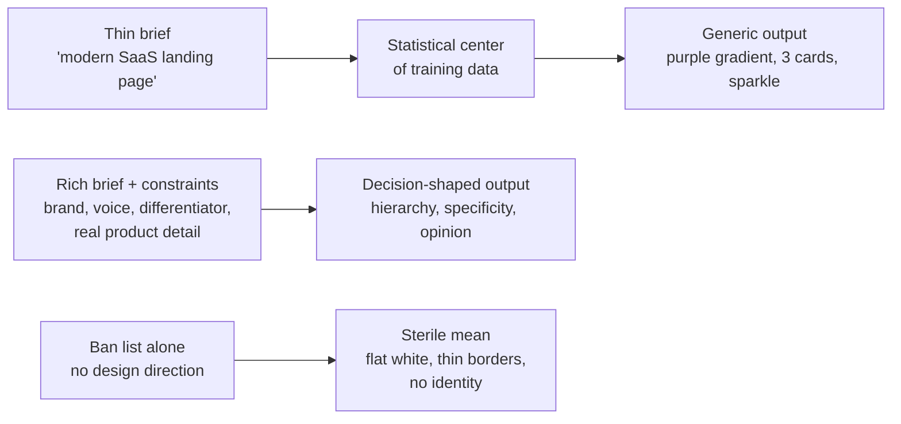

# 07 — Authenticity & the Anti-Slop Discipline

*Product authenticity and polish as a first-class domain. Synthesised from the authenticity research stream (user prompt §§15–17). Claim labels — **Verified** / **Corroborated** / **Inferred** / **Proposed** / **Unknown** — are preserved from the research; nothing has been upgraded.*

---

## 1. The theory: decisions vs defaults

**Plain English:** interfaces look "AI-generated" not because a model touched them, but because no product-specific decision survives in them. Authenticity, in the surveyed sources, is not hand-madeness or anti-AI purity — it is the residue of decisions made *against* the statistical average.

The research converges on four observable properties of an interface that reads as authentic (from the krirox anti-slop skill, corroborated across four independent community sources — **Corroborated**):

1. **Hierarchy** — the eye is led; elements carry visibly different weight.
2. **Specificity** — concrete copy, real numbers, named entities, product-specific visuals.
3. **Restraint** — each decorative device used sparingly and deliberately.
4. **Opinion** — the design could not belong to any company; some aesthetic risk is visible.

**The mechanism: distributional convergence.** When asked for "a modern website," a model returns the statistical center of its training distribution — the most probable, least objectionable answer. A 2024 *Nature* paper (Shumailov et al.) formalized the underlying dynamic for recursive training: **model collapse**, where the tails of the distribution — the rare, distinctive cases — disappear first. **Labels:** the collapse mechanism itself is **Verified** (peer-reviewed). Its application to one-shot UI generation is **Corroborated** as an observational regularity but **Inferred** as a causal explanation — the Nature paper concerns recursive training, not single prompts. Do not cite it as proof that one prompt produces the mean; cite it as the mechanism that makes the analogy plausible.

**The highest-leverage insight (Corroborated):** the "generic AI look" is not one fixed aesthetic — it is *whatever is most probable given the information provided*, and thin input makes the probable answer the cliché one (sharadvermasv design-intelligence skill). The fix is informational, not stylistic: supply brand, audience, differentiator, real product detail, and point of view *before* generating.

## 2. The visual identity elements (what excellent teams actually decide)

Documented design systems (Material 3, Carbon, Ant Design, Polaris) show identity is not a style — it is thirteen decisions, each with a known AI-default failure mode. Condensed from the research (**Corroborated** across system docs and community analysis; research note: the source file's heading says "fifteen" but enumerates thirteen — preserved here as thirteen):

| # | Element | What systems do | The AI-default failure mode |
|---|---|---|---|
| 1 | **Typography** | One display voice + one workhorse face; type scale as tokens (Material 3's five-role scale: Display/Headline/Title/Body/Label) | One default grotesk (Inter/Geist) at one or two sizes; bold everywhere so weight means nothing |
| 2 | **Spacing rhythm** | Token scales (Carbon: 2px base, `$spacing-01`→`$spacing-13`); arbitrary values (13px, 23px) explicitly wrong | Arbitrary or uniform padding; sections separated by identical spacing regardless of content relationship |
| 3 | **Colour roles** | Colours assigned *jobs* (Material 3: Primary, Surface, Error…; Notion uses colour semantically) | Tailwind defaults untouched (`indigo-500`); one accent sprinkled "for vibes" on everything at once |
| 4 | **Contrast** | Research floor: 4.5:1 normal text, 3:1 large text and UI components (**Verified**, WCAG) | Grey-on-grey secondary text; gradient text at small sizes; frosted panels over busy imagery |
| 5 | **Density** | A product decision: Carbon's functional density for enterprise vs editorial air — neither is inherently premium | One density everywhere: landing-page air applied to data UI, or cramped defaults |
| 6 | **Grids & alignment** | Documented grids (Carbon: 16-column, 32px gutters); one deliberate compositional decision *before* placing elements | Centered, symmetrical, everything-in-a-3-column-grid with no compositional intent |
| 7 | **Component consistency** | Do/don't guidance per component; one radius/shadow language per elevation (Carbon: 0px corners; shadows only on modal/notification) | `rounded-2xl shadow-lg border` on every surface, or the same component styled three ways on one page |
| 8 | **Iconography** | One stroke width, token sizes, one style per hierarchy level | Emoji as structural icons (font-dependent, uncontrollable via tokens); mixed icon sets with no custom touch |
| 9 | **Imagery** | Real product visuals as hero; real company photos (NN/g-cited: users respond best to real people from the company; staged stock is spotted instantly) | Unrelated stock handshakes, generated abstract blobs, AI "team" photos |
| 10 | **Brand voice / microcopy** | Content as a co-equal design discipline (Polaris); error messages, empty states, and button verbs carry the brand | "Transform / Elevate / Unlock" vagueness; puffery clusters; hedged dutiful reassurance |
| 11 | **Design tokens** | Three-tier tokens (primitive → semantic → component); new tokens need explicit approval — tokens are what let identity *survive* AI-assisted implementation | Arbitrary hex values invented per screen |
| 12 | **Responsive behaviour** | Real breakpoints; touch targets ≥44px (platform guidance; WCAG 2.5.8 floor is 24×24 CSS px — **Verified** standard) | Desktop-screenshot-only layouts that collapse by accident |
| 13 | **Motion restraint** | Every animation serves feedback, continuity, hierarchy, or delight ("if the answer is 'it looks cool,' delete it"); button ≤100ms, dropdown 150–200ms, modal 200–300ms; `prefers-reduced-motion` honored (**Verified** requirement) | Hover-lift and scroll-reveal applied to everything; motion serving none of the four functions |

**The saturated-anchor warning (Proposed as terminology, Corroborated as observation):** naming Linear, Vercel, Stripe, Raycast, Notion, Figma, or Apple in a brief is described as the bug itself — those references are so widely imitated by generative tools that the output becomes the *average of the imitations*, not the reference. Counter-anchor with a reference from *outside* software (print, signage, instruments, architecture).

## 3. What is research-backed, what is consensus, what is taste

The research supports a three-tier discipline for anti-slop claims (**Proposed** framework — a working tool, not a finding). Act on tier 1 as constraints; treat tier 3 as tripwires, never laws:

| Tier | Examples | Status |
|---|---|---|
| **Research-backed** | Aesthetic–usability effect (attractive interfaces are perceived as more usable — but beauty can *mask* real defects); 50ms first-impression judgments; prominence–interpretation theory (prominent elements dominate credibility judgments); Jakob's Law (users prefer what they know); Von Restorff effect (the different item is remembered); contrast minimums; modal-interruption costs | **Verified** — act on these as constraints |
| **Professional consensus** | Semantic colour roles; 4/8pt spacing scales; one type voice; restraint in motion; real product visuals over decoration | Strong defaults; allow justified exceptions |
| **Community pattern-language** | "purple gradient = slop", "three cards = slop", "bento = slop" | Useful tripwires, **not laws** |
| **Taste / positioning** | Anti-design imperfection-as-authenticity; "never center a hero" | One stance among several; record, don't universalize |

**The Jakob's-law / differentiation tension (Inferred — the whole game):** conventions should be borrowed for *usability mechanics* (navigation, forms, checkout, icons-as-language) and broken for *identity* (colour, type voice, composition, illustration). The warning: the monochrome-plus-one-accent system "still works and still wins" — while becoming "the new 'blue for trust'": a seriousness signal that says nothing specific about *who you are*.

## 4. The anti-pattern catalogue — the 20 most load-bearing entries

Each entry below is condensed from a full six-question investigation (why it reads generic · pattern vs execution · evidence · when appropriate · alternatives · evaluation test) in the research. **The full 58-hypothesis catalogue lives in** `research/authenticity/03-anti-pattern-catalogue.md` (20 visual + 14 copy + 13 interaction + 11 structural). **Master caution:** these are tripwires, not laws. The default finding across rows is *execution, not the pattern* — the problem is almost always unexamined use.

### Visual (5)

**V-1 · Purple-and-black without rationale.** *Why generic:* the documented "AI startup uniform" — near-black + purple-blue radial glow + sparkle icon + Inter/Geist + bento grid (E03, Corroborated). *Pattern vs execution:* execution — dark violet is legitimate as a *chosen* brand. *When appropriate:* developer tools used at night, gaming, brands whose violet identity predates the trend — with a written rationale ("only if dark mode says something true about your product"). *Test:* write one sentence for why *this* product is dark violet. Can't → change it.

**V-2 · Generic three-feature card layouts.** *Why generic:* the "#1 AI slop layout" — icon + heading + one line ×3 at equal weight = no hierarchy; "signals zero creative effort" (E07, E38). *Pattern vs execution:* execution — 3-up grids are legitimate for truly parallel choices (plans, integrations). *When appropriate:* genuinely parallel options. *Test:* reorder the cards — if nothing is lost, the layout adds nothing; restructure.

**V-3 · Emoji as iconography substitutes.** *Why generic:* reads as placeholder; emoji are font-dependent, render inconsistently across platforms, and cannot be controlled via design tokens (three independent skills agree — E38). *Pattern vs execution:* execution — emoji are fine as *content* (reactions, user text); the failure is structural use in nav, buttons, feature icons. *Test:* render on three OSs; if the glyph changes appearance or meaning, replace it.

**V-4 · Unrelated stock imagery.** *Why generic:* staged stock "quietly signals generic"; users "spot a staged stock image a mile away"; NN/g-cited finding: users respond best to photos of real company people (E34, E35 — Corroborated). *Pattern vs execution:* execution — stock is a budget reality; the failure is unrelated or staged imagery presented as the company. *Test:* the swap test — could this image appear unchanged on a competitor's site? Yes → replace.

**V-5 · Fake dashboards / fabricated content.** *Why generic:* "fills space, communicates nothing"; fabricated testimonials are unlawful — the FTC's Rule on the Use of Consumer Reviews and Testimonials (16 CFR Part 465, effective 21 Oct 2024) bans fake reviews/testimonials **whether human- or AI-generated**, with civil penalties (E20 — **Verified** rule). *Pattern vs execution:* presenting fabrication *as reality* is deception; clearly labeled sample data in docs is fine. *Test:* could a user mistake this for real data? Yes → label or remove.

### Copywriting (5)

**C-1 · Repetitive AI-sounding marketing language.** *Why generic:* "Transform / Elevate / Unlock" vagueness; averaged tone makes messaging interchangeable and weakens brand recall (E04, E31). *Pattern vs execution:* execution — no word is banned; the failure is *unexamined clustering* of abstraction with no specifics. *Test:* delete the adjective — if the sentence says *more*, keep the deletion.

**C-2 · Overused "It's not X, it's Y" contrasts.** *Why generic:* "manufactures the shape of insight without delivering any"; "the single most-cited AI writing tell" (E33, E32). *Pattern vs execution:* execution — corrective antithesis is legitimate rhetoric; the failure is decorative contrast where the negation does no work. *Test:* the swap test — if "It's not Y, it's X" is equally plausible, delete the contrast.

**C-3 · Generic feature descriptions.** *Why generic:* one line that could describe any product = "no reason to believe the product is real" (E46). *Pattern vs execution:* execution — brevity is fine; the failure is abstraction without mechanism. *Test:* the competitor test — could a rival paste this unchanged? Rewrite until no.

**C-4 · Fake testimonials / logos.** *Why generic + unlawful:* fabricated social proof; the FTC rule bans it whether human- or AI-generated (E20 — **Verified**). The pattern itself: no legitimate use. *Alternative:* zero testimonials beats fake ones; real names, faces, companies. *Test:* can you produce the person's consent and real identity? If not, remove.

**C-5 · Fake metrics / trust indicators.** *Why generic:* "10k+ users / 99.9% uptime" with no data "fills space, communicates nothing"; ~52% of users lose trust when they spot fake positives (E07, E45). *Pattern vs execution:* execution — real metrics are among the strongest trust signals ("specificity reads as honesty"). *Test:* the source test — where did this number come from? No source → remove.

### Interaction (5)

**I-1 · Clickable-looking dead elements.** *Why generic:* violates learned conventions (Jakob's Law, **Verified**); hoverable cards and buttons that do nothing teach users the UI lies — eroding trust disproportionately (prominence–interpretation theory, **Verified**). *Pattern vs execution:* execution failure — affordances must be honest. Never appropriate. *Test:* click-test every affordance-looking element; dead ones get restyled or wired.

**I-2 · Buttons with no feedback.** *Why generic:* no press/loading state makes the system feel broken; feedback faster than ~400ms keeps users in flow (Doherty threshold — E13, Corroborated). *Pattern vs execution:* the pattern itself is a defect — feedback is a *requirement*, not decoration. *Test:* throttle the network and click — is system state always visible? If not, add it.

**I-3 · Unnecessary modals.** *Why generic:* "unsolicited pop-ups are one of the most hated web design features"; modals obscure context, force memory load, break flow (E11 — **Verified**, NN/g). *Pattern vs execution:* execution — modals are legitimate for binary decisions and destructive confirmations. *Test:* the 6-second rule (spending >6s inside it → probably shouldn't be a dialog) and "why not a page?"

**I-4 · Mouse-only interactions.** *Why generic + non-compliant:* hover-only reveals exclude touch and keyboard users; operability is a WCAG principle (E27 — **Verified**, W3C). The pattern itself is a defect: pointer-specific interactions must have equivalents. *Test:* unplug the mouse — full task completion by keyboard + touch.

**I-5 · Inconsistent control states.** *Why generic:* missing hover/focus/pressed/disabled/loading/error/empty states = "happy-path-only components" — the production-readiness tell (E04). The pattern itself is a defect: states are *required*, not polish. *Test:* state audit per component — every cell filled or explicitly N/A.

### Structural (5)

**S-1 · Repetitive card layouts for all content.** *Why generic:* "everything gets a card, and every card behaves like a good citizen" — consistent *before it has earned consistency*; real projects carry "scars" from constraints that break the pattern (E14 — Corroborated). *Pattern vs execution:* execution — cards are legitimate for heterogeneous collections; the failure is cards as the *only* container. *Test:* the scar test — what real constraint breaks this grid? Vary containers by content job.

**S-2 · Identical hero sections.** *Why generic:* badge + H1 + sub + two CTAs + visual, repeated site-wide = no information architecture; every page says the same thing (E04). *Pattern vs execution:* execution — hero conventions aid orientation and conversion (best SaaS pages share *structure*, differ in *style*); the failure is *identical* heroes regardless of page purpose. *Test:* cover the logos — can you tell which page you're on? If not, differentiate.

**S-3 · Generic dashboard templates.** *Why generic:* sidebar + stat cards + chart grid with fake data = "assembled from a mood board"; a template without a data model (E17, E07). *Pattern vs execution:* execution — dashboard *patterns* are legitimate IA for data products; the failure is a template with no real data model behind it. *Test:* the data test — map every widget to a real query. Unmappable → cut.

**S-4 · Non-informative decoration.** *Why generic:* heuristic #8 (E09 — **Verified**): every extra unit competes with relevant ones — decoration with no information *costs* comprehension. *Pattern vs execution:* execution — owned brand motifs are legitimate; the failure is *filler*. *Test:* the deletion test — remove it; if comprehension is unchanged, it was filler.

**S-5 · Desktop-screenshot-only layouts.** *Why generic:* layouts that only work at 1440px = unfinished responsive behaviour (E38). The pattern itself is a defect: responsive behaviour is a production requirement. *Test:* 360px and 768px — horizontal scroll or overlap = fail.

## 5. The ban-list caution: two failure modes, not one

Sources describe two opposite ways to fail (**Inferred** from E04/E05, observationally corroborated):

- **The polished mean** — purple gradients, glass, bento: over-decorated convergence.
- **The sterile mean** — flat white, thin grey borders, no texture, no identity: produced by over-filtering *without a design direction*. "Reads as AI-generated just as loudly as a purple gradient."

**A ban list without a design direction produces the sterile mean.** This is why the research insists on tripwires, not laws (E04: "do not ban these patterns globally"; E05: counter-examples in §2 of the research — Stripe's crafted gradient, Notion's semantic colour, Linear's dark UI, deliberate bento — exist so the catalogue cannot harden into law).

The recommended operating model (**Corroborated**):

1. **Decide before generating.** Establish a written design direction first — one-page Design DNA: palette with roles, type scale, spacing tokens, radius/shadow language, icon style, motion budget, voice notes. Designers must "shift attention toward outcomes and constraints" (NN/g) — because generated interfaces "carry no scars from real constraints" and are "consistent before [they have] earned consistency."
2. **Counter-anchor.** Pair any saturated reference with a reference from outside software; "not Linear" alone does not escape the mean.
3. **Differentiator test.** Require a written answer to: *"What will a viewer see in three seconds that a generated default would not have?"* Adjective soup ("clean, modern, premium") fails the test.
4. **Generate, then audit.** Use the catalogue as a tripwire list in the E04 audit format: severity, certainty, *why it reads generic*, product justification, correction.
5. **Keep humans on states, not just screens.** Generated UI is "happy-path-only" — loading, error, focus, pressed, and empty states are where production-readiness shows (see §09 for the full state matrix).

**Honest unknowns (preserved from the research):** whether users *consciously* detect "AI-generatedness" or merely react to low specificity/low craft (**Unknown**); whether anti-slop checklists measurably improve user outcomes versus simply adding a design-review step (**Unknown** — no comparative study found). The "80%+ of AI websites share the same structure" figure circulating in 2025–26 discourse is a third-hand citation chain — treat as **Proposed**, not evidence.

## Sources

- Full evidence: `research/authenticity/01-authenticity-principles.md`, `02-visual-identity.md`, `03-anti-pattern-catalogue.md` (the complete 58-hypothesis catalogue), `04-evidence-register.md` (per-finding metadata, E01–E51).
- Legal spine: FTC Rule on the Use of Consumer Reviews and Testimonials, 16 CFR Part 465 (effective 21 Oct 2024).
- Related report sections: §08 (demo honesty, boring completeness signals), §09 (UX state matrix — states are where production-readiness shows), §12 (the FTC fake-review rule in the business-viability context).
