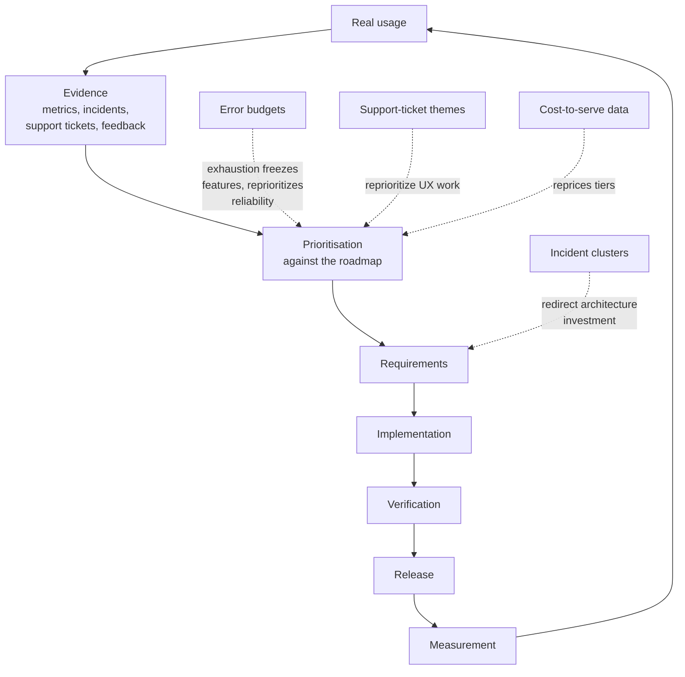

# 11 — Testing, Quality Gates, Deployment & Operations

*Testing and release readiness, the per-stage quality-gate system, staged deployment, and production operations through continuous improvement. Synthesised from the build-ship stream (§§11–13) and the quality stream (§23 gates). Claim labels — **Verified** / **Corroborated** / **Inferred** / **Proposed** / **Unknown** — are preserved; nothing upgraded.*

---

## 1. The test-type catalog (what each type is for)

**Plain English:** different tests answer different questions. Unit tests ask "does this function do the right thing?"; integration tests ask "do these parts work together?"; end-to-end tests ask "can a real user complete a real task?"

| Type | Question it answers | Strength | Characteristic weakness |
|---|---|---|---|
| **Unit** | Does this unit behave correctly in isolation? | Fast, precise fault localization | Mocks can drift from reality; brittle under refactoring |
| **Integration** | Do components work together (service↔DB, service↔broker)? | Catches the seam bugs where most production failures live | Needs real-ish dependencies; slower |
| **Contract** (consumer-driven) | Does the provider still honor what consumers expect? | Fast, no shared staging env, blocks breaking changes pre-merge | Can't catch runtime/network/data problems |
| **E2E** | Can a user complete a critical journey? | Only test of the whole assembled system | Slow, expensive, flaky; every feature E2E'd = inverted pyramid |
| **Regression** | Did we break something that used to work? | Guards the existing contract with users | Can calcify into change-detector tests that block refactoring |
| **Visual** | Does it still *look* right? | Catches unintended UI changes | Pixel-diff flakiness (anti-aliasing, fonts); dynamic content must be stabilized |
| **Accessibility** | Can people with disabilities use it? | Automated scans (axe-core) have near-zero false positives | Automation catches only ~20–50% of WCAG issues; humans needed for the rest |
| **Performance / load** | Does it meet budgets under realistic load? | Finds capacity cliffs before users do | Requires production-like data and traffic shapes to mean anything |
| **Security** | Are known vulnerability classes exercised? | Shift-left catches issues at PR time | Can't prove absence; needs threat-model grounding |
| **Exploratory** | What happens when a skilled human pokes at it? | Finds the bugs nobody thought to automate for | Not repeatable; depends on tester skill |

**Google's size-based framing (Verified** — *Software Engineering at Google* Ch. 11): small tests run in a single process/thread — no sleep, no I/O, no blocking calls — constraints that make nondeterminism and slowness structurally hard. Medium tests may span processes; large tests span systems.

## 2. Coverage is a flag, not a goal

**Plain English:** coverage measures which lines *ran* during tests, not whether the tests would *notice* if those lines were wrong. A test that executes code but asserts nothing meaningful still counts toward coverage.

**Mutation testing — the adequacy check (Corroborated):** deliberately introduce small plausible bugs ("mutants": `>` → `>=`, `+` → `-`, `return x` → `return 0`, `true` → `false`) and measure the percentage the suite kills. Score = mutants killed ÷ total. A surviving mutant in domain logic is a missing test the team can act on. Worked example: a pagination function with 100% line coverage ("returns something," "returns array," "length > 0") scored 63% on mutation — changing `i <= offset + limit` to `i < offset + limit` (a real page-size bug) failed no test.

**Why this matters more in the AI era (Corroborated):** assistants can generate many syntactically different tests exercising *identical* behaviour, inflating test counts and nudging coverage up without adding validation scenarios. A 2026 study (arXiv 2607.22880) found that for LLM-generated suites, coverage correlates only weakly with bug detection *within* one model, while raw mutation score correlates strongly (r = 0.863) with real-bug detection *across* models; on buggy code, coverage correlations collapse entirely — "an agent that writes the test second writes the test its code passes" (study accessed second-hand — **Corroborated**, not primary-verified).

**Practitioner guidance (Corroborated):** 80% line coverage is a reasonable target; 100% is vanity producing low-value tests (Goodhart's law: a coverage target degrades into assertion-free tests). Run mutation analysis on changed code in PRs, full analysis nightly; set thresholds with headroom — one project CI-fails below 88% with observed scores 90.5–94.0, deliberately not gated at the best observed score ("a gate set to the best observed score would fail on an unlucky afternoon and teach everyone to ignore it"). **Prevent:** lowering a coverage ratchet to unblock a merge without a documented reason — "exactly the silent regression the ratchet exists to prevent."

**The pyramid and its critics (Corroborated):** Mike Cohn's pyramid (many fast unit tests, fewer integration, few E2E) is a model about *cost and feedback speed*, not a law of nature (**Verified** origin). The 2025–26 criticisms: the 70/20/10 ratio is made up (the right mix emerges from the system's risk profile); over-mocked unit tests "test your mock, not your system"; production's failure modes are emergent and live in interactions (partial failures, message-ordering violations, cache races, retry storms) — unit-untestable and mostly missed by sequential integration tests; contract/component tests carry the weight in microservice architectures ("thick middle" beats "tall pyramid"). What's kept (**Inferred** consensus): invest in fast feedback; fix test infrastructure so integration tests are cheap; a few deliberate E2E tests on the 3–4 critical paths that would be immediately catastrophic if broken.

## 3. Flaky tests

**Definition (Verified):** a test that can pass and fail without a relevant code change. **Measurement is not standardized** — Google's 1.5% counts *test runs*; its ~16% counts *tests in inventory* showing some flakiness; GitHub counts commits with an affected build; Bitrise counts teams with any flakiness. All can be true simultaneously; before reusing any flake statistic, check the unit, the population, and the observation period (**Corroborated** via a 2026 denominator-first analysis).

**Root causes (Corroborated** — Luo et al., FSE 2014, undisplaced taxonomy): async wait 45%, concurrency 20%, test-order dependency 12% — 77% of fixes in the top three, *all defects in test code*, none fixable by migrating frameworks. A 2025 analysis found 75% of flaky tests cluster with others sharing a root cause (mean cluster size 13.5) — fixing one data-provisioning bug often clears dozens of failures.

**Structural prevention (Verified** — Google's practices): hermetic, ephemeral test environments — spawn the system under test *and all its dependencies* in a container, removing network calls to shared staging/prod stacks.

**The governing rule:** treat any test that only passes on retry as a bug, not a green result — and quarantine it. Triage probes (**Proposed** heuristic): (1) does it pass alone? (2) does it survive repetition + concurrency? (3) does it survive a clean database? Passes-alone-but-fails-in-suite = order dependency or shared state; fails-identically-everywhere = real defect or stale locator; fails-only-under-concurrency = data collision.

## 4. Contract testing (Pact-style) — and its limits

**Plain English:** the consumer writes down exactly what it expects from the provider ("when I call /customers/1 I expect this shape"); the provider verifies it honors those expectations in CI; a `can-i-deploy` gate blocks releases with unverified contracts. Good for: catching obvious API breakages; documenting what consumers actually use (useful for deprecation); independent deployability without shared staging; fast deterministic feedback (**Corroborated**).

**What it is NOT enough for — the negative evidence (Corroborated**, first-hand practitioner account): version mismatches between test and production; messy real-world data; network failures and timeouts; schema-evolution coordination; resilience and error handling. *Pact verifies the agreement, not the behavior under adversity.* The practitioner's evolved stack: contract tests + integration tests + production-traffic shadowing + chaos testing for resilience + contract-compliance monitoring in production — "contract tests told us what should work; monitoring tells us what actually works."

## 5. The quality-gate system: 9 stages

**Governing principle (required by the commissioning brief; rationale Corroborated):** a passing build, green tests, a pretty screenshot, or an agent's "done" message must **never** alone count as proof of readiness. Green tests prove the tests passed — not that the tests are *strong* (suites can pass vacuously; documented back to van Deursen et al. 2001; reproduced by LLM-generated tests, arXiv:2410.10628). Evidence is an artifact a stranger could re-check: a named build, a test report with assertion counts, a signed review, a trace.

**Gate verdicts (Proposed):** **GO** — every in-scope item checked with evidence, or formally excepted by a named owner. **NO-GO** — a critical failure condition is present and not excepted. **NOT ASSESSED** — no blocker found, but something in scope could not be checked (this is *not* a pass; the gate names what is missing). Precedence: **NO-GO > NOT ASSESSED > GO.** An unknown is never a pass.

**Risk calibration (Proposed framework; the "calibrate the bar" principle Corroborated by SRE practice):** Tier 1 — high (payments, health, safety-critical, EAA/ADA-covered consumer services, auth/identity): all necessary controls mandatory, most recommended become mandatory. Tier 2 — standard (general SaaS, content, widely-used internal tools): necessary mandatory unless excepted. Tier 3 — low (prototypes, throwaway experiments): necessary controls in lightweight form; recommended optional. The gates are never *absent* — they scale.

| Gate | Inputs → deliverables | Validation checks | Critical failure conditions | Reviewer |
|---|---|---|---|---|
| **1 Discovery** | problem/users/constraints → dated brief + decision log | Disabled users in the user segments; applicable legal regime named | No identifiable user or problem; legal scope unknown for a Tier 1 product | Product lead |
| **2 Spec** | brief → stories with *testable* acceptance criteria + non-functional requirements + out-of-scope list | Every story has a criterion (no "works well," no "fast"); accessibility criteria named at Tier 1; each criterion maps to a verification method | Untestable criteria; accessibility criteria absent for Tier 1/2 consumer products; scope two engineers would build differently | Product + Eng leads |
| **3 Design** | spec → all states designed: default, loading, **empty, error, destructive-confirmation** (the states most often never designed); breakpoints; focus/hover/disabled/error states; real microcopy, not lorem | Contrast checked on actual colour pairs; keyboard interaction specified for custom components; APG patterns reviewed for dialogs/menus | Happy-path-only core flows; custom components with no keyboard spec; contrast failing WCAG AA on primary surfaces | Design lead |
| **4 Prototype** | riskiest assumption named in writing → prototype exercising *only* that assumption + learnings memo (go/pivot/kill) | The prototype actually tests the named risk (not a polished demo of the easy parts) | Prototype "validates" without touching the risk; learnings memo missing (becomes shadow production code) | Product lead |
| **5 Implementation** | spec/design → working code + tests on CI | CI green **on the exact artifact**; static analysis + dependency scan clean or triaged; axe-core zero new *violations*; test review for assertion strength ("would this test fail if the code were wrong?"); keyboard walk-through of changed flows; human code review (an agent's approval is not evidence) | CI red or skipped; known S1/S2 merged; new axe violations; secrets in code; unreviewed merge to a release branch | Eng lead / reviewer |
| **6 Testing** | frozen release candidate → test report with evidence (traces, screenshots, logs) + defect log + a11y record + performance vs budget | Scope freeze recorded (late additions re-trigger affected tests); full §08 inventory exercised on the candidate; regression suite green; flaky-test quarantine; cross-browser/device matrix; screen-reader task completion on core flows | Unresolved S1/S2; scope changed mid-test without re-verification; a11y tiers 2/3 skipped for Tier 1; perf budget breached without approved exception | QA lead |
| **7 Security review** | threat model → signed review record (threats considered, findings, remediation or risk acceptance) | No unresolved high/critical on the release path; secrets handling, authZ checks, input validation verified on changed endpoints | Open high/critical; auth/payment/crypto change without security reviewer; known-vulnerable dependency on the release path | Security lead |
| **8 Deployment** | GO release candidate → staged deploy + smoke test | Immutable artifact promoted through stages (not rebuilt at deploy); **tested rollback path** — restore rehearsed, not just documented; DB migrations backward-compatible and reversible; smoke tests on the live candidate; feature flags for risky changes | No rollback path; untested restore; non-reversible migration; artifact mismatch with the tested one; Tier 1 big-bang deploy without staged exposure | Eng/SRE lead |
| **9 Post-launch** | live traffic → launch watch report (errors, latency, business metrics vs baseline) + incident log + retrospective | Alert coverage for *this release's* failure modes tested in staging (not assumed); error budgets/SLOs defined with a named rollback decider; real-user monitoring; support-ticket triage incl. accessibility reports | No monitoring on new failure modes; alert fatigue ignored; S1 without a blameless postmortem; accessibility complaints routed to /dev/null | SRE + Product |

**QA, security, and operational readiness start when implementation starts** — not after a build is "done" (**Corroborated** delivery-framework practice). The gates are decision points on parallel tracks, not the tracks themselves.

## 6. Deployment: staged rollouts, migrations, rollback, verification

**Why staged rollouts exist (the incident record — each Verified or Corroborated from official postmortems and first-hand reporting):**

- **CrowdStrike, July 2024 (Verified):** faulty content update shipped to ~8.5M Windows machines simultaneously → global crashes; the commitment afterwards was staged, canary-style rollouts for content updates.
- **GPT-4o sycophancy, April 2025 (Corroborated** via OWASP AISVS synthesis): a system-prompt change deployed to 100% of traffic with no staged rollout → harmful behaviour for three days before rollback; social media became the alerting system. Lesson: prompt/config changes deserve the same rollout discipline as code, and canary analysis must include *behavioural* metrics (guardrail alert rates), not just latency/errors — functional metrics passed while safety regressed.
- **Google Cloud, June 2025 (Corroborated):** a new code path in a core control system had *no* feature flag protecting it, so bad data crashed it everywhere at once.
- **Knight Capital, Aug 2012 (Verified):** a repurposed flag reactivated retired trading logic on 1 of 8 servers — ~$400M+ lost in ~45 minutes. Lessons: never recycle a flag for a new meaning; delete dead code when a flag retires (see §7 of the build-ship research).

**Migrations — expand–migrate–contract (Corroborated):** (1) **Expand** — add the new column/table/endpoint alongside the old, nullable/optional; old paths keep working; deploy and verify stability first. (2) **Migrate** — dual-write (old stays source of truth; writes to the new side idempotent and must not fail the request if the new side fails), backfill in resumable rate-limited batches with reconciliation, shadow-read (read both, return old, log diffs until diff rate ≈ 0), then switch reads behind a flag with an instant kill switch back. (3) **Contract** — remove the old side only after the new side is authoritative. The asymmetry that drives the whole discipline: rolling back *code* is easy; rolling back *data migrations* is hard.

**Rollback (Corroborated):** Google SRE's maxim — "rollback early, rollback often"; every runbook ships with exact undo commands and the conditions that trigger them. Rollback must be rehearsed, not just documented (game days).

**Post-deploy verification — closing the "silent success" gap:** all-systems-green while users are broken is a recurring failure class. Canary tooling can report "Synced/Healthy" while the deploy silently hasn't taken effect (community Argo Rollouts accounts); post-deploy verification must check *behaviour*, not dashboard colour — smoke tests, synthetic probes matching recent failure modes, and (for AI systems) probing canaries with malformed inputs rather than promoting on a vacuous green signal.

## 7. Production ops: observe, respond, learn

**The three pillars (Corroborated; Verified as the industry's standard framing):** *Metrics* — aggregated numbers over time (alerting, dashboards, trends). *Logs* — discrete event records (debugging specific failures). *Traces* — a single request's journey across services (finding bottlenecks in distributed systems). Mnemonic: metrics tell you something is wrong; logs tell you what went wrong; traces tell you where. By 2026, **OpenTelemetry** is the de-facto collection standard (**Corroborated**). Practitioner rules: instrument *before* you need it; alert on symptoms users feel, not internal causes; every paging alert must be actionable ("if there's nothing to do at 3am, it's a dashboard metric, not a page") — alert fatigue is itself a reliability failure.

**Google SRE's four golden signals (Verified):** if you can only measure four things about a user-facing system, measure **latency, traffic, errors, and saturation.**

**SLIs, SLOs, error budgets (Verified** — Google SRE Workbook): an SLI is the measured metric ("fraction of successful checkout requests under 500ms"); the SLO is the target ("99.9% over 30 days"); the **error budget** is the allowed failure slice (0.1%) — and it is a *policy instrument*: "If the service has exceeded its error budget for the preceding four-week window, we will halt all changes and releases other than P01 issues or security fixes until the service is back within its SLO." Operationalised postures: >50% budget remaining = ship freely; 10–50% = caution; <10% = slow down; exhausted = release freeze (**Corroborated**). Rules: define SLIs from user-visible behaviour; page on burn *rate*, not raw thresholds; set the SLO tighter than any contractual SLA so a breached SLO is a leading indicator; an SLO without a named SLI query and an owner is decoration.

**Incident response (Corroborated** across Google SRE, PagerDuty, Atlassian, GitLab): severity classification (Sev 0–4) with postmortem requirements per level; declared roles (incident commander, communications lead, SMEs); two timing windows — a hot-wash debrief within 24–72h while memory is fresh, then the formal review 1–2 weeks later once logs/traces/transcripts are assembled; the postmortem template (summary → impact → timeline → root cause(s) → what went well/poorly → concrete, owned, deadlined action items → lessons).

**Blameless culture (Verified** origin — John Allspaw, "Blameless PostMortems and a Just Culture," Etsy Code as Craft, May 2012): focus on contributing causes without indicting any individual; assume everyone acted with good intentions on the information they had. The mechanism: "If we have an engineering culture where we punish people for making mistakes, we'll have a culture where people lie about mistakes." **First Story vs Second Story:** the First Story treats human error as *the cause* ("be more careful"); the Second Story treats it as the *effect* of deeper systemic vulnerabilities and asks why the person's actions made sense at the time — always write the Second Story. HubSpot's first-hand lesson across 250 postmortems: "this was my fault, I'll be more careful" ended the conversation and changed nothing; the counter-sentence — "We are trying to prepare for a future where we are all just as stupid as we are today." **Any action item that requires humans to behave differently *without changing the system* is a wish, not a fix.** Accountability is redirected, not eliminated: from "who is at fault" to "who owns the fix." Judge decisions by information available *at the time*, not hindsight.

**Recovery (Corroborated):** "rollback early, rollback often." **Chaos engineering** (Netflix, from 2011) is recovery *rehearsal* — hypothesis around steady-state behaviour; vary real-world events; run in production; automate continuously; and the practitioner-added fifth: **define abort criteria up front; chaos without abort criteria is an outage**. The canonical payoff: when a real AWS DynamoDB outage hit US-EAST-1 in September 2015 and cascaded for ~8.5 hours, Netflix "sidestepped any significant impact" because Chaos Kong drills had already forced the cross-region failover fixes (**Corroborated**).

## 8. The full feedback loop

Shipping is the middle of the story, not the end (**Inferred** synthesis; each component well-evidenced):

**The loop's instruments (Corroborated):** product analytics (funnel and cohort analysis — what users *do*, not what they say); customer feedback (support tickets, NPS, interviews — what users *feel* and *can't do*); experimentation (A/B testing) with documented pitfalls from Kohavi/Microsoft research — **Sample Ratio Mismatch** (~10% of experiments fail from assignment errors — check split ratios before reading any metric), **peeking** (stopping early inflates false positives — pre-register stopping rules), **novelty/primacy effects** (segment new vs returning users), **Twyman's Law** (an unusually large win is more likely a measurement error), **A/A tests** (run identical experiences continuously — Microsoft found a platform with 30% false-positive rates against a nominal 5% from a miscalibrated stats engine). *Test the test before trusting the test.*

**The loop only functions if measurement survives the release** — teams that stop measuring after launch are flying the second half blind.

## 9. When to redesign or retire (**Inferred** from evidence)

- **Maintenance:** the unglamorous continuous work — dependency upgrades, certificate rotations, capacity planning, data retention, runbook updates. Google SRE's **toil** (manual, repetitive, automatable operational work) gets a name and a budget: cap it (≤50% of SRE time — **Verified** from the SRE book) and engineer it away, not heroically absorbed.
- **Redesign triggers:** error budget chronically exhausted despite paydown (the architecture can't meet its SLO — not a tuning problem); incident clusters with the same systemic shape; cost-to-serve exceeding unit economics (see §12); a component whose change-failure rate resists all process fixes (usually a coupling problem, not a people problem).
- **Retire triggers:** feature flags past their death date (flag graveyards); API versions with usage below the cost of maintenance (sunset with grace periods); products whose feedback loop shows no path to viable economics. Retirement is itself a migration: deprecate, dual-run, communicate, remove.
- **The strangler pattern** (established practice; **Inferred** applicability): incrementally replace a legacy system by routing traffic slice-by-slice to the new implementation behind the old interface.

## Sources

- Full evidence: `research/build-ship/01-implementation-quality.md`, `02-testing-deployment.md`, `03-production-ops.md`, `research/quality/03-quality-gates.md`, plus evidence registers `research/build-ship/05-evidence-register.md` and `research/quality/04-evidence-register.md`.
- Key sources consulted: *Software Engineering at Google* Chs. 9 & 11; DORA research (incl. 2025 AI-adoption findings via secondary synthesis); Google SRE Book & Workbook; John Allspaw / Etsy (2012); OWASP AISVS Appendix C (Veracode, Apiiro, CSA analyses); Netflix chaos engineering; Kohavi/Microsoft experimentation research.
- Related report sections: §08 (the §21 interaction inventory exercised at Gate 6; severity framework), §09 (accessibility gates inside G2/G3/G5/G6; block-release rules), §10 (security review Gate 7; §25 classification index), §12 (cost-to-serve repricing tiers; feedback-loop outcomes as the viability test).
