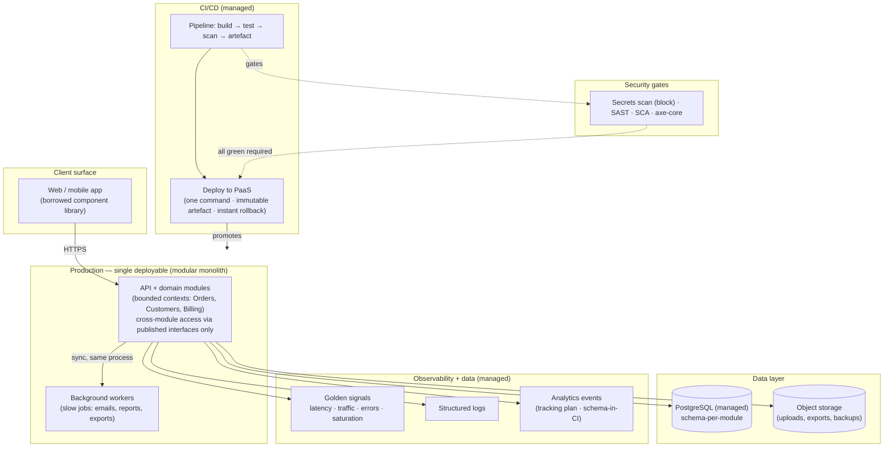
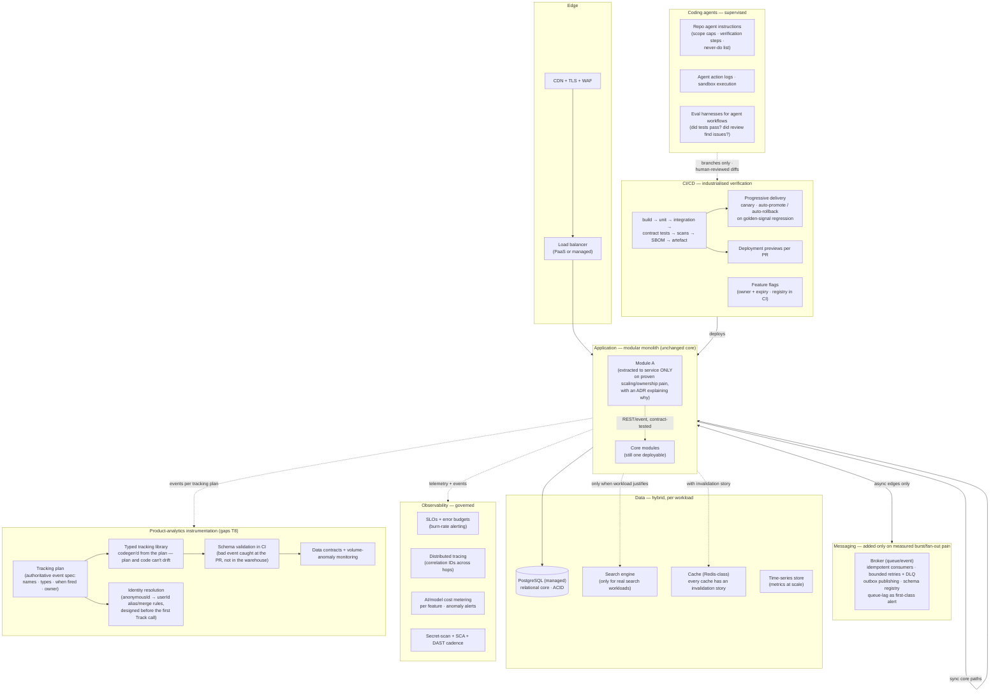

# 15 — Reference Architecture

**Status:** report section; read-only synthesis, not adoption advice. **Source:** `research/rules/03-small-team-os.md` (the small-team operating system, 17 components with build/buy/reuse/automate/omit verdicts), `research/spec-arch/02-architecture-decisions.md` (monolith vs modular monolith vs microservices; SQL vs NoSQL; sync vs async; self-hosted vs managed/serverless — each a matrix with *conditions*, no universal winners), `research/automation/01-automation-stack.md` (12 automation layers), and `research/gaps/01-missing-topics.md` T8 (product-analytics instrumentation engineering). Claim labels preserved (**Verified / Corroborated / Inferred / Proposed / Unknown**). The default shape here is the **modular monolith on managed services** — the research's consistent answer for teams without proven scaling/ownership pain.

**Guiding constraints (from the evidence):**
- **Gall's law:** working complex systems evolve from working simple ones — start from a working simple system [Corroborated].
- **Cognitive load is the binding constraint:** a 2–8-person team has one team's worth; every component below must fit inside it (Team Topologies, cited as E-CONWAY [Corroborated]).
- **Boring by default:** innovation tokens go to differentiation only [Corroborated].
- **Extract on pain, not fashion:** split/extract/scale when the pain of *not* doing so clearly outweighs the cost of operating it — never because the shape "feels slow" or a pattern is trending [Corroborated].
- **Omissions are deliberate and staged:** service mesh, platform team, multi-region active-active, bespoke ML infra are *not* in either diagram. Each omission carries a revisit trigger — simplicity is a stage, not a religion.

---

## 1. The minimum-viable architecture (day one)

The smallest shape that is still professional: releasable mainline, gated CI, managed runtime, golden signals, and a data layer that won't rot.

**What it assumes and what it deliberately omits:**
- Single repo, protected `main`, trunk-based flow (R-11); one-command release artefact with build/release/run separation (R-12).
- Environment-based config; secrets only in a secret manager, never in code (R-15).
- Module boundaries *mechanically* enforced (import-linter contracts, no cross-module foreign keys, CI checks) — "a convention that must be mechanically guarded, not just documented" [Corroborated, first-hand practitioner ADRs].
- Background workers use the *same* idempotency/retry/dead-letter-queue discipline as event consumers; idempotent by assumption (at-least-once delivery) [Verified, Temporal/AWS docs].
- One database: PostgreSQL for the relational core; object storage for blobs. No second store until a genuinely different workload appears [Corroborated decision rule].
- No queues/broker yet: async needs (emails, reports) live in a simple job table + worker until *burst or fan-out pain* justifies a broker [Corroborated — async introduces DLQ discipline, schema versioning, and forensic difficulty].
- Sync everywhere the user waits for an authoritative answer; async at the edges (the hybrid default) [Corroborated].

---

## 2. The advanced version (maturity — reached by measurement, not ambition)

Same core, grown *on pain*: the monolith stays; seams get mechanical teeth; the verification machinery that §13 identifies as the binding constraint gets industrialised.

**What changed and why:**
- **The monolith is still the core.** Extraction is a recorded event with an ADR and a measured trigger (deploy contention, divergent scaling profile, distinct failure-isolation need) — not a phase of the roadmap [Corroborated].
- **Async is introduced per workflow, not per philosophy.** Every async path gets the production prerequisites: idempotent consumers, bounded retries + alerting DLQs, outbox publishing, schema registry, queue-lag alerts [Corroborated].
- **The verification layer is the growth story** — because §13's evidence says verification, not generation, is the binding constraint. Contract tests at seams, canary automation, previews, flag hygiene: all cheap relative to incident cost.
- **The analytics layer is engineered, not accumulated.** T8's finding [Corroborated, practitioner consensus]: a tracking plan is the authoritative spec of every event; schema-in-CI catches bad events at the PR; object-action naming (`signup_completed`, never `signup_button_clicked_v2_blue`); identity stitching designed *before* the first Track call. Taxonomy sprawl is "the #1 killer of analytics trust."
- **Agents stay supervised contributors.** Written repo instructions, branch-only work, human review of every diff, action logs; staged autonomy (read-only investigation first) [Anthropic, Verified; rules stream].
- **What is STILL omitted:** service mesh, platform team, multi-region active-active, bespoke ML infrastructure, self-hosted CI, security team. The revisit triggers below say when each earns reconsideration.

---

## 3. The data / instrumentation layer (in depth)

The brief's whole improvement machinery (§13's DORA trends, R-34 kill/fix/keep, experimentation, post-launch evaluation) consumes analytics — none of it works if the events are unowned, unversioned, or wrong. This layer is engineering, not a side effect.

| Element | Plain English | Mechanics | Verdict (MVP → advanced) |
|---|---|---|---|
| **Tracking plan** | The authoritative technical spec of every analytics event: exact names, property schemas with types, when each fires, who implements it, validation rules. "An event not in the plan doesn't get sent." | Object-action naming; fewer well-propertied events beat bespoke-event explosions; versioned with the code | **BUILD** — the writing is the work; a shared doc is the MVP; versioned spec at maturity |
| **Schema-in-CI** | Catching malformed events at pull-request time instead of discovering them in the warehouse months later | Validate event payloads against the plan on every PR; contract tests between instrumentation and consumers | **AUTOMATE** — from the first events you care about |
| **Typed tracking library** | Generated client code for the plan so the plan and the code can't drift apart | Codegen from the tracking plan into type-safe send functions | **BUILD** — lightweight at first (a wrapper), codegen at maturity |
| **Identity resolution** | Stitching anonymous sessions to signed-in users so funnels don't reset at login | anonymousId → userId alias/merge rules, designed *before* the first Track call | **BUILD** — design once, early; the retrofit is painful |
| **Consent-aware collection** | Lawful-basis and consent designed into the collection layer, not bolted on | No PII in event properties without lawful basis; third-party trackers inventoried and justified | **BUILD** — part of the plan, from day one |
| **Data contracts & freshness** | Agreements on schema, ownership, and freshness with the people who consume the data | Versioned schemas; owner per event domain; volume-anomaly monitoring (spike or drop = a broken instrument, not a business event) | **OMIT initially** — add when >1 consumer or when a silent data break has cost you once |

**Evidence class for this layer:** Corroborated (practitioner consensus, multiple 2026 sources) — not primary research. Counter-evidence preserved: small teams can manage instrumentation informally; premature instrumentation governance is its own tax.

---

## 4. Component table: build / buy / reuse / automate / omit

**Verdict vocabulary:** **REUSE** = adopt an existing practice/tool rather than inventing; **BUY** = pay for a managed service; **BUILD** = make it yourself; **AUTOMATE** = set up automation for it; **OMIT** = deliberately skip for now, with a revisit trigger. Reasoning carries the evidence label where one applies.

| # | Component | Verdict | Reasoning | Revisit trigger (when to upgrade) |
|---|---|---|---|---|
| 1 | Problem intake | REUSE + AUTOMATE | One shared inbox + weekly triage beats a backlog swamp (Shape Up: unpitched ideas return if they matter) [Verified]. No intake software before intake volume. | Intake volume > triage capacity |
| 2 | Discovery (research) | REUSE + BUILD | Weekly customer contact per builder beats quarterly research projects (Torres) [Corroborated]; Cagan's four risks say *what* to research [Corroborated] | A dedicated researcher is affordable |
| 3 | Prioritisation | REUSE | Appetite-based betting (Shape Up) [Verified]; omit scoring frameworks (RICE/WSJF) — false precision at small scale | Strategy needs theme-level mapping |
| 4 | Requirements | REUSE + BUILD | The writing *is* the requirements work — PR/FAQ surfaces weak thinking before design (Amazon) [Verified for mechanics]; lives in the repo, next to the code | Large bets needing full PRDs; regulated traceability needs |
| 5 | Design & prototyping | REUSE + BUY | Fat-marker sketches preserve engineering optionality (Shape Up) [Verified]; borrow a component library's design system — boring by default (R-07) | ≥2 surfaces sharing components (then define a design system) |
| 6 | Architecture | REUSE + BUILD | Modular monolith + ADRs; microservices taxed in operations from day one while the monolith taxes coordination as it grows — defer the ops tax [Corroborated] | Proven scaling-profile divergence, deploy contention, or failure-isolation need |
| 7 | Repo foundations | BUILD + AUTOMATE | Cheapest high-leverage investment in the system: protected main, CI, one-command release, secrets scanning (R-11, R-12, R-15) [Verified]. Never OMIT. | Multi-service repo templates |
| 8 | Coding agents | REUSE + AUTOMATE + BUILD | Workflows where the path is known, agents only where it isn't (Anthropic) [Verified]; AI output untrusted until verified (R-13) [Verified]. OMIT autonomous production agents. | Eval harnesses for agent workflows; staged autonomy |
| 9 | Testing | BUILD + AUTOMATE + REUSE | Critical paths tested, releases gated (R-18/R-19) [Verified]; coverage % is a vanity metric; omit 100%-coverage dogma and QA headcount initially | Contract/chaos/load testing |
| 10 | Code review | REUSE + AUTOMATE | Every production change gets a second pair of eyes; AI diffs get *more* scrutiny (author confidence is inflated) (R-20) [Verified] | Review SLAs; AI pre-review as triage (never the only reviewer) |
| 11 | UX & visual QA | BUILD + AUTOMATE | Checklist habit (Gawande's mechanism) [Verified]; missing states and responsive gaps are cheap to catch with a list | Visual regression; a11y checks in CI |
| 12 | Security checks | AUTOMATE + REUSE + BUILD | ASVS L1 is *designed* to be automatable — a small team gets the baseline without headcount [Verified]; threat-model trust boundaries at design (R-09) | ASVS L2 for sensitive surfaces; pentest; disclosure page |
| 13 | CI/CD | BUY/REUSE + AUTOMATE | CI is the enforcement arm of R-11 through R-20; managed CI is the boring choice (R-07). Never BUILD your own CI server. | Progressive delivery automation; DORA metrics piped from the pipeline |
| 14 | Deployment | BUY + AUTOMATE | PaaS: reversible, progressive releases (R-25) [Verified]; dev/prod parity (Twelve-Factor) [Verified]. OMIT self-managed orchestration. | Canary automation; feature flags; multi-region only with an ADR (latency/regulation) |
| 15 | Monitoring | BUY + AUTOMATE | Four golden signals from day one; alert on symptoms, page only on actionable (R-28/R-29) [Verified]. OMIT building your own stack; OMIT alerting on everything. | SLOs + error budgets (R-31); tracing at the seams that hurt |
| 16 | Customer feedback | REUSE + AUTOMATE | Direct channels beat platforms at small scale (Torres) [Corroborated]; automate *collection*, keep *analysis* human | Feedback→opportunity mapping; pulse surveys with comment analysis |
| 17 | Continuous improvement | BUILD + REUSE | Three rituals: blameless postmortems (Allspaw) [Verified], DORA trend review [Verified], kill/fix/keep [Verified]. OMIT transformation programmes. | Error-budget policy; quarterly architecture fitness review |

---

## 5. Design rules that hold across both versions

1. **Sync core, async edges.** The user waits for an authoritative answer on synchronous paths; queues and events handle bursts, fan-out, and slow work — each async path carrying idempotency, DLQ, and lag-alerting discipline [Corroborated].
2. **One database until two workloads.** Postgres for the relational core; specialised stores added only for genuinely different access patterns (search, cache, time-series), each one an operational commitment [Corroborated decision rule].
3. **Integrity lives near the data.** FKs and constraints inside a module or monolith; where boundaries are crossed, integrity moves into code you must write and test (outbox + idempotency) [Corroborated].
4. **Failure strategies are designed, not discovered.** Every integration point — HTTP API, database, queue, LLM provider call, webhook — gets timeout, retry-with-backoff (idempotent only), circuit breaker, or graceful degradation, recorded in the design doc (R-10) [Verified].
5. **Reversibility beats perfection.** Every release is reversible and progressively rolled out (R-25); every data migration rehearsed forward and back; every irreversible change gets the *strictest* progressive treatment [Verified].
6. **Verification is independent of generation.** Human review, independent checks, and gated tests apply to agent-produced and human-produced changes identically (R-13, R-20) [Verified].
7. **Specifications before speed.** As generation gets cheap, precise specification *rises* in value — the agent can only build what was specified [Inferred, DORA 2025]. Invest in requirements writing as coding gets faster.

---

**Sources:** `research/rules/03-small-team-os.md` · `research/spec-arch/02-architecture-decisions.md` · `research/automation/01-automation-stack.md` · `research/gaps/01-missing-topics.md` (T8) · `research/rules/05-evidence-register.md`
